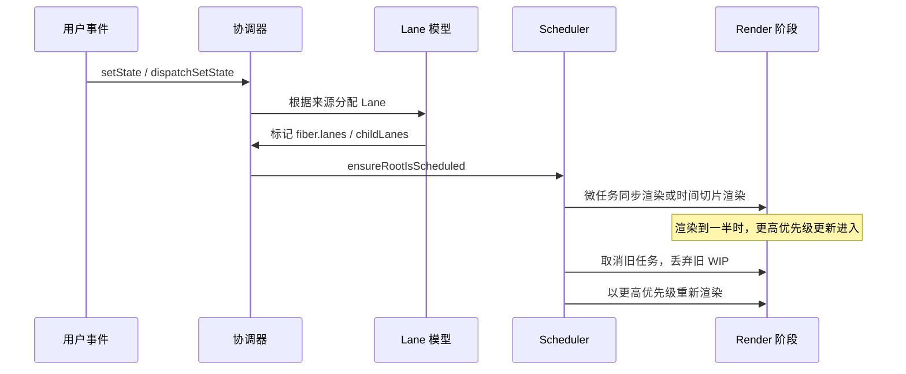

# 调度器（Scheduler）与 Lanes 优先级模型

React 的并发渲染**不是多线程**，而是将 Render 阶段拆分为可暂停的工作单元，并按优先级调度执行。React 18 为此使用了两套优先级体系：**Lane** 和 **Scheduler**。

## 1. 两套优先级体系

[width(22,49,29)]

| 体系                 | 作用                                                 | 所在模块           |
| -------------------- | ---------------------------------------------------- | ------------------ |
| **Lane 模型**        | 在协调器内部表示更新的优先级，可组合、可跳过、可重放 | `react-reconciler` |
| **Scheduler 优先级** | 调度 JavaScript 回调的紧急程度，控制何时执行         | `scheduler` 包     |

## 2. Lane 模型

### 2.1 为什么需要 Lane？

React 16 使用 expiration-time（时间戳）表示优先级，越小的过期时间越紧急。这种方式有三个局限：

- 优先级只是一个数字，无法表示“**这几条更新属于同一批、那几条可以跳过**”。
- 一个 Fiber 只有有限的优先级字段，很难同时维护多组互不相邻的待处理更新。
- 无法表达“这两条更新必须一起渲染”这类关系。

Lane 用**位掩码**代替时间戳：一条更新占一个二进制位，多条更新就是多个位的组合。这样就能对“**待处理的优先级集合**”做与、或、非和子集判断，而不用遍历队列。

### 2.2 位掩码编码

React 使用 31 位（bit 0 到 bit 30），因为 JavaScript 的位运算按 32 位有符号整数执行，最高位是符号位。

```javascript
const TotalLanes = 31

const SyncLane = 1 // bit 0
const InputContinuousLane = 4 // bit 2
const DefaultLane = 16 // bit 4
const IdleLane = 1 << 29 // bit 29
```

- **位号越小，优先级越高**。
- **只有单条 Lane 可以直接比大小**。`Lanes` 是集合，比较大小没有意义，必须先取最高优先级位：`getHighestPriorityLane(lanes)`，实现就是 `lanes & -lanes`，只保留最低的那个 `1` 位。

### 2.3 主要 Lane 类型

[width(23,15,41,21)]

| Lane                     | 数值        | 触发场景                           | 说明             |
| ------------------------ | ----------- | ---------------------------------- | ---------------- |
| `SyncLane`               | 1           | `flushSync`、离散事件、legacy root | 最高，微任务同步 |
| `InputContinuousLane`    | 4           | 拖拽、滚动、`mousemove` 等连续事件 | 高优先级         |
| `DefaultLane`            | 16          | 普通 `setState`（非 Transition）   | 中优先级         |
| `TransitionLanes`        | 64 ~ 2^21   | `startTransition`、`useTransition` | 16 条，可被打断  |
| `RetryLanes`             | 2^22 ~ 2^26 | Suspense 重试                      | 5 条             |
| `SelectiveHydrationLane` | 2^27        | 选择性水合                         | 用户交互优先     |
| `IdleLane`               | 2^29        | 空闲时执行的更新                   | 最低             |
| `OffscreenLane`          | 2^30        | Offscreen 预渲染、增量水合         | 特殊，永不过期   |

### 2.4 位运算操作

```javascript
// 合并：把一条更新挂到 Fiber 和祖先节点上
fiber.lanes |= updateLane
parent.childLanes |= updateLane

// 判断是否包含某条 lane
const hasSync = (lanes & SyncLane) !== NoLanes

// 取最高优先级
const nextLane = getHighestPriorityLane(pendingLanes)

// 删除已完成的 lane
pendingLanes &= ~completedLane

// 子集判断：本次 renderLanes 是否覆盖这条更新
const shouldProcess = (renderLanes & updateLane) === updateLane
```

### 2.5 Lane 存在哪里

[width(48,52)]

| 字段                                       | 含义                                     |
| ------------------------------------------ | ---------------------------------------- |
| `update.lane`                              | 单条更新所属的 lane                      |
| `fiber.lanes`                              | 这个 Fiber 自己排队的更新 lane 集合      |
| `fiber.childLanes`                         | 子树中待处理 lane 的并集，向根方向冒泡   |
| `root.pendingLanes`                        | 根上所有待处理 lane                      |
| `root.suspendedLanes` / `root.pingedLanes` | 因 Suspense 挂起 / 已恢复、可重试的 lane |
| `root.expiredLanes`                        | 已超过过期时间、必须强制完成的 lane      |
| `renderLanes`                              | 本次渲染实际处理的 lane 子集             |

更新入队时，lane 会沿着 `return` 指针向上写入每个祖先的 `childLanes`。这带来两个关键优化：

- **更新跳过**：`processUpdateQueue` 只处理 `update.lane` 属于 `renderLanes` 的更新，其余留在队列里等下一次渲染。
- **子树跳过**：`beginWork` 检查 `childLanes`，如果子树没有本次要处理的 lane，可以直接跳过整棵子树。

## 3. Lane 的分配与生命周期

### 3.1 一次更新拿到哪条 Lane

`requestUpdateLane` 是分配入口，核心逻辑很简单：

```javascript
function requestUpdateLane(fiber) {
  if (isLegacyRoot(fiber)) return SyncLane
  if (isRendering()) return pickArbitraryLane(renderLanes)

  if (requestCurrentTransition() !== NoTransition) {
    return claimNextTransitionLane()
  }

  return eventPriorityToLane(resolveUpdatePriority())
}
```

[width(41,32,27)]

| 更新来源                           | 分配到的 Lane              | 调度路径               |
| ---------------------------------- | -------------------------- | ---------------------- |
| 离散事件（`click`、`input` 等）    | `SyncLane`                 | 微任务中同步 render    |
| 连续事件（`scroll`、`mousemove`）  | `InputContinuousLane`      | Scheduler UserBlocking |
| Effect、`setTimeout`、Promise      | `DefaultLane`              | Scheduler Normal       |
| `startTransition`、`useTransition` | `TransitionLane`           | Scheduler Normal       |
| `useDeferredValue`                 | `TransitionLane`（复用池） | 低优先级后台渲染       |
| Suspense 重试                      | `RetryLane`                | 低优先级重渲染         |
| SSR 水合                           | 对应的 `*HydrationLane`    | 单独批次               |
| Offscreen 预渲染                   | `OffscreenLane`            | 最低优先级             |

`resolveUpdatePriority` 会优先使用当前手动设置的更新优先级（例如 `flushSync`），否则根据 `window.event` 的类型推断：离散事件、连续事件、其余情况分别映射到三档事件优先级。

### 3.2 getNextLanes：选出下一批

每次调度时，React 都会调用 `getNextLanes`，从 pending lane 中选出一批。规则可以概括为：

- **没有 pending lane 就直接返回**，不创建任务。
- **排除挂起的 lane**。Suspense 抛出 thenable 后，该 lane 进入 `suspendedLanes`；数据 resolve 并 `markRootPinged` 后，才允许重试。
- **非 idle 工作优先**。只要还有 `NonIdleLanes` 中的工作，`IdleLane`、`OffscreenLane` 就不会被选中。
- **取最高优先级组**。`getHighestPriorityLanes` 会把同一组的 Transition lane 一起返回；连续事件更新还会把 pending 的 `DefaultLane` 一起纳入，避免被拆成多次渲染。
- **不轻易打断进行中的渲染**。新 lane 不比当前 `wipLanes` 更高时继续当前渲染；`DefaultLane` 也不会打断 Transition。
- **最后扩展纠缠 lane**。`getNextLanes`会把`root.entanglements`中与选中lane纠缠的lane一并加入本批次。

### 3.3 Transition 与 useDeferredValue

Transition 使用一个 16 条 lane 的池，由 `claimNextTransitionLane` 轮流分配：

- 同一个事件内的多个 transition 共用一条 lane（`currentEventTransitionLane` 缓存到下一次工作循环）。
- 不同事件各拿一条 lane，因此可以分别打断和重试。
- 16 条用完后回绕，同时存在过多 transition 时会复用 lane，它们会被合并进同一批渲染。

`useDeferredValue` 在 React 18 中并不单独引入 deferred lane，而是在紧急渲染时先返回旧值，再申请一条 Transition lane 来渲染新值：

```jsx
function SearchPage() {
  const [query, setQuery] = useState('')
  const deferredQuery = useDeferredValue(query)

  return (
    <>
      <input value={query} onChange={e => setQuery(e.target.value)} />
      <SearchResults query={deferredQuery} />
    </>
  )
}
```

它与 `startTransition` 的区别是：`startTransition` 包裹的是一段更新逻辑，`useDeferredValue` 延迟的是**一个值**。

### 3.4 Lane 的生命周期

[width(16,30,54)]

| 状态      | 字段                  | 说明                                    |
| --------- | --------------------- | --------------------------------------- |
| Pending   | `root.pendingLanes`   | 新更新加入；非 idle 更新会清除挂起状态  |
| Rendering | `renderLanes`         | 本次渲染处理的 lane 子集                |
| Suspended | `root.suspendedLanes` | 抛出 thenable，清除该 lane 的过期时间   |
| Pinged    | `root.pingedLanes`    | 数据 resolve，允许重新尝试              |
| Expired   | `root.expiredLanes`   | 饿死保护，必须强制完成                  |
| Finished  | `root.pendingLanes`   | 从 pending 中移除，剩余 lane 留给下一次 |

过期时间不是优先级，而是**防饿死机制**：低优先级工作被长期挤占时，到达过期时间后会被升级为同步渲染。React 18 的时间设置为：

- `SyncLane`、`InputContinuousLane`：250ms。
- `DefaultLane`、Transition lane：5000ms。
- Retry、Idle、Offscreen：永不过期。

### 3.5 纠缠与合并

**纠缠（entanglement）** 描述的是“**不同 lane 必须放在同一批里渲染**”。例如同一个 state 队列上的多条 transition 更新，React 会把它们的 lane 纠缠起来，保证按顺序一起处理，而不是某一条被跳过。纠缠关系保存在 `root.entangledLanes` 和 `root.entanglements` 中，`getNextLanes` 选完批次后会把相关 lane 一并展开。纠缠只扩大本次渲染的 lane 集合，不改变任务本身的优先级。

**合并（batching）** 则是另一个层面：同一个事件里的多次 `setState` 会被分配同一条 lane，进入同一个更新队列，最终只触发一次渲染。

```jsx
function handleClick() {
  setCount(c => c + 1) // 同一条 SyncLane
  setCount(c => c + 1)
  setName('new')
}
// 三个更新合并到一次 Render/Commit
```

注意：**不同 lane 的更新即使发生在同一个事件里，也不会合并**。例如先 `setQuery` 再 `startTransition(setResults)`，会发生两次渲染：先同步渲染输入框，再低优先级渲染结果列表。这正是 `startTransition` 能让输入保持流畅的原因。

## 4. Scheduler 调度器

### 4.1 优先级映射

事件优先级与 Lane 共用同一组位：

```javascript
const DiscreteEventPriority = SyncLane
const ContinuousEventPriority = InputContinuousLane
const DefaultEventPriority = DefaultLane
const IdleEventPriority = IdleLane
```

根调度器把选出的 `nextLanes` 映射为 Scheduler 优先级：

```javascript
switch (lanesToEventPriority(nextLanes)) {
  case DiscreteEventPriority:
    schedulerPriorityLevel = ImmediatePriority
    break
  case ContinuousEventPriority:
    schedulerPriorityLevel = UserBlockingPriority
    break
  case DefaultEventPriority:
    schedulerPriorityLevel = NormalPriority
    break
  case IdleEventPriority:
    schedulerPriorityLevel = IdlePriority
    break
}
```

需要特别注意：**`SyncLane` 的更新通常不经过 Scheduler**。React 18 会用 `scheduleSyncCallback` 把同步更新放入内部队列，并在微任务中通过 `flushSyncCallbacks` 执行完，从而保证离散事件的结果在下一帧绘制前生效。

[width(31,22,47)]

| Scheduler 优先级           | timeout         | React 中的使用场景                        |
| -------------------------- | --------------- | ----------------------------------------- |
| `ImmediatePriority` (1)    | -1ms            | 源码保留该分支，SyncLane 实际先走同步队列 |
| `UserBlockingPriority` (2) | 250ms           | 连续事件                                  |
| `NormalPriority` (3)       | 5000ms          | 普通更新、Transition、Retry               |
| `LowPriority` (4)          | 10000ms         | React 未使用                              |
| `IdlePriority` (5)         | 约 1073741823ms | Idle、Offscreen                           |

### 4.2 时间切片

Scheduler 内部用最小堆维护任务，按 `expirationTime` 排序。工作循环可以简化成：

```javascript
function workLoop(hasTimeRemaining, initialTime) {
  let currentTime = initialTime
  currentTask = peek(taskQueue)

  while (currentTask !== null) {
    // 未过期且时间片用完 -> 让出主线程
    if (
      currentTask.expirationTime > currentTime &&
      (!hasTimeRemaining || shouldYieldToHost())
    ) {
      break
    }

    const callback = currentTask.callback
    if (typeof callback === 'function') {
      currentTask.callback = null
      const didTimeout = currentTask.expirationTime <= currentTime
      const continuation = callback(didTimeout)

      if (typeof continuation === 'function') {
        currentTask.callback = continuation
      } else {
        pop(taskQueue)
      }
    } else {
      pop(taskQueue)
    }

    currentTask = peek(taskQueue)
  }

  return currentTask !== null
}
```

- **时间切片**：`shouldYieldToHost` 默认以 5ms 为片长，超过就让出主线程，让浏览器处理输入和绘制。
- **过期任务不切片**：如果任务已经过期，上面的 `shouldYieldToHost` 分支不生效，任务会一直执行到完成，避免低优先级任务被永久饿死。
- **continuation callback**：回调可以返回一个新函数表示“还没做完”，Scheduler 会把它放回任务里，等下一个时间片继续。
- **`MessageChannel` 调度宏任务**：Scheduler 优先使用 `MessageChannel`，避免 `setTimeout` 约 4ms 的最小延迟钳制。

### 4.3 打断发生在哪里

Scheduler 不能抢占正在执行的 JavaScript，所谓“高优先级打断低优先级”是**协作式**的：

- 高优先级更新进入 `root.pendingLanes`，`ensureRootIsScheduled` 发现新的批次优先级更高，取消旧的 `root.callbackNode`，调度新任务。
- 低优先级渲染不会在任意一行被切断，只会在下一次 `shouldYieldToHost` 返回 `true` 时退出 work loop。
- 新任务执行 `getNextLanes` 得到更高优先级的 lane，`prepareFreshStack` 丢弃旧的 work-in-progress 树，从头开始渲染。
- 如果旧任务还没走到让出检查点，新更新只能等待当前时间片结束。因此打断的延迟上限大约是**一个时间片**。
- `flushSync` 是另一条路径：它不进入并发调度，而是立刻同步渲染，因而不可被打断。

## 5. 完整调度流程



## 6. 总结

- **Lane 是位掩码优先级**：31 位、位号越小越急，用位运算完成合并、跳过和子集判断。
- **Lane 按工作类型分组**：同步更新、连续事件、Transition、Retry、水合、Idle/Offscreen 各自有独立的 lane。
- **Lane 贯穿更新、Fiber 与根**：`update.lane` 标记更新，`fiber.lanes`/`childLanes` 冒泡，`root.pendingLanes` 汇总，`renderLanes` 限定本轮批次。
- **`getNextLanes` 决定本轮做什么**：排除挂起、优先非 idle、取最高优先级组，并扩展纠缠 lane。
- **过期时间只用于防饿死**：真正决定顺序的是位号，过期后强制同步完成。
- **Scheduler 负责何时执行、执行多久**：最小堆、5ms 时间切片、continuation callback，过期任务不切片。
- **打断是协作式的**：高优先级更新取消旧回调，低优先级渲染在时间片边界退出，新渲染丢弃旧 WIP。
