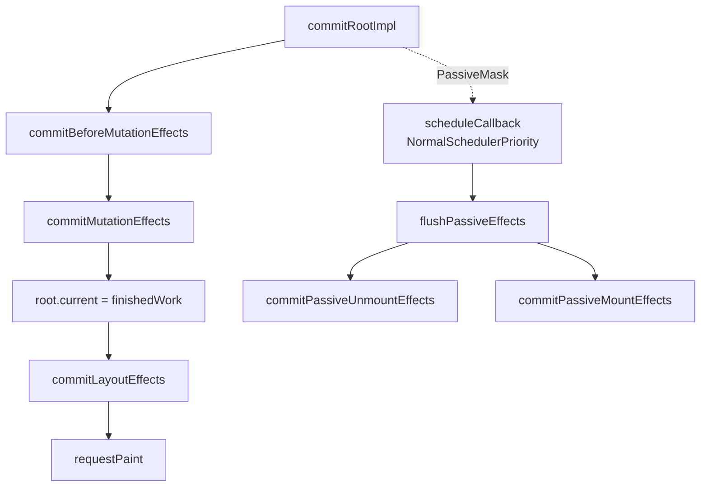

# Commit 阶段

Render 阶段只在 Fiber 树上“记账”：比较新旧节点、计算 Lane、给需要变化的 Fiber 打上 `flags`。真正改 DOM、跑生命周期、执行 Effect 的是 Commit 阶段。它同步且不可中断——一旦开始，就必须把整棵树的变更应用完，否则页面会停在半更新状态。

React 18.3.1 的 `enableNewReconciler` 默认为 `false`，因此运行时走 `.old.js` 分叉。Commit 的核心实现位于 `react-reconciler/src/ReactFiberCommitWork.old.js` 与 `react-reconciler/src/ReactFiberWorkLoop.old.js`。Render 阶段如何产生这些 flags，可参考[工作循环](/frameworks/react/advanced/source-code/reconciler/workLoop)、[beginWork](/frameworks/react/advanced/source-code/reconciler/beginWork) 和 [completeWork](/frameworks/react/advanced/source-code/reconciler/completeWork)。

## 1. Commit 阶段的三幕剧

### 1.1 `commitRootImpl` 的固定顺序

Commit 的总入口是 `commitRootImpl`。它拿到 Render 阶段留下的 `root.finishedWork`，按固定顺序执行 BeforeMutation、Mutation、Layout 三个阶段，并在 Mutation 与 Layout 之间切换 `root.current`：

```ts [react-reconciler/src/ReactFiberWorkLoop.old.js]
// The first phase a "before mutation" phase. We use this phase to read the
// state of the host tree right before we mutate it. This is where
// getSnapshotBeforeUpdate is called.
const shouldFireAfterActiveInstanceBlur = commitBeforeMutationEffects(
  root,
  finishedWork,
)

// ...

// The next phase is the mutation phase, where we mutate the host tree.
commitMutationEffects(root, finishedWork, lanes)

// ...

// The work-in-progress tree is now the current tree. This must come after
// the mutation phase, so that the previous tree is still current during
// componentWillUnmount, but before the layout phase, so that the finished
// work is current during componentDidMount/Update.
root.current = finishedWork

// ...

commitLayoutEffects(finishedWork, root, lanes)

// ...

// Tell Scheduler to yield at the end of the frame, so the browser has an
// opportunity to paint.
requestPaint()
```

`root.current = finishedWork` 的位置很关键：

- 放在 Mutation 之后，`componentWillUnmount` 执行时旧树仍然是 `current`；
- 放在 Layout 之前，`componentDidMount` / `componentDidUpdate` 执行时新树已经是 `current`。

`requestPaint()` 则请求 Scheduler 在这一帧结束时让出主线程，给浏览器绘制机会。

### 1.2 三个同步子阶段与一个异步阶段

[width(19,36,45)]

| 子阶段         | 入口函数                                                    | 主要工作                                                             |
| -------------- | ----------------------------------------------------------- | -------------------------------------------------------------------- |
| BeforeMutation | `commitBeforeMutationEffects`                               | `getSnapshotBeforeUpdate`、读取 DOM 变更前的状态                     |
| Mutation       | `commitMutationEffects`                                     | 插入、移动、删除 DOM；执行 Insertion Effect；执行 Layout Effect 清理 |
| Layout         | `commitLayoutEffects`                                       | 执行 Layout Effect 的 create、`componentDidMount`、挂载 ref          |
| Passive        | `commitPassiveMountEffects` / `commitPassiveUnmountEffects` | 在绘制后异步执行 `useEffect` 的 create 与 destroy                    |

前三个阶段在 `commitRootImpl` 中同步完成；Passive 阶段不在其中直接执行，而是通过 `scheduleCallback` 安排到后续任务：

```ts [react-reconciler/src/ReactFiberWorkLoop.old.js]
if (
  (finishedWork.subtreeFlags & PassiveMask) !== NoFlags ||
  (finishedWork.flags & PassiveMask) !== NoFlags
) {
  if (!rootDoesHavePassiveEffects) {
    rootDoesHavePassiveEffects = true
    pendingPassiveEffectsRemainingLanes = remainingLanes
    // workInProgressTransitions might be overwritten, so we want
    // to store it in pendingPassiveTransitions until they get processed
    // We need to pass this through as an argument to commitRoot
    // because workInProgressTransitions might have changed between
    // the previous render and commit if we throttle the commit
    // with setTimeout
    pendingPassiveTransitions = transitions
    scheduleCallback(NormalSchedulerPriority, () => {
      flushPassiveEffects()
      // This render triggered passive effects: release the root cache pool
      // *after* passive effects fire to avoid freeing a cache pool that may
      // be referenced by a node in the tree (HostRoot, Cache boundary etc)
      return null
    })
  }
}
```

注意每轮 `commitRootImpl` 开头还会先清空上一轮遗留的 Passive Effect：

```ts [react-reconciler/src/ReactFiberWorkLoop.old.js]
do {
  // `flushPassiveEffects` will call `flushSyncUpdateQueue` at the end, which
  // means `flushPassiveEffects` will sometimes result in additional
  // passive effects. So we need to keep flushing in a loop until there are
  // no more pending effects.
  // TODO: Might be better if `flushPassiveEffects` did not automatically
  // flush synchronous work at the end, to avoid factoring hazards like this.
  flushPassiveEffects()
} while (rootWithPendingPassiveEffects !== null)
```

这保证了“上一次提交的 `useEffect` 清理”不会拖到下一次提交之后才执行。

### 1.3 整体流程



## 2. Mutation 阶段

Mutation 阶段负责“把 Fiber 上的标记翻译成宿主操作”。它的入口很小，真正的分派发生在 `commitMutationEffectsOnFiber`。

### 2.1 `commitMutationEffects`

```ts [react-reconciler/src/ReactFiberCommitWork.old.js]
export function commitMutationEffects(
  root: FiberRoot,
  finishedWork: Fiber,
  committedLanes: Lanes,
) {
  inProgressLanes = committedLanes
  inProgressRoot = root

  setCurrentDebugFiberInDEV(finishedWork)
  commitMutationEffectsOnFiber(finishedWork, root, committedLanes)
  setCurrentDebugFiberInDEV(finishedWork)

  inProgressLanes = null
  inProgressRoot = null
}
```

`inProgressLanes` / `inProgressRoot` 是模块级变量，供 `captureCommitPhaseError` 等错误处理逻辑使用；进入时保存、退出时清空。

### 2.2 `recursivelyTraverseMutationEffects`

真正的递归发生在 `recursivelyTraverseMutationEffects`。它做两件事：先处理父节点收集到的删除队列，再按 `subtreeFlags` 决定是否继续遍历子节点。

```ts [react-reconciler/src/ReactFiberCommitWork.old.js]
function recursivelyTraverseMutationEffects(
  root: FiberRoot,
  parentFiber: Fiber,
  lanes: Lanes,
) {
  // Deletions effects can be scheduled on any fiber type. They need to happen
  // before the children effects hae fired.
  const deletions = parentFiber.deletions
  if (deletions !== null) {
    for (let i = 0; i < deletions.length; i++) {
      const childToDelete = deletions[i]
      try {
        commitDeletionEffects(root, parentFiber, childToDelete)
      } catch (error) {
        captureCommitPhaseError(childToDelete, parentFiber, error)
      }
    }
  }

  const prevDebugFiber = getCurrentDebugFiberInDEV()
  if (parentFiber.subtreeFlags & MutationMask) {
    let child = parentFiber.child
    while (child !== null) {
      setCurrentDebugFiberInDEV(child)
      commitMutationEffectsOnFiber(child, root, lanes)
      child = child.sibling
    }
  }
  setCurrentDebugFiberInDEV(prevDebugFiber)
}
```

两个顺序约定值得记住：

1. **删除先于子节点副作用**。`deletions` 在遍历 `child` 之前处理，保证被删除子树的清理发生在兄弟节点插入之前。
2. **`subtreeFlags & MutationMask` 剪枝**。如果整棵子树都没有 Mutation 相关标记，就不再向下遍历，这是 React 18 去掉 effect list 后仍能避免全树扫描的关键。

`MutationMask` 由多个 flag 位或而成：

```ts [react-reconciler/src/ReactFiberFlags.js]
export const Placement = /*                    */ 0b00000000000000000000000010
export const Update = /*                       */ 0b00000000000000000000000100
export const ChildDeletion = /*                */ 0b00000000000000000000010000
export const ContentReset = /*                 */ 0b00000000000000000000100000
export const Ref = /*                          */ 0b00000000000000001000000000
export const Passive = /*                      */ 0b00000000000000100000000000
export const Hydrating = /*                    */ 0b00000000000001000000000000

// ...

export const MutationMask =
  Placement |
  Update |
  ChildDeletion |
  ContentReset |
  Ref |
  Hydrating |
  Visibility
export const LayoutMask = Update | Callback | Ref | Visibility
export const PassiveMask = Passive | ChildDeletion
```

### 2.3 `commitMutationEffectsOnFiber`

不同类型 Fiber 的副作用不同。以函数组件为例，`Update` 标记意味着需要处理 Hook Effect：

```ts [react-reconciler/src/ReactFiberCommitWork.old.js]
    case FunctionComponent:
    case ForwardRef:
    case MemoComponent:
    case SimpleMemoComponent: {
      recursivelyTraverseMutationEffects(root, finishedWork, lanes);
      commitReconciliationEffects(finishedWork);

      if (flags & Update) {
        try {
          commitHookEffectListUnmount(
            HookInsertion | HookHasEffect,
            finishedWork,
            finishedWork.return,
          );
          commitHookEffectListMount(
            HookInsertion | HookHasEffect,
            finishedWork,
          );
        } catch (error) {
          captureCommitPhaseError(finishedWork, finishedWork.return, error);
        }
        // Layout effects are destroyed during the mutation phase so that all
        // destroy functions for all fibers are called before any create functions.
        // This prevents sibling component effects from interfering with each other,
        // e.g. a destroy function in one component should never override a ref set
        // by a create function in another component during the same commit.
        // ...
        try {
          commitHookEffectListUnmount(
            HookLayout | HookHasEffect,
            finishedWork,
            finishedWork.return,
          );
        } catch (error) {
          captureCommitPhaseError(finishedWork, finishedWork.return, error);
        }
      }
      return;
    }
```

可以看到三类 Effect 在 Mutation 阶段的分工：

- `useInsertionEffect`：先卸载旧的，再同步挂载新的；
- `useLayoutEffect`：只执行 destroy，create 留到 Layout 阶段；
- `useEffect`：完全不在 Mutation 阶段处理，交给 Passive 阶段。

### 2.4 `commitReconciliationEffects`

所有“结构变化”的标记最终汇聚到 `commitReconciliationEffects`：

```ts [react-reconciler/src/ReactFiberCommitWork.old.js]
function commitReconciliationEffects(finishedWork: Fiber) {
  // Placement effects (insertions, reorders) can be scheduled on any fiber
  // type. They needs to happen after the children effects have fired, but
  // before the effects on this fiber have fired.
  const flags = finishedWork.flags
  if (flags & Placement) {
    try {
      commitPlacement(finishedWork)
    } catch (error) {
      captureCommitPhaseError(finishedWork, finishedWork.return, error)
    }
    // Clear the "placement" from effect tag so that we know that this is
    // inserted, before any life-cycles like componentDidMount gets called.
    // TODO: findDOMNode doesn't rely on this any more but isMounted does
    // and isMounted is deprecated anyway so we should be able to kill this.
    finishedWork.flags &= ~Placement
  }
  if (flags & Hydrating) {
    finishedWork.flags &= ~Hydrating
  }
}
```

位掩码在这里体现得很直接：

- `flags & Placement` 判断是否存在标记；
- `flags &= ~Placement` 清除标记，避免后续阶段或重复遍历再次处理；
- 同一个 Fiber 可以同时带多个位，按阶段分别消费。

## 3. 插入与移动

### 3.1 为什么必须用 `insertBefore`

假设列表从 `[A, B, C]` 变成 `[B, A, C]`，只有 A 被标记为 `Placement`。如果直接：

```js
parent.appendChild(A)
```

A 会被追加到 C 后面，结果变成 `[B, C, A]`，顺序错误。正确做法是找到 A 后面第一个“稳定”的宿主节点 C，把 A 插到 C 之前：

```js
parent.insertBefore(A, C) // 结果 [B, A, C]
```

`getHostSibling` 的职责就是找这个锚点；找不到锚点时才退回 `appendChild`。

### 3.2 `commitPlacement`

```ts [react-reconciler/src/ReactFiberCommitWork.old.js]
function commitPlacement(finishedWork: Fiber): void {
  if (!supportsMutation) {
    return
  }

  // Recursively insert all host nodes into the parent.
  const parentFiber = getHostParentFiber(finishedWork)

  // Note: these two variables *must* always be updated together.
  switch (parentFiber.tag) {
    case HostComponent: {
      const parent: Instance = parentFiber.stateNode
      if (parentFiber.flags & ContentReset) {
        // Reset the text content of the parent before doing any insertions
        resetTextContent(parent)
        // Clear ContentReset from the effect tag
        parentFiber.flags &= ~ContentReset
      }

      const before = getHostSibling(finishedWork)
      // We only have the top Fiber that was inserted but we need to recurse down its
      // children to find all the terminal nodes.
      insertOrAppendPlacementNode(finishedWork, before, parent)
      break
    }
    case HostRoot:
    case HostPortal: {
      const parent: Container = parentFiber.stateNode.containerInfo
      const before = getHostSibling(finishedWork)
      insertOrAppendPlacementNodeIntoContainer(finishedWork, before, parent)
      break
    }
    // eslint-disable-next-line-no-fallthrough
    default:
      throw new Error(
        'Invalid host parent fiber. This error is likely caused by a bug ' +
          'in React. Please file an issue.',
      )
  }
}
```

几处细节：

- `supportsMutation` 为 `false` 的渲染器（如部分自定义渲染器）直接跳过 DOM 操作；
- `HostComponent` 的父容器是 `stateNode`，`HostRoot` / `HostPortal` 的父容器是 `stateNode.containerInfo`；
- 父节点带 `ContentReset` 时，先清空文本再插入，避免旧文本残留在新节点前面。

### 3.3 `getHostSibling`：向前找稳定锚点

```ts [react-reconciler/src/ReactFiberCommitWork.old.js]
function getHostSibling(fiber: Fiber): ?Instance {
  // We're going to search forward into the tree until we find a sibling host
  // node. Unfortunately, if multiple insertions are done in a row we have to
  // search past them. This leads to exponential search for the next sibling.
  // TODO: Find a more efficient way to do this.
  let node: Fiber = fiber
  siblings: while (true) {
    // If we didn't find anything, let's try the next sibling.
    while (node.sibling === null) {
      if (node.return === null || isHostParent(node.return)) {
        // If we pop out of the root or hit the parent the fiber we are the
        // last sibling.
        return null
      }
      node = node.return
    }
    node.sibling.return = node.return
    node = node.sibling
    while (
      node.tag !== HostComponent &&
      node.tag !== HostText &&
      node.tag !== DehydratedFragment
    ) {
      // If it is not host node and, we might have a host node inside it.
      // Try to search down until we find one.
      if (node.flags & Placement) {
        // If we don't have a child, try the siblings instead.
        continue siblings
      }
      // If we don't have a child, try the siblings instead.
      // We also skip portals because they are not part of this host tree.
      if (node.child === null || node.tag === HostPortal) {
        continue siblings
      } else {
        node.child.return = node
        node = node.child
      }
    }
    // Check if this host node is stable or about to be placed.
    if (!(node.flags & Placement)) {
      // Found it!
      return node.stateNode
    }
  }
}
```

查找规则：

1. 没有兄弟就沿 `return` 向上，直到遇到有兄弟的祖先或宿主父节点；越过宿主父节点仍找不到就返回 `null`。
2. 找到兄弟后，如果它不是宿主节点，就向下找它的 `child`。
3. 跳过本身也带 `Placement` 的节点——它们也会移动，不能作为稳定锚点。
4. 跳过 `HostPortal`，因为 Portal 的 DOM 不在当前宿主树里。
5. 返回第一个“本轮不移动”的宿主节点的 `stateNode`。

注释里也坦白了代价：连续多次插入时，每次都要越过前面尚未插入的节点，最坏会退化成指数级搜索。

### 3.4 `insertOrAppendPlacementNode`

```ts [react-reconciler/src/ReactFiberCommitWork.old.js]
function insertOrAppendPlacementNode(
  node: Fiber,
  before: ?Instance,
  parent: Instance,
): void {
  const { tag } = node
  const isHost = tag === HostComponent || tag === HostText
  if (isHost) {
    const stateNode = node.stateNode
    if (before) {
      insertBefore(parent, stateNode, before)
    } else {
      appendChild(parent, stateNode)
    }
  } else if (tag === HostPortal) {
    // If the insertion itself is a portal, then we don't want to traverse
    // down its children. Instead, we'll get insertions from each child in
    // the portal directly.
  } else {
    const child = node.child
    if (child !== null) {
      insertOrAppendPlacementNode(child, before, parent)
      let sibling = child.sibling
      while (sibling !== null) {
        insertOrAppendPlacementNode(sibling, before, parent)
        sibling = sibling.sibling
      }
    }
  }
}
```

函数组件、Context Provider 等没有 DOM 的 Fiber，会继续向下递归，直到找到 `HostComponent` 或 `HostText`。Portal 则直接返回：它的子节点会由 Portal 自己的容器处理。

对应的 `insertOrAppendPlacementNodeIntoContainer` 逻辑相同，只是把 `insertBefore` / `appendChild` 换成了容器版本。

### 3.5 `getHostParentFiber` 与 `isHostParent`

```ts [react-reconciler/src/ReactFiberCommitWork.old.js]
function getHostParentFiber(fiber: Fiber): Fiber {
  let parent = fiber.return
  while (parent !== null) {
    if (isHostParent(parent)) {
      return parent
    }
    parent = parent.return
  }

  throw new Error(
    'Expected to find a host parent. This error is likely caused by a bug ' +
      'in React. Please file an issue.',
  )
}

function isHostParent(fiber: Fiber): boolean {
  return (
    fiber.tag === HostComponent ||
    fiber.tag === HostRoot ||
    fiber.tag === HostPortal
  )
}
```

函数组件、Context Provider 等没有 DOM 的节点会被跳过，直到遇到 `HostComponent`、`HostRoot` 或 `HostPortal`。

## 4. 删除

### 4.1 `commitDeletionEffects`

删除的入口不是被删节点自己，而是它的父节点。`commitDeletionEffects` 先确定“从哪个宿主节点里移除”，再递归清理整棵被删子树。

```ts [react-reconciler/src/ReactFiberCommitWork.old.js]
// These are tracked on the stack as we recursively traverse a
// deleted subtree.
// TODO: Update these during the whole mutation phase, not just during
// a deletion.
let hostParent: Instance | Container | null = null
let hostParentIsContainer: boolean = false

function commitDeletionEffects(
  root: FiberRoot,
  returnFiber: Fiber,
  deletedFiber: Fiber,
) {
  if (supportsMutation) {
    // ...
    // Before starting, find the nearest host parent on the stack so we know
    // which instance/container to remove the children from.
    // ...
    let parent = returnFiber
    findParent: while (parent !== null) {
      switch (parent.tag) {
        case HostComponent: {
          hostParent = parent.stateNode
          hostParentIsContainer = false
          break findParent
        }
        case HostRoot: {
          hostParent = parent.stateNode.containerInfo
          hostParentIsContainer = true
          break findParent
        }
        case HostPortal: {
          hostParent = parent.stateNode.containerInfo
          hostParentIsContainer = true
          break findParent
        }
      }
      parent = parent.return
    }
    if (hostParent === null) {
      throw new Error(
        'Expected to find a host parent. This error is likely caused by ' +
          'a bug in React. Please file an issue.',
      )
    }
    commitDeletionEffectsOnFiber(root, returnFiber, deletedFiber)
    hostParent = null
    hostParentIsContainer = false
  } else {
    // Detach refs and call componentWillUnmount() on the whole subtree.
    commitDeletionEffectsOnFiber(root, returnFiber, deletedFiber)
  }

  detachFiberMutation(deletedFiber)
}
```

`hostParent` / `hostParentIsContainer` 是模块级变量，相当于“删除遍历期间使用的游标”。找到最近的宿主父节点后，`commitDeletionEffectsOnFiber` 递归处理子树；结束后清空游标，最后调用 `detachFiberMutation` 切断 `return` 指针，让已卸载组件上的 `setState` 能被检测出来。

### 4.2 `commitDeletionEffectsOnFiber`

删除遍历会区分节点类型。宿主节点负责真正 `removeChild`，函数组件负责执行 Effect 的 destroy：

```ts [react-reconciler/src/ReactFiberCommitWork.old.js]
    case HostComponent: {
      if (!offscreenSubtreeWasHidden) {
        safelyDetachRef(deletedFiber, nearestMountedAncestor);
      }
      // Intentional fallthrough to next branch
    }
    // eslint-disable-next-line-no-fallthrough
    case HostText: {
      // We only need to remove the nearest host child. Set the host parent
      // to `null` on the stack to indicate that nested children don't
      // need to be removed.
      if (supportsMutation) {
        const prevHostParent = hostParent;
        const prevHostParentIsContainer = hostParentIsContainer;
        hostParent = null;
        recursivelyTraverseDeletionEffects(
          finishedRoot,
          nearestMountedAncestor,
          deletedFiber,
        );
        hostParent = prevHostParent;
        hostParentIsContainer = prevHostParentIsContainer;

        if (hostParent !== null) {
          // Now that all the child effects have unmounted, we can remove the
          // node from the tree.
          if (hostParentIsContainer) {
            removeChildFromContainer(
              ((hostParent: any): Container),
              (deletedFiber.stateNode: Instance | TextInstance),
            );
          } else {
            removeChild(
              ((hostParent: any): Instance),
              (deletedFiber.stateNode: Instance | TextInstance),
            );
          }
        }
      } else {
        recursivelyTraverseDeletionEffects(
          finishedRoot,
          nearestMountedAncestor,
          deletedFiber,
        );
      }
      return;
    }
```

有几个容易忽略的点：

- 进入宿主节点后先把 `hostParent` 置为 `null`，再递归子节点。这样嵌套的子宿主节点不会重复执行 `removeChild`，只由最外层负责移除。
- `HostComponent` 会先 `safelyDetachRef`，再落入 `HostText` 分支。
- 递归清理完子节点后，才恢复 `hostParent` 并执行 `removeChild`，所以清理函数访问 DOM 时节点仍然存在。

函数组件分支只处理 `useInsertionEffect` 和 `useLayoutEffect` 的 destroy：

```ts [react-reconciler/src/ReactFiberCommitWork.old.js]
    case FunctionComponent:
    case ForwardRef:
    case MemoComponent:
    case SimpleMemoComponent: {
      if (!offscreenSubtreeWasHidden) {
        const updateQueue: FunctionComponentUpdateQueue | null = (deletedFiber.updateQueue: any);
        if (updateQueue !== null) {
          const lastEffect = updateQueue.lastEffect;
          if (lastEffect !== null) {
            const firstEffect = lastEffect.next;

            let effect = firstEffect;
            do {
              const {destroy, tag} = effect;
              if (destroy !== undefined) {
                if ((tag & HookInsertion) !== NoHookEffect) {
                  safelyCallDestroy(
                    deletedFiber,
                    nearestMountedAncestor,
                    destroy,
                  );
                } else if ((tag & HookLayout) !== NoHookEffect) {
                  // ...
                  safelyCallDestroy(
                    deletedFiber,
                    nearestMountedAncestor,
                    destroy,
                  );
                  // ...
                }
              }
              effect = effect.next;
            } while (effect !== firstEffect);
          }
        }
      }

      recursivelyTraverseDeletionEffects(
        finishedRoot,
        nearestMountedAncestor,
        deletedFiber,
      );
      return;
    }
```

`useEffect` 的 destroy 不在这里执行，而是留到 Passive Unmount 阶段。这样能保证所有同步清理先完成，再把异步副作用的清理推迟到绘制之后。

### 4.3 删除标记为什么挂在父节点

Render 阶段发现子节点需要删除时，调用的是 `deleteChild`；父节点同时被打上 `ChildDeletion`，而 `ChildDeletion` 会同时进入 Mutation 与 Passive 两套掩码：

:::code-group

```ts [react-reconciler/src/ReactChildFiber.old.js]
function deleteChild(returnFiber: Fiber, childToDelete: Fiber): void {
  if (!shouldTrackSideEffects) {
    // Noop.
    return
  }
  const deletions = returnFiber.deletions
  if (deletions === null) {
    returnFiber.deletions = [childToDelete]
    returnFiber.flags |= ChildDeletion
  } else {
    deletions.push(childToDelete)
  }
}
```

```ts [react-reconciler/src/ReactFiberFlags.js]
export const ChildDeletion = /*                */ 0b00000000000000000000010000
export const Passive = /*                      */ 0b00000000000000100000000000

// ...

export const MutationMask =
  Placement |
  Update |
  ChildDeletion |
  ContentReset |
  Ref |
  Hydrating |
  Visibility

// TODO: Split into PassiveMountMask and PassiveUnmountMask
export const PassiveMask = Passive | ChildDeletion
```

:::

待删除的 Fiber 被放进父节点的 `deletions` 数组，同时父节点被打上 `ChildDeletion`。好处是：

- Commit 阶段只需要在父节点处处理一次 `deletions`，不必再遍历被删子树去找“谁是根”；
- 被删子树的 Fiber 可能已经不再参与本轮协调，单独遍历容易遗漏；
- `ChildDeletion` 同时出现在 `MutationMask` 和 `PassiveMask` 中，Mutation 阶段负责移除 DOM，Passive 阶段负责清理 `useEffect`。

## 5. Hook Effect 的挂载与卸载

### 5.1 Effect 标签

Effect 不是按“类型”直接存成 `useEffect` / `useLayoutEffect`，而是用位标记描述它属于哪个阶段、是否需要在本次提交执行：

```ts [react-reconciler/src/ReactHookEffectTags.js]
export type HookFlags = number

export const NoFlags = /*   */ 0b0000

// Represents whether effect should fire.
export const HasEffect = /* */ 0b0001

// Represents the phase in which the effect (not the clean-up) fires.
export const Insertion = /*  */ 0b0010
export const Layout = /*    */ 0b0100
export const Passive = /*   */ 0b1000
```

[width(22,18,60)]

| 标签        | 值     | 含义                                        |
| ----------- | ------ | ------------------------------------------- |
| `HasEffect` | `0001` | 本次提交需要执行 create 或 destroy          |
| `Insertion` | `0010` | `useInsertionEffect`，Mutation 阶段同步执行 |
| `Layout`    | `0100` | `useLayoutEffect`，Layout 阶段执行 create   |
| `Passive`   | `1000` | `useEffect`，绘制后异步执行                 |

调用方通过组合标签筛选，例如 `HookLayout | HookHasEffect` 表示“本次需要执行的 Layout Effect”。

### 5.2 环形链表遍历

每个函数组件的 `updateQueue.lastEffect` 指向 Hook Effect 环形链表的尾节点，`lastEffect.next` 才是头节点。挂载和卸载都按同一个环走一圈：

```ts [react-reconciler/src/ReactFiberCommitWork.old.js]
function commitHookEffectListUnmount(
  flags: HookFlags,
  finishedWork: Fiber,
  nearestMountedAncestor: Fiber | null,
) {
  const updateQueue: FunctionComponentUpdateQueue | null = (finishedWork.updateQueue: any);
  const lastEffect = updateQueue !== null ? updateQueue.lastEffect : null;
  if (lastEffect !== null) {
    const firstEffect = lastEffect.next;
    let effect = firstEffect;
    do {
      if ((effect.tag & flags) === flags) {
        // Unmount
        const destroy = effect.destroy;
        effect.destroy = undefined;
        if (destroy !== undefined) {
          // ...
          safelyCallDestroy(finishedWork, nearestMountedAncestor, destroy);
          // ...
        }
      }
      effect = effect.next;
    } while (effect !== firstEffect);
  }
}

function commitHookEffectListMount(flags: HookFlags, finishedWork: Fiber) {
  const updateQueue: FunctionComponentUpdateQueue | null = (finishedWork.updateQueue: any);
  const lastEffect = updateQueue !== null ? updateQueue.lastEffect : null;
  if (lastEffect !== null) {
    const firstEffect = lastEffect.next;
    let effect = firstEffect;
    do {
      if ((effect.tag & flags) === flags) {
        // Mount
        const create = effect.create;
        effect.destroy = create();
        // ...
      }
      effect = effect.next;
    } while (effect !== firstEffect);
  }
}
```

两个实现细节：

- `(effect.tag & flags) === flags` 要求 `flags` 中的每一位都匹配，因此不会误执行其它阶段的 Effect。
- 卸载时先把 `effect.destroy` 置为 `undefined`，再调用旧 destroy，避免清理函数重入或重复执行。
- 挂载时把 `create()` 的返回值写回 `effect.destroy`，供下一次卸载使用。

### 5.3 为什么 Layout Effect 的 destroy 在 Mutation 阶段

`useLayoutEffect` 的 create 在 Layout 阶段执行，但 destroy 被提前到 Mutation 阶段。源码注释给出了原因：让所有组件的 destroy 都先于任何 create 执行。否则兄弟组件的副作用可能互相干扰——比如一个组件的 destroy 覆盖了另一个组件在 create 中设置的 ref。

`useInsertionEffect` 更特殊：它在 Mutation 阶段先 destroy、再 create，因为它本来就是为“在布局读取前插入样式”设计的。

## 6. Passive Effects

### 6.1 调度时机

Passive Effect 的调度在 `commitRootImpl` 前半段完成（见 [1.2](#12-三个同步子阶段与一个异步阶段)）。它使用 `NormalSchedulerPriority`，因此：

- 不会阻塞当前 Commit；
- 浏览器先完成绘制；
- Scheduler 在后续任务中调用 `flushPassiveEffects`。

如果本次提交由同步 Lane 触发，`commitRootImpl` 末尾还会同步冲刷一次 Passive Effect：

```ts [react-reconciler/src/ReactFiberWorkLoop.old.js]
if (
  includesSomeLane(pendingPassiveEffectsLanes, SyncLane) &&
  root.tag !== LegacyRoot
) {
  flushPassiveEffects()
}
```

这是为了兼容“同步渲染的结果必须立即可观察”的语义，同时避免 Legacy Root 的行为变化。

### 6.2 `commitPassiveMountEffects`

Passive 遍历不使用递归，而是用模块级 `nextEffect` 做迭代，避免深树导致调用栈过深：

```ts [react-reconciler/src/ReactFiberCommitWork.old.js]
export function commitPassiveMountEffects(
  root: FiberRoot,
  finishedWork: Fiber,
  committedLanes: Lanes,
  committedTransitions: Array<Transition> | null,
): void {
  nextEffect = finishedWork
  commitPassiveMountEffects_begin(
    finishedWork,
    root,
    committedLanes,
    committedTransitions,
  )
}

function commitPassiveMountEffects_begin(
  subtreeRoot: Fiber,
  root: FiberRoot,
  committedLanes: Lanes,
  committedTransitions: Array<Transition> | null,
) {
  while (nextEffect !== null) {
    const fiber = nextEffect
    const firstChild = fiber.child
    if ((fiber.subtreeFlags & PassiveMask) !== NoFlags && firstChild !== null) {
      firstChild.return = fiber
      nextEffect = firstChild
    } else {
      commitPassiveMountEffects_complete(
        subtreeRoot,
        root,
        committedLanes,
        committedTransitions,
      )
    }
  }
}

function commitPassiveMountEffects_complete(
  subtreeRoot: Fiber,
  root: FiberRoot,
  committedLanes: Lanes,
  committedTransitions: Array<Transition> | null,
) {
  while (nextEffect !== null) {
    const fiber = nextEffect

    if ((fiber.flags & Passive) !== NoFlags) {
      setCurrentDebugFiberInDEV(fiber)
      try {
        commitPassiveMountOnFiber(
          root,
          fiber,
          committedLanes,
          committedTransitions,
        )
      } catch (error) {
        captureCommitPhaseError(fiber, fiber.return, error)
      }
      resetCurrentDebugFiberInDEV()
    }

    if (fiber === subtreeRoot) {
      nextEffect = null
      return
    }

    const sibling = fiber.sibling
    if (sibling !== null) {
      sibling.return = fiber.return
      nextEffect = sibling
      return
    }

    nextEffect = fiber.return
  }
}
```

`begin` 只负责向下找到叶子，`complete` 负责在回溯途中执行带 `Passive` 标记的 Fiber。`subtreeFlags & PassiveMask` 再次承担剪枝作用。

真正执行 `useEffect` create 的是 `commitPassiveMountOnFiber` 的函数组件分支：

```ts [react-reconciler/src/ReactFiberCommitWork.old.js]
    case FunctionComponent:
    case ForwardRef:
    case SimpleMemoComponent: {
      if (
        enableProfilerTimer &&
        enableProfilerCommitHooks &&
        finishedWork.mode & ProfileMode
      ) {
        startPassiveEffectTimer();
        try {
          commitHookEffectListMount(HookPassive | HookHasEffect, finishedWork);
        } finally {
          recordPassiveEffectDuration(finishedWork);
        }
      } else {
        commitHookEffectListMount(HookPassive | HookHasEffect, finishedWork);
      }
      break;
    }
```

### 6.3 `commitPassiveUnmountEffects`

卸载遍历比挂载多了一件事：遇到 `ChildDeletion` 时，要先清理被删除子树内部的 Passive Effect。

```ts [react-reconciler/src/ReactFiberCommitWork.old.js]
export function commitPassiveUnmountEffects(firstChild: Fiber): void {
  nextEffect = firstChild
  commitPassiveUnmountEffects_begin()
}

function commitPassiveUnmountEffects_begin() {
  while (nextEffect !== null) {
    const fiber = nextEffect
    const child = fiber.child

    if ((nextEffect.flags & ChildDeletion) !== NoFlags) {
      const deletions = fiber.deletions
      if (deletions !== null) {
        for (let i = 0; i < deletions.length; i++) {
          const fiberToDelete = deletions[i]
          nextEffect = fiberToDelete
          commitPassiveUnmountEffectsInsideOfDeletedTree_begin(
            fiberToDelete,
            fiber,
          )
        }

        // ...
        nextEffect = fiber
      }
    }

    if ((fiber.subtreeFlags & PassiveMask) !== NoFlags && child !== null) {
      child.return = fiber
      nextEffect = child
    } else {
      commitPassiveUnmountEffects_complete()
    }
  }
}
```

被删子树的清理走单独的遍历 `commitPassiveUnmountEffectsInsideOfDeletedTree_begin`，它按“父 → 子”的顺序执行 destroy。这一点与挂载阶段“子 → 父”的 create 顺序相反：清理应当先释放父级资源，再释放子级依赖。

最终执行 `useEffect` destroy 的函数仍然是 `commitHookEffectListUnmount`：

```ts [react-reconciler/src/ReactFiberCommitWork.old.js]
function commitPassiveUnmountOnFiber(finishedWork: Fiber): void {
  switch (finishedWork.tag) {
    case FunctionComponent:
    case ForwardRef:
    case SimpleMemoComponent: {
      if (
        enableProfilerTimer &&
        enableProfilerCommitHooks &&
        finishedWork.mode & ProfileMode
      ) {
        startPassiveEffectTimer()
        commitHookEffectListUnmount(
          HookPassive | HookHasEffect,
          finishedWork,
          finishedWork.return,
        )
        recordPassiveEffectDuration(finishedWork)
      } else {
        commitHookEffectListUnmount(
          HookPassive | HookHasEffect,
          finishedWork,
          finishedWork.return,
        )
      }
      break
    }
  }
}
```

### 6.4 为什么不在 Mutation 阶段直接执行

- `useEffect` 的语义是“浏览器绘制之后”，此时布局已经稳定，读取布局不会触发额外的强制同步。
- 如果同步执行，耗时副作用会阻塞绘制，用户看到首屏的时间变长。
- 交给 Scheduler 后，React 可以在浏览器空闲时执行，必要时还能继续让出主线程。
- 卸载时的 `useEffect` destroy 也要等 DOM 移除完成后再执行，避免清理函数访问已经不在文档中的节点。

需要“DOM 已更新、绘制之前”执行副作用时，应该使用 `useLayoutEffect`；两者的调度差异可参考 [useEffect](/frameworks/react/advanced/source-code/hooks/useEffect) 与 [useLayoutEffect](/frameworks/react/advanced/source-code/hooks/useLayoutEffect)。

## 7. 总结

[width(13,15,45,27)]

| 操作             | 触发标记        | 关键函数                                                                   | 注意事项                             |
| ---------------- | --------------- | -------------------------------------------------------------------------- | ------------------------------------ |
| 插入 / 移动      | `Placement`     | `commitPlacement`、`getHostSibling`                                        | 必须用 `insertBefore` 保持顺序       |
| 删除             | `ChildDeletion` | `commitDeletionEffects`、`commitDeletionEffectsOnFiber`                    | 先清理子节点，再由最外层宿主节点移除 |
| 更新属性         | `Update`        | 在 `completeWork` 中生成，Mutation 阶段消费                                | `ContentReset` 要先重置文本          |
| Insertion Effect | `Insertion`     | `commitHookEffectListUnmount` / `commitHookEffectListMount`                | Mutation 阶段先 destroy 再 create    |
| Layout Effect    | `Layout`        | Mutation 阶段 destroy，Layout 阶段 `commitHookEffectListMount` 执行 create | DOM 已变、绘制前同步执行             |
| Passive Effect   | `Passive`       | `commitPassiveMountEffects`、`commitPassiveUnmountEffects`                 | 绘制后异步执行；删除子树单独清理     |

Commit 阶段的设计原则可以概括为“Render 只算、Commit 只做”：

- Render 阶段负责比较、打标记、计算 Lane；
- Mutation 阶段消费结构标记，完成 DOM 的插入、移动、删除；
- Layout 阶段读取变更后的 DOM，执行同步副作用；
- Passive 阶段在绘制后异步补齐 `useEffect`。

## 8. 与简化实现的差异

本节对照一个教学用的极简实现，帮助理解官方实现删掉了哪些东西。该实现的 `commitRoot` 只调用一次 `commitMutationEffects`，然后把 `useEffect` 交给 Scheduler；它保留了三件事：按 `flags` 处理 `Placement` / `ChildDeletion` / `Update`、用 `insertBefore` 维护顺序、删除时先跑清理再 `removeChild`。

[width(13,35,52)]

| 维度         | 简化实现                                               | React 18.3.1                                                        |
| ------------ | ------------------------------------------------------ | ------------------------------------------------------------------- |
| 子阶段       | 只有 Mutation，Layout Effect 在 Mutation 中同步 create | BeforeMutation、Mutation、Layout 三个同步阶段 + 异步 Passive        |
| DOM 更新时机 | 部分属性更新提前到 `completeWork`                      | 结构变更集中在 Mutation，属性在 `completeWork` 生成标记后统一消费   |
| 遍历方式     | 递归遍历整棵 Fiber 树                                  | `subtreeFlags & MutationMask` / `PassiveMask` 剪枝，Passive 用迭代  |
| 删除         | 遍历 `deletions`，执行 cleanup + `removeChild`         | `hostParent` 游标 + `commitDeletionEffectsOnFiber`，区分宿主/组件   |
| 节点类型     | 主要处理 `HostComponent`、`HostRoot`                   | 还处理 `HostPortal`、`HostText`、`Offscreen`、Suspense/Dehydrated   |
| Effect 调度  | `useEffect` 统一交给 Scheduler                         | Insertion / Layout / Passive 三类标签，各自有独立的执行阶段         |
| 错误处理     | 异常直接冒泡                                           | 每个副作用调用都包在 `try/catch` 中，交给 `captureCommitPhaseError` |

简化实现适合用来理解“Commit 在做什么”，但阅读官方源码时要把这些裁剪掉的边界条件补回来：Portal 的容器、被删子树的 Passive 清理、`ContentReset`、Suspense 的隐藏子树，以及 Layout Effect destroy 与 create 的分离。
