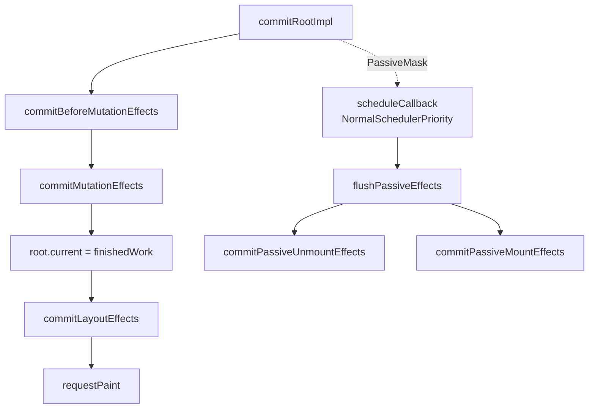

# Commit 阶段

Render 阶段只在 Fiber 树上“**记账**”：比较新旧节点、计算 Lane、给需要变化的 Fiber 打上 `flags`。真正改 DOM、跑生命周期、执行 Effect 的是 Commit 阶段。它同步且不可中断——一旦开始，就必须把整棵树的变更应用完，否则页面会停在半更新状态。

## 1. Commit 阶段

### 1.1 `commitRootImpl`

Commit 的总入口是 `commitRootImpl`。它拿到 Render 阶段留下的 `root.finishedWork`，按固定顺序执行 BeforeMutation、Mutation、Layout 三个阶段，并在 Mutation 与 Layout 之间切换 `root.current`。下面去掉错误处理、DEV 分支、无副作用分支与优先级特判，只保留主路径：

:::code-group

```ts [react-reconciler/src/ReactFiberWorkLoop.old.js]
function commitRootImpl(root, transitions) {
  // 上一轮挂起的 Passive Effect 先清完，避免本次提交与旧副作用交错。
  // flushPassiveEffects 末尾的 flushSyncCallbacks 可能又产生新的 Passive Effect，
  // 所以要循环清空。
  do {
    flushPassiveEffects()
  } while (rootWithPendingPassiveEffects !== null)

  const finishedWork = root.finishedWork
  const lanes = root.finishedLanes
  root.finishedWork = null
  root.finishedLanes = NoLanes

  // 本次提交已经接走 Render 的成果，清掉 Scheduler 留下的回调信息。
  root.callbackNode = null
  root.callbackPriority = NoLane

  // 渲染完成后剩余的 lanes，用于 commit 结束后的续调度。
  const remainingLanes = mergeLanes(finishedWork.lanes, finishedWork.childLanes)
  markRootFinished(root, remainingLanes)

  // 只要树里带 Passive 标记，就在进入三阶段之前把回调排进 Scheduler，
  // 确保它排在 Commit 期间新增的任务之前。
  if (
    (finishedWork.subtreeFlags & PassiveMask) !== NoFlags ||
    (finishedWork.flags & PassiveMask) !== NoFlags
  ) {
    rootDoesHavePassiveEffects = true
    pendingPassiveTransitions = transitions
    scheduleCallback(NormalSchedulerPriority, () => {
      flushPassiveEffects()
      return null
    })
  }

  // 第一幕 BeforeMutation：在修改宿主树前读取状态，调用 getSnapshotBeforeUpdate。
  const shouldFireAfterActiveInstanceBlur = commitBeforeMutationEffects(
    root,
    finishedWork,
  )

  // 第二幕 Mutation：插入、移动、删除宿主节点，执行 Insertion Effect。
  commitMutationEffects(root, finishedWork, lanes)
  resetAfterCommit(root.containerInfo)

  // 新旧树在此切换：必须晚于 Mutation（卸载时旧树仍是 current），
  // 早于 Layout（挂载时新树已是 current）。
  root.current = finishedWork

  // 第三幕 Layout：执行 Layout Effect、componentDidMount 与 ref 挂载。
  commitLayoutEffects(finishedWork, root, lanes)

  // 通知 Scheduler 在帧末让出主线程，给浏览器绘制机会。
  requestPaint()

  // 记录本次提交的 Passive Effect，绘制后由 Scheduler 回调统一清理并执行。
  if (rootDoesHavePassiveEffects) {
    rootDoesHavePassiveEffects = false
    rootWithPendingPassiveEffects = root
    pendingPassiveEffectsLanes = lanes
  }

  // 还有剩余工作（例如被高优先级更新打断）就继续调度下一轮。
  ensureRootIsScheduled(root, now())
}
```

:::

### 1.2 子阶段

[width(19,36,45)]

| 子阶段         | 入口函数                                                    | 主要工作                                                             |
| -------------- | ----------------------------------------------------------- | -------------------------------------------------------------------- |
| BeforeMutation | `commitBeforeMutationEffects`                               | `getSnapshotBeforeUpdate`、读取 DOM 变更前的状态                     |
| Mutation       | `commitMutationEffects`                                     | 插入、移动、删除 DOM；执行 Insertion Effect；执行 Layout Effect 清理 |
| Layout         | `commitLayoutEffects`                                       | 执行 Layout Effect 的 create、`componentDidMount`、挂载 ref          |
| Passive        | `commitPassiveMountEffects` / `commitPassiveUnmountEffects` | 在绘制后异步执行 `useEffect` 的 create 与 destroy                    |

### 1.3 完整流程图



## 2. Mutation 阶段

Mutation 阶段负责“**把 Fiber 上的标记翻译成宿主操作**”。它的入口很小，真正的分派发生在 `commitMutationEffectsOnFiber`。

### 2.1 `commitMutationEffects`

:::code-group

```ts [react-reconciler/src/ReactFiberCommitWork.old.js]
export function commitMutationEffects(
  root: FiberRoot,
  finishedWork: Fiber,
  committedLanes: Lanes,
) {
  // 记录当前提交的 lanes 与 root，供错误捕获逻辑使用。
  inProgressLanes = committedLanes
  inProgressRoot = root

  // 省略 DEV 下的调试 Fiber 标记。

  commitMutationEffectsOnFiber(finishedWork, root, committedLanes)

  // 提交结束，清空游标。
  inProgressLanes = null
  inProgressRoot = null
}
```

:::

### 2.2 `commitMutationEffectsOnFiber`

`commitMutationEffects` 把分派交给 `commitMutationEffectsOnFiber`。不同类型 Fiber 的副作用不同，以函数组件为例，`Update` 标记意味着需要处理 Hook Effect：

:::code-group

```ts [react-reconciler/src/ReactFiberCommitWork.old.js]
function commitMutationEffectsOnFiber(
  finishedWork: Fiber,
  root: FiberRoot,
  lanes: Lanes,
) {
  const flags = finishedWork.flags

  // 按 Fiber 类型分派，这里只展开函数组件分支。
  switch (finishedWork.tag) {
    case FunctionComponent:
    case ForwardRef:
    case MemoComponent:
    case SimpleMemoComponent: {
      // 先递归子树，再处理本节点的结构标记。
      recursivelyTraverseMutationEffects(root, finishedWork, lanes)
      commitReconciliationEffects(finishedWork)

      // Update 标记表示 Hook Effect 需要在本次提交重新执行。
      if (flags & Update) {
        // Insertion Effect 在 Mutation 阶段同步卸载并重新挂载。
        commitHookEffectListUnmount(
          HookInsertion | HookHasEffect,
          finishedWork,
          finishedWork.return,
        )
        commitHookEffectListMount(HookInsertion | HookHasEffect, finishedWork)

        // Layout Effect 的 destroy 也在这里执行，保证所有 destroy 都先于任何 create。
        commitHookEffectListUnmount(
          HookLayout | HookHasEffect,
          finishedWork,
          finishedWork.return,
        )
      }
      return
    }
    // 省略 ClassComponent、HostComponent、HostText 等分支。
  }
}
```

:::

> [!TIP] Effect 在 Mutation 阶段的分工
>
> - `useInsertionEffect`：先卸载旧的，再同步挂载新的；
> - `useLayoutEffect`：只执行 destroy，create 留到 Layout 阶段；
> - `useEffect`：完全不在 Mutation 阶段处理，交给 Passive 阶段。

### 2.3 `recursivelyTraverseMutationEffects`

先处理父节点收集到的删除队列，再按 `subtreeFlags` 决定是否继续遍历子节点。

:::code-group

```ts [react-reconciler/src/ReactFiberCommitWork.old.js]
function recursivelyTraverseMutationEffects(
  root: FiberRoot,
  parentFiber: Fiber,
  lanes: Lanes,
) {
  // 删除队列可能挂在任意类型的 Fiber 上，且必须先于子节点的副作用执行。
  const deletions = parentFiber.deletions
  if (deletions !== null) {
    // 省略各删除调用外的错误捕获。
    for (let i = 0; i < deletions.length; i++) {
      const childToDelete = deletions[i]
      commitDeletionEffects(root, parentFiber, childToDelete)
    }
  }

  // 省略 DEV 下的调试 Fiber 标记。

  // 子树没有 Mutation 标记就剪枝，不再向下遍历。
  if (parentFiber.subtreeFlags & MutationMask) {
    let child = parentFiber.child
    // 沿 sibling 指针依次处理所有子 Fiber。
    while (child !== null) {
      commitMutationEffectsOnFiber(child, root, lanes)
      child = child.sibling
    }
  }
}
```

:::

> [!TIP]
>
> - **删除先于子节点副作用**。`deletions` 在遍历 `child` 之前处理，保证被删除子树的清理发生在兄弟节点插入之前。
> - **`subtreeFlags & MutationMask` 剪枝**。如果整棵子树都没有 Mutation 相关标记，就不再向下遍历，这是 React 18 去掉 effect list 后仍能避免全树扫描的关键。

`MutationMask` 由多个 flag 位或而成：

:::code-group

```ts [react-reconciler/src/ReactFiberFlags.js]
// 每个标记独占一个二进制位，便于按位判断与组合。
// 插入或移动宿主节点
export const Placement = /*                    */ 0b00000000000000000000000010
// 更新属性、文本或执行 Layout Effect
export const Update = /*                       */ 0b00000000000000000000000100
// 有子节点需要删除
export const ChildDeletion = /*                */ 0b00000000000000000000010000
// 重置文本内容
export const ContentReset = /*                 */ 0b00000000000000000000100000
// 需要绑定或解绑 ref
export const Ref = /*                          */ 0b00000000000000001000000000
// 有 Passive Effect（useEffect）待执行
export const Passive = /*                      */ 0b00000000000000100000000000
// hydration 进行中，提交阶段消费后清位
export const Hydrating = /*                    */ 0b00000000000001000000000000

// ...

// MutationMask 汇总 Mutation 阶段要消费的标记。
export const MutationMask =
  Placement |
  Update |
  ChildDeletion |
  ContentReset |
  Ref |
  Hydrating |
  Visibility
// LayoutMask 与 PassiveMask 分别供另外两个阶段剪枝。
export const LayoutMask = Update | Callback | Ref | Visibility
export const PassiveMask = Passive | ChildDeletion
```

:::

### 2.4 `commitReconciliationEffects`

所有“**结构变化**”的标记最终汇聚到 `commitReconciliationEffects`：

:::code-group

```ts [react-reconciler/src/ReactFiberCommitWork.old.js]
function commitReconciliationEffects(finishedWork: Fiber) {
  // 插入/移动标记可能挂在任意 Fiber 上，执行时机在子节点副作用之后、本节点副作用之前。
  const flags = finishedWork.flags
  // 有 Placement 标记就执行真正的插入或移动。
  if (flags & Placement) {
    commitPlacement(finishedWork)
    // 清除 Placement，后续生命周期才能知道节点已插入。
    finishedWork.flags &= ~Placement
  }

  // hydration 完成后同样清位，避免后续阶段重复处理。
  if (flags & Hydrating) {
    finishedWork.flags &= ~Hydrating
  }
}
```

:::

## 3. 插入与移动

### 3.1 `commitPlacement`

把 `finishedWork` 插入到宿主父节点下：先定位父节点，再找稳定锚点，最后递归插入终端宿主节点。

:::code-group

```ts [react-reconciler/src/ReactFiberCommitWork.old.js]
function commitPlacement(finishedWork: Fiber): void {
  // 先向上找到宿主父节点，再递归插入它的所有宿主子节点。
  const parentFiber = getHostParentFiber(finishedWork)

  // 注意：这两个变量必须始终一起更新。
  switch (parentFiber.tag) {
    case HostComponent: {
      const parent: Instance = parentFiber.stateNode
      if (parentFiber.flags & ContentReset) {
        // 插入前先清空父节点的旧文本，避免残留。
        resetTextContent(parent)
        // 消费后清除 ContentReset 标记。
        parentFiber.flags &= ~ContentReset
      }

      // 找稳定锚点，找不到时退回 appendChild。
      const before = getHostSibling(finishedWork)
      // 只拿到被插入的顶层 Fiber，需要向下递归找所有终端宿主节点。
      insertOrAppendPlacementNode(finishedWork, before, parent)
      break
    }
    case HostRoot:
    case HostPortal: {
      const parent: Container = parentFiber.stateNode.containerInfo
      const before = getHostSibling(finishedWork)
      insertOrAppendPlacementNodeIntoContainer(finishedWork, before, parent)
      break
    }
    // 省略无效宿主父节点时的报错。
  }
}
```

:::

`HostComponent` 从 `stateNode` 取父容器，`HostRoot` / `HostPortal` 取 `stateNode.containerInfo`；父节点带 `ContentReset` 时先清空旧文本。

### 3.2 `getHostParentFiber`

沿 `return` 指针向上找最近的宿主父节点。

:::code-group

```ts [react-reconciler/src/ReactFiberCommitWork.old.js]
function getHostParentFiber(fiber: Fiber): Fiber {
  // 沿 return 向上找第一个宿主父节点。
  let parent = fiber.return
  while (parent !== null) {
    if (isHostParent(parent)) {
      return parent
    }
    parent = parent.return
  }

  // 找不到宿主父节点属于内部错误。
  throw new Error('Expected to find a host parent.')
}
```

:::

### 3.3 `getHostSibling`

向后找第一个本轮不移动的宿主兄弟；没有兄弟就沿 `return` 向上，跳过待移动节点与 `HostPortal`，找不到则返回 `null`。连续插入时搜索会退化。

:::code-group

```ts [react-reconciler/src/ReactFiberCommitWork.js]
function getHostSibling(fiber: Fiber): ?Instance {
  // 向前寻找第一个稳定的宿主兄弟节点；连续插入时需要越过已标记的节点。
  // 省略 TODO 注释：连续插入会退化成指数级搜索，待优化。
  let node: Fiber = fiber
  siblings: while (true) {
    // 没有兄弟就沿 return 向上，直到遇到宿主父节点；仍没有则返回 null。
    while (node.sibling === null) {
      if (node.return === null || isHostParent(node.return)) {
        return null
      }
      node = node.return
    }
    node.sibling.return = node.return
    node = node.sibling
    while (
      node.tag !== HostComponent &&
      node.tag !== HostText &&
      node.tag !== DehydratedFragment
    ) {
      // 非宿主节点，向下找它的 child，直到遇到宿主节点。
      if (node.flags & Placement) {
        // 本身也待移动，不能作为锚点，换下一个兄弟。
        continue siblings
      }
      // 没有子节点，或遇到不属于当前宿主树的 Portal，同样换兄弟。
      if (node.child === null || node.tag === HostPortal) {
        continue siblings
      } else {
        node.child.return = node
        node = node.child
      }
    }
    // 本轮不移动的宿主节点才是稳定锚点。
    if (!(node.flags & Placement)) {
      return node.stateNode
    }
  }
}
```

```ts [react-reconciler/src/ReactFiberCommitWork.js]
// 只有宿主组件、根节点和 Portal 能承载子节点。
function isHostParent(fiber: Fiber): boolean {
  return (
    fiber.tag === HostComponent ||
    fiber.tag === HostRoot ||
    fiber.tag === HostPortal
  )
}
```

:::

### 3.4 `insertOrAppendPlacementNode`

把终端宿主节点插入锚点之前；没有 DOM 的 Fiber 向下递归，Portal 直接返回。

:::code-group

```ts [react-reconciler/src/ReactFiberCommitWork.old.js]
function insertOrAppendPlacementNode(
  node: Fiber,
  before: ?Instance,
  parent: Instance,
): void {
  const { tag } = node
  const isHost = tag === HostComponent || tag === HostText
  // 宿主节点直接插入或追加。
  if (isHost) {
    const stateNode = node.stateNode
    if (before) {
      insertBefore(parent, stateNode, before)
    } else {
      appendChild(parent, stateNode)
    }
  } else if (tag === HostPortal) {
    // Portal 不向下遍历，它的子节点由各自的容器处理。
  } else {
    // 普通组件 Fiber 没有 DOM，继续向下找宿主子节点。
    const child = node.child
    if (child !== null) {
      insertOrAppendPlacementNode(child, before, parent)
      let sibling = child.sibling
      while (sibling !== null) {
        insertOrAppendPlacementNode(sibling, before, parent)
        sibling = sibling.sibling
      }
    }
  }
}
```

:::

## 4. 删除

### 4.1 `commitDeletionEffects`

删除的入口不是被删节点自己，而是它的父节点。`commitDeletionEffects` 先确定“**从哪个宿主节点里移除**”，再递归清理整棵被删子树。

:::code-group

```ts [react-reconciler/src/ReactFiberCommitWork.old.js]
// 递归遍历被删子树期间，用这两个变量记录该从哪个实例/容器中移除。
let hostParent: Instance | Container | null = null
let hostParentIsContainer: boolean = false

function commitDeletionEffects(
  root: FiberRoot,
  returnFiber: Fiber,
  deletedFiber: Fiber,
) {
  // 先向上找到最近的宿主父节点，确定从哪个实例或容器移除子节点。
  let parent = returnFiber
  findParent: while (parent !== null) {
    // 宿主节点取 stateNode，HostRoot 与 HostPortal 取 containerInfo。
    switch (parent.tag) {
      case HostComponent: {
        hostParent = parent.stateNode
        hostParentIsContainer = false
        break findParent
      }
      case HostRoot: {
        hostParent = parent.stateNode.containerInfo
        hostParentIsContainer = true
        break findParent
      }
      case HostPortal: {
        hostParent = parent.stateNode.containerInfo
        hostParentIsContainer = true
        break findParent
      }
    }
    parent = parent.return
  }

  // 递归清理整棵被删子树。
  commitDeletionEffectsOnFiber(root, returnFiber, deletedFiber)
  hostParent = null
  hostParentIsContainer = false

  // 断开 return 指针，已卸载组件上的 setState 才能被检测到。
  detachFiberMutation(deletedFiber)
}
```

:::

### 4.2 `commitDeletionEffectsOnFiber`

按 Fiber 类型分派删除逻辑：宿主节点执行 `removeChild`，函数组件执行 Insertion / Layout Effect 的 `destroy`，最后递归清理子树。递归本身由 `recursivelyTraverseDeletionEffects` 完成，它不关心节点类型，只沿 `child` / `sibling` 把每个孩子交回 `commitDeletionEffectsOnFiber`。

:::code-group

```ts [react-reconciler/src/ReactFiberCommitWork.js]
function commitDeletionEffectsOnFiber(
  finishedRoot: FiberRoot,
  nearestMountedAncestor: Fiber | null,
  deletedFiber: Fiber,
): void {
  // 按 Fiber 类型分派清理逻辑。
  switch (deletedFiber.tag) {
    case HostComponent: {
      safelyDetachRef(deletedFiber, nearestMountedAncestor)
      // 故意落入 HostText 分支，统一走移除逻辑。
    }
    // eslint-disable-next-line-no-fallthrough
    case HostText: {
      // 先把 hostParent 置空，避免嵌套节点重复移除。
      const prevHostParent = hostParent
      const prevHostParentIsContainer = hostParentIsContainer
      hostParent = null
      recursivelyTraverseDeletionEffects(
        finishedRoot,
        nearestMountedAncestor,
        deletedFiber,
      )
      hostParent = prevHostParent
      hostParentIsContainer = prevHostParentIsContainer

      // 子节点的清理都完成后，才真正把节点从树上移除。
      if (hostParent !== null) {
        if (hostParentIsContainer) {
          removeChildFromContainer(hostParent, deletedFiber.stateNode)
        } else {
          removeChild(hostParent, deletedFiber.stateNode)
        }
      }
      return
    }

    case FunctionComponent:
    case ForwardRef:
    case MemoComponent:
    case SimpleMemoComponent: {
      // 取出该组件的 Effect 环形链表，逐个执行 destroy。
      const updateQueue: FunctionComponentUpdateQueue | null =
        deletedFiber.updateQueue
      if (updateQueue !== null) {
        const lastEffect = updateQueue.lastEffect
        if (lastEffect !== null) {
          // lastEffect.next 才是头节点，绕环遍历一整圈。
          const firstEffect = lastEffect.next
          let effect = firstEffect
          do {
            const { destroy, tag } = effect
            if (destroy !== undefined) {
              // 只处理 Insertion 与 Layout Effect，Passive 留到 Passive Unmount 阶段。
              if ((tag & HookInsertion) !== NoHookEffect) {
                safelyCallDestroy(deletedFiber, nearestMountedAncestor, destroy)
              } else if ((tag & HookLayout) !== NoHookEffect) {
                safelyCallDestroy(deletedFiber, nearestMountedAncestor, destroy)
              }
            }
            effect = effect.next
          } while (effect !== firstEffect)
        }
      }

      // 子树同样需要递归清理。
      recursivelyTraverseDeletionEffects(
        finishedRoot,
        nearestMountedAncestor,
        deletedFiber,
      )
      return
    }
    // 省略 HostPortal、ClassComponent、Offscreen 等分支。
  }
}
```

```ts [react-reconciler/src/ReactFiberCommitWork.js]
function recursivelyTraverseDeletionEffects(
  finishedRoot: FiberRoot,
  nearestMountedAncestor: Fiber | null,
  parent: Fiber,
): void {
  // 沿 sibling 指针把每个被删孩子重新交回分派函数处理。
  let child = parent.child
  while (child !== null) {
    commitDeletionEffectsOnFiber(finishedRoot, nearestMountedAncestor, child)
    child = child.sibling
  }
}
```

:::

进入宿主节点后先把 `hostParent` 置为 `null`，嵌套子节点就不会重复 `removeChild`；子节点清理完再恢复游标、移除节点。`recursivelyTraverseDeletionEffects` 本身不判断类型、也不动 `hostParent`，它只是把“**遍历**”和“**分派**”拆开，让 `commitDeletionEffectsOnFiber` 能对子树里的每个 Fiber 各自走一遍。`useEffect` 的 destroy 不在这里执行，留到 Passive Unmount 阶段。

### 4.3 删除标记为什么挂在父节点

Render 阶段发现子节点需要删除时，调用的是 `deleteChild`；父节点同时被打上 `ChildDeletion`，而 `ChildDeletion` 会同时进入 Mutation 与 Passive 两套掩码：

:::code-group

```ts [react-reconciler/src/ReactChildFiber.old.js]
function deleteChild(returnFiber: Fiber, childToDelete: Fiber): void {
  const deletions = returnFiber.deletions
  // 首次删除时初始化 deletions，并给父节点打上 ChildDeletion。
  if (deletions === null) {
    returnFiber.deletions = [childToDelete]
    returnFiber.flags |= ChildDeletion
  } else {
    deletions.push(childToDelete)
  }
}
```

```ts [react-reconciler/src/ReactFiberFlags.js]
// 有子节点需要删除
export const ChildDeletion = /*                */ 0b00000000000000000000010000
// 有 Passive Effect（useEffect）待执行
export const Passive = /*                      */ 0b00000000000000100000000000

// ...

// ChildDeletion 同时进入两套掩码：Mutation 移除 DOM，Passive 清理 useEffect。
export const MutationMask =
  Placement |
  Update |
  ChildDeletion |
  ContentReset |
  Ref |
  Hydrating |
  Visibility

// 省略 TODO 注释：之后拆成 PassiveMountMask 与 PassiveUnmountMask。
export const PassiveMask = Passive | ChildDeletion
```

:::

> [!TIP] 删除逻辑
>
> - Commit 阶段只需要在父节点处处理一次 `deletions`，不必再遍历被删子树去找“**谁是根**”；
> - 被删子树的 Fiber 可能已经不再参与本轮协调，单独遍历容易遗漏；
> - `ChildDeletion` 同时出现在 `MutationMask` 和 `PassiveMask` 中，Mutation 阶段负责移除 DOM，Passive 阶段负责清理 `useEffect`。

## 5. Hook Effect 的挂载与卸载

### 5.1 Effect 标签

Effect 不是按“**类型**”直接存成 `useEffect` / `useLayoutEffect`，而是用位标记描述它属于哪个阶段、是否需要在本次提交执行：

:::code-group

```ts [react-reconciler/src/ReactHookEffectTags.js]
export type HookFlags = number

// 四个位分别表示是否执行与所属阶段，组合后用于筛选。
export const NoFlags = /*   */ 0b0000

// 本次提交是否需要执行 create 或 destroy。
export const HasEffect = /* */ 0b0001

// 标记 create 在哪个阶段执行（destroy 的阶段另算）。
export const Insertion = /*  */ 0b0010
export const Layout = /*    */ 0b0100
export const Passive = /*   */ 0b1000
```

:::

调用方通过组合标签筛选，例如 `HookLayout | HookHasEffect` 表示“**本次需要执行的 Layout Effect**”。

### 5.2 环形链表遍历

每个函数组件的 `updateQueue.lastEffect` 指向 Hook Effect 环形链表的尾节点，`lastEffect.next` 才是头节点。挂载和卸载都按同一个环走一圈：

:::code-group

```ts [react-reconciler/src/ReactFiberCommitWork.old.js]
function commitHookEffectListUnmount(
  flags: HookFlags,
  finishedWork: Fiber,
  nearestMountedAncestor: Fiber | null,
) {
  const updateQueue: FunctionComponentUpdateQueue | null =
    finishedWork.updateQueue
  const lastEffect = updateQueue !== null ? updateQueue.lastEffect : null
  if (lastEffect !== null) {
    // lastEffect.next 是头节点，绕环遍历一圈。
    const firstEffect = lastEffect.next
    let effect = firstEffect
    do {
      // flags 的每一位都命中才执行，避免误处理其它阶段。
      if ((effect.tag & flags) === flags) {
        // 先置空 destroy，再执行清理，避免重入或重复执行。
        const destroy = effect.destroy
        effect.destroy = undefined
        if (destroy !== undefined) {
          safelyCallDestroy(finishedWork, nearestMountedAncestor, destroy)
        }
      }
      effect = effect.next
    } while (effect !== firstEffect)
  }
}

function commitHookEffectListMount(flags: HookFlags, finishedWork: Fiber) {
  const updateQueue: FunctionComponentUpdateQueue | null =
    finishedWork.updateQueue
  const lastEffect = updateQueue !== null ? updateQueue.lastEffect : null
  if (lastEffect !== null) {
    // 同样从环形链表头节点开始遍历。
    const firstEffect = lastEffect.next
    let effect = firstEffect
    do {
      if ((effect.tag & flags) === flags) {
        // 执行 create，返回值保存为下一次的 destroy。
        const create = effect.create
        effect.destroy = create()
      }
      effect = effect.next
    } while (effect !== firstEffect)
  }
}
```

:::

### 5.3 为什么 Layout Effect 的 destroy 在 Mutation 阶段

`useLayoutEffect` 的 create 在 Layout 阶段执行，但 destroy 被提前到 Mutation 阶段。让所有组件的 destroy 都先于任何 create 执行。否则兄弟组件的副作用可能互相干扰——比如一个组件的 destroy 覆盖了另一个组件在 create 中设置的 ref。

## 6. Passive Effects

### 6.1 flushPassiveEffects

:::code-group

```ts [react-reconciler/src/ReactFiberWorkLoop.old.js]
function flushPassiveEffects(): boolean {
  // 没有待处理的树就直接返回，避免空跑。
  if (rootWithPendingPassiveEffects === null) {
    return false
  }

  // 把待处理的 lanes 换算成事件优先级，并保证不高于 DefaultEventPriority。
  const renderPriority = lanesToEventPriority(pendingPassiveEffectsLanes)
  const priority = lowerEventPriority(DefaultEventPriority, renderPriority)

  // 执行期间临时切换更新优先级，结束后恢复。
  const previousPriority = getCurrentUpdatePriority()
  try {
    setCurrentUpdatePriority(priority)
    return flushPassiveEffectsImpl()
  } finally {
    setCurrentUpdatePriority(previousPriority)
  }
}
```

```ts [react-reconciler/src/ReactFiberWorkLoop.old.js]
function flushPassiveEffectsImpl(): boolean {
  // 没有待处理的树就直接返回，避免空跑。
  if (rootWithPendingPassiveEffects === null) {
    return false
  }

  // 取出并清空本轮待处理的状态，回调结束后这些记录就失效了。
  const transitions = pendingPassiveTransitions
  pendingPassiveTransitions = null
  const root = rootWithPendingPassiveEffects
  const lanes = pendingPassiveEffectsLanes
  rootWithPendingPassiveEffects = null
  pendingPassiveEffectsLanes = NoLanes

  // 临时进入 Commit 上下文，防止执行 Effect 期间再次提交。
  const prevExecutionContext = executionContext
  executionContext |= CommitContext

  // 先清理旧的 useEffect，再执行新的 useEffect。
  commitPassiveUnmountEffects(root.current)
  commitPassiveMountEffects(root, root.current, lanes, transitions)

  executionContext = prevExecutionContext

  // Effect 里产生的同步更新立即冲刷。
  flushSyncCallbacks()

  return true
}
```

:::

> [!TIP]
> 异步执行保证不阻塞 commit 与绘制，但同步渲染的结果必须立即可观察，所以同步 Lane 在 commit 末尾直接冲刷。

### 6.2 `commitPassiveUnmountEffects`

卸载遍历除了常规的 Effect destroy，还要处理被删除的子树：遇到 `ChildDeletion` 时，先清理被删子树内部的 Passive Effect。

:::code-group

```ts [react-reconciler/src/ReactFiberCommitWork.old.js]
export function commitPassiveUnmountEffects(firstChild: Fiber): void {
  // 与挂载一致，用 nextEffect 迭代遍历整棵树。
  nextEffect = firstChild
  commitPassiveUnmountEffects_begin()
}

function commitPassiveUnmountEffects_begin() {
  while (nextEffect !== null) {
    const fiber = nextEffect
    const child = fiber.child

    // 遇到删除标记，先清理被删子树内部的 Passive Effect。
    if ((nextEffect.flags & ChildDeletion) !== NoFlags) {
      const deletions = fiber.deletions
      if (deletions !== null) {
        for (let i = 0; i < deletions.length; i++) {
          const fiberToDelete = deletions[i]
          nextEffect = fiberToDelete
          commitPassiveUnmountEffectsInsideOfDeletedTree_begin(
            fiberToDelete,
            fiber,
          )
        }

        // ...
        nextEffect = fiber
      }
    }

    // 其余节点照常下潜或回溯。
    if ((fiber.subtreeFlags & PassiveMask) !== NoFlags && child !== null) {
      child.return = fiber
      nextEffect = child
    } else {
      commitPassiveUnmountEffects_complete()
    }
  }
}
```

:::

被删子树的清理走单独的遍历 `commitPassiveUnmountEffectsInsideOfDeletedTree_begin`，它按“**父 → 子**”的顺序执行 destroy。与挂载阶段“**子 → 父**”的 create 顺序相反：清理应当先释放父级资源，再释放子级依赖。

最终执行 `useEffect` destroy 的函数仍然是 `commitHookEffectListUnmount`：

:::code-group

```ts [react-reconciler/src/ReactFiberCommitWork.old.js]
function commitPassiveUnmountOnFiber(finishedWork: Fiber): void {
  // Passive 阶段执行 useEffect 的 destroy。
  switch (finishedWork.tag) {
    case FunctionComponent:
    case ForwardRef:
    case SimpleMemoComponent: {
      // Passive 阶段执行 useEffect 的 destroy。
      commitHookEffectListUnmount(
        HookPassive | HookHasEffect,
        finishedWork,
        finishedWork.return,
      )
      break
    }
  }
}
```

:::

### 6.3 `commitPassiveMountEffects`

Passive 遍历不使用递归，而是用模块级 `nextEffect` 做迭代，避免深树导致调用栈过深：

:::code-group

```ts [react-reconciler/src/ReactFiberCommitWork.old.js]
export function commitPassiveMountEffects(
  root: FiberRoot,
  finishedWork: Fiber,
  committedLanes: Lanes,
  committedTransitions: Array<Transition> | null,
): void {
  // 用模块级 nextEffect 做迭代遍历，避免深树递归爆栈。
  nextEffect = finishedWork
  commitPassiveMountEffects_begin(
    finishedWork,
    root,
    committedLanes,
    committedTransitions,
  )
}

function commitPassiveMountEffects_begin(
  subtreeRoot: Fiber,
  root: FiberRoot,
  committedLanes: Lanes,
  committedTransitions: Array<Transition> | null,
) {
  while (nextEffect !== null) {
    const fiber = nextEffect
    const firstChild = fiber.child
    // 子树仍有 Passive 标记就继续下潜，否则交给 complete 回溯处理。
    if ((fiber.subtreeFlags & PassiveMask) !== NoFlags && firstChild !== null) {
      firstChild.return = fiber
      nextEffect = firstChild
    } else {
      commitPassiveMountEffects_complete(
        subtreeRoot,
        root,
        committedLanes,
        committedTransitions,
      )
    }
  }
}

function commitPassiveMountEffects_complete(
  subtreeRoot: Fiber,
  root: FiberRoot,
  committedLanes: Lanes,
  committedTransitions: Array<Transition> | null,
) {
  while (nextEffect !== null) {
    const fiber = nextEffect

    // 回溯时执行本节点上待处理的 Passive Effect。
    if ((fiber.flags & Passive) !== NoFlags) {
      // 省略 DEV 下的调试 Fiber 标记与各调用外的错误捕获。
      commitPassiveMountOnFiber(
        root,
        fiber,
        committedLanes,
        committedTransitions,
      )
    }

    // 回到子树根即结束；否则转向兄弟，没有兄弟就继续向上。
    if (fiber === subtreeRoot) {
      nextEffect = null
      return
    }

    const sibling = fiber.sibling
    if (sibling !== null) {
      sibling.return = fiber.return
      nextEffect = sibling
      return
    }

    nextEffect = fiber.return
  }
}
```

:::

`begin` 只负责向下找到叶子，`complete` 负责在回溯途中执行带 `Passive` 标记的 Fiber。`subtreeFlags & PassiveMask` 再次承担剪枝作用。

真正执行 `useEffect` create 的是 `commitPassiveMountOnFiber` 的函数组件分支：

:::code-group

```ts [react-reconciler/src/ReactFiberCommitWork.old.js]
function commitPassiveMountOnFiber(
  finishedRoot: FiberRoot,
  finishedWork: Fiber,
  committedLanes: Lanes,
  committedTransitions: Array<Transition> | null,
): void {
  // 按 Fiber 类型分派，这里只展开函数组件分支。
  switch (finishedWork.tag) {
    case FunctionComponent:
    case ForwardRef:
    case SimpleMemoComponent: {
      // Passive 阶段执行 useEffect 的 create。
      commitHookEffectListMount(HookPassive | HookHasEffect, finishedWork)
      break
    }
    // 省略 HostRoot、Cache 等分支。
  }
}
```

:::

### 6.4 为什么不在 Mutation 阶段直接执行

- `useEffect` 的语义是“**浏览器绘制之后**”，此时布局已经稳定，读取布局不会触发额外的强制同步。
- 如果同步执行，耗时副作用会阻塞绘制，用户看到首屏的时间变长。
- 交给 Scheduler 后，React 可以在浏览器空闲时执行；但一次 `flushPassiveEffects` 会在同一个 Scheduler 回调内同步跑完，执行中途不会让出，只能在多次回调之间让出。
- 卸载时的 `useEffect` destroy 也要等 DOM 移除完成后再执行，避免清理函数访问已经不在文档中的节点。

## 7. 总结

[width(13,15,45,27)]

| 操作             | 触发标记        | 关键函数                                                                   | 注意事项                             |
| ---------------- | --------------- | -------------------------------------------------------------------------- | ------------------------------------ |
| 插入 / 移动      | `Placement`     | `commitPlacement`、`getHostSibling`                                        | 必须用 `insertBefore` 保持顺序       |
| 删除             | `ChildDeletion` | `commitDeletionEffects`、`commitDeletionEffectsOnFiber`                    | 先清理子节点，再由最外层宿主节点移除 |
| 更新属性         | `Update`        | 在 `completeWork` 中生成，Mutation 阶段消费                                | `ContentReset` 要先重置文本          |
| Insertion Effect | `Insertion`     | `commitHookEffectListUnmount` / `commitHookEffectListMount`                | Mutation 阶段先 destroy 再 create    |
| Layout Effect    | `Layout`        | Mutation 阶段 destroy，Layout 阶段 `commitHookEffectListMount` 执行 create | DOM 已变、绘制前同步执行             |
| Passive Effect   | `Passive`       | `commitPassiveMountEffects`、`commitPassiveUnmountEffects`                 | 绘制后异步执行；删除子树单独清理     |
