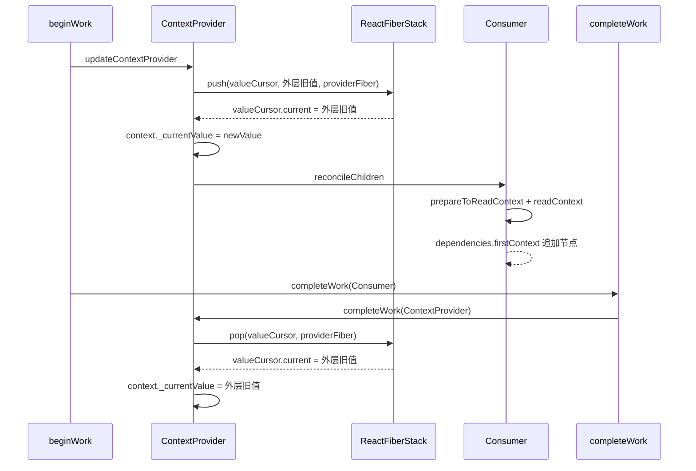

# Context

Context 解决的是“组件树太深，props 一层层传太麻烦”的问题。它的实现看似简单：一个对象上挂一个 `_currentValue`。真正的难点在于：

- 同一个 Context 在不同子树里可能有不同的值；
- 嵌套 Provider 需要“进入时覆盖、离开时恢复”；
- 消费者要能记录自己依赖了哪个 Context，值变化时只更新相关子树。

React 18.3.1 的 `enableNewReconciler` 默认为 `false`，运行时使用 `.old.js` 分叉。Context 的核心实现位于 [react/src/ReactContext.js](https://github.com/facebook/react/blob/v18.3.1/packages/react/src/ReactContext.js)、`react-reconciler/src/ReactFiberNewContext.old.js` 和 `react-reconciler/src/ReactFiberStack.old.js`。Provider 的“推入 / 弹出”分别发生在 [beginWork](/frameworks/react/advanced/source-code/reconciler/beginWork) 与 [completeWork](/frameworks/react/advanced/source-code/reconciler/completeWork) 中。

## 1. Context 对象的结构

### 1.1 `createContext`

`createContext` 创建的是一个普通对象，同时承担三种角色：值容器、Provider 的元素类型、Consumer 的引用；它的类型定义则描述了这些角色之间的关系。

:::code-group

```ts [react/src/ReactContext.js]
export function createContext<T>(defaultValue: T): ReactContext<T> {
  // TODO: Second argument used to be an optional `calculateChangedBits`
  // function. Warn to reserve for future use?

  const context: ReactContext<T> = {
    $$typeof: REACT_CONTEXT_TYPE,
    // As a workaround to support multiple concurrent renderers, we categorize
    // some renderers as primary and others as secondary. We only expect
    // there to be two concurrent renderers at most: React Native (primary) and
    // Fabric (secondary); React DOM (primary) and React ART (secondary).
    // Secondary renderers store their context values on separate fields.
    _currentValue: defaultValue,
    _currentValue2: defaultValue,
    // Used to track how many concurrent renderers this context currently
    // supports within in a single renderer. Such as parallel server rendering.
    _threadCount: 0,
    // These are circular
    Provider: (null: any),
    Consumer: (null: any),

    // Add these to use same hidden class in VM as ServerContext
    _defaultValue: (null: any),
    _globalName: (null: any),
  };

  context.Provider = {
    $$typeof: REACT_PROVIDER_TYPE,
    _context: context,
  };

  // ...
  if (__DEV__) {
    // A separate object, but proxies back to the original context object for
    // backwards compatibility. It has a different $$typeof, so we can properly
    // warn for the incorrect usage of Context as a Consumer.
    const Consumer = {
      $$typeof: REACT_CONTEXT_TYPE,
      _context: context,
    };
    // ...
    context.Consumer = Consumer;
  } else {
    context.Consumer = context;
  }

  // ...
  return context;
}
```

```ts [shared/ReactTypes.js]
export type ReactProviderType<T> = {
  $$typeof: Symbol | number,
  _context: ReactContext<T>,
  ...
};

export type ReactContext<T> = {
  $$typeof: Symbol | number,
  Consumer: ReactContext<T>,
  Provider: ReactProviderType<T>,
  _currentValue: T,
  _currentValue2: T,
  _threadCount: number,
  // DEV only
  _currentRenderer?: Object | null,
  _currentRenderer2?: Object | null,
  // This value may be added by application code
  // to improve DEV tooling display names
  displayName?: string,

  // only used by ServerContext
  _defaultValue: T,
  _globalName: string,
  ...
};
```

:::

生产环境里 `context.Consumer = context`，消费者元素和 `useContext` 拿到的是同一个对象。开发环境则额外创建一个带 `_context` 的代理对象，用来在误用 `<Context>`、`<Context.Consumer.Provider>` 等写法时给出警告。

### 1.2 三个角色与多渲染器字段

[width(15,43,42)]

| 角色              | 形态                                  | 作用                           |
| ----------------- | ------------------------------------- | ------------------------------ |
| 值容器            | `context._currentValue`               | 保存当前生效的值               |
| Provider 元素类型 | `{ $$typeof, _context }`              | `<Context.Provider>` 的 `type` |
| Consumer          | 生产环境为 `context` 自身，DEV 为代理 | `<Context.Consumer>` 的 `type` |

React 允许同一棵树上同时存在多个渲染器（例如 React DOM 与 React ART），因此 Context 为“主渲染器”和“次渲染器”分别保存值：

[width(46,54)]

| 字段                                     | 用途                                          |
| ---------------------------------------- | --------------------------------------------- |
| `_currentValue`                          | 主渲染器（primary）当前值                     |
| `_currentValue2`                         | 次渲染器（secondary）当前值                   |
| `_threadCount`                           | 同一渲染器内并发使用该 Context 的线程计数     |
| `_currentRenderer` / `_currentRenderer2` | DEV 专用，检测多渲染器并发渲染同一个 Provider |
| `_defaultValue` / `_globalName`          | 仅 ServerContext 使用                         |

`pushProvider` / `readContext` 都会根据 `isPrimaryRenderer` 决定读写哪一组字段。

## 2. 三种消费方式

### 2.1 `useContext`：dispatcher 直接指向 `readContext`

`useContext` 本身只是 dispatcher 的转发；在 reconciler 的 Hooks dispatcher 中，它直接映射为 `readContext`：

:::code-group

```ts [react/src/ReactHooks.js]
export function useContext<T>(Context: ReactContext<T>): T {
  const dispatcher = resolveDispatcher()
  // ...
  return dispatcher.useContext(Context)
}
```

```ts [react-reconciler/src/ReactFiberHooks.old.js]
const HooksDispatcherOnMount: Dispatcher = {
  readContext,

  useCallback: mountCallback,
  useContext: readContext,
  useEffect: mountEffect,
  useImperativeHandle: mountImperativeHandle,
  useLayoutEffect: mountLayoutEffect,
  useInsertionEffect: mountInsertionEffect,
  useMemo: mountMemo,
  // ...
}

const HooksDispatcherOnUpdate: Dispatcher = {
  readContext,

  useCallback: updateCallback,
  useContext: readContext,
  useEffect: updateEffect,
  useImperativeHandle: updateImperativeHandle,
  useInsertionEffect: updateInsertionEffect,
  useLayoutEffect: updateLayoutEffect,
  useMemo: updateMemo,
  // ...
}
```

:::

因此 `useContext(ThemeContext)` 最终就是 `readContext(ThemeContext)`，读取 `_currentValue` 并把依赖记录到当前 Fiber。

### 2.2 `<Context.Consumer>`：render props

Consumer 的元素 `type` 就是 `context`（DEV 下是带 `_context` 的代理）。`updateContextConsumer` 读取当前值，把值传给 `children` 函数：

```ts [react-reconciler/src/ReactFiberBeginWork.old.js]
function updateContextConsumer(
  current: Fiber | null,
  workInProgress: Fiber,
  renderLanes: Lanes,
) {
  let context: ReactContext<any> = workInProgress.type
  // ...
  const newProps = workInProgress.pendingProps
  const render = newProps.children

  // ...
  prepareToReadContext(workInProgress, renderLanes)
  const newValue = readContext(context)
  // ...
  let newChildren
  // ...
  newChildren = render(newValue)
  // ...

  // React DevTools reads this flag.
  workInProgress.flags |= PerformedWork
  reconcileChildren(current, workInProgress, newChildren, renderLanes)
  return workInProgress.child
}
```

`children` 是一个函数，所以 Consumer 的更新粒度是“重新执行这个函数”，而不是重新渲染整个父组件。

### 2.3 类组件的 `static contextType`

类组件在挂载时读取 `ctor.contextType`，把当前值写入 `instance.context`：

```ts [react-reconciler/src/ReactFiberClassComponent.old.js]
const contextType = ctor.contextType
if (typeof contextType === 'object' && contextType !== null) {
  instance.context = readContext(contextType)
} else if (disableLegacyContext) {
  instance.context = emptyContextObject
} else {
  const unmaskedContext = getUnmaskedContext(workInProgress, ctor, true)
  instance.context = getMaskedContext(workInProgress, unmaskedContext)
}
```

更新路径同样会在 `updateClassInstance` 中调用 `readContext(contextType)`。三种消费方式最终都落到 `readContext`，区别只在于“谁负责在读取前设置 `currentlyRenderingFiber`”。

## 3. 嵌套 Provider 与值栈

### 3.1 问题

```tsx
<ThemeContext.Provider value="light">
  <div>
    <ThemeContext.Provider value="dark">
      <Button /> {/* 读到 dark */}
    </ThemeContext.Provider>
    <Button /> {/* 应该读回 light */}
  </div>
</ThemeContext.Provider>
```

`Context` 对象只有一个 `_currentValue`。遍历离开内层 Provider 时，必须把值恢复成 `light`。这天然是“后进先出”，因此 React 用栈保存每一层 Provider 进入前的旧值。

### 3.2 `ReactFiberStack`：共享的值栈

```ts [react-reconciler/src/ReactFiberStack.old.js]
const valueStack: Array<any> = []

let fiberStack: Array<Fiber | null>

if (__DEV__) {
  fiberStack = []
}

let index = -1

function createCursor<T>(defaultValue: T): StackCursor<T> {
  return {
    current: defaultValue,
  }
}

function pop<T>(cursor: StackCursor<T>, fiber: Fiber): void {
  if (index < 0) {
    // ...
    return
  }

  // ...
  cursor.current = valueStack[index]

  valueStack[index] = null

  // ...
  index--
}

function push<T>(cursor: StackCursor<T>, value: T, fiber: Fiber): void {
  index++

  valueStack[index] = cursor.current

  // ...
  cursor.current = value
}
```

设计要点：

- 只有一个全局 `valueStack` 和一个 `index`，所有游标共享。
- `push` 保存的是“游标当前的 `current`”，不是外部传入的 `value`。
- `pop` 先读栈顶旧值回填游标，再清空栈顶、`index--`。
- DEV 下额外维护 `fiberStack`，`pop` 时校验传入的 Fiber 是否是压栈时的那个，防止 Provider 栈错配。

### 3.3 `pushProvider` 与 `popProvider`

Context 使用一个专门的 `valueCursor`：

```ts [react-reconciler/src/ReactFiberNewContext.old.js]
const valueCursor: StackCursor<mixed> = createCursor(null)

export function pushProvider<T>(
  providerFiber: Fiber,
  context: ReactContext<T>,
  nextValue: T,
): void {
  if (isPrimaryRenderer) {
    push(valueCursor, context._currentValue, providerFiber)

    context._currentValue = nextValue
    // ...
  } else {
    push(valueCursor, context._currentValue2, providerFiber)

    context._currentValue2 = nextValue
    // ...
  }
}

export function popProvider(
  context: ReactContext<any>,
  providerFiber: Fiber,
): void {
  const currentValue = valueCursor.current
  pop(valueCursor, providerFiber)
  if (isPrimaryRenderer) {
    if (
      enableServerContext &&
      currentValue === REACT_SERVER_CONTEXT_DEFAULT_VALUE_NOT_LOADED
    ) {
      context._currentValue = context._defaultValue
    } else {
      context._currentValue = currentValue
    }
  } else {
    if (
      enableServerContext &&
      currentValue === REACT_SERVER_CONTEXT_DEFAULT_VALUE_NOT_LOADED
    ) {
      context._currentValue2 = context._defaultValue
    } else {
      context._currentValue2 = currentValue
    }
  }
}
```

`pushProvider` 调用 `push(valueCursor, context._currentValue, providerFiber)`：`push` 把 `valueCursor` 的旧值压栈，并把游标设为传入的“Provider 外层值”；随后 `context._currentValue` 才被覆盖为新值。`popProvider` 先保存游标当前值（也就是外层值），调用 `pop` 把游标恢复到压栈前的状态，再把保存的外层值写回 `context._currentValue`。`enableServerContext` 分支处理 ServerContext 的“默认值尚未加载”哨兵。

### 3.4 beginWork 推入、completeWork 弹出

Provider 的推入发生在 `updateContextProvider` 的开头：

```ts [react-reconciler/src/ReactFiberBeginWork.old.js]
function updateContextProvider(
  current: Fiber | null,
  workInProgress: Fiber,
  renderLanes: Lanes,
) {
  const providerType: ReactProviderType<any> = workInProgress.type
  const context: ReactContext<any> = providerType._context

  const newProps = workInProgress.pendingProps
  const oldProps = workInProgress.memoizedProps

  const newValue = newProps.value

  // ...
  pushProvider(workInProgress, context, newValue)

  if (enableLazyContextPropagation) {
    // ...
  } else {
    if (oldProps !== null) {
      const oldValue = oldProps.value
      if (is(oldValue, newValue)) {
        // No change. Bailout early if children are the same.
        if (
          oldProps.children === newProps.children &&
          !hasLegacyContextChanged()
        ) {
          return bailoutOnAlreadyFinishedWork(
            current,
            workInProgress,
            renderLanes,
          )
        }
      } else {
        // The context value changed. Search for matching consumers and schedule
        // them to update.
        propagateContextChange(workInProgress, context, renderLanes)
      }
    }
  }

  const newChildren = newProps.children
  reconcileChildren(current, workInProgress, newChildren, renderLanes)
  return workInProgress.child
}
```

弹出发生在 `completeWork` 的 `ContextProvider` 分支：

```ts [react-reconciler/src/ReactFiberCompleteWork.old.js]
    case ContextProvider:
      // Pop provider fiber
      const context: ReactContext<any> = workInProgress.type._context;
      popProvider(context, workInProgress);
      bubbleProperties(workInProgress);
      return null;
```

即使 Provider 走的是“跳过子树”的 bailout 路径，也必须执行 push：

```ts [react-reconciler/src/ReactFiberBeginWork.old.js]
    case ContextProvider: {
      const newValue = workInProgress.memoizedProps.value;
      const context: ReactContext<any> = workInProgress.type._context;
      pushProvider(workInProgress, context, newValue);
      break;
    }
```

这样 `beginWork` 的“递”和 `completeWork` 的“归”始终成对，栈不会失衡。

[width(31,69)]

| 阶段                     | 函数                                          |
| ------------------------ | --------------------------------------------- |
| `beginWork(Provider)`    | `pushProvider(providerFiber, context, value)` |
| `completeWork(Provider)` | `popProvider(context, providerFiber)`         |

因为 `beginWork` 是“递”、`completeWork` 是“归”，Provider 的覆盖一定先于子树中所有消费者，恢复一定晚于它们。

### 3.5 为什么 `oldValue` 要取 `memoizedProps`

`updateContextProvider` 判断“这个 Provider 提供的值是否变化”时，用的是：

```js
const oldValue = oldProps.value
```

而不是 `context._currentValue`。原因在于执行到 `beginWork(Provider)` 时，`_currentValue` 已经被上一轮的 `popProvider` 恢复成了 Provider 外层的值：

- 它代表“外层最近 Provider 的值”，不是“这个 Provider 上一轮提供的值”；
- 只有 `oldProps.value`（即这个 Provider 上一轮的 `memoizedProps.value`）才是它自己上一轮的值。

用错字段会导致该更新的子树被误判为“没有变化”，从而跳过更新。

## 4. 依赖收集

### 4.1 `prepareToReadContext`

每次组件开始渲染前，React 会把 `currentlyRenderingFiber` 指向当前 Fiber，并清空上一轮的依赖链表：

```ts [react-reconciler/src/ReactFiberNewContext.old.js]
export function prepareToReadContext(
  workInProgress: Fiber,
  renderLanes: Lanes,
): void {
  currentlyRenderingFiber = workInProgress
  lastContextDependency = null
  lastFullyObservedContext = null

  const dependencies = workInProgress.dependencies
  if (dependencies !== null) {
    if (enableLazyContextPropagation) {
      // Reset the work-in-progress list
      dependencies.firstContext = null
    } else {
      const firstContext = dependencies.firstContext
      if (firstContext !== null) {
        if (includesSomeLane(dependencies.lanes, renderLanes)) {
          // Context list has a pending update. Mark that this fiber performed work.
          markWorkInProgressReceivedUpdate()
        }
        // Reset the work-in-progress list
        dependencies.firstContext = null
      }
    }
  }
}
```

`dependencies.lanes` 记录“上一次传播 Context 变化时合并进来的 Lane”。如果它与本轮 `renderLanes` 有交集，说明这个 Fiber 是因为 Context 变化而重新渲染的，需要标记 `didReceiveUpdate`。

### 4.2 `readContext`

```ts [react-reconciler/src/ReactFiberNewContext.old.js]
export function readContext<T>(context: ReactContext<T>): T {
  if (__DEV__) {
    // ...
  }

  const value = isPrimaryRenderer
    ? context._currentValue
    : context._currentValue2;

  if (lastFullyObservedContext === context) {
    // Nothing to do. We already observe everything in this context.
  } else {
    const contextItem = {
      context: ((context: any): ReactContext<mixed>),
      memoizedValue: value,
      next: null,
    };

    if (lastContextDependency === null) {
      if (currentlyRenderingFiber === null) {
        throw new Error(
          'Context can only be read while React is rendering. ' +
            'In classes, you can read it in the render method or getDerivedStateFromProps. ' +
            'In function components, you can read it directly in the function body, but not ' +
            'inside Hooks like useReducer() or useMemo().',
        );
      }

      // This is the first dependency for this component. Create a new list.
      lastContextDependency = contextItem;
      currentlyRenderingFiber.dependencies = {
        lanes: NoLanes,
        firstContext: contextItem,
      };
      if (enableLazyContextPropagation) {
        currentlyRenderingFiber.flags |= NeedsPropagation;
      }
    } else {
      // Append a new context item.
      lastContextDependency = lastContextDependency.next = contextItem;
    }
  }
  return value;
}
```

与“头插法”不同，官方实现是**尾插**：`lastContextDependency` 始终指向链表尾，新节点追加到 `next`。这样依赖顺序与读取顺序一致，遍历时也少一次反向。

`lastFullyObservedContext` 是一个预留的优化分支：如果某个渲染器已经完整观察了该 Context 的变化，就可以跳过依赖记录。在 React 18.3.1 的 reconciler 中它始终为 `null`，所以实际都会记录依赖。

### 4.3 依赖链表结构

```ts [react-reconciler/src/ReactInternalTypes.js]
export type ContextDependency<T> = {
  context: ReactContext<T>,
  next: ContextDependency<mixed> | null,
  memoizedValue: T,
  ...
};

export type Dependencies = {
  lanes: Lanes,
  firstContext: ContextDependency<mixed> | null,
  ...
};
```

```text
Fiber.dependencies
  ├─ lanes: Lanes
  └─ firstContext
       → { context: ThemeContext, memoizedValue: 'dark', next: ... }
       → { context: UserContext,  memoizedValue: {...},  next: null }
```

每个节点记录：

- `context`：依赖的是哪个 Context；
- `memoizedValue`：读取时的快照值；
- `next`：指向下一个依赖。

### 4.4 owner 的来源

`readContext` 不接收 Fiber 参数，它依赖 `currentlyRenderingFiber`。不同调用方在读取前设置它的位置不同：

[width(19,81)]

| 调用方               | `currentlyRenderingFiber` 的设置点                                      |
| -------------------- | ----------------------------------------------------------------------- |
| `useContext`         | `updateFunctionComponent` → `prepareToReadContext(workInProgress, ...)` |
| `<Context.Consumer>` | `updateContextConsumer` → `prepareToReadContext`                        |
| 类组件 `contextType` | `updateClassComponent` → `prepareToReadContext`，随后 `readContext`     |

### 4.5 `resetContextDependencies`

Render 结束或异常中断时，必须清空模块级游标，防止在渲染阶段之外读取 Context：

```ts [react-reconciler/src/ReactFiberNewContext.old.js]
export function resetContextDependencies(): void {
  // This is called right before React yields execution, to ensure `readContext`
  // cannot be called outside the render phase.
  currentlyRenderingFiber = null
  lastContextDependency = null
  lastFullyObservedContext = null
  if (__DEV__) {
    isDisallowedContextReadInDEV = false
  }
}
```

`ReactFiberWorkLoop.old.js` 在同步渲染、并发渲染以及错误处理的收尾阶段都会调用它。

## 5. Provider 值变化时的传播

### 5.1 `propagateContextChange` 的两条路径

React 18.3.1 同时保留了两套传播实现，由 `enableLazyContextPropagation` 切换。该开关在 18.3.1 中默认为 `false`，因此默认走 eager 路径：

```ts [react-reconciler/src/ReactFiberNewContext.old.js]
export function propagateContextChange<T>(
  workInProgress: Fiber,
  context: ReactContext<T>,
  renderLanes: Lanes,
): void {
  if (enableLazyContextPropagation) {
    // TODO: This path is only used by Cache components. Update
    // lazilyPropagateParentContextChanges to look for Cache components so they
    // can take advantage of lazy propagation.
    const forcePropagateEntireTree = true
    propagateContextChanges(
      workInProgress,
      [context],
      renderLanes,
      forcePropagateEntireTree,
    )
  } else {
    propagateContextChange_eager(workInProgress, context, renderLanes)
  }
}
```

eager 路径会立即扫描 Provider 子树，找到所有依赖该 Context 的 Fiber 并标脏；lazy 路径则把检查推迟到消费者渲染时，通过 `checkIfContextChanged` 判断 `_currentValue` 是否与 `memoizedValue` 不同。

### 5.2 `propagateContextChange_eager`

```ts [react-reconciler/src/ReactFiberNewContext.old.js]
      let dependency = list.firstContext;
      while (dependency !== null) {
        // Check if the context matches.
        if (dependency.context === context) {
          // Match! Schedule an update on this fiber.
          if (fiber.tag === ClassComponent) {
            // Schedule a force update on the work-in-progress.
            const lane = pickArbitraryLane(renderLanes);
            const update = createUpdate(NoTimestamp, lane);
            update.tag = ForceUpdate;
            // ...
            const updateQueue = fiber.updateQueue;
            if (updateQueue === null) {
              // Only occurs if the fiber has been unmounted.
            } else {
              const sharedQueue: SharedQueue<any> = (updateQueue: any).shared;
              const pending = sharedQueue.pending;
              if (pending === null) {
                // This is the first update. Create a circular list.
                update.next = update;
              } else {
                update.next = pending.next;
                pending.next = update;
              }
              sharedQueue.pending = update;
            }
          }

          fiber.lanes = mergeLanes(fiber.lanes, renderLanes);
          const alternate = fiber.alternate;
          if (alternate !== null) {
            alternate.lanes = mergeLanes(alternate.lanes, renderLanes);
          }
          scheduleContextWorkOnParentPath(
            fiber.return,
            renderLanes,
            workInProgress,
          );

          // Mark the updated lanes on the list, too.
          list.lanes = mergeLanes(list.lanes, renderLanes);

          // Since we already found a match, we can stop traversing the
          // dependency list.
          break;
        }
        dependency = dependency.next;
      }
```

匹配到依赖后，eager 路径做四件事：

1. **类组件强制更新**：给 `fiber.updateQueue` 塞一个 `ForceUpdate`，因为类组件的 `shouldComponentUpdate` 可能返回 `false`，但 Context 变化必须绕过它。
2. **合并 Fiber 的 `lanes`**：当前 Fiber 和它的 `alternate` 都要标记，保证下一次 Render 会重新处理。
3. **沿父路径合并 `childLanes`**：调用 `scheduleContextWorkOnParentPath`。
4. **合并依赖链表的 `lanes`**：让 `prepareToReadContext` 能判断“这次渲染是否由 Context 变化触发”。

遍历时还有两个剪枝点：

- 遇到同类型的 `ContextProvider` 时不再向下扫描，因为内层 Provider 会覆盖外层值；
- 遇到 `DehydratedFragment` 时无法确定子树里是否有消费者，于是把父 Suspense 边界整体标脏。

### 5.3 `scheduleContextWorkOnParentPath`

```ts [react-reconciler/src/ReactFiberNewContext.old.js]
export function scheduleContextWorkOnParentPath(
  parent: Fiber | null,
  renderLanes: Lanes,
  propagationRoot: Fiber,
) {
  // Update the child lanes of all the ancestors, including the alternates.
  let node = parent
  while (node !== null) {
    const alternate = node.alternate
    if (!isSubsetOfLanes(node.childLanes, renderLanes)) {
      node.childLanes = mergeLanes(node.childLanes, renderLanes)
      if (alternate !== null) {
        alternate.childLanes = mergeLanes(alternate.childLanes, renderLanes)
      }
    } else if (
      alternate !== null &&
      !isSubsetOfLanes(alternate.childLanes, renderLanes)
    ) {
      alternate.childLanes = mergeLanes(alternate.childLanes, renderLanes)
    } else {
      // Neither alternate was updated.
      // ...
    }
    if (node === propagationRoot) {
      break
    }
    node = node.return
  }
  if (__DEV__) {
    if (node !== propagationRoot) {
      console.error(
        'Expected to find the propagation root when scheduling context work. ' +
          'This error is likely caused by a bug in React. Please file an issue.',
      )
    }
  }
}
```

`childLanes` 是“这棵子树里有待处理工作”的摘要。把消费者的 Lane 从祖先路径一路合并到 Provider（`propagationRoot`），本轮 Render 就能沿 `childLanes` 命中消费者所在的子树，跳过无关分支。

### 5.4 Lane 如何缩小更新范围

一次 Context 更新中的传播链路可以概括为：

```text
Provider 值变化
  → propagateContextChange_eager
    → 找到依赖该 Context 的 Fiber
      → fiber.lanes |= renderLanes
      → scheduleContextWorkOnParentPath 把 Lane 合并到 Provider
        → 本轮 Render 从 Provider 继续向下，沿 childLanes 进入消费者子树
```

触发 Provider 重新渲染的那次更新，已经通过根调度把整条祖先路径标记为有工作；传播函数只需要把新的 Lane 补充到“Provider 到消费者”这段路径上。与“整树重渲染”相比，Lane 让更新范围收敛到真正依赖该 Context 的子树，这也是 Context 在大型应用中仍然可用的关键。

## 6. 一次 Context 更新的时序



如果 Provider 的值发生变化，`updateContextProvider` 还会在 push 之后调用 `propagateContextChange`，把消费者的 Lane 和祖先的 `childLanes` 标脏，触发下一轮只针对受影响子树的 Render。

## 7. 总结

[width(40,60)]

| 机制                              | 作用                                                |
| --------------------------------- | --------------------------------------------------- |
| `createContext`                   | 创建值容器、Provider 类型、Consumer 引用            |
| `pushProvider`                    | 进入 Provider 时保存外层旧值并覆盖 `_currentValue`  |
| `popProvider`                     | 离开 Provider 时从栈顶恢复外层值                    |
| `ReactFiberStack`                 | 用全局值栈支撑嵌套 Provider 的后进先出恢复          |
| `prepareToReadContext`            | 设置 `currentlyRenderingFiber`，清空并准备依赖链表  |
| `readContext`                     | 读取当前值，把依赖追加到 Fiber 的依赖链表           |
| `propagateContextChange`          | 值变化时沿子树找消费者，合并 `lanes` / `childLanes` |
| `scheduleContextWorkOnParentPath` | 把消费者的 Lane 冒泡到 Provider 和根，缩小更新范围  |

Context 的实现可以浓缩成一句话：**用值栈管理覆盖，用依赖链表记录谁读过，用 Lane 把变化送到消费者**。值栈保证嵌套正确，依赖链表保证更新可追踪，Lane 保证更新范围可控。

## 8. 与简化实现的差异

教学用的简化实现通常只保留主干：一个 `_currentValue`、一个全局值栈、一份依赖链表，足以演示嵌套覆盖和消费关系，但不参与 Lane 调度。

[width(15,34,51)]

| 维度          | 简化实现                                  | React 18.3.1                                                         |
| ------------- | ----------------------------------------- | -------------------------------------------------------------------- |
| 值字段        | 只有 `_currentValue`                      | `_currentValue` / `_currentValue2` / `_threadCount`，支持多渲染器    |
| 栈操作命名    | `pushProvide` / `popProvide`              | `pushProvider` / `popProvider`，并传入 `providerFiber` 做 DEV 校验   |
| 依赖写入      | 头插到 `dependencies.firstContext`        | 尾插，维护 `lastContextDependency`，并记录 `dependencies.lanes`      |
| 值变化传播    | 只把依赖节点的 `memoizedValue` 刷新为新值 | 给消费者合并 `lanes` / `childLanes`，由调度器精确重渲染              |
| 调度          | 没有 Lane，通常整树重渲染                 | 结合 Lane 与 `childLanes`，只走受影响的子树                          |
| Consumer 形态 | 始终 `context.Consumer = context`         | DEV 使用代理对象做误用警告，生产环境才自引用                         |
| 类组件        | 一般不实现 `contextType` 的强制更新       | Context 变化时给类组件塞 `ForceUpdate`，绕过 `shouldComponentUpdate` |

简化实现适合理解“Context 为什么需要栈”和“依赖链表长什么样”。阅读官方源码时，还需要补上多渲染器字段、Lane 传播、`ForceUpdate`、eager/lazy 两套传播路径，以及 `resetContextDependencies` 对模块级游标的清理。
