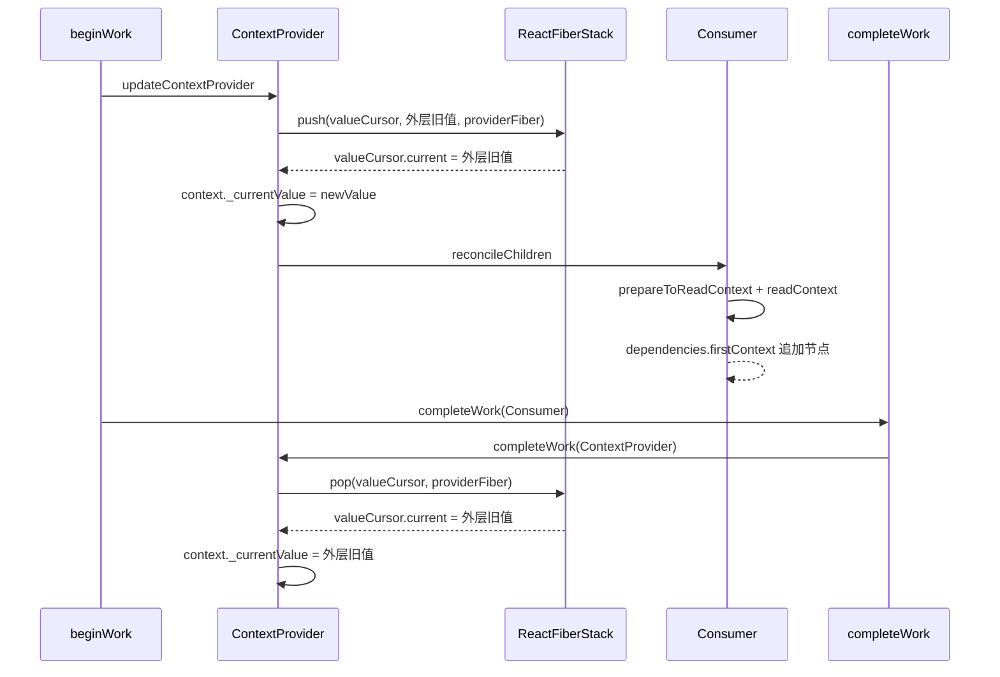

# Context

Context 解决的是“**组件树太深，props 一层层传递太麻烦**”的问题：`_currentValue` 保存当前值，值栈处理嵌套 Provider 的覆盖与恢复，依赖链表把值变化精确送达消费者。

## 1. Context 对象的结构

### 1.1 `createContext`

`createContext` 创建的是一个普通对象，同时承担三种角色：值容器、Provider 的元素类型、Consumer 的引用；它的类型定义则描述了这些角色之间的关系。

:::code-group

```ts [react/src/ReactContext.js]
export function createContext<T>(defaultValue: T): ReactContext<T> {
  const context: ReactContext<T> = {
    $$typeof: REACT_CONTEXT_TYPE,
    // 主渲染器（primary）的当前值。
    _currentValue: defaultValue,
    // 次渲染器（secondary，如 Fabric、React ART）的当前值。
    _currentValue2: defaultValue,
    // 同一渲染器内并发使用该 Context 的计数，例如并行服务端渲染。
    _threadCount: 0,
    // 这两个字段稍后会指回 context 自身，形成循环引用。
    Provider: (null: any),
    Consumer: (null: any),

    // 以下两个字段仅为与 ServerContext 保持相同隐藏类而存在。
    _defaultValue: (null: any), // ServerContext 的默认值
    _globalName: (null: any), // ServerContext 的全局名称
  };

  // Provider 的元素类型只保存 $$typeof 和对 context 的引用。
  context.Provider = {
    $$typeof: REACT_PROVIDER_TYPE,
    _context: context,
  };

  // 省略 __DEV__ 下用于误用警告的 Consumer 代理对象。
  context.Consumer = context;

  return context;
}
```

```ts [shared/ReactTypes.js]
// Provider 元素类型：<Context.Provider> 的 type 只保存 $$typeof 和 context 引用。
export type ReactProviderType<T> = {
  $$typeof: Symbol | number, // 元素类型标记
  _context: ReactContext<T>, // 对应的 Context 对象
  ...
};

export type ReactContext<T> = {
  $$typeof: Symbol | number,
  Consumer: ReactContext<T>, // DEV 下是代理对象，生产环境指向 context 自身
  Provider: ReactProviderType<T>, // Provider 元素类型
  _currentValue: T, // 主渲染器当前值
  _currentValue2: T, // 次渲染器当前值
  _threadCount: number, // 并发使用该 Context 的计数
  // 仅 DEV 使用：检测多渲染器是否并发渲染同一个 Provider。
  _currentRenderer?: Object | null,
  _currentRenderer2?: Object | null,
  // 应用代码可以设置它，供开发工具显示更友好的名称。
  displayName?: string,

  // 仅 ServerContext 使用
  _defaultValue: T, // ServerContext 的默认值
  _globalName: string, // ServerContext 的全局名称
  ...
};
```

:::

生产环境里 `context.Consumer = context`，消费者元素和 `useContext` 拿到的是同一个对象。开发环境则额外创建一个带 `_context` 的代理对象，用来在误用 `<Context>`、`<Context.Consumer.Provider>` 等写法时给出警告。

### 1.2 角色与多渲染器字段

[width(15,43,42)]

| 角色              | 形态                                  | 作用                           |
| ----------------- | ------------------------------------- | ------------------------------ |
| 值容器            | `context._currentValue`               | 保存当前生效的值               |
| Provider 元素类型 | `{ $$typeof, _context }`              | `<Context.Provider>` 的 `type` |
| Consumer          | 生产环境为 `context` 自身，DEV 为代理 | `<Context.Consumer>` 的 `type` |

React 允许同一棵树上同时存在多个渲染器（例如 React DOM 与 React ART），因此 Context 为“**主渲染器**”和“**次渲染器**”分别保存值：`_currentValue` 与 `_currentValue2`。`_threadCount`、DEV 专用的 `_currentRenderer` / `_currentRenderer2`、ServerContext 的 `_defaultValue` / `_globalName` 的含义见上方类型定义的行内注释。

`pushProvider` / `readContext` 都会根据 `isPrimaryRenderer` 决定读写哪一组字段。

## 2. 消费方式

### 2.1 `useContext`：dispatcher 直接指向 `readContext`

`useContext` 本身只是 dispatcher 的转发；在 reconciler 的 Hooks dispatcher 中，它直接映射为 `readContext`：

:::code-group

```ts [react/src/ReactHooks.js]
export function useContext<T>(Context: ReactContext<T>): T {
  const dispatcher = resolveDispatcher()
  // 省略 dispatcher 为空时的错误处理。
  // 只是转发：具体实现由当前 dispatcher 决定，渲染阶段直接映射到 readContext。
  return dispatcher.useContext(Context)
}
```

```ts [react-reconciler/src/ReactFiberHooks.old.js]
const HooksDispatcherOnMount: Dispatcher = {
  readContext,

  // 挂载阶段：useContext 直接指向 readContext。
  useContext: readContext,
  // 省略其他 Hook 的挂载实现。
}

const HooksDispatcherOnUpdate: Dispatcher = {
  readContext,

  // 更新阶段同样复用 readContext，读取与依赖记录逻辑不变。
  useContext: readContext,
  // 省略其他 Hook 的更新实现。
}
```

:::

### 2.2 `<Context.Consumer>`：render props

Consumer 的元素 `type` 就是 `context`（DEV 下是带 `_context` 的代理）。`updateContextConsumer` 读取当前值，把值传给 `children` 函数：

:::code-group

```ts [react-reconciler/src/ReactFiberBeginWork.old.js]
function updateContextConsumer(
  current: Fiber | null,
  workInProgress: Fiber,
  renderLanes: Lanes,
) {
  // Consumer 的 type 就是 context；DEV 下是带 _context 的代理对象。
  let context: ReactContext<any> = workInProgress.type
  // 省略 __DEV__ 下从代理对象取出 _context 的兼容处理。
  const newProps = workInProgress.pendingProps
  const render = newProps.children

  // 读取当前值前，先把 currentlyRenderingFiber 指向本 Fiber 并清空旧依赖。
  prepareToReadContext(workInProgress, renderLanes)
  const newValue = readContext(context)
  // 省略 __DEV__ 下 render 不是函数的校验，以及 enableLazyContextPropagation 的懒传播标记。

  // children 是 render prop，用当前值调用它得到子元素。
  const newChildren = render(newValue)

  // React DevTools 依赖这个标记判断组件是否执行过 render。
  workInProgress.flags |= PerformedWork
  // 用新子树和旧树做 diff，生成子 Fiber。
  reconcileChildren(current, workInProgress, newChildren, renderLanes)
  return workInProgress.child
}
```

:::

`children` 是一个函数，所以 Consumer 的更新粒度是“**重新执行这个函数**”，而不是重新渲染整个父组件。

### 2.3 类组件的 `static contextType`

类组件在挂载时读取 `ctor.contextType`，把当前值写入 `instance.context`：

:::code-group

```ts [react-reconciler/src/ReactFiberClassComponent.old.js]
const contextType = ctor.contextType
if (typeof contextType === 'object' && contextType !== null) {
  // 声明了 static contextType：直接读取该 Context 的当前值。
  instance.context = readContext(contextType)
}
// 省略 else 分支的 legacy context 兜底：关闭 legacy 时取 emptyContextObject，
// 否则按 contextTypes 掩码后挂到 instance.context。
```

:::

更新路径同样会在 `updateClassInstance` 中调用 `readContext(contextType)`。三种消费方式最终都落到 `readContext`，区别只在于“**谁负责在读取前设置 `currentlyRenderingFiber`**”。

## 3. 嵌套 Provider 与值栈

### 3.1 问题

```tsx
// 内层 Provider 覆盖外层值，离开后恢复为 light。
<ThemeContext.Provider value="light">
  <div>
    <ThemeContext.Provider value="dark">
      <Button /> {/* 读到 dark */}
    </ThemeContext.Provider>
    <Button /> {/* 应该读回 light */}
  </div>
</ThemeContext.Provider>
```

`Context` 对象只有一个 `_currentValue`。遍历离开内层 Provider 时，必须把值恢复成 `light`。这天然是“**后进先出**”，因此 React 用栈保存每一层 Provider 进入前的旧值。

### 3.2 `ReactFiberStack`：共享的值栈

:::code-group

```ts [react-reconciler/src/ReactFiberStack.old.js]
// 所有游标共享同一个值栈，index 指向栈顶。
const valueStack: Array<any> = []

let index = -1
// 省略 __DEV__ 下的 fiberStack 及其栈错配校验。

// 游标就是一个可变引用，current 保存当前层可见的值。
function createCursor<T>(defaultValue: T): StackCursor<T> {
  return {
    current: defaultValue,
  }
}

function pop<T>(cursor: StackCursor<T>, fiber: Fiber): void {
  // 栈已空，说明 push 与 pop 不成对，直接返回。
  if (index < 0) {
    // 省略 __DEV__ 下的栈为空警告。
    return
  }

  // 用栈顶旧值恢复游标，再清空栈顶并退栈。
  cursor.current = valueStack[index]

  valueStack[index] = null

  // 省略 __DEV__ 下校验传入 fiber 与压栈时是否一致的逻辑。
  index--
}

function push<T>(cursor: StackCursor<T>, value: T, fiber: Fiber): void {
  // 压入游标的旧值，再把游标更新为新值。
  index++

  valueStack[index] = cursor.current

  // 省略 __DEV__ 下把 fiber 记入 fiberStack 的逻辑。
  cursor.current = value
}
```

:::

### 3.3 `pushProvider` 与 `popProvider`

Context 使用一个专门的 `valueCursor`：用于存储传入的“**Provider 外层值**”

:::code-group

```ts [react-reconciler/src/ReactFiberNewContext.old.js]
// Context 专用游标，保存的是当前 Provider 外层的值。
const valueCursor: StackCursor<mixed> = createCursor(null)

export function pushProvider<T>(
  providerFiber: Fiber,
  context: ReactContext<T>,
  nextValue: T,
): void {
  if (isPrimaryRenderer) {
    // 先压栈保存外层值，再覆盖 _currentValue。
    push(valueCursor, context._currentValue, providerFiber)

    context._currentValue = nextValue
    // 省略 __DEV__ 下多渲染器并发使用同一个 Provider 的警告。
  } else {
    // 次渲染器的值存在 _currentValue2，流程与主渲染器一致。
    push(valueCursor, context._currentValue2, providerFiber)

    context._currentValue2 = nextValue
    // 省略 __DEV__ 下同样的并发使用警告。
  }
}

export function popProvider(
  context: ReactContext<any>,
  providerFiber: Fiber,
): void {
  // currentValue 是出栈前的外层值，pop 后再写回 context。
  const currentValue = valueCursor.current
  pop(valueCursor, providerFiber)
  if (isPrimaryRenderer) {
    context._currentValue = currentValue
  } else {
    context._currentValue2 = currentValue
  }
  // 省略 enableServerContext 下哨兵值恢复为 _defaultValue 的分支。
}
```

:::

### 3.4 beginWork 推入、completeWork 弹出

Provider 的推入发生在 `updateContextProvider` 的开头：

:::code-group

```ts [react-reconciler/src/ReactFiberBeginWork.old.js]
function updateContextProvider(
  current: Fiber | null,
  workInProgress: Fiber,
  renderLanes: Lanes,
) {
  const providerType: ReactProviderType<any> = workInProgress.type
  const context: ReactContext<any> = providerType._context

  const newProps = workInProgress.pendingProps
  const oldProps = workInProgress.memoizedProps

  const newValue = newProps.value

  // 省略 __DEV__ 下缺失 value 的警告与 propTypes 校验。
  // 即使后面走 bailout，也要先入栈，保证 completeWork 能成对出栈。
  pushProvider(workInProgress, context, newValue)

  if (enableLazyContextPropagation) {
    // 省略懒传播分支：把消费者检查推迟到读取时。
  } else {
    if (oldProps !== null) {
      // 比较的是这个 Provider 上一轮提供的值，而不是 context._currentValue。
      // context._currentValue此时已经被PopProvide恢复成了外层的值
      const oldValue = oldProps.value
      if (is(oldValue, newValue)) {
        // 值没变，children 也没变时可以直接跳过子树。
        if (
          oldProps.children === newProps.children &&
          !hasLegacyContextChanged()
        ) {
          return bailoutOnAlreadyFinishedWork(
            current,
            workInProgress,
            renderLanes,
          )
        }
      } else {
        // 值变了，找到依赖该 Context 的消费者并调度更新。
        propagateContextChange(workInProgress, context, renderLanes)
      }
    }
  }

  // 值或 children 有变化，继续渲染子树。
  const newChildren = newProps.children
  reconcileChildren(current, workInProgress, newChildren, renderLanes)
  return workInProgress.child
}
```

:::

弹出发生在 `completeWork` 的 `ContextProvider` 分支：

:::code-group

```ts [react-reconciler/src/ReactFiberCompleteWork.old.js]
    case ContextProvider:
      // 离开 Provider 时出栈，恢复外层值。
      const context: ReactContext<any> = workInProgress.type._context;
      popProvider(context, workInProgress);
      bubbleProperties(workInProgress);
      return null;
```

:::

即使 Provider 走的是“**跳过子树**”的 bailout 路径，也必须执行 push：

:::code-group

```ts [react-reconciler/src/ReactFiberBeginWork.old.js]
    case ContextProvider: {
      // 即使走 bailout 跳过子树，也必须入栈，保证 completeWork 能成对出栈。
      const newValue = workInProgress.memoizedProps.value;
      const context: ReactContext<any> = workInProgress.type._context;
      pushProvider(workInProgress, context, newValue);
      break;
    }
```

:::

这样 `beginWork` 的“**递**”和 `completeWork` 的“**归**”始终成对，栈不会失衡。

[width(31,69)]

| 阶段                     | 函数                                          |
| ------------------------ | --------------------------------------------- |
| `beginWork(Provider)`    | `pushProvider(providerFiber, context, value)` |
| `completeWork(Provider)` | `popProvider(context, providerFiber)`         |

## 4. 依赖收集

### 4.1 `prepareToReadContext`

每次组件开始渲染前，React 会把 `currentlyRenderingFiber` 指向当前 Fiber，并清空上一轮的依赖链表：

:::code-group

```ts [react-reconciler/src/ReactFiberNewContext.old.js]
export function prepareToReadContext(
  workInProgress: Fiber,
  renderLanes: Lanes,
): void {
  // 把 readContext 的归属指向本 Fiber，并重置依赖收集游标。
  currentlyRenderingFiber = workInProgress
  lastContextDependency = null
  lastFullyObservedContext = null

  const dependencies = workInProgress.dependencies
  if (dependencies !== null) {
    if (enableLazyContextPropagation) {
      // 清空上一轮收集的依赖，准备重新收集。
      dependencies.firstContext = null
    } else {
      const firstContext = dependencies.firstContext
      if (firstContext !== null) {
        // 依赖记录的 lanes 与 renderLanes 有交集，说明是被 Context 变化唤醒的。
        if (includesSomeLane(dependencies.lanes, renderLanes)) {
          // 依赖链表上有待处理的更新，标记本次渲染确实做了工作。
          markWorkInProgressReceivedUpdate()
        }
        // 清空上一轮收集的依赖，准备重新收集。
        dependencies.firstContext = null
      }
    }
  }
}
```

:::

`dependencies.lanes` 记录“**上一次传播 Context 变化时合并进来的 Lane**”。如果它与本轮 `renderLanes` 有交集，说明这个 Fiber 是因为 Context 变化而重新渲染的，需要标记 `didReceiveUpdate`。

### 4.2 `readContext`

:::code-group

```ts [react-reconciler/src/ReactFiberNewContext.old.js]
export function readContext<T>(context: ReactContext<T>): T {
  // 省略 __DEV__ 下的渲染期检查与多渲染器并发警告。

  // 主渲染器读 _currentValue，次渲染器读 _currentValue2。
  const value = isPrimaryRenderer
    ? context._currentValue
    : context._currentValue2;

  if (lastFullyObservedContext === context) {
    // 已经完整观察过这个 Context，无需再记录依赖。
  } else {
    const contextItem = {
      context: ((context: any): ReactContext<mixed>), // 被读取的 Context
      memoizedValue: value, // 读取时的快照值
      next: null, // 链表下一个节点
    };

    if (lastContextDependency === null) {
      if (currentlyRenderingFiber === null) {
        // 省略渲染期外读取 Context 的详细错误提示拼装。
        throw new Error('Context can only be read while React is rendering.');
      }

      // 本组件的第一个依赖，创建一条新的依赖链表。
      lastContextDependency = contextItem;
      currentlyRenderingFiber.dependencies = {
        lanes: NoLanes,
        firstContext: contextItem,
      };
      if (enableLazyContextPropagation) {
        // 懒传播模式下标记这个 Fiber 需要检查 Context 变化。
        currentlyRenderingFiber.flags |= NeedsPropagation;
      }
    } else {
      // 尾插新节点，lastContextDependency 始终指向链表尾。
      lastContextDependency = lastContextDependency.next = contextItem;
    }
  }
  return value;
}
```

:::

### 4.3 依赖链表结构

:::code-group

```ts [react-reconciler/src/ReactInternalTypes.js]
// 依赖链表节点：记录读过哪个 Context 以及读取时的值。
export type ContextDependency<T> = {
  context: ReactContext<T>, // 被读取的 Context
  next: ContextDependency<mixed> | null, // 下一个依赖节点
  memoizedValue: T, // 读取时的快照值
  ...
};

// Fiber 上挂的依赖摘要：链表头 + 待处理的 Lane。
export type Dependencies = {
  lanes: Lanes, // 待处理的 Lane
  firstContext: ContextDependency<mixed> | null, // 依赖链表头
  ...
};
```

:::

```tree
Fiber.dependencies
  ├─ lanes: Lanes
  └─ firstContext
       → { context: ThemeContext, memoizedValue: 'dark', next: ... }
       → { context: UserContext,  memoizedValue: {...},  next: null }
```

### 4.4 owner 的来源

`readContext`不接收 Fiber参数,它依赖`currentlyRenderingFiber`。不同调用方在读取前设置的位置不同：

[width(19,81)]

| 调用方               | `currentlyRenderingFiber` 的设置点                                      |
| -------------------- | ----------------------------------------------------------------------- |
| `useContext`         | `updateFunctionComponent` → `prepareToReadContext(workInProgress, ...)` |
| `<Context.Consumer>` | `updateContextConsumer` → `prepareToReadContext`                        |
| 类组件 `contextType` | `updateClassComponent` → `prepareToReadContext`，随后 `readContext`     |

### 4.5 `resetContextDependencies`

Render 结束或异常中断时，必须清空模块级游标，防止在渲染阶段之外读取 Context：

:::code-group

```ts [react-reconciler/src/ReactFiberNewContext.old.js]
export function resetContextDependencies(): void {
  // 在 React 让出执行权前调用，保证 readContext 不会在渲染阶段之外被调用。
  // 清空模块级游标，避免残留上一轮渲染的 Fiber 引用。
  currentlyRenderingFiber = null
  lastContextDependency = null
  lastFullyObservedContext = null
  // 省略 __DEV__ 下关闭 isDisallowedContextReadInDEV 标记的赋值。
}
```

:::

`ReactFiberWorkLoop.old.js` 在同步渲染、并发渲染以及错误处理的收尾阶段都会调用它。

## 5. Provider 值变化时的传播

### 5.1 `propagateContextChange` 的两条路径

React 18.3.1 同时保留了两套传播实现，由 `enableLazyContextPropagation` 切换。该开关在 18.3.1 中默认为 `false`，因此默认走 eager 路径：

:::code-group

```ts [react-reconciler/src/ReactFiberNewContext.old.js]
export function propagateContextChange<T>(
  workInProgress: Fiber,
  context: ReactContext<T>,
  renderLanes: Lanes,
): void {
  // 18.3.1 默认关闭懒传播，因此默认走 eager 路径。
  if (enableLazyContextPropagation) {
    // 省略 TODO 注释：这条路径目前只被 Cache 组件使用。
    const forcePropagateEntireTree = true
    propagateContextChanges(
      workInProgress,
      [context],
      renderLanes,
      forcePropagateEntireTree,
    )
  } else {
    // eager 路径：立即扫描子树，标记依赖该 Context 的 Fiber。
    propagateContextChange_eager(workInProgress, context, renderLanes)
  }
}
```

:::

eager 路径会立即扫描 Provider 子树，找到所有依赖该 Context 的 Fiber 并标脏；lazy 路径则把检查推迟到消费者渲染时，通过 `checkIfContextChanged` 判断 `_currentValue` 是否与 `memoizedValue` 不同。

### 5.2 `propagateContextChange_eager`

它从 Provider 的子节点出发，对整棵子树做一次深度优先遍历：依赖链表命中就标脏，遇到会覆盖值或无法判断的子树就剪枝。

:::code-group

```ts [react-reconciler/src/ReactFiberNewContext.old.js]
function propagateContextChange_eager<T>(
  workInProgress: Fiber,
  context: ReactContext<T>,
  renderLanes: Lanes,
): void {
  // 只服务 eager 实现；懒传播开启时这条路径不参与。
  if (enableLazyContextPropagation) {
    return
  }

  // 从 Provider 的子节点开始遍历整棵子树。
  let fiber = workInProgress.child
  if (fiber !== null) {
    // 先把子节点的 return 指向本次渲染中的 Provider。
    fiber.return = workInProgress
  }
  while (fiber !== null) {
    let nextFiber

    // 检查当前 Fiber 是否记录了 Context 依赖。
    const list = fiber.dependencies
    if (list !== null) {
      // 有依赖记录：继续向下遍历，同时逐项比对依赖链表。
      nextFiber = fiber.child

      let dependency = list.firstContext
      while (dependency !== null) {
        // 依赖链表按读取顺序排列，逐个比对 context。
        if (dependency.context === context) {
          // 命中：给这个 Fiber 调度更新。
          if (fiber.tag === ClassComponent) {
            // 类组件的 shouldComponentUpdate 可能返回 false，这里强制插入一次更新。
            const lane = pickArbitraryLane(renderLanes)
            const update = createUpdate(NoTimestamp, lane)
            update.tag = ForceUpdate
            // 省略 TODO 注释：更新可能挂到 current 树上，本轮渲染被丢弃时也会残留。

            // 内联 enqueueUpdate：只关心把 ForceUpdate 塞进更新队列。
            const updateQueue = fiber.updateQueue
            if (updateQueue === null) {
              // 只有 Fiber 已卸载时才会为空。
            } else {
              const sharedQueue: SharedQueue<any> = (updateQueue: any).shared
              const pending = sharedQueue.pending
              if (pending === null) {
                // 第一个更新：让它的 next 指向自己，形成循环链表。
                update.next = update
              } else {
                update.next = pending.next
                pending.next = update
              }
              sharedQueue.pending = update
            }
          }

          // Fiber 与 alternate 都要标脏，保证下一次渲染会重新处理。
          fiber.lanes = mergeLanes(fiber.lanes, renderLanes)
          const alternate = fiber.alternate
          if (alternate !== null) {
            alternate.lanes = mergeLanes(alternate.lanes, renderLanes)
          }
          scheduleContextWorkOnParentPath(
            fiber.return,
            renderLanes,
            workInProgress,
          )

          // 依赖链表也记录 lane，供 prepareToReadContext 判断渲染原因。
          list.lanes = mergeLanes(list.lanes, renderLanes)

          // 已经命中依赖，可以停止遍历依赖链表。
          break
        }
        dependency = dependency.next
      }
    } else if (fiber.tag === ContextProvider) {
      // 遇到同一个 Context 的内层 Provider 时不再向下扫描，因为它会覆盖外层值。
      nextFiber = fiber.type === workInProgress.type ? null : fiber.child
    } else if (fiber.tag === DehydratedFragment) {
      // 脱水子树里是否有消费者无法判断，直接把父 Suspense 边界标脏。
      const parentSuspense = fiber.return
      if (parentSuspense === null) {
        throw new Error(
          'We just came from a parent so we must have had a parent. This is a bug in React.',
        )
      }
      parentSuspense.lanes = mergeLanes(parentSuspense.lanes, renderLanes)
      const alternate = parentSuspense.alternate
      if (alternate !== null) {
        alternate.lanes = mergeLanes(alternate.lanes, renderLanes)
      }
      // 这些 Fiber 往往还没真正挂到树上，所以按父路径冒泡。
      scheduleContextWorkOnParentPath(
        parentSuspense,
        renderLanes,
        workInProgress,
      )
      // 跳过这棵脱水子树，转到它的兄弟节点。
      nextFiber = fiber.sibling
    } else {
      // 普通节点：继续向下遍历。
      nextFiber = fiber.child
    }

    if (nextFiber !== null) {
      // 把子节点的 return 指向当前 Fiber，保证回溯时路径正确。
      nextFiber.return = fiber
    } else {
      // 没有子节点：回溯，寻找下一个兄弟。
      nextFiber = fiber
      while (nextFiber !== null) {
        if (nextFiber === workInProgress) {
          // 回到子树根，遍历结束。
          nextFiber = null
          break
        }
        const sibling = nextFiber.sibling
        if (sibling !== null) {
          // 找到兄弟：让它继承当前节点的父节点。
          sibling.return = nextFiber.return
          nextFiber = sibling
          break
        }
        // 没有兄弟，继续向上回溯。
        nextFiber = nextFiber.return
      }
    }
    fiber = nextFiber
  }
}
```

:::

匹配到依赖后，eager 路径做四件事：

- **类组件强制更新**：给 `fiber.updateQueue` 塞一个 `ForceUpdate`，因为类组件的 `shouldComponentUpdate` 可能返回 `false`，但 Context 变化必须绕过它。
- **合并 Fiber 的 `lanes`**：当前 Fiber 和它的 `alternate` 都要标记，保证下一次 Render 会重新处理。
- **沿父路径合并 `childLanes`**：调用 `scheduleContextWorkOnParentPath`。
- **合并依赖链表的 `lanes`**：让 `prepareToReadContext` 能判断“**这次渲染是否由 Context 变化触发**”。

### 5.3 `scheduleContextWorkOnParentPath`

:::code-group

```ts [react-reconciler/src/ReactFiberNewContext.old.js]
export function scheduleContextWorkOnParentPath(
  parent: Fiber | null,
  renderLanes: Lanes,
  propagationRoot: Fiber,
) {
  // 把 renderLanes 合并到祖先路径（含 alternate）的 childLanes 上。
  let node = parent
  while (node !== null) {
    const alternate = node.alternate
    // node 缺少这批 lane 时才合并，避免重复写入。
    if (!isSubsetOfLanes(node.childLanes, renderLanes)) {
      node.childLanes = mergeLanes(node.childLanes, renderLanes)
      if (alternate !== null) {
        alternate.childLanes = mergeLanes(alternate.childLanes, renderLanes)
      }
    } else if (
      alternate !== null &&
      !isSubsetOfLanes(alternate.childLanes, renderLanes)
    ) {
      // node 已覆盖，但 alternate 还没覆盖，单独补上。
      alternate.childLanes = mergeLanes(alternate.childLanes, renderLanes)
    } else {
      // 两个 Fiber 都已包含这批 lane，说明更上层也已覆盖，可以提前结束。
    }
    // 到达传播起点就停止，不再往根方向合并。
    if (node === propagationRoot) {
      break
    }
    node = node.return
  }
  // 省略 __DEV__ 下未找到 propagationRoot 的校验与错误提示。
}
```

:::

`childLanes` 是“**这棵子树里有待处理工作**”的摘要。把消费者的 Lane 从祖先路径一路合并到 Provider（`propagationRoot`），本轮 Render 就能沿 `childLanes` 命中消费者所在的子树，跳过无关分支。

### 5.4 Lane 如何缩小更新范围

一次 Context 更新中的传播链路可以概括为：

```tree
Provider 值变化
  → propagateContextChange_eager
    → 找到依赖该 Context 的 Fiber
      → fiber.lanes |= renderLanes
      → scheduleContextWorkOnParentPath 把 Lane 合并到 Provider
        → 本轮 Render 从 Provider 继续向下，沿 childLanes 进入消费者子树
```

> [!TIP]
> 触发 Provider 重新渲染的那次更新，已经通过根调度把整条祖先路径标记为有工作；传播函数只需要把新的 Lane 补充到“**Provider 到消费者**”这段路径上。与“**整树重渲染**”相比，Lane 让更新范围收敛到真正依赖该 Context 的子树，这也是 Context 在大型应用中仍然可用的关键。

## 6. 完整流程图



如果 Provider 的值发生变化，`updateContextProvider` 还会在 push 之后调用 `propagateContextChange`，把消费者的 Lane 和祖先的 `childLanes` 标脏，触发下一轮只针对受影响子树的 Render。

## 7. 总结

[width(40,60)]

| 机制                              | 作用                                                |
| --------------------------------- | --------------------------------------------------- |
| `createContext`                   | 创建值容器、Provider 类型、Consumer 引用            |
| `pushProvider`                    | 进入 Provider 时保存外层旧值并覆盖 `_currentValue`  |
| `popProvider`                     | 离开 Provider 时从栈顶恢复外层值                    |
| `ReactFiberStack`                 | 用全局值栈支撑嵌套 Provider 的后进先出恢复          |
| `prepareToReadContext`            | 设置 `currentlyRenderingFiber`，清空并准备依赖链表  |
| `readContext`                     | 读取当前值，把依赖追加到 Fiber 的依赖链表           |
| `propagateContextChange`          | 值变化时沿子树找消费者，合并 `lanes` / `childLanes` |
| `scheduleContextWorkOnParentPath` | 把消费者的 Lane 冒泡到 Provider 和根，缩小更新范围  |

Context 的实现可以浓缩成一句话：**用值栈管理覆盖，用依赖链表记录谁读过，用 Lane 把变化送到消费者**。值栈保证嵌套正确，依赖链表保证更新可追踪，Lane 保证更新范围可控。
