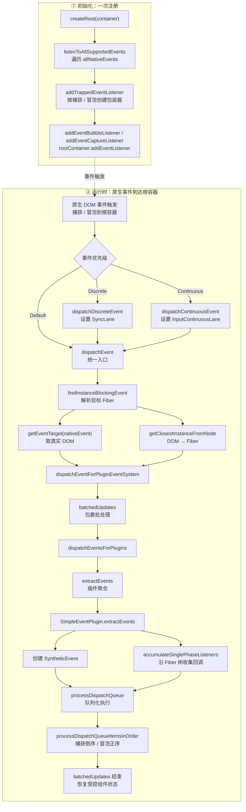

# 事件处理

React 不会把 `onClick` 直接绑到 DOM 节点上，而是在根容器上为每种原生事件注册一次监听；事件触发后，沿 Fiber 树的 `return` 指针收集监听函数，构造 `SyntheticEvent`，再按捕获、冒泡顺序统一执行。事件入口还会按原生事件类型设置更新优先级，最终映射成不同的 Lane。

## 1. 基础用法

```tsx
function Toolbar() {
  return (
    <div onClickCapture={() => console.log('捕获：先于子节点')}>
      <button
        onClick={event => {
          // event 是 SyntheticEvent，不是原生事件。
          console.log(event.type, event.currentTarget)
          event.stopPropagation()
        }}
      >
        保存
      </button>
    </div>
  )
}
```

`onClick` 不会追加到 `<button>` 上：`createRoot(container)` 只在容器上为 `click` 注册捕获、冒泡两个原生监听，点击时从目标 DOM 找到对应 Fiber，再沿 `return` 向上收集所有 `onClick`。捕获阶段的监听收集 `onClickCapture`，冒泡阶段的监听收集 `onClick`，两者靠 `IS_CAPTURE_PHASE` 区分。`event` 是包装后的 `SyntheticEvent`，`stopPropagation` 与 `preventDefault` 都会同步作用到原生事件。

## 2. 核心结构

### 2.1 SyntheticEvent

`createSyntheticEvent(Interface)` 返回一个事件构造函数。构造时把原生事件字段按 `Interface` 归一化复制到实例上：

:::code-group

```ts [react-dom/src/events/SyntheticEvent.js]
function SyntheticBaseEvent(
  reactName, // React 事件名，如 onClick
  reactEventType, // 事件类型，如 click
  targetInst, // 目标 DOM 对应的 Fiber
  nativeEvent, // 原生事件对象
  nativeEventTarget, // 原生 target
) {
  this._reactName = reactName
  this._targetInst = targetInst
  this.type = reactEventType
  this.nativeEvent = nativeEvent
  this.target = nativeEventTarget
  this.currentTarget = null

  // 按 Interface 逐项读取或归一化原生事件字段。
  for (const propName in Interface) {
    if (!Interface.hasOwnProperty(propName)) continue
    const normalize = Interface[propName]
    this[propName] = normalize ? normalize(nativeEvent) : nativeEvent[propName]
  }

  // 原生事件已经 preventDefault 时同步初始状态。
  const defaultPrevented =
    nativeEvent.defaultPrevented != null
      ? nativeEvent.defaultPrevented
      : nativeEvent.returnValue === false
  this.isDefaultPrevented = defaultPrevented
    ? functionThatReturnsTrue
    : functionThatReturnsFalse
  this.isPropagationStopped = functionThatReturnsFalse
  return this
}

Object.assign(SyntheticBaseEvent.prototype, {
  preventDefault() {
    this.defaultPrevented = true
    const event = this.nativeEvent
    if (!event) return

    if (event.preventDefault) {
      event.preventDefault()
    } else {
      event.returnValue = false
    }
    this.isDefaultPrevented = functionThatReturnsTrue
  },

  stopPropagation() {
    const event = this.nativeEvent
    if (!event) return

    if (event.stopPropagation) {
      event.stopPropagation()
    } else {
      event.cancelBubble = true
    }
    // 派发队列据此决定是否继续执行后续监听器。
    this.isPropagationStopped = functionThatReturnsTrue
  },

  // 现代事件系统不再池化，保留方法只为兼容旧代码。
  persist() {},
  isPersistent: functionThatReturnsTrue,
})
```

:::

`isPropagationStopped` 只在派发队列里读取，`stopPropagation` 除了设置标志，还会调用原生事件的同名方法，避免浏览器继续传播到 React 之外的监听器。

### 2.2 事件名与原生事件

`SimpleEventPlugin` 通过 `topLevelEventsToReactNames` 把原生事件名映射成 props 名，例如 `click → onClick`；少数事件还会替换事件类型与 SyntheticEvent 子类：

[width(18,23,18,41)]

| 原生事件     | React props    | 事件类型     | 构造类                   |
| ------------ | -------------- | ------------ | ------------------------ |
| `click`      | `onClick`      | `click`      | `SyntheticMouseEvent`    |
| `focusin`    | `onFocus`      | `focus`      | `SyntheticFocusEvent`    |
| `focusout`   | `onBlur`       | `blur`       | `SyntheticFocusEvent`    |
| `keydown`    | `onKeyDown`    | `keydown`    | `SyntheticKeyboardEvent` |
| `touchstart` | `onTouchStart` | `touchstart` | `SyntheticTouchEvent`    |

### 2.3 事件优先级

原生事件先映射成一个更新优先级，再通过 `ReactEventPriorities.old.js` 换成 Lane：

:::code-group

```ts [react-reconciler/src/ReactEventPriorities.js]
// 事件优先级直接复用 Lane 的位，不再单独定义一套数值。
export const DiscreteEventPriority: EventPriority = SyncLane
export const ContinuousEventPriority: EventPriority = InputContinuousLane
export const DefaultEventPriority: EventPriority = DefaultLane
export const IdleEventPriority: EventPriority = IdleLane
```

```ts [react-dom/src/events/ReactDOMEventListener.js]
function getEventPriority(domEventName) {
  switch (domEventName) {
    // 离散事件：点击、输入、键盘、焦点等，用户预期立即看到结果。
    case 'click':
    case 'input':
    case 'keydown':
    case 'focusin':
    case 'focusout':
    case 'submit':
      return DiscreteEventPriority

    // 连续事件：滚动、移动、拖拽等，可以按帧合并。
    case 'drag':
    case 'mousemove':
    case 'scroll':
    case 'wheel':
      return ContinuousEventPriority

    case 'message': {
      // MessageChannel 回调：跟随当前 Scheduler 优先级。
      const schedulerPriority = getCurrentPriorityLevel()
      switch (schedulerPriority) {
        case ImmediatePriority:
          return DiscreteEventPriority
        case UserBlockingPriority:
          return ContinuousEventPriority
        case IdlePriority:
          return IdleEventPriority
        default:
          return DefaultEventPriority
      }
    }

    default:
      return DefaultEventPriority
  }
}
```

:::

[width(32,48,20)]

| 事件优先级                | 典型原生事件                                                   | 对应 Lane             |
| ------------------------- | -------------------------------------------------------------- | --------------------- |
| `DiscreteEventPriority`   | `click`、`input`、`keydown`、`focusin`、`submit`、`touchstart` | `SyncLane`            |
| `ContinuousEventPriority` | `scroll`、`mousemove`、`drag`、`wheel`、`touchmove`            | `InputContinuousLane` |
| `DefaultEventPriority`    | 其余未列出的原生事件（如 `load`、`error`、动画结束）           | `DefaultLane`         |
| `IdleEventPriority`       | 调度器处于 Idle 时的 `message`                                 | `IdleLane`            |

> `message` 不是固定映射：Scheduler 为 Immediate / UserBlocking / Normal / Low / Idle 时，分别落到 Discrete / Continuous / Default / Idle。`mouseover`、`mouseout`、`pointerover`、`pointerout`、`mouseenter`、`mouseleave`、`pointerenter`、`pointerleave`、`dragenter`、`dragleave`、`dragover` 等也属于 Continuous，不是“**其余**”。

## 3. 注册阶段

### 3.1 `listenToAllSupportedEvents`

`createRoot` 创建根容器后会调用 `listenToAllSupportedEvents`。它给每个根容器打一个随机 marker，保证只注册一次；随后遍历 `allNativeEvents`：可委托的事件在根容器上同时注册捕获与冒泡监听，`nonDelegatedEvents` 只在根容器注册捕获监听（冒泡监听由目标元素自己注册）：

:::code-group

```ts [events/ReactDOMEventListener.js]
//一次性委托所有事件
export function listenToAllSupportedEvents(rootContainerElement) {
  const container = rootContainerElement
  // 每个根容器只注册一次，marker 随容器实例保存。
  if (container[listeningMarker]) return
  container[listeningMarker] = true

  allNativeEvents.forEach(domEventName => {
    // selectionchange 不冒泡，单独挂到 document 上。
    if (domEventName === 'selectionchange') return

    // 不冒泡的事件直接绑到目标元素，其余在根容器上做委托。
    if (!nonDelegatedEvents.has(domEventName)) {
      listenToNativeEvent(domEventName, false, rootContainerElement)
    }
    listenToNativeEvent(domEventName, true, rootContainerElement)
  })

  const ownerDocument =
    rootContainerElement.nodeType === DOCUMENT_NODE
      ? rootContainerElement
      : rootContainerElement.ownerDocument
  if (ownerDocument !== null) {
    listenToNativeEvent('selectionchange', false, ownerDocument)
  }
}
```

```ts [events/DOMPluginEventSystem.js]
//监听原生事件
export function listenToNativeEvent(
  domEventName: DOMEventName,
  isCapturePhaseListener: boolean,
  target: EventTarget,
): void {
  // 省略 __DEV__ 下把不冒泡事件错误注册到冒泡阶段的告警。

  let eventSystemFlags = 0
  if (isCapturePhaseListener) {
    // 捕获阶段的监听器用 flag 标记，派发时据此进入捕获队列。
    eventSystemFlags |= IS_CAPTURE_PHASE
  }
  addTrappedEventListener(
    target,
    domEventName,
    eventSystemFlags,
    isCapturePhaseListener,
  )
}
```

```ts [events/EventRegistry.js]
// 所有需要挂载原生监听的事件名，由各事件的注册函数填充。
export const allNativeEvents: Set<DOMEventName> = new Set()

export function registerDirectEvent(
  registrationName: string,
  dependencies: Array<DOMEventName>,
) {
  // 省略 __DEV__ 下重复注册的告警与 registrationNameDependencies 记录。

  // React 事件的每个依赖原生事件都进入集合，注册监听时统一遍历。
  for (let i = 0; i < dependencies.length; i++) {
    allNativeEvents.add(dependencies[i])
  }
}
```

:::

`allNativeEvents` 由 `registerSimpleEvents` 等注册函数经 `registerDirectEvent` 填充，收集的是所有插件声明过的原生事件；`listenToNativeEvent` 只负责按阶段补上 `IS_CAPTURE_PHASE` flag，再交给 `addTrappedEventListener` 创建监听器。

### 3.2 `addTrappedEventListener`

真正创建原生监听器的是 `addTrappedEventListener`。它把事件名、flags 与容器预先绑定到包装函数，浏览器调用时只需要传原生事件：

:::code-group

```ts [react-dom/src/events/ReactDOMEventListener.js]
function addTrappedEventListener(
  targetContainer,
  domEventName,
  eventSystemFlags,
  isCapturePhaseListener,
) {
  // 每个事件在每个根上只创建一个包装后的监听器。
  const listener = createEventListenerWrapperWithPriority(
    targetContainer,
    domEventName,
    eventSystemFlags,
  )

  // touch 与 wheel 手动模拟 passive，避免监听器阻塞滚动。
  const isPassiveListener =
    passiveBrowserEventsSupported &&
    (domEventName === 'touchstart' ||
      domEventName === 'touchmove' ||
      domEventName === 'wheel')
      ? true
      : undefined

  if (isCapturePhaseListener) {
    if (isPassiveListener !== undefined) {
      addEventCaptureListenerWithPassiveFlag(
        targetContainer,
        domEventName,
        listener,
        isPassiveListener,
      )
    } else {
      addEventCaptureListener(targetContainer, domEventName, listener)
    }
  } else {
    if (isPassiveListener !== undefined) {
      addEventBubbleListenerWithPassiveFlag(
        targetContainer,
        domEventName,
        listener,
        isPassiveListener,
      )
    } else {
      addEventBubbleListener(targetContainer, domEventName, listener)
    }
  }
}
```

:::

### 3.3 `createEventListenerWrapperWithPriority`

捕获和冒泡会各自创建一个包装函数——`listenToNativeEvent` 每被调用一次，就调用一次 `createEventListenerWrapperWithPriority`。包装函数根据事件优先级选择不同的入口。入口的职责很单一：设置更新上下文，然后调用真正的 `dispatchEvent`：

:::code-group

```ts [react-dom/src/events/ReactDOMEventListener.js]
function createEventListenerWrapperWithPriority(
  targetContainer,
  domEventName,
  eventSystemFlags,
) {
  const eventPriority = getEventPriority(domEventName)

  // 按优先级选出这个事件专用的包装函数，后面再绑定其余参数。
  let listenerWrapper
  switch (eventPriority) {
    case DiscreteEventPriority:
      listenerWrapper = dispatchDiscreteEvent
      break
    case ContinuousEventPriority:
      listenerWrapper = dispatchContinuousEvent
      break
    default:
      listenerWrapper = dispatchEvent
  }

  // 绑定事件名、flags 与容器，原生回调只剩 event 一个参数。
  return listenerWrapper.bind(
    null,
    domEventName,
    eventSystemFlags,
    targetContainer,
  )
}

function dispatchDiscreteEvent(
  domEventName,
  eventSystemFlags,
  container,
  nativeEvent,
) {
  const previousPriority = getCurrentUpdatePriority()
  try {
    // 事件处理期间产生的 setState 会读取这个优先级。
    setCurrentUpdatePriority(DiscreteEventPriority)
    dispatchEvent(domEventName, eventSystemFlags, container, nativeEvent)
  } finally {
    setCurrentUpdatePriority(previousPriority)
  }
}
```

```ts [react-reconciler/src/ReactEventPriorities.js]
// 当前更新优先级：默认 NoLane，表示没有事件正在派发。
let currentUpdatePriority: EventPriority = NoLane

// 进入事件入口时先读出旧值，用于 finally 里恢复。
export function getCurrentUpdatePriority(): EventPriority {
  return currentUpdatePriority
}

// 设置本次派发的优先级，期间产生的 setState 会读取它来决定 Lane。
export function setCurrentUpdatePriority(newPriority: EventPriority) {
  currentUpdatePriority = newPriority
}
```

:::

`dispatchContinuousEvent` 的结构完全相同，只是把优先级换成 `ContinuousEventPriority`；默认事件则直接进入 `dispatchEvent`，不额外抬高优先级。`currentUpdatePriority` 是模块级变量，`getCurrentUpdatePriority` / `setCurrentUpdatePriority` 负责在入口前后成对保存与恢复，避免一次事件派发的优先级泄漏到下一次。

## 4. 派发阶段

### 4.1 `dispatchEvent`

`dispatchEvent` 是所有原生事件的统一入口：包装器最终都调用它。它先确认事件系统可用，再把原生事件的目标解析成 Fiber；如果目标落在还没水合完成的 Suspense 边界上，就把事件排队等待重放，否则直接进入插件事件系统：

:::code-group

```ts [ReactDOMEventListener.js]
export function dispatchEvent(
  domEventName,
  eventSystemFlags,
  targetContainer,
  nativeEvent,
) {
  // 事件系统被卸载后不再处理。
  if (!_enabled) return

  // 省略开关分支：默认走 dispatchEventOriginal。
  dispatchEventOriginal(
    domEventName,
    eventSystemFlags,
    targetContainer,
    nativeEvent,
  )
}

function dispatchEventOriginal(
  domEventName,
  eventSystemFlags,
  targetContainer,
  nativeEvent,
) {
  // 省略 allowReplay 与离散 / 连续事件的排队、重放分支。

  // 找到阻塞派发的边界，同时把事件目标解析成 Fiber。
  const blockedOn = findInstanceBlockingEvent(
    domEventName,
    eventSystemFlags,
    targetContainer,
    nativeEvent,
  )
  if (blockedOn === null) {
    // 没有阻塞：用解析出的目标 Fiber 进入插件事件系统。
    dispatchEventForPluginEventSystem(
      domEventName,
      eventSystemFlags,
      nativeEvent,
      return_targetInst,
      targetContainer,
    )
    return
  }

  // 被尚未水合的边界挡住：按 allowReplay 排队重放，或带空目标派发（已省略）。
}

// 概念上是 findInstanceBlockingEvent 的返回值：没有阻塞时的目标 Fiber。
export let return_targetInst = null

export function findInstanceBlockingEvent(
  domEventName,
  eventSystemFlags,
  targetContainer,
  nativeEvent,
) {
  return_targetInst = null

  // 从原生事件取出真实 DOM，再找到它对应的 Fiber。
  const nativeEventTarget = getEventTarget(nativeEvent)
  let targetInst = getClosestInstanceFromNode(nativeEventTarget)

  if (targetInst !== null) {
    const nearestMounted = getNearestMountedFiber(targetInst)
    if (nearestMounted === null) {
      // 树已经卸载，按“无目标”派发。
      targetInst = null
    } else if (nearestMounted.tag === SuspenseComponent) {
      const instance = getSuspenseInstanceFromFiber(nearestMounted)
      if (instance !== null) {
        // 边界还在水合：返回阻塞点，事件稍后重放。
        return instance
      }
      targetInst = null
    } else {
      // 省略 HostRoot 脱水与“尚未提交挂载”的判定。
    }
  }

  return_targetInst = targetInst
  // 没有阻塞，调用方可以继续派发。
  return null
}
```

```ts [getEventTarget.js]
function getEventTarget(nativeEvent) {
  // 老浏览器没有 target 时退回 srcElement，再兜底到 window。
  let target = nativeEvent.target || nativeEvent.srcElement || window

  // SVG <use> 的事件统一指向对应的 use 元素。
  if (target.correspondingUseElement) {
    target = target.correspondingUseElement
  }

  // Safari 可能把事件派发到文本节点，统一上溯到它的父元素。
  return target.nodeType === TEXT_NODE ? target.parentNode : target
}
```

```ts [ReactDOMComponentTree.js]
export function getClosestInstanceFromNode(targetNode) {
  // React 管理的节点上直接挂着 Fiber 引用（__reactFiber$ + 随机串）。
  let targetInst = targetNode[internalInstanceKey]
  if (targetInst) {
    return targetInst
  }

  // 目标不是 React 节点：沿父链向上找最近的 React 节点或容器。
  let parentNode = targetNode.parentNode
  while (parentNode) {
    targetInst =
      parentNode[internalContainerInstanceKey] ||
      parentNode[internalInstanceKey]
    if (targetInst) {
      // 省略：跨过未水合节点时，优先返回内层 Suspense 的 Fiber。
      return targetInst
    }
    targetNode = parentNode
    parentNode = targetNode.parentNode
  }

  // 整条父链都没有 React 节点。
  return null
}
```

:::

`getEventTarget` 负责从原生事件取出真实 DOM，`getClosestInstanceFromNode` 再沿父链找到最近的 React 节点；整条父链都没有 React 节点时返回 null。

### 4.2 `dispatchEventForPluginEventSystem`

拿到目标 Fiber 后，`dispatchEventForPluginEventSystem` 负责找到与当前根匹配的祖先，再用 `batchedUpdates` 进入插件事件系统。完整实现还要处理 Portal 与 hydration，这里只保留主路径：

:::code-group

```ts [react-dom/src/events/DOMPluginEventSystem.js]
function dispatchEventForPluginEventSystem(
  domEventName,
  eventSystemFlags,
  nativeEvent,
  targetInst,
  targetContainer,
) {
  // targetInst 是目标 DOM 对应的 Fiber；Portals 与 hydration 的边界处理已省略。
  const ancestorInst = targetInst

  // 同一次原生事件内的多次 setState 合并到同一批。
  batchedUpdates(() => {
    dispatchEventsForPlugins(
      domEventName,
      eventSystemFlags,
      nativeEvent,
      ancestorInst,
      targetContainer,
    )
  })
}
```

:::

### 4.3 `dispatchEventsForPlugins`

建立本次事件的派发队列。插件只负责把`{ event, listeners }`放进队列，真正的执行留到队列处理阶段：

:::code-group

```ts [react-dom/src/events/DOMPluginEventSystem.js]
function dispatchEventsForPlugins(
  domEventName,
  eventSystemFlags,
  nativeEvent,
  targetInst,
  targetContainer,
) {
  const nativeEventTarget = getEventTarget(nativeEvent)
  const dispatchQueue = []

  extractEvents(
    dispatchQueue,
    domEventName,
    targetInst,
    nativeEvent,
    nativeEventTarget,
    eventSystemFlags,
    targetContainer,
  )

  processDispatchQueue(dispatchQueue, eventSystemFlags)
}
```

```ts [react-dom/src/events/getEventTarget.js]
function getEventTarget(nativeEvent) {
  // 老浏览器没有 target 时退回 srcElement，再兜底到 window。
  let target = nativeEvent.target || nativeEvent.srcElement || window

  // SVG <use> 的事件统一指向对应的 use 元素。
  if (target.correspondingUseElement) {
    target = target.correspondingUseElement
  }

  // Safari 可能把事件派发到文本节点，统一上溯到它的父元素。
  return target.nodeType === TEXT_NODE ? target.parentNode : target
}
```

:::

### 4.4 `extractEvents`：插件聚合

`SimpleEventPlugin` 负责基础事件；其余插件本质上是兼容层，只在冒泡阶段运行：

:::code-group

```ts [react-dom/src/events/DOMPluginEventSystem.js]
export function extractEvents(
  dispatchQueue,
  domEventName,
  targetInst,
  nativeEvent,
  nativeEventTarget,
  eventSystemFlags,
  targetContainer,
) {
  // 基础事件：click、input、键盘、焦点、指针等。
  SimpleEventPlugin.extractEvents(
    dispatchQueue,
    domEventName,
    targetInst,
    nativeEvent,
    nativeEventTarget,
    eventSystemFlags,
    targetContainer,
  )

  const shouldProcessPolyfillPlugins =
    (eventSystemFlags & SHOULD_NOT_PROCESS_POLYFILL_EVENT_PLUGINS) === 0

  // 这些插件依赖各自的内部状态，只在冒泡阶段处理。
  if (shouldProcessPolyfillPlugins) {
    EnterLeaveEventPlugin.extractEvents(
      dispatchQueue,
      domEventName,
      targetInst,
      nativeEvent,
      nativeEventTarget,
      eventSystemFlags,
      targetContainer,
    )
    ChangeEventPlugin.extractEvents(
      dispatchQueue,
      domEventName,
      targetInst,
      nativeEvent,
      nativeEventTarget,
      eventSystemFlags,
      targetContainer,
    )
    SelectEventPlugin.extractEvents(
      dispatchQueue,
      domEventName,
      targetInst,
      nativeEvent,
      nativeEventTarget,
      eventSystemFlags,
      targetContainer,
    )
    BeforeInputEventPlugin.extractEvents(
      dispatchQueue,
      domEventName,
      targetInst,
      nativeEvent,
      nativeEventTarget,
      eventSystemFlags,
      targetContainer,
    )
  }
}
```

:::

### 4.5 `SimpleEventPlugin.extractEvents`

`SimpleEventPlugin` 先选好事件构造类，再收集监听器；只有找到监听器时才创建 `SyntheticEvent`：

:::code-group

```ts [react-dom/src/events/plugins/SimpleEventPlugin.js]
function extractEvents(
  dispatchQueue,
  domEventName,
  targetInst,
  nativeEvent,
  nativeEventTarget,
  eventSystemFlags,
) {
  const reactName = topLevelEventsToReactNames.get(domEventName)
  if (reactName === undefined) return

  let SyntheticEventCtor = SyntheticEvent
  let reactEventType = domEventName

  switch (domEventName) {
    case 'focusin':
      reactEventType = 'focus'
      SyntheticEventCtor = SyntheticFocusEvent
      break
    case 'focusout':
      reactEventType = 'blur'
      SyntheticEventCtor = SyntheticFocusEvent
      break
    case 'click':
    case 'mousedown':
    case 'mousemove':
    case 'mouseup':
      SyntheticEventCtor = SyntheticMouseEvent
      break
    // 省略键盘、拖拽、触摸、动画等分支。
  }

  const inCapturePhase = (eventSystemFlags & IS_CAPTURE_PHASE) !== 0
  // scroll 不冒泡，只收集目标自身。
  const accumulateTargetOnly = !inCapturePhase && domEventName === 'scroll'

  const listeners = accumulateSinglePhaseListeners(
    targetInst,
    reactName,
    nativeEvent.type,
    inCapturePhase,
    accumulateTargetOnly,
    nativeEvent,
  )

  // 没有任何监听器就不创建事件对象。
  if (listeners.length > 0) {
    const event = new SyntheticEventCtor(
      reactName,
      reactEventType,
      targetInst,
      nativeEvent,
      nativeEventTarget,
    )
    dispatchQueue.push({ event, listeners })
  }
}
```

:::

## 5. 监听收集与执行顺序

### 5.1 `accumulateSinglePhaseListeners`

捕获与冒泡共用同一段收集逻辑，区别只在读取 `onClickCapture` 还是 `onClick`：

:::code-group

```ts [react-dom/src/events/DOMPluginEventSystem.js]
function accumulateSinglePhaseListeners(
  targetFiber,
  reactName,
  nativeEventType,
  inCapturePhase,
  accumulateTargetOnly,
  nativeEvent,
) {
  // 捕获阶段读 onClickCapture，冒泡阶段读 onClick。
  const reactEventName = inCapturePhase ? reactName + 'Capture' : reactName
  const listeners = []

  let instance = targetFiber
  let lastHostComponent = null

  // 沿 return 指针从目标向上走到根，收集所有同阶段的监听器。
  while (instance !== null) {
    const { stateNode, tag } = instance
    if (tag === HostComponent && stateNode !== null) {
      lastHostComponent = stateNode

      const listener = getListener(instance, reactEventName)
      if (listener != null) {
        listeners.push(
          createDispatchListener(instance, listener, lastHostComponent),
        )
      }
    }

    // 不冒泡的事件只处理目标自身。
    if (accumulateTargetOnly) break
    instance = instance.return
  }

  return listeners
}

// 同一个 DOM 节点上的监听器连同它的 Fiber 与 currentTarget 一起入队。
function createDispatchListener(
  instance: null | Fiber,
  listener: Function,
  currentTarget: EventTarget,
): DispatchListener {
  return {
    instance,
    listener,
    currentTarget,
  }
}
```

:::

数组顺序固定为“**目标 → 根**”：捕获阶段执行时需要反向遍历，冒泡阶段正序执行。

### 5.2 `getListener`

监听器不在 Fiber 上，而在 DOM 节点的 props 里。`getListener` 通过 `getFiberCurrentPropsFromNode` 取回当前 props，再按 `onClick` 这类名字读取：

:::code-group

```ts [events/DOMPluginEventSystem.js]
function getListener(inst, registrationName) {
  const stateNode = inst.stateNode
  // 尚未挂载完成的 Fiber 没有可读取的 DOM。
  if (stateNode === null) return null

  const props = getFiberCurrentPropsFromNode(stateNode)
  if (props === null) return null

  const listener = props[registrationName]
  // 禁用元素上的鼠标事件不再触发。
  if (shouldPreventMouseEvent(registrationName, inst.type, props)) {
    return null
  }
  return listener
}
```

```ts [client/ReactDOMComponentTree.js]
export function getFiberCurrentPropsFromNode(
  node: Instance | TextInstance | SuspenseInstance,
): Props {
  // props 挂在 DOM 节点的 __reactProps$ 属性上，没有则为 null。
  return (node: any)[internalPropsKey] || null
}
```

:::

### 5.3 `processDispatchQueue`

派发队列按事件逐个执行。捕获阶段从数组尾部（祖先）开始，冒泡阶段从头部（目标）开始：

:::code-group

```ts [react-dom/src/events/DOMPluginEventSystem.js]
function processDispatchQueue(dispatchQueue, eventSystemFlags) {
  const inCapturePhase = (eventSystemFlags & IS_CAPTURE_PHASE) !== 0

  for (let i = 0; i < dispatchQueue.length; i++) {
    const { event, listeners } = dispatchQueue[i]
    processDispatchQueueItemsInOrder(event, listeners, inCapturePhase)
  }

  // 所有监听器执行完毕后，再统一抛出捕获到的第一个错误。
  rethrowCaughtError()
}

function processDispatchQueueItemsInOrder(
  event,
  dispatchListeners,
  inCapturePhase,
) {
  let previousInstance

  if (inCapturePhase) {
    // 捕获：父 → 子，数组按目标 → 根收集，因此反向遍历。
    for (let i = dispatchListeners.length - 1; i >= 0; i--) {
      const { instance, currentTarget, listener } = dispatchListeners[i]
      // 同一个实例上的多个监听器不受 stopPropagation 影响。
      if (instance !== previousInstance && event.isPropagationStopped()) {
        return
      }
      executeDispatch(event, listener, currentTarget)
      previousInstance = instance
    }
  } else {
    // 冒泡：子 → 父，正序执行。
    for (let i = 0; i < dispatchListeners.length; i++) {
      const { instance, currentTarget, listener } = dispatchListeners[i]
      if (instance !== previousInstance && event.isPropagationStopped()) {
        return
      }
      executeDispatch(event, listener, currentTarget)
      previousInstance = instance
    }
  }
}

function executeDispatch(event, listener, currentTarget) {
  event.currentTarget = currentTarget
  // 用统一的错误边界调用，避免单个 handler 中断整条派发链。
  invokeGuardedCallbackAndCatchFirstError(
    event.type,
    listener,
    undefined,
    event,
  )
  event.currentTarget = null
}
```

```ts [shared/ReactErrorUtils.js]
export function invokeGuardedCallbackAndCatchFirstError(
  name: string,
  func: (event: SyntheticEvent) => void,
  context: any,
  event: SyntheticEvent,
): void {
  try {
    func.call(context, event)
  } catch (error) {
    // 只记录第一个错误；后续错误不再覆盖，保证「首错优先」
    if (!hasCaughtError) {
      hasCaughtError = true
      firstCaughtError = error
    }
  }
}
```

:::

`currentTarget` 在执行前设置为当前监听器所在的 DOM 节点，执行后立即清空，因此合成事件在异步回调里读到的 `currentTarget` 是 `null`，这也是事件系统不再依赖池化仍要保留该字段的原因。

## 6. 事件优先级如何变成 Lane

事件包装器只设置了“**当前更新优先级**”，真正取 Lane 发生在 `requestUpdateLane`：

:::code-group

```ts [react-dom/src/events/ReactDOMEventListener.js]
export function getCurrentEventPriority() {
  const currentEvent = window.event
  if (currentEvent === undefined) {
    return DefaultEventPriority
  }
  return getEventPriority(currentEvent.type)
}
```

```ts [react-reconciler/src/ReactFiberWorkLoopjs]
function requestUpdateLane(fiber) {
  // 省略 legacy、render 阶段更新与 transition 分支。

  // 事件包装器或 flushSync 设置的优先级优先。
  const updateLane = getCurrentUpdatePriority()
  if (updateLane !== NoLane) {
    return updateLane
  }

  // 否则根据 window.event 的类型推断。
  return getCurrentEventPriority()
}
```

:::

因此点击事件里的 `setState` 拿到 `SyncLane`，滚动等连续事件拿到 `InputContinuousLane`，其余更新落到 `DefaultLane`。这些 Lane 如何参与选批、打断与过期，见 [Lane 模型](/frameworks/react/advanced/source-code/reconciler/laneModel)。

## 7. 完整流程图



## 8. 总结

[width(11,48,41)]

| 阶段   | 关键函数                                 | 作用                                      |
| ------ | ---------------------------------------- | ----------------------------------------- |
| 注册   | `listenToAllSupportedEvents`             | 在根容器上为所有原生事件注册捕获/冒泡监听 |
| 入口   | `createEventListenerWrapperWithPriority` | 按事件类型设置更新优先级                  |
| 派发   | `dispatchEventForPluginEventSystem`      | DOM 目标 → Fiber，进入批处理              |
| 提取   | `extractEvents` / `SimpleEventPlugin`    | 选出 SyntheticEvent 子类并收集监听器      |
| 收集   | `accumulateSinglePhaseListeners`         | 沿 `return` 指针从目标走到根              |
| 执行   | `processDispatchQueue`                   | 捕获反向、冒泡正向，支持中止传播          |
| 优先级 | `getEventPriority` + `requestUpdateLane` | 事件类型 → 事件优先级 → Lane              |

事件系统的核心是“**一次原生监听 + 沿 Fiber 树收集 + 队列化执行**”：浏览器只负责把事件送到根容器，React 自己重建捕获与冒泡顺序，并在派发期间维护更新优先级，让事件触发的更新能够进入正确的 Lane。
