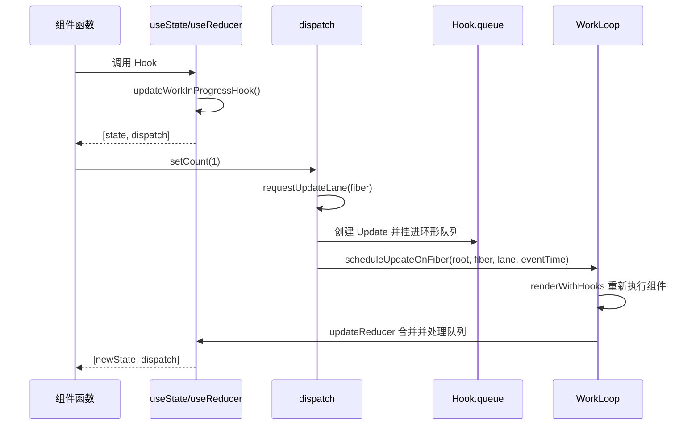

# Hooks 链表

Hooks 让函数组件拥有了跨渲染保存状态的能力。实现它的关键不是“魔法”，而是一条挂在 `Fiber.memoizedState` 上的单向链表，以及一套“按调用顺序对齐”的读取规则。

Hooks 的实现集中在 `packages/react-reconciler/src/ReactFiberHooks.old.js`，核心函数包括 `renderWithHooks`、`mountWorkInProgressHook`、`updateWorkInProgressHook`、`enqueueConcurrentHookUpdate`。本篇讲所有 Hook 共用的底层机制；`useState`、`useReducer`、Effect 类 Hook 与缓存类 Hook 的完整实现见对应各篇。

## 1. 为什么 Hooks 必须按顺序调用

### 1.1 Hook 没有名字

每次调用 `useState`、`useEffect`，React 并不会拿到一个叫 `count` 的变量名。它只能记录：

```text
第 1 个 Hook → 状态 A
第 2 个 Hook → 状态 B
第 3 个 Hook → Effect C
```

下次渲染时，React 按同样的顺序逐个匹配。如果某次渲染跳过了第 2 个 Hook：

```js
if (visible) {
  useState() // 第 1 个
}
useEffect() // 这次变成第 1 个，读到了上次 useState 的状态
```

链表就会错位，状态和副作用全部对不上。这就是 Hooks 规则“只能在顶层调用”的底层原因。

React 18 在开发构建里会额外记录每次调用的 Hook 名称（`hookTypesDev`），一旦顺序变化就打印对比表；在生产构建里，则通过 `currentHook.next` 是否还有剩余节点来检测“这次渲染的 Hook 变少了”。

### 1.2 Hook 链表长什么样

一个组件调用 `useReducer → useState → useEffect`，其 `Fiber.memoizedState` 指向：

```text
Hook(reducer) → Hook(state) → Hook(effect) → null
```

React 18 的 Hook 节点不只有 `memoizedState` 和 `next`，还带有更新队列相关字段：

```ts [react-reconciler/src/ReactFiberHooks.old.js]
export type Hook = {|
  memoizedState: any,
  baseState: any,
  baseQueue: Update<any, any> | null,
  queue: any,
  next: Hook | null,
|};
```

`memoizedState` 的语义随 Hook 类型变化：

[width(19,81)]

| Hook          | `memoizedState` 的内容      |
| ------------- | --------------------------- |
| `useReducer`  | 当前状态值                  |
| `useState`    | 当前状态值                  |
| `useEffect`   | 一个 `Effect` 对象          |
| `useMemo`     | `[缓存值, 依赖数组]`        |
| `useCallback` | `[缓存函数, 依赖数组]`      |
| `useRef`      | `{ current: initialValue }` |

## 2. 渲染上下文与 Dispatcher

### 2.1 三个全局指针

Hooks 的实现依赖模块级变量来维持“当前正在渲染谁”：

```ts [react-reconciler/src/ReactFiberHooks.old.js]
// These are set right before calling the component.
let renderLanes: Lanes = NoLanes;
// The work-in-progress fiber. I've named it differently to distinguish it from
// the work-in-progress hook.
let currentlyRenderingFiber: Fiber = (null: any);

// Hooks are stored as a linked list on the fiber's memoizedState field. The
// current hook list is the list that belongs to the current fiber. The
// work-in-progress hook list is a new list that will be added to the
// work-in-progress fiber.
let currentHook: Hook | null = null;
let workInProgressHook: Hook | null = null;
```

- `currentlyRenderingFiber`：当前正在执行 `renderWithHooks` 的函数组件 Fiber，Hook 通过它找到所属组件。
- `workInProgressHook`：本次渲染正在构建的 Hook 链表尾指针。
- `currentHook`：`current` 树上对应的旧 Hook，更新阶段用它读取上一次的状态。

### 2.2 `renderWithHooks`

`renderWithHooks` 是函数组件的统一入口：设置全局指针、切换 Dispatcher、执行组件函数，最后清理现场。

```ts [react-reconciler/src/ReactFiberHooks.old.js]
export function renderWithHooks<Props, SecondArg>(
  current: Fiber | null,
  workInProgress: Fiber,
  Component: (p: Props, arg: SecondArg) => any,
  props: Props,
  secondArg: SecondArg,
  nextRenderLanes: Lanes,
): any {
  renderLanes = nextRenderLanes;
  currentlyRenderingFiber = workInProgress;

  workInProgress.memoizedState = null;
  workInProgress.updateQueue = null;
  workInProgress.lanes = NoLanes;

  // ... DEV 分支会切换到带 Hook 顺序校验的 Dispatcher
  ReactCurrentDispatcher.current =
    current === null || current.memoizedState === null
      ? HooksDispatcherOnMount
      : HooksDispatcherOnUpdate;

  let children = Component(props, secondArg);

  // Check if there was a render phase update
  if (didScheduleRenderPhaseUpdateDuringThisPass) {
    // ... 在同一个渲染过程中反复重试，直到没有新的 render phase update
  }

  ReactCurrentDispatcher.current = ContextOnlyDispatcher;

  const didRenderTooFewHooks =
    currentHook !== null && currentHook.next !== null;

  renderLanes = NoLanes;
  currentlyRenderingFiber = (null: any);

  currentHook = null;
  workInProgressHook = null;

  if (didRenderTooFewHooks) {
    throw new Error(
      'Rendered fewer hooks than expected. This may be caused by an accidental ' +
        'early return statement.',
    );
  }

  return children;
}
```

为什么每次都要把 `memoizedState` 置空？

- Mount 阶段：需要从零创建 Hook 链表。
- Update 阶段：`updateWorkInProgressHook` 会从 `current.memoizedState` 逐项克隆，而不是复用 WIP 上可能残留的引用。
- 清空 `updateQueue` 同理，Effect 循环链表会在本次渲染中重新构建。

### 2.3 两套 Dispatcher

React 18 用 `ReactCurrentDispatcher.current` 在 Mount 与 Update 之间切换整套 Hook 实现：

:::code-group

```ts [react-reconciler/src/ReactFiberHooks.old.js]
const HooksDispatcherOnMount: Dispatcher = {
  readContext,

  useCallback: mountCallback,
  useContext: readContext,
  useEffect: mountEffect,
  useImperativeHandle: mountImperativeHandle,
  useLayoutEffect: mountLayoutEffect,
  useInsertionEffect: mountInsertionEffect,
  useMemo: mountMemo,
  useReducer: mountReducer,
  useRef: mountRef,
  useState: mountState,
  useDebugValue: mountDebugValue,
  useDeferredValue: mountDeferredValue,
  useTransition: mountTransition,
  useMutableSource: mountMutableSource,
  useSyncExternalStore: mountSyncExternalStore,
  useId: mountId,

  unstable_isNewReconciler: enableNewReconciler,
}
```

```ts [react-reconciler/src/ReactFiberHooks.old.js]
const HooksDispatcherOnUpdate: Dispatcher = {
  readContext,

  useCallback: updateCallback,
  useContext: readContext,
  useEffect: updateEffect,
  useImperativeHandle: updateImperativeHandle,
  useInsertionEffect: updateInsertionEffect,
  useLayoutEffect: updateLayoutEffect,
  useMemo: updateMemo,
  useReducer: updateReducer,
  useRef: updateRef,
  useState: updateState,
  useDebugValue: updateDebugValue,
  useDeferredValue: updateDeferredValue,
  useTransition: updateTransition,
  useMutableSource: updateMutableSource,
  useSyncExternalStore: updateSyncExternalStore,
  useId: updateId,

  unstable_isNewReconciler: enableNewReconciler,
}
```

:::

这样每个 Hook 内部不需要再判断“现在是挂载还是更新”，分发成本被集中到一次 `ReactCurrentDispatcher.current` 赋值上。组件的 `useState` 调用最终会落到 `mountState` 或 `updateState`。

## 3. 创建或复用 Hook 节点

### 3.1 `mountWorkInProgressHook`

挂载阶段没有旧链表，直接创建新节点并追加到尾部：

```ts [react-reconciler/src/ReactFiberHooks.old.js]
function mountWorkInProgressHook(): Hook {
  const hook: Hook = {
    memoizedState: null,

    baseState: null,
    baseQueue: null,
    queue: null,

    next: null,
  }

  if (workInProgressHook === null) {
    // This is the first hook in the list
    currentlyRenderingFiber.memoizedState = workInProgressHook = hook
  } else {
    // Append to the end of the list
    workInProgressHook = workInProgressHook.next = hook
  }
  return workInProgressHook
}
```

### 3.2 `updateWorkInProgressHook`

更新阶段的核心是“对齐”：

```ts [react-reconciler/src/ReactFiberHooks.old.js]
function updateWorkInProgressHook(): Hook {
  // This function is used both for updates and for re-renders triggered by a
  // render phase update. It assumes there is either a current hook we can
  // clone, or a work-in-progress hook from a previous render pass that we can
  // use as a base. When we reach the end of the base list, we must switch to
  // the dispatcher used for mounts.
  let nextCurrentHook: null | Hook
  if (currentHook === null) {
    const current = currentlyRenderingFiber.alternate
    if (current !== null) {
      nextCurrentHook = current.memoizedState
    } else {
      nextCurrentHook = null
    }
  } else {
    nextCurrentHook = currentHook.next
  }

  let nextWorkInProgressHook: null | Hook
  if (workInProgressHook === null) {
    nextWorkInProgressHook = currentlyRenderingFiber.memoizedState
  } else {
    nextWorkInProgressHook = workInProgressHook.next
  }

  if (nextWorkInProgressHook !== null) {
    // There's already a work-in-progress. Reuse it.
    workInProgressHook = nextWorkInProgressHook
    nextWorkInProgressHook = workInProgressHook.next

    currentHook = nextCurrentHook
  } else {
    // Clone from the current hook.

    if (nextCurrentHook === null) {
      throw new Error('Rendered more hooks than during the previous render.')
    }

    currentHook = nextCurrentHook

    const newHook: Hook = {
      memoizedState: currentHook.memoizedState,

      baseState: currentHook.baseState,
      baseQueue: currentHook.baseQueue,
      queue: currentHook.queue,

      next: null,
    }

    if (workInProgressHook === null) {
      // This is the first hook in the list.
      currentlyRenderingFiber.memoizedState = workInProgressHook = newHook
    } else {
      // Append to the end of the list.
      workInProgressHook = workInProgressHook.next = newHook
    }
  }
  return workInProgressHook
}
```

两个分支对应两种场景：

- `nextWorkInProgressHook !== null`：这是 render phase update 触发的重试，本轮 WIP 链表已经存在，直接复用。
- 否则：从 `current` 树逐项克隆 Hook。克隆出的新节点共享 `memoizedState`、`baseState`、`baseQueue`、`queue`，但 `next` 重新串成一条属于 WIP 的新链表。

因此，WIP 与 current 并不是“共享同一条链表”，而是“按节点位置对应、共享节点上的状态与队列”。这样既能保留上一次的队列，又能让本次渲染安全地重建链表。

[width(11,45,24,20)]

| 阶段   | 链表来源                              | 是否新建 Hook 节点 | 是否读取旧状态 |
| ------ | ------------------------------------- | ------------------ | -------------- |
| Mount  | `workInProgress.memoizedState = null` | 是                 | 否             |
| Update | `current.memoizedState`               | 是（克隆）         | 是             |

## 4. 依赖数组的比较规则

`useEffect`、`useMemo`、`useCallback` 都用依赖数组决定“要不要重新执行”。React 为此提供了一个统一函数：

:::code-group

```ts [react-reconciler/src/ReactFiberHooks.old.js]
function areHookInputsEqual(
  nextDeps: Array<mixed>,
  prevDeps: Array<mixed> | null,
) {
  if (prevDeps === null) {
    // ... DEV 下会警告依赖数组从无到有
    return false
  }

  // ... DEV 下会检查两次依赖数组长度是否一致

  for (let i = 0; i < prevDeps.length && i < nextDeps.length; i++) {
    if (is(nextDeps[i], prevDeps[i])) {
      continue
    }
    return false
  }
  return true
}
```

```ts [shared/objectIs.js]
/**
 * inlined Object.is polyfill to avoid requiring consumers ship their own
 * https://developer.mozilla.org/en-US/docs/Web/JavaScript/Reference/Global_Objects/Object/is
 */
function is(x: any, y: any) {
  return (
    (x === y && (x !== 0 || 1 / x === 1 / y)) || (x !== x && y !== y) // eslint-disable-line no-self-compare
  )
}

const objectIs: (x: any, y: any) => boolean =
  typeof Object.is === 'function' ? Object.is : is

export default objectIs
```

:::

`is` 就是 `Object.is` 的语义，与 `===` 的差异如下：

[width(19,12,69)]

| 表达式        | `===`   | `Object.is` |
| ------------- | ------- | ----------- |
| `NaN === NaN` | `false` | `true`      |
| `+0 === -0`   | `true`  | `false`     |

React 的依赖比较以 `Object.is` 为准。依赖数组的三种常见写法：

[width(26,26,48)]

| 写法                 | `deps` 值            | 执行时机                |
| -------------------- | -------------------- | ----------------------- |
| `useEffect(fn)`      | `undefined` → `null` | 每次渲染后都执行        |
| `useEffect(fn, [])`  | `[]`                 | 只在挂载时执行一次      |
| `useEffect(fn, [a])` | `[a]`                | 挂载时 + `a` 变化时执行 |

`[]` 与不传 deps 完全不同：前者的 `prevDeps` 是空数组，循环一次都不执行，直接返回 `true`；后者 `prevDeps === null`，每次都会返回 `false`。`useMemo` / `useCallback` 复用同一套比较，只是比较结果决定“复用缓存还是重新计算”。

## 5. 状态更新的载体：Update 与环形队列

### 5.1 `Update` 与 `UpdateQueue`

React 18 不在 dispatch 时立刻改状态，而是把每次更新包装成 `Update`：

```ts [react-reconciler/src/ReactFiberHooks.old.js]
export type Update<S, A> = {|
  lane: Lane,
  action: A,
  hasEagerState: boolean,
  eagerState: S | null,
  next: Update<S, A>,
|};

export type UpdateQueue<S, A> = {|
  pending: Update<S, A> | null,
  interleaved: Update<S, A> | null,
  lanes: Lanes,
  dispatch: (A => mixed) | null,
  lastRenderedReducer: ((S, A) => S) | null,
  lastRenderedState: S | null,
|};
```

### 5.2 环形链表

多个 `Update` 通过 `next` 组成环形链表，`queue.pending` 指向最后一个更新：

```text
queue.pending ──▶ update3
                    │ next
                    ▼
                  update1 ──next──▶ update2 ──next──▶ update3
```

`pending.next` 就是第一个更新。环形结构让“取队首”和“追加队尾”都能在 O(1) 内完成。

### 5.3 入队与调度

`useState` 和 `useReducer` 的 `dispatch` 最终都会走 `enqueueConcurrentHookUpdate`：它把 `Update` 挂进队列，并返回需要调度的根节点。随后 `scheduleUpdateOnFiber` 把“状态变化”转成“根节点上有一条指定 lane 的待处理工作”。

队列入队之后如何在渲染阶段被消费，见 [useReducer](/frameworks/react/advanced/source-code/hooks/useReducer#_3-updatereducer-合并队列与按-lane-处理)；`useState` 在入队前多走一条 eager bailout 快速路径，见 [useState](/frameworks/react/advanced/source-code/hooks/useState#_4-dispatchsetstate-与-eager-bailout)。

## 6. 一次状态更新的完整流程



一次典型的更新会经历：

1. 事件处理函数调用 `dispatch`，创建带 lane 的 `Update`。
2. Update 进入 `hook.queue.pending` 环形链表，根节点被标记。
3. 调度器选择 lane，进入 Render 阶段，`renderWithHooks` 切换 Dispatcher。
4. `updateReducer` 合并 `pending` 与 `baseQueue`，按 `renderLanes` 应用更新。
5. 新状态写回 `hook.memoizedState`，后续 `beginWork` / `completeWork` / Commit 继续执行。

这条链路上的调度与双缓冲细节，可以继续阅读 [WorkLoop 与调度](/frameworks/react/advanced/source-code/reconciler/workLoop) 和 [Fiber 节点](/frameworks/react/advanced/source-code/reconciler/fiberNode)。

## 7. 与简化实现的差异

这里的“简化实现”指仓库中用于教学的 mini-react / xunbei-react 版本。它们通常把 Mount/Update 合并到同一个函数里，用 `fiber.alternate` 是否存在来判断阶段；dispatch 则直接调用 reducer 并修改 `hook.memoizedState`。与 React 18.3.1 的差异可以概括为：

[width(13,50,37)]

| 维度     | React 18.3.1                                         | 简化实现                         |
| -------- | ---------------------------------------------------- | -------------------------------- |
| 阶段切换 | `ReactCurrentDispatcher` 切换两套 Dispatcher         | 在 Hook 内部判断 `alternate`     |
| 状态计算 | dispatch 只入队，渲染阶段在 `updateReducer` 中计算   | dispatch 时立即计算并写回        |
| 更新载体 | `Update` 环形队列 + `baseQueue` / `pending`          | 直接修改 `hook.memoizedState`    |
| 优先级   | Lane + `renderLanes`，低优先级更新留到下一轮         | 固定同步或微任务，没有 lane 概念 |
| 批量更新 | `batchedUpdates` + 并发队列                          | 没有显式批量逻辑                 |
| 相同值   | `dispatchSetState` 用 eagerState 做 bailout          | 通常总是调度一次渲染             |
| 双缓冲   | `createWorkInProgress` 建立完整 WIP，Hook 按节点克隆 | 可能用浅拷贝模拟 `alternate`     |

“入队延后计算”是官方实现与简化实现最本质的分歧。只有把更新保留为队列，React 才能支持高优先级插入、同一事件中的多次合并、可中断渲染，以及基于最新状态依次执行函数式更新。

## 8. 总结

[width(33,67)]

| 概念                       | 作用                                 |
| -------------------------- | ------------------------------------ |
| Hook 链表                  | 用调用顺序标识每个 Hook，`next` 串联 |
| `memoizedState`            | 保存状态值或 Hook 专属数据           |
| `currentlyRenderingFiber`  | 让 Hook 找到所属组件                 |
| `mountWorkInProgressHook`  | 挂载阶段创建并追加 Hook 节点         |
| `updateWorkInProgressHook` | 更新阶段从 current 树逐项克隆并对齐  |
| `UpdateQueue`              | 用环形链表保存待处理更新             |
| `dispatch`                 | 创建 Update、入队并触发调度          |
| Lane                       | 决定本次渲染能处理哪些更新           |

理解了这条链表与队列，就可以分别阅读具体的 Hook 实现：

- [useState](/frameworks/react/advanced/source-code/hooks/useState)
- [useReducer](/frameworks/react/advanced/source-code/hooks/useReducer)
- [useEffect](/frameworks/react/advanced/source-code/hooks/useEffect)
- [useLayoutEffect](/frameworks/react/advanced/source-code/hooks/useLayoutEffect)
- [useInsertionEffect](/frameworks/react/advanced/source-code/hooks/useInsertionEffect)
- [useMemo](/frameworks/react/advanced/source-code/hooks/useMemo)
- [useCallback](/frameworks/react/advanced/source-code/hooks/useCallback)
- [useRef](/frameworks/react/advanced/source-code/hooks/useRef)
