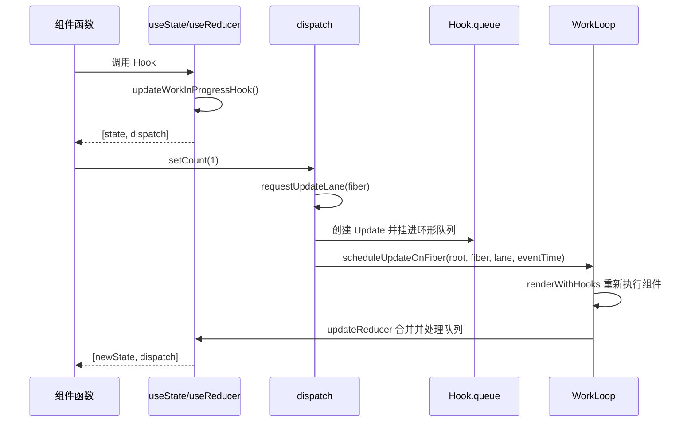

# Hooks 链表

Hooks 让函数组件拥有了跨渲染保存状态的能力。实现它的关键不是“**魔法**”，而是一条挂在 `Fiber.memoizedState` 上的单向链表，以及一套“**按调用顺序对齐**”的读取规则。

## 1. Hook 的作用

函数组件的每次渲染都会重新执行，局部变量无法跨渲染保留。Hooks 把需要保留的数据挂到对应的 Fiber 上：每调用一次 Hook，就在 `Fiber.memoizedState` 上追加一个 Hook 节点，节点保存该 Hook 的状态、更新队列，以及指向下一个 Hook 的 `next`。多个 Hook 依次串成链表，链表的顺序就是调用顺序，不同 Hook 复用同一套节点结构，只是 `memoizedState` 里存的东西不同：状态、Effect、缓存或 ref。

## 2. 调用顺序规则

### 2.1 Hook 没有名字

每次调用 `useState`、`useEffect`，React 并不会拿到一个叫 `count` 的变量名。它只能记录：

```markdown
第 1 个 Hook → 状态 A
第 2 个 Hook → 状态 B
第 3 个 Hook → Effect C
```

下次渲染时，React 按同样的顺序逐个匹配。如果某次渲染跳过了第 2 个 Hook：

```js
// 条件调用 Hook 会让后续 Hook 的位置整体前移。
if (visible) {
  useState() // 第 1 个
}
useEffect() // 这次变成第 1 个，读到了上次 useState 的状态
```

链表就会错位，状态和副作用全部对不上。这就是 Hooks 规则“**只能在顶层调用**”的底层原因。

### 2.2 Hook 链表的结构

一个组件调用 `useReducer → useState → useEffect`，其 `Fiber.memoizedState` 指向：

```markdown
Hook(reducer) → Hook(state) → Hook(effect) → null
```

React 18 的 Hook 节点不只有 `memoizedState` 和 `next`，还带有更新队列相关字段：

:::code-group

```ts [react-reconciler/src/ReactFiberHooks.old.js]
export type Hook = {|
  // 状态值或 Hook 专属数据，语义随 Hook 类型变化：
  // useReducer / useState → 当前状态值；useEffect → 一个 Effect 对象；
  // useMemo → [缓存值, 依赖数组]；useCallback → [缓存函数, 依赖数组]；
  // useRef → { current: initialValue }。
  memoizedState: any,
  // 低优先级更新被跳过时，保留的基准状态与待重放队列。
  baseState: any,
  baseQueue: Update<any, any> | null,
  // 状态类 Hook 的更新队列；Effect 类 Hook 不用这个字段。
  queue: any,
  // 指向链表中的下一个 Hook。
  next: Hook | null,
|};
```

:::

## 3. 渲染：全局指针与 Dispatcher

### 3.1 全局指针

Hooks 的实现依赖模块级变量来维持“**当前正在渲染谁**”：

:::code-group

```ts [react-reconciler/src/ReactFiberHooks.old.js]
// 调用组件函数前设置，记录本次渲染的 lane。
let renderLanes: Lanes = NoLanes;
// 当前正在执行 `renderWithHooks` 的函数组件 Fiber，Hook 通过它找到所属组件。
let currentlyRenderingFiber: Fiber = (null: any);

// Hook 以链表形式挂在 Fiber.memoizedState 上：currentHook 属于 current 树上对应的旧 Hook，
// workInProgressHook 是本次渲染正在构建的 Hook 链表尾指针、将要挂到 WIP Fiber 上的那条链。
let currentHook: Hook | null = null;
let workInProgressHook: Hook | null = null;
```

:::

### 3.2 `renderWithHooks`：统一入口

`renderWithHooks`是函数组件的统一入口：设置全局指针、切换 Dispatcher、执行组件函数，最后清理现场。

:::code-group

```ts [react-reconciler/src/ReactFiberHooks.old.js]
export function renderWithHooks<Props, SecondArg>(
  current: Fiber | null,
  workInProgress: Fiber,
  Component: (p: Props, arg: SecondArg) => any,
  props: Props,
  secondArg: SecondArg,
  nextRenderLanes: Lanes,
): any {
  // 记录本次渲染的全局上下文：lane 与正在渲染的 Fiber。
  renderLanes = nextRenderLanes
  currentlyRenderingFiber = workInProgress
  //从零创建 Hook 链表
  workInProgress.memoizedState = null
  workInProgress.updateQueue = null
  workInProgress.lanes = NoLanes

  // 省略 DEV 下带 Hook 顺序校验的 Dispatcher。
  // 没有旧 Hook 链表时用 mount 版 Dispatcher，否则用 update 版。
  ReactCurrentDispatcher.current =
    current === null || current.memoizedState === null
      ? HooksDispatcherOnMount
      : HooksDispatcherOnUpdate

  let children = Component(props, secondArg)

  // 渲染阶段调用了更新时，在同一轮内反复重试组件函数。
  if (didScheduleRenderPhaseUpdateDuringThisPass) {
    // 省略 渲染期更新的重试循环。
  }

  ReactCurrentDispatcher.current = ContextOnlyDispatcher

  // 旧链表还有剩余节点，说明本次渲染的 Hook 比上一次少。
  const didRenderTooFewHooks = currentHook !== null && currentHook.next !== null

  renderLanes = NoLanes
  currentlyRenderingFiber = null

  currentHook = null
  workInProgressHook = null

  if (didRenderTooFewHooks) {
    // 本次渲染的 Hook 比上一次少。
    throw new Error('Rendered fewer hooks than expected.')
  }

  return children
}
```

:::

### 3.3 内容分发

React 18 用 `ReactCurrentDispatcher.current` 在 Mount 与 Update 之间切换整套 Hook 实现：

:::code-group

```ts [react-reconciler/src/ReactFiberHooks.old.js]
// 挂载阶段：每个 Hook 都指向 mount 实现。
const HooksDispatcherOnMount: Dispatcher = {
  readContext,
  useCallback: mountCallback,
  useContext: readContext,
  useEffect: mountEffect,
  useImperativeHandle: mountImperativeHandle,
  useLayoutEffect: mountLayoutEffect,
  useInsertionEffect: mountInsertionEffect,
  useMemo: mountMemo,
  useReducer: mountReducer,
  useRef: mountRef,
  useState: mountState,
  useDebugValue: mountDebugValue,
  useDeferredValue: mountDeferredValue,
  useTransition: mountTransition,
  useMutableSource: mountMutableSource,
  useSyncExternalStore: mountSyncExternalStore,
  useId: mountId,
  unstable_isNewReconciler: enableNewReconciler,
}

// 更新阶段：整套切换到 update 实现，逐项对齐 current 链表。
const HooksDispatcherOnUpdate: Dispatcher = {
  readContext,
  useCallback: updateCallback,
  useContext: readContext,
  useEffect: updateEffect,
  useImperativeHandle: updateImperativeHandle,
  useInsertionEffect: updateInsertionEffect,
  useLayoutEffect: updateLayoutEffect,
  useMemo: updateMemo,
  useReducer: updateReducer,
  useRef: updateRef,
  useState: updateState,
  useDebugValue: updateDebugValue,
  useDeferredValue: updateDeferredValue,
  useTransition: updateTransition,
  useMutableSource: updateMutableSource,
  useSyncExternalStore: updateSyncExternalStore,
  useId: updateId,
  unstable_isNewReconciler: enableNewReconciler,
}
```

:::

这样每个 Hook 内部不需要再判断“**现在是挂载还是更新**”，分发成本被集中到一次 `ReactCurrentDispatcher.current` 赋值上。组件的 `useState` 调用最终会落到 `mountState` 或 `updateState`。

## 4. 挂载与更新：Hook 节点的创建与复用

### 4.1 挂载：`mountWorkInProgressHook`

挂载阶段没有旧链表，直接创建新节点并追加到尾部：

:::code-group

```ts [react-reconciler/src/ReactFiberHooks.old.js]
function mountWorkInProgressHook(): Hook {
  // 新建空节点，具体字段由调用方填充。
  const hook: Hook = {
    memoizedState: null,

    baseState: null,
    baseQueue: null,
    queue: null,

    next: null,
  }

  if (workInProgressHook === null) {
    // 第一个 Hook，直接挂到 Fiber.memoizedState 上。
    currentlyRenderingFiber.memoizedState = workInProgressHook = hook
  } else {
    // 追加到链表尾部。
    workInProgressHook = workInProgressHook.next = hook
  }
  return workInProgressHook
}
```

:::

### 4.2 更新：`updateWorkInProgressHook`

更新阶段不再从零建链表，而是按调用顺序遍历 `current` 树上的旧 Hook，逐项克隆到 WIP Fiber 上：`currentHook` 沿旧链表前进，`workInProgressHook` 沿新链表前进，两边位置一一对应。克隆只沿用旧节点的状态与队列，真正的状态合并留给 `updateReducer` 等具体 Hook。

:::code-group

```ts [react-reconciler/src/ReactFiberHooks.old.js]
function updateWorkInProgressHook(): Hook {
  // 同时服务更新与 render phase update 触发的重渲染：优先复用本轮已构建的
  // WIP Hook，否则从 current 链表克隆；基准链表耗尽后，后续 Hook 会切换到
  // mount 版 Dispatcher。
  let nextCurrentHook: null | Hook
  if (currentHook === null) {
    // 本次渲染还没对齐过 Hook：从 current 链表的表头开始。
    const current = currentlyRenderingFiber.alternate
    if (current !== null) {
      nextCurrentHook = current.memoizedState
    } else {
      nextCurrentHook = null
    }
  } else {
    // 继续沿 current 链表向后取。
    nextCurrentHook = currentHook.next
  }

  let nextWorkInProgressHook: null | Hook
  if (workInProgressHook === null) {
    // 本轮还没建过 Hook：检查 WIP Fiber 上是否已有重试留下的链表头。
    nextWorkInProgressHook = currentlyRenderingFiber.memoizedState
  } else {
    // 继续沿本轮 WIP 链表向后取。
    nextWorkInProgressHook = workInProgressHook.next
  }

  if (nextWorkInProgressHook !== null) {
    // 本轮 WIP 链表已有该位置的节点（render phase update 重试），直接复用。
    workInProgressHook = nextWorkInProgressHook
    nextWorkInProgressHook = workInProgressHook.next

    // 两条链表的游标同步前进。
    currentHook = nextCurrentHook
  } else {
    // WIP 链表没有对应节点：从 current 树的节点克隆。

    if (nextCurrentHook === null) {
      // 旧链表已经走完：本次渲染的 Hook 比上一次多。
      throw new Error('Rendered more hooks than during the previous render.')
    }

    currentHook = nextCurrentHook

    // 克隆节点：状态与队列沿用旧节点，next 重新串成 WIP 链表。
    const newHook: Hook = {
      memoizedState: currentHook.memoizedState,

      baseState: currentHook.baseState,
      baseQueue: currentHook.baseQueue,
      queue: currentHook.queue,

      next: null,
    }

    if (workInProgressHook === null) {
      // 第一个 Hook，挂到 WIP Fiber 的 memoizedState 上。
      currentlyRenderingFiber.memoizedState = workInProgressHook = newHook
    } else {
      // 追加到 WIP 链表尾部。
      workInProgressHook = workInProgressHook.next = newHook
    }
  }
  return workInProgressHook
}
```

:::

函数先用 `nextCurrentHook` 和 `nextWorkInProgressHook` 对准两条链表的下一个位置，再按 WIP 链表上是否已有节点分叉：

- **有**：render phase update 触发的重试，本轮 WIP 链表已经建好，直接复用节点，两个游标同步前进。
- **没有**：从 `current` 树按位置克隆。克隆节点共享旧节点的 `memoizedState`、`baseState`、`baseQueue`、`queue`，`next` 重新串成 WIP 链表。

所以 WIP 与 current 不是“**共享同一条链表**”，而是“**位置一一对应、状态与队列共享**”：旧队列因此保留，本次渲染也能安全地重建链表。

[width(11,45,24,20)]

| 阶段   | 链表来源                              | 是否新建 Hook 节点 | 是否读取旧状态 |
| ------ | ------------------------------------- | ------------------ | -------------- |
| Mount  | `workInProgress.memoizedState = null` | 是                 | 否             |
| Update | `current.memoizedState`               | 是（克隆）         | 是             |

## 5. 依赖判断：依赖数组的比较 {#\_5-依赖判断-依赖数组的比较}

`useEffect`、`useMemo`、`useCallback`用依赖数组决定**要不要重新执行**。React为此提供了一个统一函数：

:::code-group

```ts [react-reconciler/src/ReactFiberHooks.old.js]
function areHookInputsEqual(
  nextDeps: Array<mixed>,
  prevDeps: Array<mixed> | null,
) {
  if (prevDeps === null) {
    // 省略 DEV 下「依赖数组从无到有」的警告。
    return false
  }

  // 省略 DEV 下依赖数组长度不一致的校验。

  // 取两者较短的长度逐项比较，全部相等才算依赖未变。
  for (let i = 0; i < prevDeps.length && i < nextDeps.length; i++) {
    if (is(nextDeps[i], prevDeps[i])) {
      continue
    }
    return false
  }
  return true
}
```

```ts [shared/objectIs.js]
/**
 * 内联的 Object.is polyfill，避免要求调用方自带 polyfill。
 * https://developer.mozilla.org/en-US/docs/Web/JavaScript/Reference/Global_Objects/Object/is
 */
function is(x: any, y: any) {
  // 额外处理 NaN 相等，以及 +0 与 -0 不相等。
  return (
    (x === y && (x !== 0 || 1 / x === 1 / y)) || (x !== x && y !== y) // eslint-disable-line no-self-compare
  )
}

// 环境支持时优先使用原生 Object.is。
const objectIs: (x: any, y: any) => boolean =
  typeof Object.is === 'function' ? Object.is : is

export default objectIs
```

:::

React 的依赖比较以 `Object.is` 为准。依赖数组的三种常见写法：

[width(26,26,48)]

| 写法                 | `deps` 值            | 执行时机                |
| -------------------- | -------------------- | ----------------------- |
| `useEffect(fn)`      | `undefined` → `null` | 每次渲染后都执行        |
| `useEffect(fn, [])`  | `[]`                 | 只在挂载时执行一次      |
| `useEffect(fn, [a])` | `[a]`                | 挂载时 + `a` 变化时执行 |

## 6. 更新调度：Update 队列与环形链表

### 6.1 `Update` 与 `UpdateQueue`

React 18 不在 dispatch 时立刻改状态，而是把每次更新包装成 `Update`：

:::code-group

```ts [react-reconciler/src/ReactFiberHooks.old.js]
export type Update<S, A> = {|
  // 该更新所属的优先级。
  lane: Lane,
  // 更新动作：新状态值，或 (prevState) => nextState。
  action: A,
  // dispatch 时若已算出新状态，可在这里记录以走 eager bailout。
  hasEagerState: boolean,
  // 提前算出的新状态，用于 bailout。
  eagerState: S | null,
  // 串成环形链表的指针。
  next: Update<S, A>,
|};

export type UpdateQueue<S, A> = {|
  // 指向环形链表最后一个更新，pending.next 即队首。
  pending: Update<S, A> | null,
  // 并发渲染期间被插队的更新链表。
  interleaved: Update<S, A> | null,
  // 队列中更新所属的 lane 集合。
  lanes: Lanes,
  // 绑定到该 Hook 的 dispatch。
  dispatch: (A => mixed) | null,
  // 上一次渲染使用的 reducer 与状态，供提前计算新状态。
  lastRenderedReducer: ((S, A) => S) | null,
  // 上一次渲染后的状态。
  lastRenderedState: S | null,
|};
```

:::

### 6.2 环形链表

多个 `Update` 通过 `next` 组成环形链表，`queue.pending` 指向最后一个更新：

```tree
queue.pending ──▶ update3
                    │ next
                    ▼
                  update1 ──next──▶ update2 ──next──▶ update3
```

`pending.next` 就是第一个更新。环形结构让“**取队首**”和“**追加队尾**”都能在 O(1) 内完成。

### 6.3 入队与调度

`useState` 和 `useReducer` 的 `dispatch` 最终都会走 `enqueueConcurrentHookUpdate`：它把 `Update` 挂进队列，并返回需要调度的根节点。随后 `scheduleUpdateOnFiber` 把“**状态变化**”转成“**根节点上有一条指定 lane 的待处理工作**”。

队列入队之后如何在渲染阶段被消费，见 [useReducer](/frameworks/react/advanced/source-code/hooks/useReducer#_3-updatereducer-合并队列与按-lane-处理)；`useState` 在入队前多走一条 eager bailout 快速路径，见 [useState](/frameworks/react/advanced/source-code/hooks/useState#_4-dispatchsetstate-与-eager-bailout)。

## 7. 完整流程图



一次典型的更新会经历：

1. 事件处理函数调用 `dispatch`，创建带 lane 的 `Update`。
2. Update 进入 `hook.queue.pending` 环形链表，根节点被标记。
3. 调度器选择 lane，进入 Render 阶段，`renderWithHooks` 切换 Dispatcher。
4. `updateReducer` 合并 `pending` 与 `baseQueue`，按 `renderLanes` 应用更新。
5. 新状态写回 `hook.memoizedState`，后续 `beginWork` / `completeWork` / Commit 继续执行。

## 8. 总结

[width(33,67)]

| 概念                       | 作用                                 |
| -------------------------- | ------------------------------------ |
| Hook 链表                  | 用调用顺序标识每个 Hook，`next` 串联 |
| `memoizedState`            | 保存状态值或 Hook 专属数据           |
| `currentlyRenderingFiber`  | 让 Hook 找到所属组件                 |
| `mountWorkInProgressHook`  | 挂载阶段创建并追加 Hook 节点         |
| `updateWorkInProgressHook` | 更新阶段从 current 树逐项克隆并对齐  |
| `UpdateQueue`              | 用环形链表保存待处理更新             |
| `dispatch`                 | 创建 Update、入队并触发调度          |
| `Lane`                     | 决定本次渲染能处理哪些更新           |
