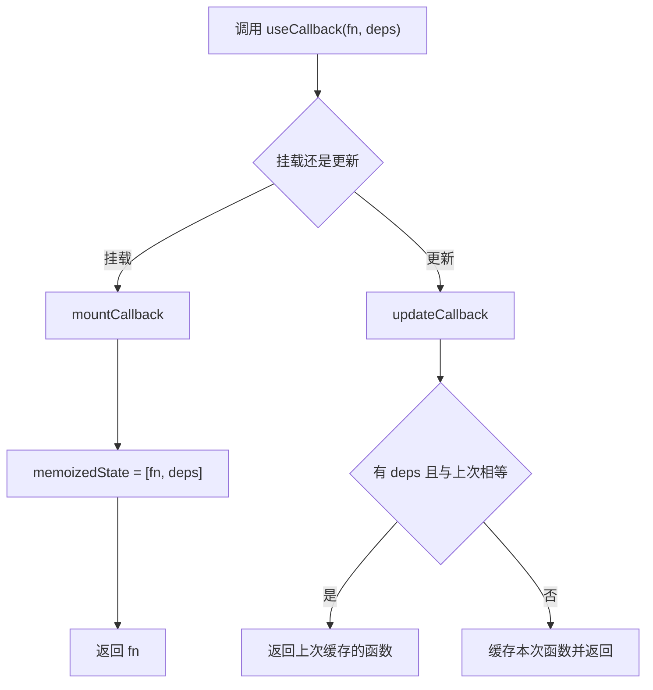

# useCallback

`useCallback` 缓存的是函数引用本身，而不是函数的执行结果。依赖不变时，多次渲染返回同一个函数；依赖变化时返回本次传入的新函数，`useCallback(fn, deps)` 返回 `fn` 本身，并在依赖数组不变时复用上一次的函数引用。它解决的是“**函数 identity 每次渲染都变**”带来的问题：传给 `memo` 子组件的回调、作为其他 Hook 依赖的函数，都应该保持稳定，它只缓存引用，既不执行函数，也不缓存计算结果；需要缓存计算结果时用 `useMemo`。

## 1. 基础用法

```tsx
import { memo, useCallback, useState } from 'react'

const Child = memo(function Child({ onAdd }: { onAdd: () => void }) {
  // props 不变时，memo 会跳过这次渲染。
  return <button onClick={onAdd}>+1</button>
})

function Parent() {
  const [count, setCount] = useState(0)

  // 依赖为空：count 变化时，回调引用依然稳定。
  const handleAdd = useCallback(() => {
    setCount(value => value + 1)
  }, [])

  return (
    <>
      <span>{count}</span>
      <Child onAdd={handleAdd} />
    </>
  )
}
```

> [!TIP]
> `useCallback(fn, deps)` 的依赖数组与 `useEffect` 一样按 `Object.is` 逐项比较。`deps` 省略时按 `null` 处理，每次渲染都会返回新的函数；传空数组则只在挂载时缓存一次。

## 2. 挂载阶段

挂载阶段创建一个 Hook 节点，把 `[callback, deps]` 存进 `memoizedState`，然后原样返回 `callback`；`deps` 未传时记为 `null`，更新阶段不会命中复用。

:::code-group

```ts [react-reconciler/src/ReactFiberHooks.old.js]
function mountCallback<T>(callback: T, deps: Array<mixed> | void | null): T {
  const hook = mountWorkInProgressHook()
  // 未传 deps 时记为 null，更新阶段不会命中复用。
  const nextDeps = deps === undefined ? null : deps
  // 缓存函数引用与依赖，供下一次渲染比较。
  hook.memoizedState = [callback, nextDeps]
  return callback
}
```

:::

## 3. 更新阶段

更新阶段先取出上次缓存的 `[callback, deps]`：依赖存在且逐项相等时直接返回旧函数，否则把本次函数与依赖写回 `memoizedState`。依赖比较复用 `areHookInputsEqual`。

:::code-group

```ts [react-reconciler/src/ReactFiberHooks.old.js]
function updateCallback<T>(callback: T, deps: Array<mixed> | void | null): T {
  const hook = updateWorkInProgressHook()
  const nextDeps = deps === undefined ? null : deps
  const prevState = hook.memoizedState
  if (prevState !== null) {
    if (nextDeps !== null) {
      const prevDeps: Array<mixed> | null = prevState[1] // 上次缓存的依赖数组
      // 依赖逐项相等时复用旧函数引用。
      if (areHookInputsEqual(nextDeps, prevDeps)) {
        return prevState[0] // 上次缓存的函数
      }
    }
  }
  // 依赖变化或没有 deps 时，换成本次的函数并更新缓存。
  hook.memoizedState = [callback, nextDeps]
  return callback
}
```

:::

## 4. 为什么不复用 `useMemo` 实现

React 没有让 `useCallback` 内部调用 `useMemo`，而是提供了独立的 `mountCallback` / `updateCallback`。这样 Dispatcher 可以直接指向对应函数，减少一次运行时分发。

## 5. 完整流程图



## 6. 总结

[width(24,76)]

| 概念                | 作用                                                     |
| ------------------- | -------------------------------------------------------- |
| `mountCallback`     | 存 `[callback, deps]` 并返回原函数                       |
| `updateCallback`    | 依赖相等返回旧函数，否则存新函数                         |
| 与 `useMemo` 的关系 | `useCallback(fn, deps)` 等价于 `useMemo(() => fn, deps)` |
| 闭包风险            | 缓存函数捕获的是创建它那次渲染的变量                     |
| 适用场景            | 稳定回调引用，而非缓存计算结果                           |

`useCallback` 与 `useMemo` 共享同一套依赖比较规则；如果缓存的是可变容器而不是函数，见 [useRef](/frameworks/react/advanced/source-code/hooks/useRef)。
