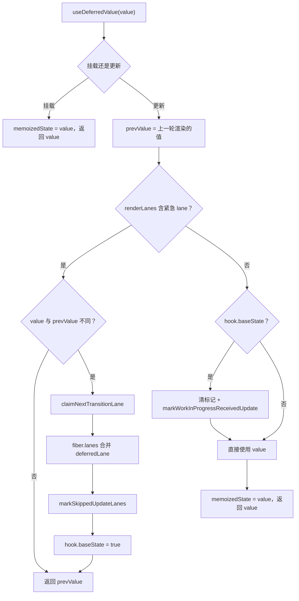

# useDeferredValue

`useDeferredValue` 返回一个“**滞后版**”的值：本轮渲染是紧急的（由点击、输入等触发）时，先继续使用上一次的值；同时申请一条 TransitionLane，等这轮渲染结束后再用新值渲染一次。它不创建额外的状态，也不提供 `isPending`，是否还在使用旧值要由调用方自己比较 `value === deferredValue`。

## 1. 基础用法

```tsx
import { useDeferredValue, useState } from 'react'

function Search() {
  const [query, setQuery] = useState('')
  // 紧急渲染继续用 deferredQuery，真正的过滤放到低优先级渲染。
  const deferredQuery = useDeferredValue(query)
  const isStale = query !== deferredQuery

  return (
    <>
      <input value={query} onChange={event => setQuery(event.target.value)} />
      <div style={{ opacity: isStale ? 0.5 : 1 }}>
        <Results query={deferredQuery} />
      </div>
    </>
  )
}
```

> [!TIP]
> React 18 的 `useDeferredValue` 只接收一个参数，`initialValue` 是 React 19 才加入的。传入的值要尽量保持引用稳定：内联对象或数组每次渲染都是新引用，`Object.is` 必然不相等，延迟渲染会被反复触发。

## 2. 挂载阶段

挂载时没有历史值，直接把当前 `value` 写进 Hook 的 `memoizedState` 并返回，不申请额外 lane。

:::code-group

```ts [react-reconciler/src/ReactFiberHooks.old.js]
function mountDeferredValue(value) {
  const hook = mountWorkInProgressHook()
  // 挂载时没有旧值，直接使用当前值。
  hook.memoizedState = value
  return value
}
```

:::

## 3. 更新阶段

更新阶段先取出上一轮真正渲染出去的值 `prevValue`，交给 `updateDeferredValueImpl` 判断这一轮要不要延迟。重渲染阶段由 `rerenderDeferredValue` 处理：挂载过程中的重渲染直接存值，否则同样走 `updateDeferredValueImpl`。

:::code-group

```ts [ReactFiberHooks.js]
function updateDeferredValue(value) {
  const hook = updateWorkInProgressHook()
  // 上一轮实际渲染出去的值，可能还没追上最新的 value。
  const prevValue = currentHook.memoizedState
  return updateDeferredValueImpl(hook, prevValue, value)
}

function updateDeferredValueImpl(hook, prevValue, value) {
  // 本轮只要包含紧急 lane，就先把新值压后。
  const shouldDeferValue = !includesOnlyNonUrgentLanes(renderLanes)
  //本次渲染包含至少一个紧急 lane
  if (shouldDeferValue) {
    //新旧值不一致
    if (!is(value, prevValue)) {
      // 申请一条 transition lane，稍后单独渲染新值。
      const deferredLane = claimNextTransitionLane()
      currentlyRenderingFiber.lanes = mergeLanes(
        currentlyRenderingFiber.lanes,
        deferredLane,
      )
      // 标记这条 lane 本轮跳过，留给下一轮。
      markSkippedUpdateLanes(deferredLane)
      // baseState 复用为“渲染值与最新值不一致”的标记。
      hook.baseState = true
    }
    return prevValue
  }

  // 非紧急渲染且新旧值不一致：可以直接使用最新值。
  if (hook.baseState) {
    hook.baseState = false
    // 值已经追上，告诉工作循环本轮确实有更新。
    markWorkInProgressReceivedUpdate()
  }
  hook.memoizedState = value
  return value
}
```

```ts [ReactFiberLane.js]
export function includesOnlyNonUrgentLanes(lanes) {
  const UrgentLanes = SyncLane | InputContinuousLane | DefaultLane
  return (lanes & UrgentLanes) === NoLanes
}

let nextTransitionLane = TransitionLane1

function claimNextTransitionLane() {
  const lane = nextTransitionLane
  nextTransitionLane <<= 1

  // 16 条用完，回到第一条复用。
  if ((nextTransitionLane & TransitionLanes) === NoLanes) {
    nextTransitionLane = TransitionLane1
  }

  return lane
}
```

```ts [ReactFiberWorkLoop.js]
export function markSkippedUpdateLanes(lane) {
  // 本轮没处理的 lane 记到根上，下一轮选批时继续。
  workInProgressRootSkippedLanes = mergeLanes(
    lane,
    workInProgressRootSkippedLanes,
  )
}
```

```ts [ReactFiberBeginWork.js]
export function markWorkInProgressReceivedUpdate() {
  // 标记本次渲染确实产生了更新，beginWork 不要走 bailout，强制更新标识
  didReceiveUpdate = true
}
```

:::

> [!TIP]
> 两条分支的区别在于本轮 `renderLanes` 的构成：只要含有 `SyncLane`、`InputContinuousLane` 或 `DefaultLane`，就属于紧急渲染，返回旧值并排一条延迟更新；如果本轮只由 transition、retry、idle 等非紧急 lane 组成，就直接使用最新值。

## 4. 与 `useTransition` 的区别

[width(16,42,42)]

| 维度     | `useTransition`                 | `useDeferredValue`       |
| -------- | ------------------------------- | ------------------------ |
| 降级对象 | 一段更新函数                    | 一个值                   |
| pending  | 内置 `isPending`                | 无，需要自己比较新旧值   |
| 调用方式 | `startTransition(() => setX())` | 直接渲染 `deferredValue` |
| 额外状态 | 多一个 state Hook               | 不增加 Hook 数量         |
| 适用场景 | 想让某次更新整体降级            | 已有值，只想延迟使用     |

`useDeferredValue` 内部同样使用 TransitionLane：紧急渲染先把旧值渲染出去，延迟 lane 再触发第二轮渲染。由于不写入紧急 state，它不会像 `useTransition` 那样额外渲染一次 `isPending`。

## 5. 完整流程图



## 6. 总结

[width(35,65)]

| 概念                         | 作用                                       |
| ---------------------------- | ------------------------------------------ |
| `mountDeferredValue`         | 直接把 value 存进 `memoizedState`          |
| `updateDeferredValueImpl`    | 紧急渲染返回旧值，非紧急渲染使用新值       |
| `includesOnlyNonUrgentLanes` | 判断本轮是否只含 transition / retry / idle |
| `claimNextTransitionLane`    | 为延迟渲染领取一条 Transition lane         |
| `markSkippedUpdateLanes`     | 把跳过的 lane 记到根上，留给下一轮         |
| `hook.baseState`             | 标记“**渲染值与最新值不一致**”，追上后清除 |

`useDeferredValue` 与 `useTransition` 都依赖 TransitionLane，但前者滞后一个值、后者滞后一段更新；Lane 的编码与选批见 [Lane 模型](/frameworks/react/advanced/source-code/reconciler/laneModel)。
