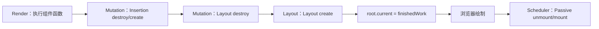
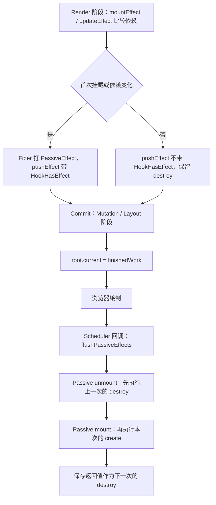

# useEffect

核心实现位于 `packages/react-reconciler/src/ReactFiberHooks.old.js`、`ReactFiberCommitWork.old.js`、`ReactFiberWorkLoop.old.js` 和 `ReactHookEffectTags.js`。三种 Effect 共用 `mountEffectImpl` / `updateEffectImpl`，差异体现在 Fiber 标记、Effect 标记和执行阶段。

`useEffect` 用于在组件提交到 DOM 之后执行副作用，并在依赖变化或组件卸载时先调用上一次返回的清理函数。它没有业务层面的返回值，只把回调与依赖数组存进 Hook 链表，由 Commit 阶段记录标记、Scheduler 在浏览器绘制后异步执行。适合请求、订阅、日志等不依赖布局的副作用；与 Mutation 阶段执行的 `useInsertionEffect`、绘制前同步执行的 `useLayoutEffect` 相比，它的执行时机最晚且不阻塞绘制。

## 1. 基础用法

```tsx
import { useEffect, useState } from 'react'

function Clock() {
  const [now, setNow] = useState(() => Date.now())

  // 依赖为空：只在挂载后启动一次定时器。
  useEffect(() => {
    const timer = setInterval(() => setNow(Date.now()), 1000)

    // 清理函数：卸载时清除定时器。
    return () => clearInterval(timer)
  }, [])

  return <div>{new Date(now).toLocaleTimeString()}</div>
}
```

示例在挂载后启动定时器，并在卸载时通过清理函数 `clearInterval` 停止它。依赖数组决定回调何时重新执行：不传表示每次渲染后都执行，`[]` 表示只在挂载和卸载时执行，`[roomId]` 这类写法表示依赖变化时先清理再执行。`useEffect` 的回调在浏览器绘制之后异步运行，因此不阻塞绘制，也拿不到绘制前的布局。

## 2. 挂载阶段

挂载入口是 `mountEffect`，它按构建模式选择 Fiber 标记，再委托给 `mountEffectImpl`：

:::code-group

```ts [react-reconciler/src/ReactFiberHooks.old.js]
function mountEffect(
  create: () => (() => void) | void,
  deps: Array<mixed> | void | null,
): void {
  if (
    __DEV__ &&
    enableStrictEffects &&
    (currentlyRenderingFiber.mode & StrictEffectsMode) !== NoMode
  ) {
    // Strict Effects 下额外带 MountPassiveDevEffect，用于模拟卸载再挂载。
    return mountEffectImpl(
      MountPassiveDevEffect | PassiveEffect | PassiveStaticEffect,
      HookPassive,
      create,
      deps,
    )
  } else {
    // 非 Strict Effects 下只带 PassiveStaticEffect 静态标记，不模拟双调用。
    return mountEffectImpl(
      PassiveEffect | PassiveStaticEffect,
      HookPassive,
      create,
      deps,
    )
  }
}

function updateEffect(
  create: () => (() => void) | void,
  deps: Array<mixed> | void | null,
): void {
  // 更新阶段只传 PassiveEffect，是否执行由 HookHasEffect 决定。
  return updateEffectImpl(PassiveEffect, HookPassive, create, deps)
}
```

:::

`useEffect` 的标记有两个特点：

- **Fiber 标记带 `PassiveStaticEffect`**：即使依赖没有变化，也标记“**这个组件含有静态 Passive Effect**”，方便 Commit 阶段决定是否需要调度 Passive 回调。
- **开发构建下可能带 `MountPassiveDevEffect`**：Strict Effects 模式下，挂载时的 Effect 会被额外标记，用于模拟卸载与重新挂载，帮助暴露没有正确清理的副作用。

`updateEffect` 只传 `PassiveEffect`，因为更新阶段的执行由 `HookHasEffect` 控制，不需要静态标记。

三种 Effect 共用下面这组挂载与更新实现：

:::code-group

```ts [react-reconciler/src/ReactFiberHooks.old.js]
function mountEffectImpl(fiberFlags, hookFlags, create, deps): void {
  // 挂载阶段新建 Hook 节点。
  const hook = mountWorkInProgressHook()
  // 不传依赖时归一为 null，表示每次渲染都执行。
  const nextDeps = deps === undefined ? null : deps
  // 给 Fiber 打标记，Commit 阶段据此判断子树是否含副作用。
  currentlyRenderingFiber.flags |= fiberFlags
  // 挂载时一定执行，因此 tag 带上 HookHasEffect。
  hook.memoizedState = pushEffect(
    HookHasEffect | hookFlags,
    create,
    undefined,
    nextDeps,
  )
}

function updateEffectImpl(fiberFlags, hookFlags, create, deps): void {
  // 取出 current 树上对应位置的 Hook。
  const hook = updateWorkInProgressHook()
  const nextDeps = deps === undefined ? null : deps
  let destroy = undefined

  if (currentHook !== null) {
    const prevEffect = currentHook.memoizedState
    // 沿用上一次 create 返回的清理函数。
    destroy = prevEffect.destroy
    if (nextDeps !== null) {
      const prevDeps = prevEffect.deps
      if (areHookInputsEqual(nextDeps, prevDeps)) {
        // 依赖相等：仍 push 新节点，但不带 HookHasEffect，本次不执行。
        hook.memoizedState = pushEffect(hookFlags, create, destroy, nextDeps)
        return
      }
    }
  }

  // 需要执行：打 Fiber 标记，并让 tag 带上 HookHasEffect。
  currentlyRenderingFiber.flags |= fiberFlags

  hook.memoizedState = pushEffect(
    HookHasEffect | hookFlags,
    create,
    destroy,
    nextDeps,
  )
}
```

:::

挂载路径（`mountEffectImpl`）做了三件事：

- 调用 `mountWorkInProgressHook` 新建 Hook 节点。
- 给 Fiber 打上 `fiberFlags`，Commit 阶段据此判断子树是否含副作用。
- 以 `HookHasEffect | hookFlags` 调用 `pushEffect`；挂载时没有旧 `destroy`，因此传入 `undefined`。

## 3. 更新阶段

上一节的 `updateEffect` 只把 `PassiveEffect` 传给 `updateEffectImpl`，是否真正执行由依赖比较决定。`updateEffectImpl` 的流程是：取出 current 树上对应位置的 Hook → 沿用上一次的 `destroy` → 依赖存在且相等时 push 一个不带 `HookHasEffect` 的新节点并直接返回 → 依赖变化或没有依赖时才给 Fiber 打标记，并 push 带 `HookHasEffect` 的节点。

挂载与更新的差异可以概括为：

```text
Mount
  → 打 Fiber 标记
  → pushEffect(HookHasEffect | hookFlags, create, undefined, deps)

Update
  → 取上一次的 destroy
  → deps 存在且相等？
      ├─ 是 → pushEffect(hookFlags, create, destroy, deps)，不打标记、不执行
      └─ 否 → 打 Fiber 标记 → pushEffect(HookHasEffect | hookFlags, create, destroy, deps)
```

注意：依赖相等时，React 仍然会创建一个新的 Effect 节点，只是 `tag` 里没有 `HookHasEffect`，并且不给 Fiber 打标记。这样既能保留最新的 `destroy` 引用，又能让 Commit 阶段跳过本次执行。

依赖是否相等的判断由 `areHookInputsEqual` 完成，比较规则与依赖数组的三种写法见 [Hooks 链表](/frameworks/react/advanced/source-code/hooks/hooksInternals#_5-依赖判断-依赖数组的比较)。

## 4. 依赖与执行时机

`useEffect` 的依赖数组遵循 Hooks 的统一比较规则：

- 不传依赖：`deps` 为 `null`，每次渲染后都执行。
- `[]`：只在挂载时执行一次。
- `[a]`：挂载时执行一次，之后 `a` 变化时执行。

依赖相等时，`updateEffectImpl` 仍然会 push 一个 Effect 节点，但不会设置 `HookHasEffect`，也不会给 Fiber 打 `PassiveEffect` 标记。Commit 阶段看到没有标记，就不会调度 Passive 回调，上一次的 `destroy` 则继续保留在节点上。

依赖比较的细节见 [Hooks 链表](/frameworks/react/advanced/source-code/hooks/hooksInternals#_5-依赖判断-依赖数组的比较)。

## 5. Effect 的数据结构

#### Effect 与 HookFlags

```ts [react-reconciler/src/ReactFiberHooks.old.js]
export type Effect = {|
  // 位标记：执行阶段 + 本次是否需要执行。
  tag: HookFlags,
  create: () => (() => void) | void,
  destroy: (() => void) | void,
  // 依赖数组，null 表示每次渲染都执行。
  deps: Array<mixed> | null,
  // 串成循环链表，挂在 Fiber.updateQueue 上。
  next: Effect,
|};
```

```ts [react-reconciler/src/ReactHookEffectTags.js]
export type HookFlags = number

export const NoFlags = /*   */ 0b0000

// 表示该 Effect 本次是否需要执行。
export const HasEffect = /* */ 0b0001

// 表示 Effect（而非清理函数）在哪个阶段执行。
export const Insertion = /*  */ 0b0010
export const Layout = /*    */ 0b0100
export const Passive = /*   */ 0b1000
```

`tag` 不是单一枚举，而是位组合：

- `HookPassive | HookHasEffect`：本次需要执行 Passive Effect。
- `HookLayout | HookHasEffect`：本次需要执行 Layout Effect。
- `HookInsertion | HookHasEffect`：本次需要执行 Insertion Effect。
- 没有 `HookHasEffect`：只保留 `destroy` 引用，本次不执行。

#### 函数组件的更新队列

Effect 节点不挂在 `hook.queue` 上，而是挂在函数组件 Fiber 的 `updateQueue.lastEffect` 上：

```ts [react-reconciler/src/ReactFiberHooks.old.js]
export type FunctionComponentUpdateQueue = {|
  // 指向 Effect 循环链表的最后一个节点，next 即最早节点。
  lastEffect: Effect | null,
  // useSyncExternalStore 的一致性检查。
  stores: Array<StoreConsistencyCheck<any>> | null,
|};
```

`lastEffect` 指向循环链表的最后一个节点，`lastEffect.next` 则指向第一个节点。

## 6. Effect 循环链表

#### pushEffect

```ts [react-reconciler/src/ReactFiberHooks.old.js]
function pushEffect(tag, create, destroy, deps) {
  const effect: Effect = {
    tag,
    create,
    destroy,
    deps,
    // 环形：next 最后会指回队首。
    next: (null: any),
  };
  // Effect 链表挂在组件的 updateQueue 上，而不是 hook.queue。
  let componentUpdateQueue: null | FunctionComponentUpdateQueue = (currentlyRenderingFiber.updateQueue: any);
  if (componentUpdateQueue === null) {
    componentUpdateQueue = createFunctionComponentUpdateQueue();
    currentlyRenderingFiber.updateQueue = (componentUpdateQueue: any);
    // 首次 push：新节点自指，构成只有一个节点的环。
    componentUpdateQueue.lastEffect = effect.next = effect;
  } else {
    const lastEffect = componentUpdateQueue.lastEffect;
    if (lastEffect === null) {
      // 队列已建立但还没有 effect。
      componentUpdateQueue.lastEffect = effect.next = effect;
    } else {
      // 插到 lastEffect 之后，并让它成为新的尾节点。
      const firstEffect = lastEffect.next;
      lastEffect.next = effect;
      effect.next = firstEffect;
      componentUpdateQueue.lastEffect = effect;
    }
  }
  return effect;
}
```

#### 链表结构

```text
lastEffect ──▶ effect3 ──next──▶ effect1 ──next──▶ effect2 ──next──▶ effect3
                  ▲
                  └── lastEffect.next 指向 firstEffect（环形）
```

- 空链表时，新 effect 的 `next` 指向自己。
- 追加时，把新 effect 插到 `lastEffect` 之后，再让 `lastEffect` 指向它。
- `lastEffect.next` 永远指向最早的 effect，因此从 `lastEffect.next` 出发 `do...while` 一圈，就能按声明顺序遍历所有 effect。

循环链表带来三个好处：

- 插入 O(1)：不需要遍历到尾部。
- 遍历方便：从任意节点出发都能走完整圈。
- 记录最新节点：`lastEffect` 直接定位最后声明的 effect。

## 7. 执行 Effect 链表

#### 挂载：只执行 `create`

```ts [react-reconciler/src/ReactFiberCommitWork.old.js]
function commitHookEffectListMount(flags: HookFlags, finishedWork: Fiber) {
  const updateQueue: FunctionComponentUpdateQueue | null = (finishedWork.updateQueue: any);
  const lastEffect = updateQueue !== null ? updateQueue.lastEffect : null;
  // 链表非空时，从 lastEffect.next（最早节点）开始绕环一周。
  if (lastEffect !== null) {
    const firstEffect = lastEffect.next;
    let effect = firstEffect;
    do {
      // tag 覆盖 flags 的 Effect 才在本次执行。
      if ((effect.tag & flags) === flags) {
        // 执行 create，返回值存为下次的 destroy。
        const create = effect.create;
        effect.destroy = create();
        // 省略 DEV 下对 create 返回值与渲染期更新的校验。
      }
      effect = effect.next;
    } while (effect !== firstEffect);
  }
}
```

这个函数**只调用 `create`**，并把返回值存回 `effect.destroy`。上一次的清理函数不在这里执行，而是在 Mutation 阶段或 Passive unmount 阶段由 `commitHookEffectListUnmount` 处理。

#### 卸载：执行 `destroy`

```ts [react-reconciler/src/ReactFiberCommitWork.old.js]
function commitHookEffectListUnmount(
  flags: HookFlags,
  finishedWork: Fiber,
  nearestMountedAncestor: Fiber | null,
) {
  const updateQueue: FunctionComponentUpdateQueue | null = (finishedWork.updateQueue: any);
  const lastEffect = updateQueue !== null ? updateQueue.lastEffect : null;
  // 同样从最早节点开始绕环遍历。
  if (lastEffect !== null) {
    const firstEffect = lastEffect.next;
    let effect = firstEffect;
    do {
      if ((effect.tag & flags) === flags) {
        // 执行上一次 create 返回的清理函数。
        const destroy = effect.destroy;
        // 先清空，避免同一次提交中重复清理。
        effect.destroy = undefined;
        if (destroy !== undefined) {
          safelyCallDestroy(finishedWork, nearestMountedAncestor, destroy);
        }
      }
      effect = effect.next;
    } while (effect !== firstEffect);
  }
}
```

执行前先把 `effect.destroy` 置为 `undefined`，避免同一次提交中重复清理。真正调用 destroy 的是 `safelyCallDestroy`，它负责捕获错误并交给错误边界。

## 8. Mutation 阶段：Insertion 与 Layout 清理 {#\_3-7-mutation-阶段-insertion-与-layout-清理}

函数组件的 Mutation 分支会先处理 `useInsertionEffect`，再处理 `useLayoutEffect` 的清理：

```ts [react-reconciler/src/ReactFiberCommitWork.old.js]
function commitMutationEffectsOnFiber(
  finishedWork: Fiber,
  root: FiberRoot,
  lanes: Lanes,
) {
  const flags = finishedWork.flags

  switch (finishedWork.tag) {
    case FunctionComponent:
    case ForwardRef:
    case MemoComponent:
    case SimpleMemoComponent: {
      recursivelyTraverseMutationEffects(root, finishedWork, lanes)
      commitReconciliationEffects(finishedWork)

      // 只有 Update 标记的 Fiber 才需要处理 effect。
      if (flags & Update) {
        // 省略 各调用外的错误捕获。
        // Insertion Effect 的 destroy 与 create 都在 Mutation 早期同步执行。
        commitHookEffectListUnmount(
          HookInsertion | HookHasEffect,
          finishedWork,
          finishedWork.return,
        )
        commitHookEffectListMount(HookInsertion | HookHasEffect, finishedWork)

        // Layout Effect 只在这里执行 destroy，所有 create 统一留到 Layout 阶段。
        commitHookEffectListUnmount(
          HookLayout | HookHasEffect,
          finishedWork,
          finishedWork.return,
        )
      }
      return
    }
  }
}
```

Insertion Effect 的 destroy 和 create 都在 Mutation 阶段早期完成，早于 Layout Effect；因此它适合在布局读取之前注入样式。Layout Effect 只在这里执行 destroy，create 留到 Layout 阶段。

#### create 分别在哪个阶段

- **Insertion create**：与 destroy 一起在 Mutation 阶段早期完成，见 [useInsertionEffect](/frameworks/react/advanced/source-code/hooks/useInsertionEffect)。
- **Layout create**：在 Layout 阶段由 `commitLayoutEffectOnFiber` 执行，见 [useLayoutEffect](/frameworks/react/advanced/source-code/hooks/useLayoutEffect)。
- **Passive mount / unmount**：在浏览器绘制后由 Scheduler 回调执行，见本文 3.10 节。

## 9. 执行顺序

React 18 的 Effect 顺序有四条规则：

1. **Layout destroy 先于 Layout create**：destroy 在 Mutation 阶段统一执行，create 在 Layout 阶段统一执行。
2. **Passive unmount 先于 Passive mount**：`flushPassiveEffectsImpl` 先清理上一次的副作用，再执行本次的副作用。
3. **挂载时子先父后**：`commitPassiveMountEffects_begin` 先向下遍历 child，再在回退时处理当前节点。
4. **删除树中的副作用父先子后**：`commitPassiveUnmountEffectsInsideOfDeletedTree_begin` 按 parent → child 的顺序清理被删除的子树。

一次更新的时间线：



这个顺序解决了一个关键问题：**所有 Layout Effect 的 destroy 都必须先于任何 Layout Effect 的 create 执行**。否则兄弟组件的副作用可能互相干扰，例如一个组件的清理函数覆盖了另一个组件刚设置的 ref。

一次完整的时序可以写成：

```text
Render 阶段
  → 调用组件函数，pushEffect 收集 effect
Commit
  → BeforeMutation
  → Mutation
      → useInsertionEffect destroy
      → useInsertionEffect create
      → useLayoutEffect destroy
  → root.current = finishedWork
  → Layout
      → useLayoutEffect create
浏览器绘制
Scheduler 回调
  → useEffect destroy
  → useEffect create
```

## 10. 标记与阶段对照

三者的区别不在“**做什么**”，而在“**什么时候做**”：

- `useInsertionEffect`：Mutation 阶段早期同步执行，主要供 CSS-in-JS 注入样式。
- `useLayoutEffect`：DOM 已变更、浏览器尚未绘制，**同步**执行。
- `useEffect`：浏览器绘制之后，**异步**执行。

[width(26,33,17,24)]

| Hook                 | Fiber 标记                                            | Effect 标记     | 执行阶段                             |
| -------------------- | ----------------------------------------------------- | --------------- | ------------------------------------ |
| `useEffect`          | `PassiveEffect \| PassiveStaticEffect`                | `HookPassive`   | Commit 之后，Scheduler 异步回调      |
| `useLayoutEffect`    | `UpdateEffect`（满足条件时再加 `LayoutStaticEffect`） | `HookLayout`    | Mutation 之后、浏览器绘制之前，同步  |
| `useInsertionEffect` | `UpdateEffect`                                        | `HookInsertion` | Mutation 阶段早期，早于 Layout，同步 |

Fiber 标记用于让 Commit 阶段知道“**这棵子树有没有对应类型的副作用**”，Effect 标记用于在遍历 Effect 循环链表时过滤具体节点。两者是不同层级的位掩码，不能混为一谈。

## 11. Passive Effect 的调度与执行

#### 调度

`commitRootImpl` 在 Mutation / Layout 之前就把 Passive 回调排进 Scheduler：

```ts [react-reconciler/src/ReactFiberWorkLoop.old.js]
if (
  (finishedWork.subtreeFlags & PassiveMask) !== NoFlags ||
  (finishedWork.flags & PassiveMask) !== NoFlags
) {
  // 同一个根节点只调度一次 Passive 回调。
  if (!rootDoesHavePassiveEffects) {
    rootDoesHavePassiveEffects = true
    // 保存本次渲染的 lane 与 transition，供回调执行时使用。
    pendingPassiveEffectsRemainingLanes = remainingLanes
    pendingPassiveTransitions = transitions
    scheduleCallback(NormalSchedulerPriority, () => {
      flushPassiveEffects()
      // Passive 回调执行后再释放 root 的 cache pool，
      // 避免释放仍被树中节点（HostRoot、Cache 边界等）引用的缓存池。
      return null
    })
  }
}
```

这段代码做了几件事：

- 检查 `PassiveMask`，确认本次提交的树里确实有 Passive Effect。
- 用 `rootDoesHavePassiveEffects` 保证同一个根节点只调度一次。
- 保存 `remainingLanes` 与 `transitions`，让 Passive 回调执行时仍能拿到本次渲染的优先级上下文。
- 以 `NormalSchedulerPriority` 调度 `flushPassiveEffects`，因此 Passive Effect 不会阻塞绘制。

#### 刷新顺序：先 unmount 再 mount

真正的刷新发生在 `flushPassiveEffectsImpl`：

```ts [react-reconciler/src/ReactFiberWorkLoop.old.js]
// 先清理上一次的副作用，再执行本次的副作用。
commitPassiveUnmountEffects(root.current)
commitPassiveMountEffects(root, root.current, lanes, transitions)
```

顺序固定为“**先清理上一次的副作用，再执行本次的副作用**”。这样即使组件在更新中更换了依赖，也能保证旧订阅先解除、新订阅再建立，不会出现重复订阅。

如果本次渲染被更高优先级的更新打断，`flushPassiveEffects` 会在新的渲染开始前先同步刷新已挂起的 Passive Effect，避免副作用与页面状态不一致。

#### create 的执行

`commitPassiveMountOnFiber` 对函数组件执行 Passive create：

```ts [react-reconciler/src/ReactFiberCommitWork.old.js]
function commitPassiveMountOnFiber(
  finishedRoot: FiberRoot,
  finishedWork: Fiber,
  committedLanes: Lanes,
  committedTransitions: Array<Transition> | null,
): void {
  switch (finishedWork.tag) {
    case FunctionComponent:
    case ForwardRef:
    case SimpleMemoComponent: {
      // 回退到函数组件节点时执行本次的 Passive create。
      commitHookEffectListMount(HookPassive | HookHasEffect, finishedWork)
      break
    }
    // 省略 HostRoot、Cache 等分支。
  }
}
```

遍历方向是**子先父后**：`commitPassiveMountEffects_begin` 先向下遍历 child，再在回退时处理当前节点。这与 React 中“**子组件的副作用先于父组件执行**”的直觉一致。

## 12. 卸载清理

组件被删除时，React 会在 Passive unmount 阶段遍历被删除的子树。这里使用的是**不带** `HookHasEffect` 的 `HookPassive`，因为删除时所有已经创建的副作用都必须清理，而不只是本次依赖变化的那些：

```ts [react-reconciler/src/ReactFiberCommitWork.old.js]
function commitPassiveUnmountInsideDeletedTreeOnFiber(
  current: Fiber,
  nearestMountedAncestor: Fiber | null,
): void {
  switch (current.tag) {
    case FunctionComponent:
    case ForwardRef:
    case SimpleMemoComponent: {
      // 删除路径不带 HookHasEffect，清理该组件的全部 Passive effect。
      commitHookEffectListUnmount(HookPassive, current, nearestMountedAncestor)
      break
    }
    // 省略 HostRoot 等分支。
  }
}
```

对比来看，组件仍在树上、只是发生更新时，`commitPassiveUnmountOnFiber` 使用的是 `HookPassive | HookHasEffect`，只清理本次依赖确实变化的旧 Effect；而删除路径使用 `HookPassive`，保证卸载时不会漏掉任何一个 `create` 返回的 `destroy`。

对于仍在树上的组件，Passive unmount 先处理子节点，再处理父节点；对于被删除的子树，注释明确说明是 parent → child。两种遍历方向不同，但都保证“**清理函数在对应的 create 之后、下次 create 之前执行**”。

## 13. 完整流程

`useEffect` 的完整路径跨越 Render、Commit 与 Scheduler 三个环节，依赖比较决定是否调度，Passive 回调则在绘制之后统一清理旧副作用、执行新副作用：



## 14. 总结

[width(45,55)]

| 概念                                             | 作用                                                        |
| ------------------------------------------------ | ----------------------------------------------------------- |
| `HookPassive`                                    | Effect 标记，本次执行时额外带上 `HookHasEffect`             |
| `PassiveEffect \| PassiveStaticEffect`           | Fiber 标记，用于在 Commit 阶段判断子树是否含 Passive Effect |
| Commit 完成后、浏览器绘制后                      | 执行时机，不阻塞绘制                                        |
| `scheduleCallback(NormalSchedulerPriority, ...)` | Passive 回调的调度方式                                      |
| 先 unmount 再 mount                              | 同一次刷新中 Passive Effect 的清理与执行顺序                |
| 子先父后、父先子后                               | 挂载遍历与删除子树清理的遍历方向                            |
| 依赖未变化                                       | 不设 `HookHasEffect`，不调度回调，保留 `destroy`            |

三种 Effect 的横向对比：

[width(18,23,33,26)]

| 关注点       | `useEffect`        | `useLayoutEffect`      | `useInsertionEffect` |
| ------------ | ------------------ | ---------------------- | -------------------- |
| Fiber 标记   | `PassiveEffect`    | `UpdateEffect`         | `UpdateEffect`       |
| Effect 标记  | `HookPassive`      | `HookLayout`           | `HookInsertion`      |
| 执行时机     | 浏览器绘制后       | DOM 变更后、绘制前     | Mutation 阶段早期    |
| 执行方式     | Scheduler 异步回调 | Commit 阶段同步        | Commit 阶段同步      |
| 是否阻塞绘制 | 否                 | 是                     | 是                   |
| 典型场景     | 请求、订阅、日志   | 测量布局、同步修改 DOM | CSS-in-JS 注入样式   |

Effect 的核心是“**循环链表 + 依赖比较 + 标记驱动执行**”。理解它之后，Commit 阶段的 Mutation / Layout / Passive 流程就只剩下具体的遍历与 DOM 操作本身了。下一步可以结合 [Commit 阶段](/frameworks/react/advanced/source-code/commit/commitWork) 一起阅读；需要同步读取布局时使用 [useLayoutEffect](/frameworks/react/advanced/source-code/hooks/useLayoutEffect)，需要在 Mutation 早期注入样式时使用 [useInsertionEffect](/frameworks/react/advanced/source-code/hooks/useInsertionEffect)。
