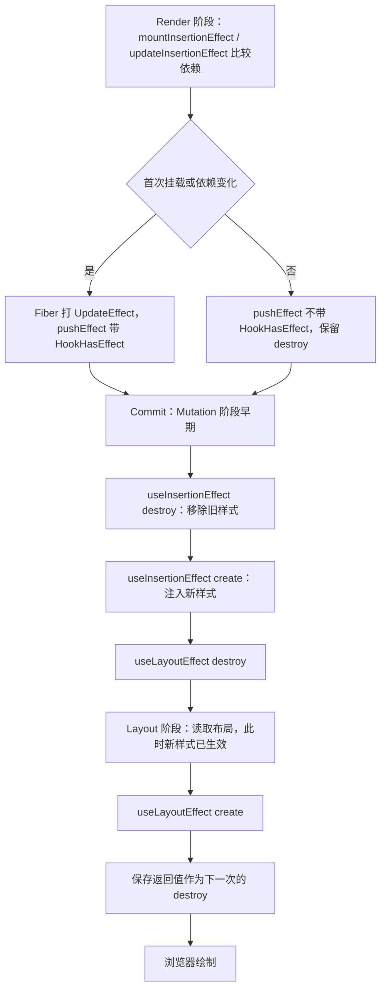

# useInsertionEffect

实现上与另外两种 Effect 共用 `mountEffectImpl` / `updateEffectImpl`，区别只在标记：Fiber 打 `UpdateEffect`，Effect 打 `HookInsertion`。核心代码位于 `packages/react-reconciler/src/ReactFiberHooks.old.js` 与 `ReactFiberCommitWork.old.js`，通用的 Effect [数据结构](/frameworks/react/advanced/source-code/hooks/useEffect#_5-effect-的数据结构)与[执行顺序](/frameworks/react/advanced/source-code/hooks/useEffect#_9-执行顺序)见 [useEffect](/frameworks/react/advanced/source-code/hooks/useEffect)。

`useInsertionEffect` 用于在布局读取之前把样式插入文档，专供 CSS-in-JS 库使用。它没有业务层面的返回值，回调的返回值作为清理函数，在 Mutation 阶段早期同步执行 destroy 与 create，比 `useLayoutEffect` 更早。普通业务副作用不应使用它；需要读取布局时用 `useLayoutEffect`，不阻塞绘制时用 `useEffect`。

## 1. 基础用法

```tsx
import { useInsertionEffect } from 'react'

function FancyButton({ color }: { color: string }) {
  // 依赖变化或卸载时，先移除旧样式再插入新样式。
  useInsertionEffect(() => {
    const style = document.createElement('style')
    style.textContent = `.fancy-button { color: ${color}; }`
    document.head.appendChild(style)

    // 清理函数：移除本次插入的 style 标签。
    return () => {
      document.head.removeChild(style)
    }
  }, [color])

  return <button className="fancy-button">按钮</button>
}
```

示例在 Layout Effect 读取布局之前把 `.fancy-button` 的样式写入 `<head>`，保证后续测量拿到的是新样式。依赖数组的语义与其他 Effect 相同：不传表示每次渲染后执行，`[]` 只在挂载和卸载时执行，`[color]` 在依赖变化时先清理再执行。执行时机固定在 Mutation 阶段早期，因此 `ref` 尚未挂载、不能读取布局，也不能在其中调度更新。

## 2. 挂载阶段

挂载入口是 `mountInsertionEffect`，直接把 Effect 类型标记为 `HookInsertion`，再委托给共享的 `mountEffectImpl`：

```ts [react-reconciler/src/ReactFiberHooks.old.js]
function mountInsertionEffect(
  create: () => (() => void) | void,
  deps: Array<mixed> | void | null,
): void {
  // 与 useLayoutEffect 共用实现，Effect 类型标记为 HookInsertion。
  return mountEffectImpl(UpdateEffect, HookInsertion, create, deps)
}

function updateInsertionEffect(
  create: () => (() => void) | void,
  deps: Array<mixed> | void | null,
): void {
  // 更新阶段同样只传这两个标记，是否执行由依赖比较决定。
  return updateEffectImpl(UpdateEffect, HookInsertion, create, deps)
}
```

两个函数都只传 `UpdateEffect` 与 `HookInsertion`，没有额外的静态标记或开发期标记。挂载时 `mountEffectImpl` 新建 Hook 节点、给 Fiber 打上 `UpdateEffect`，并以 `HookHasEffect | HookInsertion` 调用 `pushEffect`，完整代码见 [useEffect 的挂载阶段](/frameworks/react/advanced/source-code/hooks/useEffect#_2-挂载阶段)。

## 3. 更新阶段

更新入口 `updateInsertionEffect` 沿用 `UpdateEffect` 与 `HookInsertion`，交给 `updateEffectImpl` 比较依赖。依赖相等时仍然 push 一个 Effect 节点，但 `tag` 里没有 `HookHasEffect`，Fiber 也不会被打上 `UpdateEffect`，本次不执行；依赖变化时才打标记并带上 `HookHasEffect`。执行与否完全由 `HookHasEffect` 控制，上一次 create 返回的 `destroy` 会保留到新节点上。更新路径的完整代码见 [useEffect 的更新阶段](/frameworks/react/advanced/source-code/hooks/useEffect#_3-更新阶段)。

## 4. Mutation 阶段早期执行

Insertion Effect 的 destroy 和 create 都在 `commitMutationEffectsOnFiber` 里完成，且排在 Layout destroy 之前。完整代码见 [useEffect](/frameworks/react/advanced/source-code/hooks/useEffect#_3-7-mutation-阶段-insertion-与-layout-清理)：

```text
Mutation
  → useInsertionEffect destroy
  → useInsertionEffect create     ← 样式在这里注入
  → useLayoutEffect destroy       ← 此时布局读取已经能看到新样式
```

这个位置解决了 CSS-in-JS 的一个核心问题：如果样式在 `useLayoutEffect` 里注入，组件在同一个 Layout 阶段读取布局时可能还拿不到最新样式，导致测量结果错误；放到 `useInsertionEffect` 就能保证样式先落地。

## 5. 使用边界

`useInsertionEffect` 不是给普通业务代码用的，官方对它的限制很明确：

- **只做样式注入**：典型场景是动态生成 `<style>` 标签或调用 CSS-in-JS 运行时的插入方法。
- **不要读取布局**：此时 DOM 的 ref 还没有挂载，`ref.current` 仍然是 `null`，`getBoundingClientRect()` 之类的读取没有意义。
- **不要调度更新**：在 Insertion Effect 中调用 `setState` 不会得到预期结果，React 会给出警告。
- **不要依赖执行顺序处理业务逻辑**：它的执行时机属于渲染管线内部，普通副作用应使用 `useLayoutEffect` 或 `useEffect`。

## 6. 与另外两个 Effect 的对比

[width(16,26,35,23)]

| 维度         | `useInsertionEffect` | `useLayoutEffect`               | `useEffect`           |
| ------------ | -------------------- | ------------------------------- | --------------------- |
| Effect 标记  | `HookInsertion`      | `HookLayout`                    | `HookPassive`         |
| 执行阶段     | Mutation 早期        | Mutation destroy、Layout create | 绘制后 Scheduler 回调 |
| 是否同步     | 是                   | 是                              | 否                    |
| ref 是否可用 | 否                   | 是                              | 是                    |
| 典型用途     | CSS-in-JS 注入样式   | 测量布局、同步修改 DOM          | 请求、订阅、日志      |

## 7. 完整流程

`useInsertionEffect` 的 destroy 与 create 都集中在 Mutation 阶段早期，先于 Layout destroy，因此后续布局读取一定能看到刚注入的样式：



## 8. 总结

[width(37,63)]

| 概念                           | 作用                                       |
| ------------------------------ | ------------------------------------------ |
| `HookInsertion`                | 标记 Insertion Effect 类型                 |
| `UpdateEffect`                 | 让 Commit 阶段处理该子树的副作用           |
| `commitMutationEffectsOnFiber` | 在 Mutation 阶段早期执行 destroy 与 create |
| `HookHasEffect`                | 过滤出本次依赖变化的 Effect                |

`useInsertionEffect` 的“**早**”是为了让样式在布局读取前生效；它不参与普通业务副作用的执行。需要读取布局时使用 [useLayoutEffect](/frameworks/react/advanced/source-code/hooks/useLayoutEffect)，不阻塞绘制时使用 [useEffect](/frameworks/react/advanced/source-code/hooks/useEffect)。
