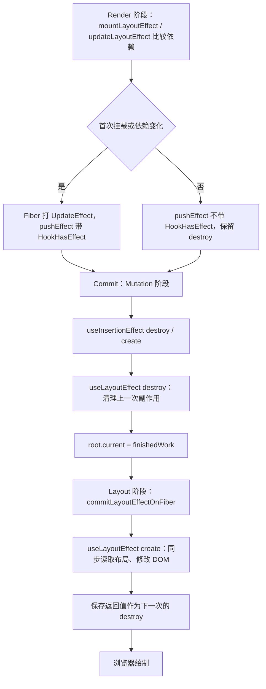

# useLayoutEffect

实现位于 `packages/react-reconciler/src/ReactFiberHooks.old.js` 与 `ReactFiberCommitWork.old.js`。通用的 Effect [数据结构](/frameworks/react/advanced/source-code/hooks/useEffect#_5-effect-的数据结构)与[执行顺序](/frameworks/react/advanced/source-code/hooks/useEffect#_9-执行顺序)见 [useEffect](/frameworks/react/advanced/source-code/hooks/useEffect)。

`useLayoutEffect` 用于在 DOM 变更完成、浏览器尚未绘制时同步执行副作用，回调的返回值作为下一次的清理函数。它不返回业务值，在 Commit 的 Mutation 阶段执行 destroy、在 Layout 阶段同步执行 create，因此可以读取最新布局并同步修改 DOM。适合测量布局、定位 tooltip、绘制前滚动或聚焦等必须避免视觉闪烁的场景；代价是阻塞绘制，不依赖布局的副作用应使用 `useEffect`。

## 1. 基础用法

```tsx
import { useLayoutEffect, useRef, useState } from 'react'

function Tooltip({ text }: { text: string }) {
  const ref = useRef<HTMLDivElement>(null)
  const [height, setHeight] = useState(0)

  // 依赖为空：只在挂载后测量一次，卸载时断开观察。
  useLayoutEffect(() => {
    const element = ref.current
    if (element === null) return

    // 浏览器绘制前读取真实高度，避免用户看到中间态。
    const observer = new ResizeObserver(() => {
      setHeight(element.getBoundingClientRect().height)
    })
    observer.observe(element)

    // 清理函数：依赖变化或卸载时断开观察。
    return () => observer.disconnect()
  }, [])

  return (
    <div ref={ref}>
      {text}（高度：{height}px）
    </div>
  )
}
```

示例在绘制前测量元素高度并同步写入状态，因此不会出现先渲染旧高度、再跳变的闪烁。依赖数组的语义与 `useEffect` 相同：不传表示每次渲染后执行，`[]` 只在挂载和卸载时执行，`[a]` 在依赖变化时执行。区别在于执行时机：`useLayoutEffect` 的 create 在 Layout 阶段同步执行，destroy 在 Mutation 阶段执行。

## 2. 挂载阶段

挂载入口是 `mountLayoutEffect`，它把 Effect 类型标记为 `HookLayout`，再委托给共享的 `mountEffectImpl`：

:::code-group

```ts [react-reconciler/src/ReactFiberHooks.old.js]
function mountLayoutEffect(
  create: () => (() => void) | void,
  deps: Array<mixed> | void | null,
): void {
  // 基础标记是 UpdateEffect，表示子树中存在需要执行的 Layout Effect。
  let fiberFlags: Flags = UpdateEffect
  // 省略 Suspense/Offscreen 与 Strict Effects 下的附加标记
  return mountEffectImpl(fiberFlags, HookLayout, create, deps) // HookLayout 标记 Effect 类型为 Layout
}

function updateLayoutEffect(
  create: () => (() => void) | void,
  deps: Array<mixed> | void | null,
): void {
  // 更新阶段沿用相同标记，是否真正执行由依赖比较决定。
  return updateEffectImpl(UpdateEffect, HookLayout, create, deps)
}
```

:::

共享的 `mountEffectImpl` 会新建 Hook 节点、给 Fiber 打上 `fiberFlags`，并以 `HookHasEffect | HookLayout` 调用 `pushEffect`，完整代码见 [useEffect 的挂载阶段](/frameworks/react/advanced/source-code/hooks/useEffect#_2-挂载阶段)。

标记说明：

- `UpdateEffect`：表示这棵子树含有需要执行的 Layout Effect。
- `LayoutStaticEffect`：开启 `enableSuspenseLayoutEffectSemantics` 时追加，用于 Suspense / Offscreen 场景下区分“**静态**”Layout Effect。
- `MountLayoutDevEffect`：开发构建的 Strict Effects 模式下追加，用于模拟卸载与重新挂载。

与 `useEffect` 不同，`useLayoutEffect` 没有 `PassiveStaticEffect`，因为它的执行由 Commit 阶段同步驱动，不需要额外的静态标记来决定是否调度。

## 3. 更新阶段

更新入口 `updateLayoutEffect` 沿用 `UpdateEffect` 与 `HookLayout`，交给 `updateEffectImpl` 比较依赖。依赖相等时，它仍然 push 一个 Effect 节点，但 `tag` 里没有 `HookHasEffect`，也不给 Fiber 打标记，Commit 阶段因此跳过本次执行；依赖变化时才打上 `UpdateEffect` 并带上 `HookHasEffect`。无论哪种情况，上一次 create 返回的 `destroy` 都会沿用到新节点，供 Mutation 阶段清理。更新路径的完整代码与依赖比较见 [useEffect 的更新阶段](/frameworks/react/advanced/source-code/hooks/useEffect#_3-更新阶段)。

## 4. Mutation 阶段：先执行 destroy

Layout Effect 的清理函数不在 Layout 阶段执行，而是在 Mutation 阶段统一执行。函数组件的 Mutation 分支见 [useEffect](/frameworks/react/advanced/source-code/hooks/useEffect#_3-7-mutation-阶段-insertion-与-layout-清理) 中的 `commitMutationEffectsOnFiber`：

```text
Mutation
  → useInsertionEffect destroy / create
  → useLayoutEffect destroy        ← 所有组件的 destroy 在这里完成
Layout
  → useLayoutEffect create         ← 所有组件的 create 在这里开始
```

把 destroy 提前到 Mutation 阶段，是为了保证“**所有**” Layout Effect 的 destroy 都先于“**任何 Layout Effect 的 create**”执行。如果某个组件的清理函数依赖另一个组件刚刚建立的状态（例如覆盖了同一个 ref），先 destroy 后 create 才能避免交叉污染。

## 5. Layout 阶段：执行 create

Layout 阶段由 `commitLayoutEffectOnFiber` 处理函数组件：

```ts [react-reconciler/src/ReactFiberCommitWork.old.js]
function commitLayoutEffectOnFiber(
  finishedRoot: FiberRoot,
  current: Fiber | null,
  finishedWork: Fiber,
  committedLanes: Lanes,
): void {
  if ((finishedWork.flags & LayoutMask) !== NoFlags) {
    // 只处理带 Layout 标记的 Fiber
    switch (finishedWork.tag) {
      // 函数组件、forwardRef 与 memo 组件统一通过 Hook 链表执行。
      case FunctionComponent:
      case ForwardRef:
      case SimpleMemoComponent: {
        // 省略 Suspense/Offscreen 隐藏子树的判断
        // 此时 Layout Effect 已在 Mutation 阶段销毁，这里只执行 create。
        commitHookEffectListMount(HookLayout | HookHasEffect, finishedWork) // 只执行依赖变化的 Layout Effect
        break
      }
      // ... 类组件的 componentDidMount / componentDidUpdate
    }
  }
}
```

Layout 阶段只执行带 `HookHasEffect` 的 Layout Effect，也就是本次依赖确实变化的那些。注释再次强调了执行顺序：执行到这里时，Layout Effect 已经在 Mutation 阶段被销毁。

## 6. 为什么必须同步执行

`useLayoutEffect` 的价值在于“**绘制前拿到确定的结果**”：

- **测量布局**：读取 `getBoundingClientRect()`、`offsetWidth` 等，再同步调整状态，避免用户看到中间态。
- **同步修改 DOM**：例如在绘制前滚动到指定位置、设置焦点、修正 tooltip 位置。
- **避免闪烁**：如果改用 `useEffect`，浏览器可能先绘制旧状态，再在下一次渲染中修正，出现可见的闪烁。

代价同样明显：create 在 Commit 阶段同步执行，会阻塞浏览器绘制。因此在里面做耗时计算或大量 DOM 操作，会直接拖慢首屏与交互响应。

## 7. 与 `useEffect` 的对比

[width(18,26,56)]

| 维度         | `useLayoutEffect`                | `useEffect`                            |
| ------------ | -------------------------------- | -------------------------------------- |
| Effect 标记  | `HookLayout`                     | `HookPassive`                          |
| Fiber 标记   | `UpdateEffect`                   | `PassiveEffect \| PassiveStaticEffect` |
| destroy 时机 | Mutation 阶段                    | Passive unmount，绘制之后              |
| create 时机  | Layout 阶段，绘制之前            | Scheduler 回调，绘制之后               |
| 是否阻塞绘制 | 是                               | 否                                     |
| 典型用途     | 测量布局、同步修正 DOM、避免闪烁 | 请求、订阅、日志等非阻塞副作用         |

**SSR 注意**：服务端渲染时没有真实的 DOM 布局，`useLayoutEffect` 在服务端会触发警告。依赖布局测量的逻辑应放到客户端组件中，或改用 `useEffect` 并在回调里做条件判断。

## 8. 完整流程

`useLayoutEffect` 的 destroy 集中在 Mutation 阶段，create 集中在 Layout 阶段，两步都发生在浏览器绘制之前：



## 9. 总结

[width(43,57)]

| 概念                                  | 作用                                     |
| ------------------------------------- | ---------------------------------------- |
| `HookLayout`                          | 标记 Layout Effect 类型                  |
| `UpdateEffect` / `LayoutStaticEffect` | 让 Commit 阶段知道子树含有 Layout Effect |
| `commitMutationEffectsOnFiber`        | 在 Mutation 阶段统一执行 Layout destroy  |
| `commitLayoutEffectOnFiber`           | 在 Layout 阶段同步执行 Layout create     |
| `HookHasEffect`                       | 过滤出本次依赖变化的 Effect              |

`useLayoutEffect` 的“**同步**”来自 Commit 阶段的执行位置，而不是 Hook 本身做了什么特殊处理。需要更早注入样式时使用 [useInsertionEffect](/frameworks/react/advanced/source-code/hooks/useInsertionEffect)；不依赖布局的副作用应优先使用 [useEffect](/frameworks/react/advanced/source-code/hooks/useEffect)。
