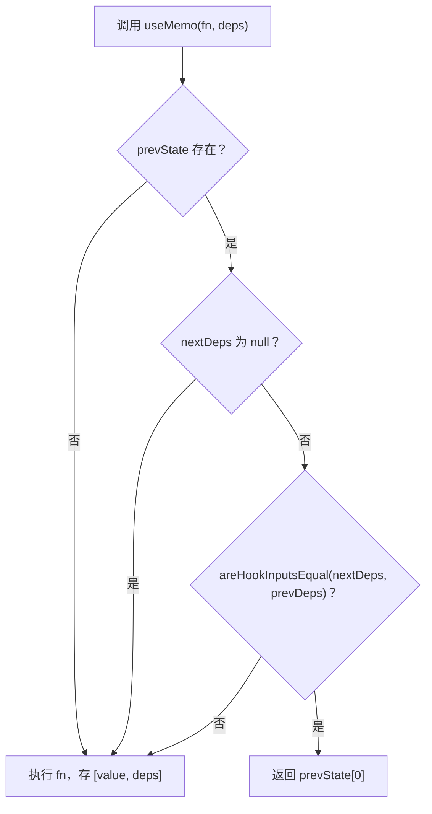

# useMemo

`useMemo` 的目标很单一：在依赖不变时复用上一次的计算结果。它的实现只比 `useCallback` 多一步“执行工厂函数”，核心决策都由 `areHookInputsEqual` 完成。

实现位于 `packages/react-reconciler/src/ReactFiberHooks.old.js`，入口是 `mountMemo` 与 `updateMemo`。依赖比较规则见 [Hooks 链表](/frameworks/react/advanced/source-code/hooks/hooksInternals#_4-依赖数组的比较规则)。

## 1. 缓存与引用 Hook 的定位

`useMemo` 与 `useCallback`、`useRef` 同属“缓存与引用”类 Hook，三者的分工不同：

[width(23,13,23,41)]

| Hook          | 缓存内容 | 依赖变化时       | 典型用途                   |
| ------------- | -------- | ---------------- | -------------------------- |
| `useMemo`     | 计算结果 | 重新执行工厂函数 | 昂贵计算、稳定对象引用     |
| `useCallback` | 函数引用 | 返回新函数       | 稳定回调，配合 `memo`      |
| `useRef`      | 可变对象 | 不参与依赖比较   | 保存 DOM、定时器、上一次值 |

三者的 `memoizedState`：

```text
useMemo:      [value, deps]
useCallback:  [callback, deps]
useRef:       { current: initialValue }
```

`useMemo` / `useCallback` 把“值 + 依赖”一起存进 Hook 节点，因为下一次渲染必须知道上一次的依赖是什么；`useRef` 只存一个可变对象，不需要依赖数组。

三个 Hook 都不参与更新调度，只决定“本次渲染拿到什么”：

- `useMemo` / `useCallback` 决定返回旧值还是新值。
- `useRef` 提供一个跨渲染保持稳定的可变容器。
- 修改 `ref.current` 不会触发渲染，因为 React 不监听这个普通对象。

三者的挂载与更新行为：

[width(23,28,28,21)]

| Hook          | Mount 行为                       | Update 行为                        | 是否触发渲染 |
| ------------- | -------------------------------- | ---------------------------------- | ------------ |
| `useMemo`     | 执行工厂函数，存 `[value, deps]` | 依赖相等返回旧值，否则重算         | 否           |
| `useCallback` | 存 `[fn, deps]`                  | 依赖相等返回旧函数，否则返回新函数 | 否           |
| `useRef`      | 创建 `{ current }`               | 返回同一个对象                     | 否           |

## 2. `mountMemo` 与 `updateMemo`

:::code-group

```ts [react-reconciler/src/ReactFiberHooks.old.js]
function mountMemo<T>(
  nextCreate: () => T,
  deps: Array<mixed> | void | null,
): T {
  const hook = mountWorkInProgressHook()
  const nextDeps = deps === undefined ? null : deps
  const nextValue = nextCreate()
  hook.memoizedState = [nextValue, nextDeps]
  return nextValue
}
```

```ts [react-reconciler/src/ReactFiberHooks.old.js]
function updateMemo<T>(
  nextCreate: () => T,
  deps: Array<mixed> | void | null,
): T {
  const hook = updateWorkInProgressHook()
  const nextDeps = deps === undefined ? null : deps
  const prevState = hook.memoizedState
  if (prevState !== null) {
    // Assume these are defined. If they're not, areHookInputsEqual will warn.
    if (nextDeps !== null) {
      const prevDeps: Array<mixed> | null = prevState[1]
      if (areHookInputsEqual(nextDeps, prevDeps)) {
        return prevState[0]
      }
    }
  }
  const nextValue = nextCreate()
  hook.memoizedState = [nextValue, nextDeps]
  return nextValue
}
```

:::

## 3. 复用决策

`updateMemo` 的判断可以写成：

```text
取 Hook
  → 有旧值、有 deps、且依赖相等？
      ├─ 是 → 返回 prevState[0]
      └─ 否 → 调用 nextCreate() → 存入 [value, deps] → 返回
```

对应到流程图：



`updateMemo` 里的 `prevState[1]` 就是上一次存的依赖数组。没有它，React 就无法判断本次是否应该重新计算。

## 4. 为什么存依赖数组

`memoizedState` 不只存计算结果，还存本次依赖：

```js
hook.memoizedState = [nextValue, nextDeps]
```

下次渲染时，才能通过 `prevState[1]` 拿到上一次的依赖，和本次 `nextDeps` 做浅比较。如果只存值，缓存就失去了“什么时候失效”的依据。

依赖数组本身也会被原样保存，因此下面两种写法的缓存行为完全不同：

- `useMemo(fn, [])`：`nextDeps` 是空数组，`areHookInputsEqual` 直接返回 `true`，只在挂载时计算一次。
- `useMemo(fn)`：`nextDeps` 是 `null`，不会进入复用分支，每次渲染都会重新执行 `nextCreate`。

## 5. 不要依赖 `useMemo` 做语义保证

React 官方明确说明：`useMemo` 是性能优化，不是语义保证。未来 React 可能丢弃缓存并重新计算。因此：

- 不要在 `useMemo` 里做有副作用的操作。
- 不要依赖它“只执行一次”。
- 需要“只执行一次”的初始化逻辑，用 `useRef` 或 `useState` 惰性初始化。

如果一段逻辑在缓存被丢弃后会产生错误结果，那么它就不应该放在 `useMemo` 里。

## 6. 依赖数组的常见错误

### 6.1 不要用内联对象/函数做依赖

```jsx
// 反例：每次渲染 options 都是新对象
const data = useMemo(() => fetchData(options), [options])
```

应把稳定值拆成基本类型，或把对象提到组件外：

```jsx
const data = useMemo(() => fetchData({ page, pageSize }), [page, pageSize])
```

内联函数作为依赖同理：每次渲染都会创建新的函数引用，`Object.is` 比较永远为 `false`，缓存随之失效。

### 6.2 依赖数组长度不要变化

React 18 在开发构建中会检查两次渲染的依赖数组长度是否一致。长度变化通常意味着条件分支改变了 Hook 的输入，容易引发难以定位的缓存错误：

```jsx
// 反例：deps 长度时有时无
useMemo(() => compute(a), flag ? [a] : [])
```

依赖数组的长度和顺序在一组 Hook 调用中必须保持稳定，这与 Hooks 必须按顺序调用的规则是同一件事。

## 7. 与简化实现的差异

这里的“简化实现”指仓库中用于教学的 mini-react / xunbei-react 版本。它们通常把 Mount 与 Update 合并进一个函数，通过 `hook.memoizedState` 是否为 `null` 来判断阶段。与 React 18.3.1 的差异如下：

[width(15,44,41)]

| 维度       | React 18.3.1                                                        | 简化实现                                   |
| ---------- | ------------------------------------------------------------------- | ------------------------------------------ |
| 阶段拆分   | `mountMemo` / `updateMemo`、`mountCallback` / `updateCallback` 分开 | 合并为一个函数，运行时判断阶段             |
| Dispatcher | Mount/Update 两套函数表                                             | 没有 Dispatcher，直接调用内部函数          |
| 依赖比较   | `areHookInputsEqual` + `Object.is`                                  | 可能直接用 `===`，对 `NaN` / `-0` 语义不同 |

`useCallback` 的实现与 `useMemo` 同构，阶段拆分与 Dispatcher 的差异也相同。

## 8. 总结

[width(26,74)]

| 概念                 | 作用                                     |
| -------------------- | ---------------------------------------- |
| `mountMemo`          | 执行工厂函数，存 `[value, deps]`         |
| `updateMemo`         | 依赖相等返回旧值，否则重新计算并更新缓存 |
| `memoizedState`      | 同时保存缓存值与依赖数组                 |
| `areHookInputsEqual` | 用 `Object.is` 逐项比较依赖              |
| 语义边界             | 只是性能优化，缓存可能被丢弃             |

`useMemo` 与 `useCallback` 的实现几乎同构，只是缓存的内容不同；需要缓存函数引用时见 [useCallback](/frameworks/react/advanced/source-code/hooks/useCallback)。
