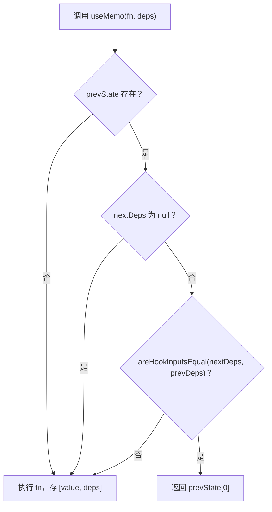
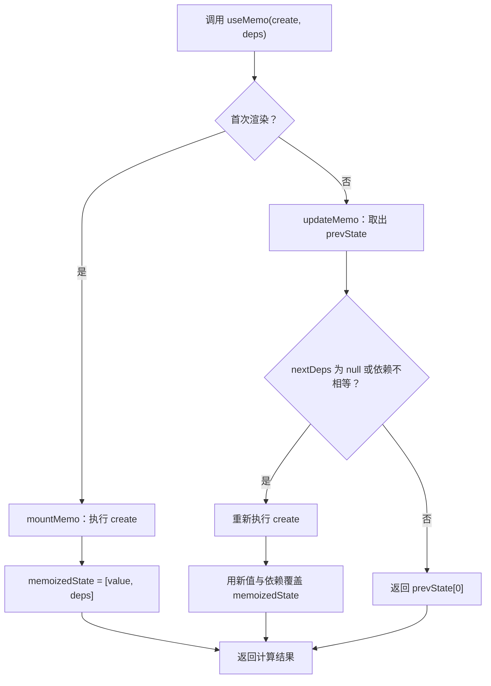

# useMemo

`useMemo` 在依赖数组不变时复用上一次的计算结果，依赖变化时重新执行工厂函数并返回新值。挂载阶段它一定会执行一次工厂函数，更新阶段用 `Object.is` 逐项比较依赖，命中则直接返回缓存。它只用于性能优化，不提供语义保证。

`useMemo` 与 `useCallback`、`useRef` 同属“**缓存与引用**”类 Hook，三者的分工不同：

[width(23,13,23,41)]

| Hook          | 缓存内容 | 依赖变化时       | 典型用途                   |
| ------------- | -------- | ---------------- | -------------------------- |
| `useMemo`     | 计算结果 | 重新执行工厂函数 | 昂贵计算、稳定对象引用     |
| `useCallback` | 函数引用 | 返回新函数       | 稳定回调，配合 `memo`      |
| `useRef`      | 可变对象 | 不参与依赖比较   | 保存 DOM、定时器、上一次值 |

## 1. 基础用法

```tsx
import { useMemo, useState } from 'react'

const products = ['apple', 'banana', 'cherry']

function ProductList() {
  const [keyword, setKeyword] = useState('')

  // 只有 keyword 变化时才重新过滤，否则直接复用上一次的结果。
  const visible = useMemo(() => {
    return products.filter(item => item.includes(keyword))
  }, [keyword])

  return (
    <ul>
      <input
        value={keyword}
        onChange={event => setKeyword(event.target.value)}
      />
      {visible.map(item => (
        <li key={item}>{item}</li>
      ))}
    </ul>
  )
}
```

> [!TIP]
> `useMemo(create, deps)` 接收一个工厂函数和依赖数组，返回工厂函数的计算结果。`deps` 省略时按 `null` 处理，每次渲染都会重新计算；传空数组则只在挂载时计算一次。依赖应使用引用稳定的值，内联对象或函数会让每次比较都失败。

## 2. 挂载阶段

`mountMemo` 先调用 `mountWorkInProgressHook` 在当前 Fiber 上挂载一个 Hook 节点，再处理依赖：`deps === undefined` 时记为 `null`，这样更新阶段不会命中复用，挂载阶段没有历史缓存，工厂函数 `nextCreate()` 必定执行一次，结果与依赖一起存成 `hook.memoizedState = [nextValue, nextDeps]`，最后把结果返回给组件。

:::code-group

```ts [react-reconciler/src/ReactFiberHooks.old.js]
function mountMemo<T>(
  nextCreate: () => T,
  deps: Array<mixed> | void | null,
): T {
  const hook = mountWorkInProgressHook()
  // 未传 deps 时记为 null，更新阶段不会命中复用。
  const nextDeps = deps === undefined ? null : deps
  // 挂载时必定执行工厂函数，并把结果与依赖一起缓存。
  const nextValue = nextCreate()
  hook.memoizedState = [nextValue, nextDeps]
  return nextValue
}
```

:::

## 3. 更新阶段

`updateMemo` 通过 `updateWorkInProgressHook` 复用 current 树上对应的 Hook 节点，然后读取上次缓存 `prevState`。只有 `prevState` 存在且本次传入 `deps` 时，才会拿 `prevState[1]` 与 `nextDeps` 交给 `areHookInputsEqual` 逐项比较，比较命中时直接返回 `prevState[0]`，不执行工厂函数；未命中时执行 `nextCreate()`，用新结果和依赖覆盖 `memoizedState`，再返回新值。

:::code-group

```ts [react-reconciler/src/ReactFiberHooks.old.js]
function updateMemo<T>(
  nextCreate: () => T,
  deps: Array<mixed> | void | null,
): T {
  const hook = updateWorkInProgressHook()
  const nextDeps = deps === undefined ? null : deps
  const prevState = hook.memoizedState
  if (prevState !== null) {
    if (nextDeps !== null) {
      const prevDeps: Array<mixed> | null = prevState[1] // 上次缓存的依赖数组
      // 依赖逐项相等时复用上一次的计算结果。
      if (areHookInputsEqual(nextDeps, prevDeps)) {
        return prevState[0] // 上次缓存的计算结果
      }
    }
  }
  // 未命中复用时重新执行工厂函数，并用新值与依赖覆盖缓存。
  const nextValue = nextCreate()
  hook.memoizedState = [nextValue, nextDeps]
  return nextValue
}
```

:::

## 4. 复用决策

`updateMemo` 的判断可以写成：

```tree
取 Hook
  → 有旧值、有 deps、且依赖相等？
      ├─ 是 → 返回 prevState[0]
      └─ 否 → 调用 nextCreate() → 存入 [value, deps] → 返回
```



`updateMemo`里的`prevState[1]`就是上一次存的依赖数组。没有它，React就无法判断是否应该重新计算。

## 5. 为什么存依赖数组

`memoizedState` 不只存计算结果，还存本次依赖：

```js
// 缓存值与依赖数组，下一次渲染靠 prevState[1] 判断缓存是否失效。
hook.memoizedState = [nextValue, nextDeps]
```

下次渲染时，才能通过 `prevState[1]` 拿到上一次的依赖，和本次 `nextDeps` 做浅比较。如果只存值，缓存就失去了“**什么时候失效**”的依据。

依赖数组本身也会被原样保存，因此下面两种写法的缓存行为完全不同：

- `useMemo(fn, [])`：`nextDeps`是空数组,`areHookInputsEqual`直接返回`true`，只在挂载时计算一次。
- `useMemo(fn)`：`nextDeps` 是 `null`，不会进入复用分支，每次渲染都会重新执行 `nextCreate`。

## 6. 依赖数组的常见错误

**不要用内联对象/函数做依赖。** 内联对象每次渲染都是新引用：

```jsx
// 反例：每次渲染 options 都是新对象
const data = useMemo(() => fetchData(options), [options])
```

应把稳定值拆成基本类型，或把对象提到组件外：

```jsx
// 依赖拆成基本类型，引用稳定才能命中缓存。
const data = useMemo(() => fetchData({ page, pageSize }), [page, pageSize])
```

内联函数作为依赖同理：每次渲染都会创建新的函数引用，`Object.is` 比较永远为 `false`，缓存随之失效。

**依赖数组长度不要变化。** React 18 在开发构建中会检查两次渲染的依赖数组长度是否一致。长度变化通常意味着条件分支改变了 Hook 的输入，容易引发难以定位的缓存错误：

```jsx
// 反例：deps 长度时有时无
useMemo(() => compute(a), flag ? [a] : [])
```

依赖数组的长度和顺序在一组 Hook 调用中必须保持稳定，这与 Hooks 必须按顺序调用的规则是同一件事。

## 7. 完整流程图



挂载阶段只走执行工厂函数的分支；更新阶段先比较依赖，命中就复用缓存，未命中才重新计算并覆盖缓存。

## 8. 总结

[width(26,74)]

| 概念                 | 作用                                     |
| -------------------- | ---------------------------------------- |
| `mountMemo`          | 执行工厂函数，存 `[value, deps]`         |
| `updateMemo`         | 依赖相等返回旧值，否则重新计算并更新缓存 |
| `memoizedState`      | 同时保存缓存值与依赖数组                 |
| `areHookInputsEqual` | 用 `Object.is` 逐项比较依赖              |
| 省略 deps            | `nextDeps` 为 `null`，每次渲染都重新计算 |
| 语义边界             | 只是性能优化，缓存可能被丢弃             |

`useMemo` 与 `useCallback` 的实现几乎同构，只是缓存的内容不同；需要缓存函数引用时见 [useCallback](/frameworks/react/advanced/source-code/hooks/useCallback)。
