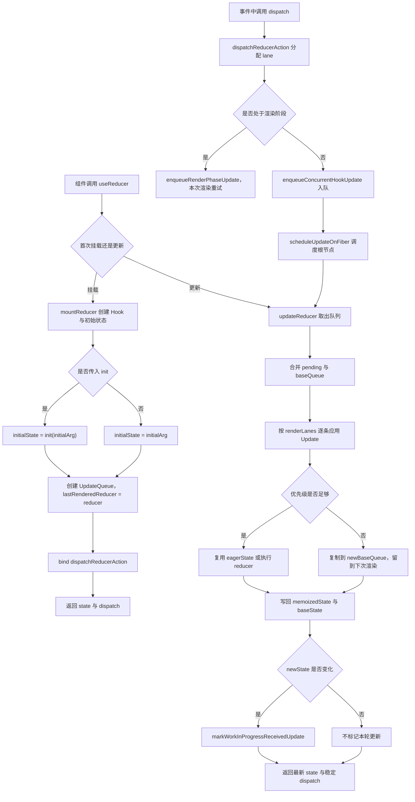

# useReducer

`useReducer` 是状态 Hook 的通用形式：它把“**如何根据 action 计算新状态**”交给调用方传入的 reducer，自己只负责维护状态、收集更新并触发调度。它接收 reducer、初始参数与可选的 init 函数，返回当前状态与稳定的 `dispatch`。`useState` 只是把 reducer 固定成 `basicStateReducer` 的特例。当状态转换逻辑复杂、action 种类多或需要集中管理状态变化时，优先使用 `useReducer`。

## 1. 基础用法

`useReducer(reducer, initialArg, init?)` 的三个参数分别是：计算新状态的 reducer、初始参数，以及可选的惰性初始化函数。返回值是 `[state, dispatch]`；`dispatch(action)` 把 action 交给 reducer，并触发一次带 lane 的调度。

```tsx
import { useReducer } from 'react'

type Action = { type: 'increment' } | { type: 'decrement' } | { type: 'reset' }

function reducer(state: number, action: Action) {
  switch (action.type) {
    case 'increment':
      return state + 1
    case 'decrement':
      return state - 1
    case 'reset':
      return 0
    default:
      return state
  }
}

function Counter() {
  // 第二个参数是初始状态；dispatch 接收 action 并交给 reducer 计算新状态。
  const [count, dispatch] = useReducer(reducer, 0)

  return (
    <div>
      <p>{count}</p>
      {/* dispatch 的函数身份稳定，可以直接传给子组件。 */}
      <button onClick={() => dispatch({ type: 'increment' })}>加一</button>
      <button onClick={() => dispatch({ type: 'reset' })}>重置</button>
    </div>
  )
}
```

> [!TIP]
> 常见写法是把 action 定义成可辨识联合类型，在 reducer 中分支计算新状态；如果初始状态需要惰性计算，可以传入第三个参数 `init`，写成 `useReducer(reducer, initialArg, init)`。`dispatch` 的身份在多次渲染间保持稳定，适合直接传给子组件。

## 2. 挂载阶段

挂载时创建状态、更新队列，并把 `dispatch` 预绑定到当前 Fiber 和队列：

:::code-group

```ts [react-reconciler/src/ReactFiberHooks.old.js]
function mountReducer<S, I, A>(
  reducer: (S, A) => S,
  initialArg: I,
  init?: I => S,
): [S, Dispatch<A>] {
  const hook = mountWorkInProgressHook();
  let initialState;
  // 传入 init 时以 init(initialArg) 作为初始状态，否则直接使用 initialArg。
  if (init !== undefined) {
    initialState = init(initialArg);
  } else {
    initialState = ((initialArg: any): S);
  }
  // memoizedState 是已呈现状态，baseState 保存应用被跳过的低优先级更新之前的状态基线。
  hook.memoizedState = hook.baseState = initialState;
  const queue: UpdateQueue<S, A> = {
    pending: null, // 待处理的更新环形队列
    interleaved: null, // 交错更新的队列，用于并发渲染
    lanes: NoLanes, // 队列中待处理更新的 lane 集合
    dispatch: null, // 稍后绑定为 dispatchReducerAction
    lastRenderedReducer: reducer, // 缓存 reducer，供渲染和 eager 计算复用
    lastRenderedState: (initialState: any), // 上次渲染出的 state，供 eager 比较
  };
  hook.queue = queue;
  // dispatch 预绑定当前 Fiber 与队列，方法引用在多次渲染间保持稳定。
  const dispatch: Dispatch<A> = (queue.dispatch = (dispatchReducerAction.bind(
    null,
    currentlyRenderingFiber,
    queue,
  ): any));
  return [hook.memoizedState, dispatch];
}
```

```ts [react-reconciler/src/ReactFiberHooks.old.js]
function mountWorkInProgressHook(): Hook {
  // 新建空节点，具体字段由调用方填充。
  const hook: Hook = {
    memoizedState: null,

    baseState: null,
    baseQueue: null,
    queue: null,

    next: null,
  }

  if (workInProgressHook === null) {
    // 第一个 Hook，直接挂到 Fiber.memoizedState 上。
    currentlyRenderingFiber.memoizedState = workInProgressHook = hook
  } else {
    // 追加到链表尾部。
    workInProgressHook = workInProgressHook.next = hook
  }
  return workInProgressHook
}
```

:::

## 3. 更新阶段

更新阶段先把 `pending` 队列合并进 `baseQueue`，再按 `renderLanes` 逐个处理：

:::code-group

```ts [react-reconciler/src/ReactFiberHooks.old.js]
function updateReducer<S, I, A>(
  reducer: (S, A) => S,
  initialArg: I,
  init?: I => S,
): [S, Dispatch<A>] {
  const hook = updateWorkInProgressHook();
  const queue = hook.queue;

  queue.lastRenderedReducer = reducer; // 缓存 reducer，供渲染和 eager 计算复用

  const current: Hook = (currentHook: any);

  // baseQueue 中最后一个不属于 baseState 的 rebase 更新
  let baseQueue = current.baseQueue;

  // 最后一个尚未被处理的 pending 更新
  const pendingQueue = queue.pending;
  if (pendingQueue !== null) {
    // 有新更新尚未处理，先把它们合并进 baseQueue。
    if (baseQueue !== null) {
      // 把 pending 队列与 baseQueue 拼成一个环。
      const baseFirst = baseQueue.next;
      const pendingFirst = pendingQueue.next;
      baseQueue.next = pendingFirst;
      pendingQueue.next = baseFirst;
    }
    current.baseQueue = baseQueue = pendingQueue;
    queue.pending = null;
  }

  if (baseQueue !== null) {
    const first = baseQueue.next;
    let newState = current.baseState;

    let newBaseState = null; // 下一次渲染使用的 baseState
    let newBaseQueueFirst = null; // 被跳过更新组成的新 baseQueue 头节点
    let newBaseQueueLast = null; // 新 baseQueue 的尾节点
    let update = first;
    do {
      const updateLane = update.lane;
      if (!isSubsetOfLanes(renderLanes, updateLane)) {
        // 优先级不足，跳过这条更新；若是第一条被跳过的更新，当前状态就是新的 baseState。
        // ...
      } else {
        // 优先级足够，正常应用这条更新。
        // ...
        if (update.hasEagerState) {
          newState = ((update.eagerState: any): S);
        } else {
          const action = update.action;
          newState = reducer(newState, action);
        }
      }
      update = update.next;
    } while (update !== null && update !== first);

    if (newBaseQueueLast === null) {
      newBaseState = newState;
    } else {
      newBaseQueueLast.next = (newBaseQueueFirst: any);
    }

    // 状态确实变化时才通知 beginWork 本轮有更新。
    if (!is(newState, hook.memoizedState)) {
      markWorkInProgressReceivedUpdate();
    }

    hook.memoizedState = newState;
    hook.baseState = newBaseState;
    hook.baseQueue = newBaseQueueLast;

    queue.lastRenderedState = newState; // 供下一次 eager 比较
  }

  // ... interleaved 更新的处理

  const dispatch: Dispatch<A> = (queue.dispatch: any);
  return [hook.memoizedState, dispatch];
}
```

:::

这段代码解决四件事：

- **合并队列**：新调度的 `pending` 与上次没处理完的 `baseQueue` 拼成一个环。
- **按 lane 过滤**：优先级不足的 Update 不丢弃，而是克隆到 `newBaseQueue`，留到下一次渲染。
- **复用 eagerState**：如果 dispatch 时已经算过新状态，渲染阶段不再调用 reducer。
- **标记更新**：只有 `newState` 与旧状态不同（`Object.is` 比较）时，才通知 `beginWork` 本轮确实有更新。

## 4. 优先级不足时会发生什么

`updateReducer` 遍历环形队列时，并不是“**全部应用**”或“**全部丢弃**”，而是逐条判断：

```tree
update1 (高优先级) → update2 (低优先级) → update3 (高优先级)
                     ↑ 跳过，复制进 newBaseQueue
```

- 高优先级的 `update1`、`update3` 依次作用于 `newState`。
- `update2` 的 lane 不在本次 `renderLanes` 中，被复制到新的 `baseQueue`。
- 第一个被跳过更新之前的状态成为新的 `baseState`，下次渲染以它为起点继续处理 `update2`。
- 跳过点之后的高优先级更新也会复制进 `baseQueue`，以保持“**低优先级更新在前、高优先级更新在后**”的原始顺序。

这样既保证本次渲染只呈现高优先级结果，又不会丢失低优先级更新。队列因此需要同时维护 `baseState` / `baseQueue`（尚未应用的部分）和 `memoizedState`（已经呈现给用户的状态）。

## 5. `dispatchReducerAction`

`useReducer` 的 dispatch 只负责“**入队 + 调度**”，不负责计算状态：

:::code-group

```ts [react-reconciler/src/ReactFiberHooks.old.js]
function dispatchReducerAction<S, A>(
  fiber: Fiber,
  queue: UpdateQueue<S, A>,
  action: A,
) {
  //根据当前事件优先级分配 lane。
  const lane = requestUpdateLane(fiber)

  const update: Update<S, A> = {
    lane, // 该更新所属的 lane
    action, // 本次 dispatch 传入的 action
    hasEagerState: false, // useReducer 不做 eager 计算
    eagerState: null, // 未使用，恒为 null
    next: null, // 环形队列的下一个节点
  }

  if (isRenderPhaseUpdate(fiber)) {
    // 渲染期间产生的更新直接进入本次渲染的队列。
    enqueueRenderPhaseUpdate(queue, update)
  } else {
    // 普通更新入队，返回需要调度的根节点。
    const root = enqueueConcurrentHookUpdate(fiber, queue, update, lane)
    if (root !== null) {
      const eventTime = requestEventTime()
      // 调度根节点，并处理 Transition 的 lane 纠缠。
      scheduleUpdateOnFiber(root, fiber, lane, eventTime)
      entangleTransitionUpdate(root, queue, lane)
    }
  }

  // 省略 __DEV__ 下的 DevTools 标记
}
```

:::

真正把 Update 挂进环形队列的是 `enqueueConcurrentHookUpdate`。它和 `scheduleUpdateOnFiber` 一起，把“**状态变化**”转成“**根节点上有一条指定 lane 的待处理工作**”。

## 6. 与 `useState` 的关系

`useState` 可以看作 `useReducer` 的一个特化版本：

[width(12,47,41)]

| 维度     | `useReducer`                                  | `useState`                                    |
| -------- | --------------------------------------------- | --------------------------------------------- |
| reducer  | 调用方传入                                    | 固定为 `basicStateReducer`                    |
| 初始化   | `initialArg` + 可选 `init`                    | 直接传值，函数参数视为惰性初始化              |
| dispatch | `dispatchReducerAction`，非渲染阶段入队并调度 | `dispatchSetState`，队列为空时先做 eager 比较 |
| 更新语义 | `dispatch(action)`，由 reducer 决定新状态     | `setState(value)` 或 `setState(fn)`           |
| 适用场景 | 状态转换逻辑复杂、action 种类多、需要集中管理 | 简单独立的状态字段                            |

## 7. 完整流程图



> [!TIP]
> 挂载时 `mountReducer` 初始化状态与队列并绑定 dispatch；`dispatchReducerAction` 把 action 包装成带 lane 的 Update 入队并调度根节点；更新时 `updateReducer` 合并队列、按 lane 应用 Update 并写回状态。

## 8. 总结

[width(36,64)]

| 概念                          | 作用                                           |
| ----------------------------- | ---------------------------------------------- |
| `mountReducer`                | 初始化状态、队列并绑定 dispatch                |
| `updateReducer`               | 合并 `pending` / `baseQueue`，按 lane 应用更新 |
| `dispatchReducerAction`       | 创建 Update、入队并触发调度                    |
| `baseState` / `baseQueue`     | 保存被低优先级跳过的更新，留到后续渲染         |
| `lastRenderedReducer`         | 缓存 reducer，供渲染和 eager 计算复用          |
| `enqueueConcurrentHookUpdate` | 把 Update 挂进环形队列                         |

理解 `useReducer` 之后，`useState` 只剩下初始化特例与 eager bailout 两处差异；Effect 类 Hook 的执行机制则见 [useEffect](/frameworks/react/advanced/source-code/hooks/useEffect)。
