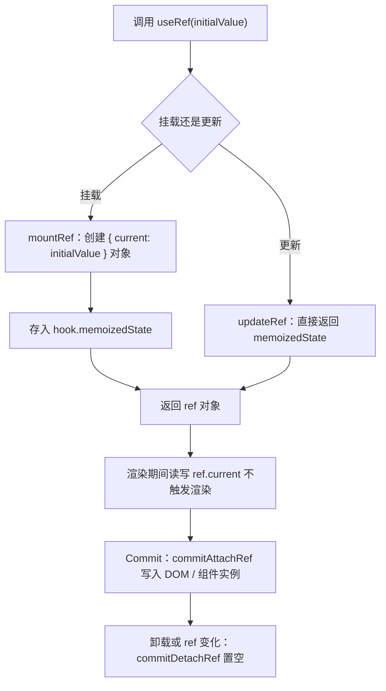

# useRef

`useRef` 是缓存与引用类 Hook 中最简单的一个：挂载时创建一个 `{ current: initialValue }` 对象，之后每次渲染都返回同一个对象。修改 `ref.current` 不会触发渲染，适合保存 DOM 引用、定时器 ID、上一次的值等“**可变但不参与渲染**”的数据。

`useRef(initialValue)` 返回一个可变的 `{ current }` 容器，并在组件多次渲染之间保持同一个对象。它不参与依赖比较，也不触发更新调度：写入 `ref.current` 只是修改一个普通对象，React 不会因此重新渲染。

它适合保存“**渲染之外的可变数据**”：DOM 节点、定时器句柄、上一次的 props / state，或者任何需要跨渲染共享、但不需要驱动视图的值。

## 1. 基础用法

```tsx
function AutoFocusInput() {
  const inputRef = useRef<HTMLInputElement>(null)

  useEffect(() => {
    // Commit 阶段已经把 DOM 写入 current，这里可以直接访问。
    inputRef.current?.focus()
  }, [])

  return <input ref={inputRef} />
}
```

> [!TIP]
>
> - `initialValue` 只在挂载时使用，后续渲染传入的新值会被忽略。
> - 修改 `ref.current` 不会触发渲染。
> - `<input ref={inputRef} />` 这种对象 ref 由 Commit 阶段的 `commitAttachRef` 赋值。

不需要驱动渲染的可变数据也可以放在 ref 里：

```jsx
function Timer() {
  const timerRef = useRef(null)

  useEffect(() => {
    // 定时器 ID 存在 ref 中，修改它不会触发渲染。
    timerRef.current = window.setInterval(() => {
      console.log('tick')
    }, 1000)

    return () => {
      // 清理函数在组件卸载时清除定时器。
      if (timerRef.current !== null) {
        clearInterval(timerRef.current)
      }
    }
  }, [])

  return null
}
```

## 2. 挂载阶段

挂载阶段创建一个 `{ current: initialValue }` 对象，存进 `hook.memoizedState` 后返回。

:::code-group

```ts [react-reconciler/src/ReactFiberHooks.old.js]
function mountRef<T>(initialValue: T): {|current: T|} {
  const hook = mountWorkInProgressHook();
  // 省略 enableUseRefAccessWarning 开启时的 DEV 警告对象
  // 默认构建创建普通对象并存入 Hook 节点。
  const ref = {current: initialValue};
  hook.memoizedState = ref;
  return ref;
}
```

:::

## 3. 更新阶段

更新阶段直接返回同一个对象，完全忽略新的 `initialValue`。因此 `useRef` 的行为可以概括为：

- Mount 时创建一个 `{current: initialValue}` 对象，存进 `hook.memoizedState`。
- Update 时直接返回同一个对象，完全忽略新的 `initialValue`。
- 修改 `ref.current` 不会触发渲染，因为 React 不监听这个普通对象。

:::code-group

```ts [react-reconciler/src/ReactFiberHooks.old.js]
function updateRef<T>(initialValue: T): {|current: T|} {
  const hook = updateWorkInProgressHook();
  // 直接返回同一个对象，忽略新的 initialValue。
  return hook.memoizedState;
}
```

:::

## 4. 为什么能跨渲染保持不变

`updateWorkInProgressHook` 会从 current 树克隆 Hook 节点，但 `memoizedState` 是直接复制引用。因此只要 Hook 的调用顺序不变，`useRef` 每次拿到的都是同一个 `{current}` 对象。它不参与依赖比较，也不会因为父组件重新渲染而重置。

## 5. DOM ref 的提交

`useRef` 只负责创建对象，真正的 DOM 赋值发生在 Commit 阶段：

:::code-group

```ts [react-reconciler/src/ReactFiberCommitWork.old.js]
function commitAttachRef(finishedWork: Fiber) {
  const ref = finishedWork.ref // 可能是回调函数或 { current } 对象
  if (ref !== null) {
    const instance = finishedWork.stateNode
    let instanceToUse
    // HostComponent 取公开实例，其他类型直接使用 stateNode。
    switch (finishedWork.tag) {
      case HostComponent:
        instanceToUse = getPublicInstance(instance)
        break
      default:
        instanceToUse = instance
    }

    // 回调 ref 以实例为参数调用。
    if (typeof ref === 'function') {
      // 省略 Profiler 计时
      ref(instanceToUse)
    } else {
      // 对象 ref 直接把实例写入 current。
      ref.current = instanceToUse
    }
    // 省略 DEV 下对回调返回值与 ref 对象的校验
  }
}

function commitDetachRef(current: Fiber) {
  const currentRef = current.ref
  if (currentRef !== null) {
    // 回调 ref 传 null 通知卸载，对象 ref 清空 current。
    if (typeof currentRef === 'function') {
      currentRef(null)
    } else {
      currentRef.current = null
    }
  }
}
```

:::

> [!TIP]
>
> - `commitAttachRef` 把 `fiber.stateNode` 写入 `ref.current`，或作为参数调用回调 ref。
> - `commitDetachRef` 在卸载或 ref 变化时把 `ref.current` 置空。
> - 对普通 DOM 元素，`stateNode` 是真实 DOM；对类组件，是组件实例。

## 6. 完整流程图



## 7. 总结

[width(23,77)]

| 概念              | 作用                                              |
| ----------------- | ------------------------------------------------- |
| `mountRef`        | 创建 `{ current: initialValue }` 并存入 Hook 节点 |
| `updateRef`       | 直接返回同一个对象，忽略新的初始值                |
| 跨渲染保持稳定    | `memoizedState` 复制的是引用，不参与依赖比较      |
| `commitAttachRef` | Commit 阶段把 DOM / 组件实例写入 `ref.current`    |
| `commitDetachRef` | 卸载或 ref 变化时把 `ref.current` 置空            |
| 不触发渲染        | 修改 `ref.current` 不会通知 React                 |
