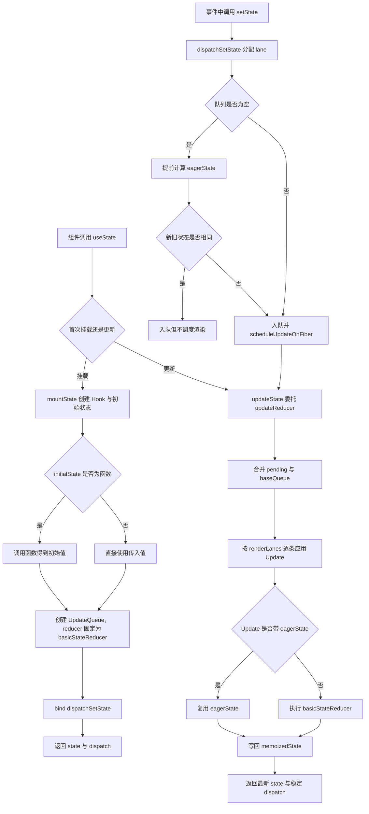

# useState

`useState` 用于在函数组件中声明一个状态变量。它返回一个二元组：当前状态值与更新该状态的 `dispatch` 函数；挂载时用传入的初始值建立状态，更新时返回队列合并后的结果。适合管理相互独立、转换逻辑简单的状态字段；当状态转换复杂时改用 `useReducer`。

## 1. 基础用法

`useState` 接收一个参数：初始值，或返回初始值的函数（惰性初始化）。返回值是一个二元组 `[state, setState]`，其中 `setState` 接收新值或 `(prevState) => nextState` 形式的更新函数。

```tsx
import { useState } from 'react'

function Profile() {
  // 初始值只在挂载阶段写入，之后每次渲染返回队列合并后的当前状态。
  const [name, setName] = useState('React')

  // setName 接收新值；函数身份在多次渲染间保持稳定。
  return <input value={name} onChange={event => setName(event.target.value)} />
}
```

常见写法有两种：直接传入新值（如 `setName('Vue')`），或传入基于旧状态的更新函数（如 `setCount(c => c + 1)`）。当新状态依赖旧状态，尤其是连续调用多次时，应使用函数式更新：

```jsx
function Counter() {
  const [count, setCount] = useState(0)

  function handleClick() {
    // 函数式更新依次叠加，每次都能拿到上一次累加后的状态。
    setCount(c => c + 1)
    setCount(c => c + 1)
    setCount(c => c + 1)
  }

  return <button onClick={handleClick}>{count}</button>
}
```

React 18 的自动批处理（automatic batching）会把同一事件循环中的多次 `dispatch` 合并为一次渲染：

- 每次 dispatch 产生一个 `Update`，多次 dispatch 的 `Update` 按调用顺序排进环形队列。
- 渲染阶段由 `updateReducer` 依次应用，只有最终状态与旧状态不同才提交。
- 不同优先级的更新按 lane 分开处理，低优先级更新留到后续渲染。

## 2. 挂载阶段

挂载阶段创建 Hook、初始化状态、建立队列，并绑定一个专用的 `dispatchSetState`。`mountState` 首先通过 `mountWorkInProgressHook` 取得 Hook 节点：

:::code-group

```ts [react-reconciler/src/ReactFiberHooks.old.js]
function mountState<S>(
  initialState: (() => S) | S,
): [S, Dispatch<BasicStateAction<S>>] {
  const hook = mountWorkInProgressHook();
  if (typeof initialState === 'function') {
    // 初始值是函数时视为惰性初始化，只在挂载阶段调用一次。
    initialState = initialState();
  }
  hook.memoizedState = hook.baseState = initialState;
  const queue: UpdateQueue<S, BasicStateAction<S>> = {
    pending: null, // 待处理的更新环形队列
    interleaved: null, // 交错更新的队列，用于并发渲染
    lanes: NoLanes, // 队列中待处理更新的 lane 集合
    dispatch: null, // 稍后绑定为 dispatchSetState
    lastRenderedReducer: basicStateReducer, // 队列固定使用的 reducer
    lastRenderedState: (initialState: any), // 上次渲染出的 state，供 eager 比较
  };
  hook.queue = queue;
  // dispatch 预绑定当前 Fiber 与队列，函数引用在多次渲染间保持稳定。
  const dispatch: Dispatch<
    BasicStateAction<S>,
  > = (queue.dispatch = (dispatchSetState.bind(
    null,
    currentlyRenderingFiber,
    queue,
  ): any));
  return [hook.memoizedState, dispatch];
}
```

```ts [react-reconciler/src/ReactFiberHooks.old.js]
function mountWorkInProgressHook(): Hook {
  // 新建空节点，具体字段由调用方填充。
  const hook: Hook = {
    memoizedState: null,

    baseState: null,
    baseQueue: null,
    queue: null,

    next: null,
  }

  if (workInProgressHook === null) {
    // 第一个 Hook，直接挂到 Fiber.memoizedState 上。
    currentlyRenderingFiber.memoizedState = workInProgressHook = hook
  } else {
    // 追加到链表尾部。
    workInProgressHook = workInProgressHook.next = hook
  }
  return workInProgressHook
}
```

:::

## 3. 更新阶段

`updateState` 直接委托给 `updateReducer(basicStateReducer, ...)`，队列的合并、lane 过滤、eagerState 复用都由后者完成：

:::code-group

```ts [react-reconciler/src/ReactFiberHooks.old.js]
function updateState<S>(
  initialState: (() => S) | S,
): [S, Dispatch<BasicStateAction<S>>] {
  // 更新阶段不使用 initialState，状态由 updateReducer 从 Hook 节点与队列中恢复。
  return updateReducer(basicStateReducer, (initialState: any));
}
```

:::

`initialState` 在更新阶段不会被使用，`useReducer` 会从 Hook 节点与队列中恢复状态。整体调用链如下：

```markdown
updateState
→ updateReducer(basicStateReducer, initialState)
→ updateWorkInProgressHook()
→ 合并 queue.pending 与 current.baseQueue
→ 按 renderLanes 应用 Update
→ 写回 hook.memoizedState
```

因此 `useState` 在更新阶段没有额外的状态计算逻辑，所有“**这次渲染能否处理这条更新**”的判断都与 `useReducer` 一致。

## 4. `basicStateReducer`

`useState` 是 `useReducer` 的特例：队列的 `lastRenderedReducer` 固定为 `basicStateReducer`，函数式更新最终由它处理：

:::code-group

```ts [react-reconciler/src/ReactFiberHooks.old.js]
function basicStateReducer<S>(state: S, action: BasicStateAction<S>): S {
  // action 是函数时以当前 state 为参数调用，否则直接作为新状态。
  return typeof action === 'function' ? action(state) : action
}
```

:::

- `setState(value)`：`action` 不是函数，直接作为新状态。
- `setState(fn)`：`action` 是函数，以当前状态为参数调用它，返回值作为新状态。

## 5. `dispatchSetState`

`dispatchSetState` 比 `dispatchReducerAction` 多了一条快速路径：如果队列为空，可以提前算出新状态；若新旧状态相同，直接跳过渲染。

:::code-group

```ts [react-reconciler/src/ReactFiberHooks.old.js]
function dispatchSetState<S, A>(
  fiber: Fiber,
  queue: UpdateQueue<S, A>,
  action: A,
) {
  const lane = requestUpdateLane(fiber);

  const update: Update<S, A> = {
    lane, // 该更新所属的 lane
    action, // 本次 dispatch 传入的值或函数
    hasEagerState: false, // 是否已在 dispatch 阶段提前算出新状态
    eagerState: null, // 提前算出的新状态，供渲染阶段复用
    next: (null: any), // 环形队列的下一个节点
  };

  if (isRenderPhaseUpdate(fiber)) {
    // 渲染期间调用 setState，直接放进本次渲染的更新队列。
    enqueueRenderPhaseUpdate(queue, update);
  } else {
    const alternate = fiber.alternate;
    if (
      fiber.lanes === NoLanes &&
      (alternate === null || alternate.lanes === NoLanes)
    ) {
      // 队列为空，可以在进入渲染阶段前提前算出新状态；若与当前状态相同就能直接 bailout。
      const lastRenderedReducer = queue.lastRenderedReducer;
      if (lastRenderedReducer !== null) {
        try {
          const currentState: S = (queue.lastRenderedState: any);
          const eagerState = lastRenderedReducer(currentState, action);
          update.hasEagerState = true;
          update.eagerState = eagerState;
          if (is(eagerState, currentState)) {
            // 快速路径：不调度重新渲染，直接退出。
            enqueueConcurrentHookUpdateAndEagerlyBailout(
              fiber,
              queue,
              update,
              lane,
            );
            return;
          }
        } catch (error) {
          // 先吞掉错误，渲染阶段会再次抛出。
        }
      }
    }

    const root = enqueueConcurrentHookUpdate(fiber, queue, update, lane);
    if (root !== null) {
      const eventTime = requestEventTime();
      scheduleUpdateOnFiber(root, fiber, lane, eventTime);
      entangleTransitionUpdate(root, queue, lane);
    }
  }

  // 省略 __DEV__ 下的 Dispatcher 恢复与 DevTools 标记
}
```

:::

这里有两个重要结论：

- **相同值会 bailout**：`is(eagerState, currentState)` 为真时，Update 仍然入队（为了后续 rebase），但不会调度新的渲染。
- **函数式更新按队列顺序叠加**：`lastRenderedReducer` 是 `basicStateReducer`。函数式 action 会进入队列，渲染时以当前累计状态依次执行；同一事件中的多次 `setState(fn)` 不会互相覆盖。

eager 计算只在“**队列为空**”时进行：一旦 `fiber.lanes` 或 `alternate.lanes` 非空，说明已有待处理更新，React 无法保证提前计算的结果与队列最终结果一致，于是放弃快速路径，交给渲染阶段处理。

## 6. 完整流程



> [!TIP]
> 挂载时 `mountState` 建立 Hook、队列与 dispatch；更新时 `updateState` 委托 `updateReducer` 合并队列并按 lane 应用 Update。`dispatchSetState` 在队列为空时额外尝试 eager 计算，相同值会入队但不调度渲染。

## 7. 总结

[width(25,75)]

| 概念                | 作用                                                |
| ------------------- | --------------------------------------------------- |
| `basicStateReducer` | 区分数值 action 与函数式 action                     |
| `mountState`        | 初始化状态、队列，处理惰性初始化                    |
| `updateState`       | 直接委托 `updateReducer(basicStateReducer, ...)`    |
| `dispatchSetState`  | 创建 Update；队列为空时提前计算，相同值直接 bailout |
| 函数式更新          | action 入队，渲染时按当前累计状态依次执行           |
| 自动批处理          | 同一事件循环中的多次更新合并为一次渲染              |

`useState` 与 `useReducer` 共享同一条 Hook 链表和同一套更新队列。两者的状态计算、优先级过滤与 rebase 逻辑都在 `updateReducer` 中，可以回到 [useReducer](/frameworks/react/advanced/source-code/hooks/useReducer#_3-updatereducer-合并队列与按-lane-处理) 继续阅读；Effect 类 Hook 见 [useEffect](/frameworks/react/advanced/source-code/hooks/useEffect)。
