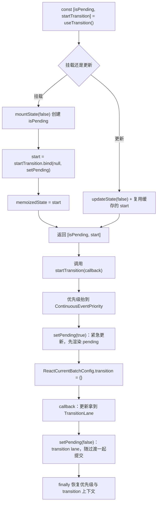

# useTransition

`useTransition` 把一次更新标记成“**transition**”：更新仍会执行，但优先级降到 TransitionLane，可以被更紧急的渲染打断；同时返回 `isPending`，让界面在过渡期间显示加载状态。

## 1. 基础用法

```tsx
import { useState, useTransition } from 'react'

function Search() {
  const [input, setInput] = useState('')
  const [query, setQuery] = useState('')
  const [isPending, startTransition] = useTransition()

  function handleChange(event) {
    // 输入框本身保持紧急更新，按键不会卡。
    setInput(event.target.value)
    // 结果列表的更新降到 transition，可以被后续输入打断。
    startTransition(() => setQuery(event.target.value))
  }

  return (
    <>
      <input value={input} onChange={handleChange} />
      {isPending && <span>加载中…</span>}
      <Results query={query} />
    </>
  )
}
```

> [!TIP]
> `startTransition` 的 callback 必须同步执行。`await` 之后的更新已经离开 transition 上下文，会重新变成普通优先级；异步场景需要把 `startTransition` 放进 `await` 之后，或改用 `useDeferredValue`。

## 2. 挂载阶段

`mountTransition` 本身不创建新机制：它用普通的 `mountState(false)` 得到 `isPending`，再把 `startTransition` 与 `setPending` 绑定成稳定的 `start` 存进 Hook 的 `memoizedState`。因此 `start` 的引用在多次渲染之间保持不变。

:::code-group

```ts [react-reconciler/src/ReactFiberHooks.old.js]
function mountTransition() {
  // isPending 就是一个普通的 state Hook。
  const [isPending, setPending] = mountState(false)
  // 把 setPending 预先绑定进去，start 的身份因此始终稳定。
  const start = startTransition.bind(null, setPending)
  const hook = mountWorkInProgressHook()
  hook.memoizedState = start
  // React 18 的返回顺序是 [isPending, startTransition]。
  return [isPending, start]
}
```

:::

## 3. 更新阶段

更新阶段只读 `isPending` 和 Hook 上缓存的 `start`，不再创建新函数。重渲染阶段由 `rerenderTransition` 处理，逻辑相同，只是状态读取换成 `rerenderState`。

:::code-group

```ts [react-reconciler/src/ReactFiberHooks.old.js]
function updateTransition() {
  // 更新阶段同样先读 isPending。
  const [isPending] = updateState(false)
  const hook = updateWorkInProgressHook()
  // 直接复用挂载时缓存的 start。
  const start = hook.memoizedState
  return [isPending, start]
}
```

:::

## 4. `startTransition` 内部

真正的优先级切换发生在 `startTransition`：先把当前更新优先级抬到至少 `ContinuousEventPriority`，让 `setPending(true)` 成为紧急更新；随后设置 transition 上下文，`setPending(false)` 与 callback 里的更新都拿到 TransitionLane，所以 pending 会一直显示到过渡渲染完成。

:::code-group

```ts [react-reconciler/src/ReactFiberHooks.old.js]
function startTransition(setPending, callback, options) {
  const previousPriority = getCurrentUpdatePriority()
  // pending 本身必须比 transition 更紧急，先抬到 Continuous。
  setCurrentUpdatePriority(
    higherEventPriority(previousPriority, ContinuousEventPriority),
  )
  //高优先级立刻渲染加载中
  setPending(true)

  // 只有上下文里的更新会被标记成 transition。
  const prevTransition = ReactCurrentBatchConfig.transition
  ReactCurrentBatchConfig.transition = {}

  try {
    // 复位 pending 和 callback()里的更新随 低优先级transition 一起提交。
    setPending(false)
    callback()
  } finally {
    // 无论 callback 是否抛错，都恢复优先级与 transition 上下文。
    setCurrentUpdatePriority(previousPriority)
    ReactCurrentBatchConfig.transition = prevTransition
  }
}
```

```ts [react-reconciler/src/ReactEventPriorities.old.js]
// 当前更新优先级：默认 NoLane，表示没有事件正在派发。
let currentUpdatePriority: EventPriority = NoLane

// 事件包装器、flushSync、startTransition 都通过这对读写它。
export function getCurrentUpdatePriority(): EventPriority {
  return currentUpdatePriority
}

export function setCurrentUpdatePriority(newPriority: EventPriority) {
  currentUpdatePriority = newPriority
}

// 两个优先级取更高者：lane 位号越小，优先级越高。
export function higherEventPriority(a, b) {
  return a !== 0 && a < b ? a : b
}
```

:::

> [!TIP]
> `import { startTransition } from 'react'` 的全局版本只负责设置 transition 上下文，不管理 `isPending`；需要 pending 状态时使用 `useTransition`。

## 5. Transition Lane 的选择

callback 里的更新进入 `requestUpdateLane` 后会命中 transition 分支：同一次事件内的多条 transition 更新共用 `currentEventTransitionLane`，需要时从 16 条池里领一条新的：

:::code-group

```ts [ReactFiberWorkLoop.js]
function requestUpdateLane(fiber) {
  // 省略 legacy / 渲染阶段 / 其他优先级分支。

  // Transition：同一事件内的多条更新共用一条 Lane。
  if (requestCurrentTransition() !== NoTransition) {
    if (currentEventTransitionLane === NoLane) {
      currentEventTransitionLane = claimNextTransitionLane()
    }
    return currentEventTransitionLane
  }

  const updateLane = getCurrentUpdatePriority()
  if (updateLane !== NoLane) {
    return updateLane
  }
  return getCurrentEventPriority()
}
```

```ts [ReactFiberTransition.js]
export const NoTransition = null

export function requestCurrentTransition() {
  // 非 null 表示当前处在 transition 上下文里。
  return ReactCurrentBatchConfig.transition
}
```

```ts [ReactFiberLane.js]
let nextTransitionLane = TransitionLane1

function claimNextTransitionLane() {
  const lane = nextTransitionLane
  nextTransitionLane <<= 1

  // 16 条用完，回到第一条复用。
  if ((nextTransitionLane & TransitionLanes) === NoLanes) {
    nextTransitionLane = TransitionLane1
  }

  return lane
}
```

```ts [ReactDOMHostConfig.js]
export function getCurrentEventPriority() {
  const currentEvent = window.event
  // 不在任何原生事件里：返回默认优先级。
  if (currentEvent === undefined) {
    return DefaultEventPriority
  }
  // 正在派发原生事件：按事件类型映射。
  return getEventPriority(currentEvent.type)
}
```

:::

选批时 `getHighestPriorityLanes` 会把同一组 transition 的位一起返回，保证它们在同一轮渲染里处理；Lane 编码与选批细节见 [Lane 模型](/frameworks/react/advanced/source-code/reconciler/laneModel)。

## 6. 完整流程图



## 7. 总结

[width(44,56)]

| 概念                                 | 作用                                              |
| ------------------------------------ | ------------------------------------------------- |
| `mountTransition`                    | 用 `mountState(false)` 创建 isPending，绑定 start |
| `updateTransition`                   | 读取 isPending 与缓存的 start，不创建新函数       |
| `startTransition`（Hook 版）         | 抬高优先级、设置 transition 上下文、管理 pending  |
| `ReactCurrentBatchConfig.transition` | 非空时，期间产生的更新走 TransitionLane           |
| `claimNextTransitionLane`            | 从 16 条池中轮流分配，同一事件内共用              |

`useTransition` 负责“**让一段更新变慢且可打断**”，并自带 pending；只想把一个值滞后使用时，见 [useDeferredValue](/frameworks/react/advanced/source-code/hooks/useDeferredValue)。优先级如何进入调度见 [Lane 模型](/frameworks/react/advanced/source-code/reconciler/laneModel)。
