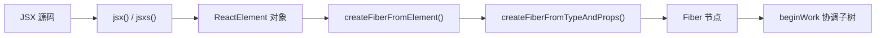

# `ReactElement`

React 的渲染起点不是 DOM，而是一个描述 UI 的普通 JavaScript 对象，也就是 `ReactElement`。它只记录“**我想渲染什么**”，不持有任何真实节点；真正把它变成 Fiber、再变成 DOM 的工作，由 `react-reconciler` 和 `react-dom` 完成。

## 1. 为什么 Element 必须是普通对象

### 1.1 描述与执行分离

- Element 是**不可变**的：每次渲染都产生新的对象，React 不需要追踪它的内部变化。
- Fiber 是**可变的工作单元**：保存 `child`、`sibling`、`flags` 等运行时状态。
- 两者分离后，同一份 Element 可以被多次协调，也可以在不同宿主环境（DOM、Native、Canvas）中生成不同的 Fiber。
- Element 只描述“**类型、key、ref、props**”，不包含优先级、副作用标记、DOM 引用等调度信息。

### 1.2 Element 与 Fiber 的对比

[width(13,47,40)]

| 维度     | `ReactElement`                            | `Fiber`                                         |
| -------- | ----------------------------------------- | ----------------------------------------------- |
| 本质     | 普通对象，描述 UI                         | 链表节点，承载渲染工作                          |
| 可变性   | 不可变（开发构建会 `Object.freeze`）      | 可变，Render 阶段持续写入                       |
| 关键字段 | `type`、`key`、`ref`、`props`、`$$typeof` | `tag`、`stateNode`、`child`、`sibling`、`flags` |
| 创建时机 | JSX 执行时                                | `beginWork` 协调子节点时                        |
| 数量     | 每次渲染一批新对象                        | 通过 `alternate` 复用，数量相对稳定             |

## 2. `ReactElement` 的构造与字段

### 2.1 工厂函数

React 18 没有把 Element 定义成一个类，而是用一个内部工厂函数创建普通对象：

:::code-group

```ts [react/src/ReactElement.js]
const ReactElement = function (type, key, ref, self, source, owner, props) {
  const element = {
    // 用 Symbol 标记它确实是 React Element，JSON 无法伪造。
    $$typeof: REACT_ELEMENT_TYPE,

    // 核心字段：类型、key、ref 与 props。
    type: type,
    key: key,
    ref: ref,
    props: props,

    // 记录创建该元素的组件，开发期用于警告与错误定位。
    _owner: owner,
  }

  // 开发构建额外写入调试字段，并在支持时冻结 props 与整个 element。
  if (__DEV__) {
    // 校验标记需要被原地修改，所以挂到独立的 _store 上，保证对象本身仍可冻结。
    element._store = {}

    Object.defineProperty(element._store, 'validated', {
      configurable: false,
      enumerable: false,
      writable: true,
      value: false,
    })
    // _self、_source 只在开发构建存在。
    Object.defineProperty(element, '_self', {
      configurable: false,
      enumerable: false,
      writable: false,
      value: self,
    })
    Object.defineProperty(element, '_source', {
      configurable: false,
      enumerable: false,
      writable: false,
      value: source,
    })
    if (Object.freeze) {
      Object.freeze(element.props)
      Object.freeze(element)
    }
  }

  return element
}
```

```ts [shared/ReactSymbols.js]
// 内置类型都用 Symbol.for 注册，保证不同 React 副本之间也能互相识别。
export const REACT_ELEMENT_TYPE = Symbol.for('react.element')
export const REACT_PORTAL_TYPE = Symbol.for('react.portal')
export const REACT_FRAGMENT_TYPE = Symbol.for('react.fragment')
export const REACT_PROVIDER_TYPE = Symbol.for('react.provider')
export const REACT_CONTEXT_TYPE = Symbol.for('react.context')
export const REACT_FORWARD_REF_TYPE = Symbol.for('react.forward_ref')
export const REACT_MEMO_TYPE = Symbol.for('react.memo')
export const REACT_LAZY_TYPE = Symbol.for('react.lazy')
export const REACT_SUSPENSE_TYPE = Symbol.for('react.suspense')
export const REACT_OFFSCREEN_TYPE = Symbol.for('react.offscreen')
```

```ts [shared/ReactTypes.js]
// Context 对象同时挂载 Provider 与 Consumer，三者通过引用互相连通。
export type ReactContext<T> = {
  $$typeof: Symbol | number, // 固定为 REACT_CONTEXT_TYPE
  Consumer: ReactContext<T>, // 生产构建下指向 context 自身
  Provider: ReactProviderType<T>, // 指向携带 _context 的 Provider 对象
  _currentValue: T, // 当前渲染器读取的值
  _currentValue2: T, // 第二个渲染器（如 Native）独立维护的值
  _threadCount: number, // 并发渲染器的引用计数
  ...
};

// Provider 只保存 $$typeof 和指回 context 的 _context。
export type ReactProviderType<T> = {
  $$typeof: Symbol | number, // 固定为 REACT_PROVIDER_TYPE
  _context: ReactContext<T>, // 反向指回所属的 context
  ...
};
```

:::

`ReactTypes.js` 用 Flow 类型描述了 Context、Provider、Portal 等“**Element-like**”对象；`ReactElement` 本身的形状则由上面的工厂函数直接写出。两者共同约束了协调器能接收的输入。

### 2.2 只在开发构建出现的字段

React 18 的开发构建会额外写入几个不可枚举字段：

- `_store`：保存 `validated` 校验位，便于在不污染枚举结果的前提下冻结整个对象。
- `_self`、`_source`：JSX 转换注入的调用位置信息，用于警告与错误堆栈。

`_owner` 在生产构建中也会写入，只是开发构建会把它和上述字段一起用于警告与错误堆栈。这些字段不影响渲染主流程，但它们解释了为什么开发构建的 Element 更重，也解释了为什么开发构建会把 `props` 和 Element 本身冻结。

## 3. `$$typeof` 的安全设计

### 3.1 为什么不能只靠 `type` 判断

假设服务端返回一段用户可控的 JSON，客户端直接把它当成元素渲染。如果没有类型标识，攻击者可以伪造：

```js
{
  // 攻击者构造的普通对象：形状与 Element 相同，但没有 $$typeof。
  type: 'div',
  props: {
    dangerouslySetInnerHTML: {__html: ''}
  }
}
```

仅凭 `type: 'div'` 无法区分“**真正的 React Element**”和“**恰好长得很像的普通对象**”。React 需要一个无法由 JSON 伪造的标记。

### 3.2 Symbol 与 `isValidElement`

`$$typeof` 设成 `Symbol.for('react.element')`。判断一个对象是不是元素时，只比较这个 Symbol：

:::code-group

```ts [react/src/ReactElement.js]
export function isValidElement(object) {
  // 只比较 $$typeof，形状相同的普通对象会被拒绝。
  return (
    typeof object === 'object' &&
    object !== null &&
    object.$$typeof === REACT_ELEMENT_TYPE
  )
}
```

:::

- `JSON.stringify` 无法序列化 Symbol，服务端返回的 JSON 里不可能出现真正的 `$$typeof`。
- 即便攻击者写字符串 `"react.element"`，它也只是字符串，不等于 `Symbol.for('react.element')`。
- 协调器在创建 Fiber 前只接受 `$$typeof` 正确的对象，伪造对象会在入口处被拒绝。

## 4. `createElement` 与自动 runtime

### 4.1 `createElement`

经典 JSX 转换会把 `<div className="box" />` 编译成 `React.createElement('div', {className: 'box'})`。React 18 的 `createElement` 负责把 `config` 拆成 `props`、`key`、`ref`：

:::code-group

```ts [react/src/ReactElement.js]
export function createElement(type, config, children) {
  let propName

  // 保留字段单独取出，其余自有属性才会进入 props。
  const props = {}

  let key = null
  let ref = null
  let self = null
  let source = null

  if (config != null) {
    // 省略 __DEV__ 下 ref、key 的校验与警告。
    if (hasValidRef(config)) {
      ref = config.ref
    }
    if (hasValidKey(config)) {
      // key 统一转成字符串，避免数字与字符串 key 被当成不同身份。
      key = '' + config.key
    }

    self = config.__self === undefined ? null : config.__self
    source = config.__source === undefined ? null : config.__source
    // 其余自有属性原样拷进新的 props 对象。
    for (propName in config) {
      if (
        hasOwnProperty.call(config, propName) &&
        !RESERVED_PROPS.hasOwnProperty(propName)
      ) {
        props[propName] = config[propName]
      }
    }
  }

  // 第三个及之后的参数都是子节点：单个保持原值，多个收进数组。
  const childrenLength = arguments.length - 2
  if (childrenLength === 1) {
    props.children = children
  } else if (childrenLength > 1) {
    const childArray = Array(childrenLength)
    for (let i = 0; i < childrenLength; i++) {
      childArray[i] = arguments[i + 2]
    }
    props.children = childArray
  }

  // 仅在对应 prop 为 undefined 时用 defaultProps 补值。
  if (type && type.defaultProps) {
    const defaultProps = type.defaultProps
    for (propName in defaultProps) {
      if (props[propName] === undefined) {
        props[propName] = defaultProps[propName]
      }
    }
  }

  return ReactElement(
    type,
    key,
    ref,
    self,
    source,
    ReactCurrentOwner.current,
    props,
  )
}

// ...

// 这四个字段由 createElement 单独处理，不允许出现在 props 中。
const RESERVED_PROPS = {
  key: true,
  ref: true,
  __self: true,
  __source: true,
}
```

:::

### 4.2 自动 runtime 的 `jsx` / `jsxs`

`jsx` 与 `jsxs` 是自动 JSX 转换（automatic runtime，React 17 起）生成的调用入口，来自 `react/jsx-runtime`。两者最终都创建同一种 `ReactElement`，区别只在负责的场景：

- `jsx(type, props, key)`：单个静态节点、字符串，或由表达式动态算出的 `children`。
- `jsxs(type, props, key)`：子节点在编译期就能确定为多个，`children` 是一个静态数组。

:::code-group

```ts [react/src/jsx/ReactJSX.js]
import { REACT_FRAGMENT_TYPE } from 'shared/ReactSymbols'
import {
  jsxWithValidationStatic,
  jsxWithValidationDynamic,
  jsxWithValidation,
} from './ReactJSXElementValidator'
import { jsx as jsxProd } from './ReactJSXElement'
// 开发构建换成带校验的版本，生产构建直接用 jsxProd。
const jsx = __DEV__ ? jsxWithValidationDynamic : jsxProd
const jsxs = __DEV__ ? jsxWithValidationStatic : jsxProd
// jsxDEV 只在开发构建导出，供自动 runtime 传入调用位置信息。
const jsxDEV = __DEV__ ? jsxWithValidation : undefined

export { REACT_FRAGMENT_TYPE as Fragment, jsx, jsxs, jsxDEV }
```

```ts [react/src/jsx/ReactJSXElement.js]
// 生产构建：jsx 与 jsxs 共用这个实现。
export function jsx(type, config, maybeKey) {
  let propName

  // 保留字段单独取出，其余自有属性进入 props。
  const props = {}

  let key = null
  let ref = null

  // 省略 __DEV__ 下 key 的字符串强转校验。
  // 第三个参数是编译期单独传出的 key，先转成字符串。
  if (maybeKey !== undefined) {
    key = '' + maybeKey
  }

  // config 里若还带 key，会覆盖第三个参数。
  if (hasValidKey(config)) {
    key = '' + config.key
  }

  if (hasValidRef(config)) {
    ref = config.ref
  }

  // 其余自有属性原样拷进 props。
  for (propName in config) {
    if (
      hasOwnProperty.call(config, propName) &&
      !RESERVED_PROPS.hasOwnProperty(propName)
    ) {
      props[propName] = config[propName]
    }
  }

  // 仅在对应 prop 为 undefined 时补 defaultProps。
  if (type && type.defaultProps) {
    const defaultProps = type.defaultProps
    for (propName in defaultProps) {
      if (props[propName] === undefined) {
        props[propName] = defaultProps[propName]
      }
    }
  }

  return ReactElement(
    type,
    key,
    ref,
    undefined,
    undefined,
    ReactCurrentOwner.current,
    props,
  )
}
```

```javascript [ReactJSXElementValidator.js]
// `jsxDEV` 的创建流程与 `jsx` 相同，只是额外接收 `source` / `self` 并追加调试警告。
export function jsxWithValidation(
  type,
  props,
  key,
  isStaticChildren,
  source,
  self,
) {
  // 创建仍复用 jsxDEV，开发构建只多做校验。
  const element = jsxDEV(type, props, key, source, self)

  const children = props.children
  if (children !== undefined) {
    // 静态多子节点：逐个校验 key，并冻结数组。
    if (isStaticChildren) {
      if (isArray(children)) {
        for (let i = 0; i < children.length; i++) {
          validateChildKeys(children[i], type)
        }
        Object.freeze(children)
      }
    } else {
      // 单子节点：只校验这一个值。
      validateChildKeys(children, type)
    }
  }

  return element
}

// jsxs 的开发入口：把 isStaticChildren 置为 true。
export function jsxWithValidationStatic(type, props, key) {
  return jsxWithValidation(type, props, key, true)
}

// jsx 的开发入口：同一套校验，isStaticChildren 为 false。
export function jsxWithValidationDynamic(type, props, key) {
  return jsxWithValidation(type, props, key, false)
}
```

:::

源码里没有独立的 `jsxs` 函数：生产构建中 `jsx` 与 `jsxs` 指向同一个 `jsx`（抽出 `key` / `ref`、把剩余属性拷进 `props`、按需补 `defaultProps`，最后交给 `ReactElement`）。

单个子节点交给 `jsx`，`children` 直接是内层 element，而不是数组：

```jsx
const single = (
  <div className="box" id="app">
    <span>hello</span>
  </div>
)
```

```js
import { jsx as _jsx } from 'react/jsx-runtime'

// 只有一个子节点：调用 jsx，children 直接放 element。
const single = _jsx('div', {
  className: 'box',
  id: 'app',
  children: _jsx('span', { children: 'hello' }),
})
```

两个及以上静态子节点交给 `jsxs`，`children` 是数组：

```jsx
const multiple = (
  <ul>
    <li>a</li>
    <li>b</li>
  </ul>
)
```

```js
import { jsx as _jsx, jsxs as _jsxs } from 'react/jsx-runtime'

// 静态多子节点：调用 jsxs，children 是数组。
const multiple = _jsxs('ul', {
  children: [_jsx('li', { children: 'a' }), _jsx('li', { children: 'b' })],
})
```

两者返回的 `ReactElement` 形状相同，只有 `props.children` 的形态不同（`_owner` 等调试字段省略）：

```js
single
// {
//   $$typeof: Symbol.for('react.element'),
//   type: 'div',
//   key: null,
//   ref: null,
//   props: {
//     className: 'box',
//     id: 'app',
//     children: { $$typeof: Symbol.for('react.element'), type: 'span', ... },
//   },
// }

multiple.props.children
// [
//   { $$typeof: Symbol.for('react.element'), type: 'li', ... },
//   { $$typeof: Symbol.for('react.element'), type: 'li', ... },
// ]
```

`jsxs` 的 `children` 一定是数组；`jsx` 保持传入值的原样（单个 element、字符串，或调用方自己给出的数组）。最内层的 `_jsx('span', { children: 'hello' })` 里，`children` 就是字符串 `'hello'`。

### 4.3 Element 只是一个对象

`_jsx('span', {children: 'hello'})` 的返回值可以近似理解为：

```js
// 一个纯数据对象：只描述类型与 props，不持有 DOM 节点。
const element = {
  $$typeof: Symbol.for('react.element'),
  type: 'span',
  key: null,
  ref: null,
  props: { children: 'hello' },
  _owner: null,
}
```

## 5. `type` 如何决定 Fiber 的 `tag`

### 5.1 `shouldConstruct`：区分类组件与函数组件

React 18 没有用 `instanceof` 判断类组件，而是检查原型上的标记：

:::code-group

```ts [react-reconciler/src/ReactFiber.old.js]
function shouldConstruct(Component: Function) {
  const prototype = Component.prototype
  // 类组件在原型上带 isReactComponent 标记，普通函数没有。
  // prototype && 同时兜住箭头函数没有 prototype 的情况。
  return !!(prototype && prototype.isReactComponent)
}
```

:::

这个标记来自 `Component.prototype.isReactComponent`。`new` 出来的类组件实例会沿原型链找到它，而普通函数没有这个属性。表达式里的 `prototype &&` 还顺带处理了箭头函数没有 `prototype` 的情况。

### 5.2 `createFiberFromTypeAndProps`

Fiber 的类型分发集中在 `createFiberFromTypeAndProps`，它算出 `tag` 后通过底层的 `createFiber` 创建节点，入口则是 `createFiberFromElement`：

:::code-group

```ts [react-reconciler/src/ReactFiber.old.js]
export function createFiberFromElement(
  element: ReactElement,
  mode: TypeOfMode,
  lanes: Lanes,
): Fiber {
  const type = element.type
  const key = element.key
  const pendingProps = element.props
  // 拆出 type、key、props 后交给类型分发函数；owner 仅开发构建使用，这里传 null。
  // 省略 __DEV__ 下挂载 _debugSource、_debugOwner 的代码。
  const fiber = createFiberFromTypeAndProps(
    type,
    key,
    pendingProps,
    null,
    mode,
    lanes,
  )
  return fiber
}

export function createFiberFromTypeAndProps(
  type: any, // React$ElementType
  key: null | string,
  pendingProps: any,
  owner: null | Fiber, // 仅开发构建使用的调试信息，生产构建为 null
  mode: TypeOfMode,
  lanes: Lanes,
): Fiber {
  // 默认先记为待定型组件，函数组件要等首次执行后才能确定 tag。
  let fiberTag = IndeterminateComponent
  // resolvedType 表示解析后的最终类型；lazy 在 resolve 前无法确定，会置为 null。
  let resolvedType = type
  if (typeof type === 'function') {
    // 函数类型：原型上带 isReactComponent 标记的是类组件。
    if (shouldConstruct(type)) {
      fiberTag = ClassComponent
    }
  } else if (typeof type === 'string') {
    // 字符串类型直接对应宿主组件。
    fiberTag = HostComponent
  } else {
    // 非函数、非字符串的 type 在这里按内置标记分发。
    getTag: switch (type) {
      case REACT_FRAGMENT_TYPE: // Fragment
        return createFiberFromFragment(pendingProps.children, mode, lanes, key)
      case REACT_SUSPENSE_TYPE: // SuspenseComponent
        return createFiberFromSuspense(pendingProps, mode, lanes, key)
      case REACT_OFFSCREEN_TYPE: // OffscreenComponent
        return createFiberFromOffscreen(pendingProps, mode, lanes, key)
      // 省略同一 switch 中的 StrictMode、Profiler、SuspenseList、
      // LegacyHidden、Cache、TracingMarker 等内置类型。
      default: {
        if (typeof type === 'object' && type !== null) {
          switch (type.$$typeof) {
            case REACT_PROVIDER_TYPE: // ContextProvider
              fiberTag = ContextProvider
              break getTag
            case REACT_CONTEXT_TYPE: // ContextConsumer（$$typeof 为 context 自身）
              fiberTag = ContextConsumer
              break getTag
            case REACT_FORWARD_REF_TYPE: // ForwardRef
              fiberTag = ForwardRef
              break getTag
            case REACT_MEMO_TYPE: // MemoComponent
              fiberTag = MemoComponent
              break getTag
            case REACT_LAZY_TYPE: // LazyComponent，resolvedType 置为 null
              fiberTag = LazyComponent
              resolvedType = null
              break getTag
          }
        }
        // 省略 __DEV__ 下拼装错误提示的代码
        throw new Error('Element type is invalid')
      }
    }
  }

  const fiber = createFiber(fiberTag, pendingProps, key, mode)
  fiber.elementType = type
  fiber.type = resolvedType
  fiber.lanes = lanes

  return fiber
}

// Fiber 的构造入口：所有 createFiberFrom* 最终都落到这里。
const createFiber = function (
  tag: WorkTag,
  pendingProps: mixed,
  key: null | string,
  mode: TypeOfMode,
): Fiber {
  // $FlowFixMe: the shapes are exact here but Flow doesn't like constructors
  return new FiberNode(tag, pendingProps, key, mode)
}
```

:::

普通函数组件的 `tag` 不是 `FunctionComponent`，而是 `IndeterminateComponent`。首次挂载时，`beginWork` 会调用 `mountIndeterminateComponent`，执行一次组件函数，再根据返回结果把它“**定型**”为函数组件或类组件。这样设计是为了兼容早期不返回 JSX 的函数组件写法。

### 5.3 从 Element 到 Fiber 的完整链路



`createFiberFromElement` 不创建 DOM，只建立链表节点；真正的 DOM 创建发生在 `completeWork`，而子节点协调发生在 `beginWork`。

## 6. Fragment、Provider 与 Consumer

### 6.1 Fragment

`<>...</>` 编译后 `type` 是 `REACT_FRAGMENT_TYPE`。它不会创建 DOM，只会在 Fiber 树中充当透明容器。`createFiberFromFragment` 本身只是给底层的 `createFiber` 固定 `Fragment` 这个 tag，再补上 lanes：

:::code-group

```ts [react-reconciler/src/ReactFiber.old.js]
export function createFiberFromFragment(
  elements: ReactFragment,
  mode: TypeOfMode,
  lanes: Lanes,
  key: null | string,
): Fiber {
  // Fragment 没有自己的 props，直接把 children 当作 pendingProps。
  const fiber = createFiber(Fragment, elements, key, mode)
  fiber.lanes = lanes
  return fiber
}

// ...

// Fiber 的构造入口：所有 createFiberFrom* 最终都落到这里。
const createFiber = function (
  tag: WorkTag,
  pendingProps: mixed,
  key: null | string,
  mode: TypeOfMode,
): Fiber {
  // $FlowFixMe: the shapes are exact here but Flow doesn't like constructors
  return new FiberNode(tag, pendingProps, key, mode)
}
```

:::

注意 Fragment 直接复用 `pendingProps.children` 作为 `pendingProps`，因此 `beginWork` 对 `Fragment` 的处理就是取出 `props.children` 继续向下协调。

### 6.2 Provider 与 Consumer

`createContext` 返回的对象同时扮演三个角色：

:::code-group

```ts [react/src/ReactContext.js]
export function createContext<T>(defaultValue: T): ReactContext<T> {
  // context 对象同时承载 Provider、Consumer 与当前值。
  const context: ReactContext<T> = {
    $$typeof: REACT_CONTEXT_TYPE, // 标记这是 context 对象
    _currentValue: defaultValue, // 当前渲染器读取的值
    _currentValue2: defaultValue, // 第二个渲染器独立维护的值
    _threadCount: 0, // 并发渲染器的引用计数
    // Provider 与 Consumer 会反向引用 context，形成循环结构。
    Provider: (null: any),
    Consumer: (null: any),

    // 补齐字段，让 VM 中的隐藏类与 ServerContext 保持一致。
    _defaultValue: (null: any),
    _globalName: (null: any),
  };

  // Provider 通过 _context 指回 context 对象。
  context.Provider = {
    $$typeof: REACT_PROVIDER_TYPE,
    _context: context,
  };

  // 省略 __DEV__ 下带警告的 Consumer 代理对象；生产构建直接复用 context 自身。
  context.Consumer = context;

  return context;
}
```

```ts [shared/ReactSymbols.js]
// Provider 与 Consumer 的区分完全依赖这两个 Symbol。
export const REACT_PROVIDER_TYPE = Symbol.for('react.provider')
export const REACT_CONTEXT_TYPE = Symbol.for('react.context')
```

:::

- `<Context.Provider value={...}>` 的 `type` 是 `context.Provider`，`createFiberFromTypeAndProps` 通过 `$$typeof` 识别为 `ContextProvider`。
- `<Context.Consumer>{value => ...}</Context.Consumer>` 的 `type` 就是 `context` 本身，因此识别为 `ContextConsumer`。
- 两者最终都指向同一个 `_currentValue`，这也是 `useContext` 能直接读取当前值的原因。Context 的依赖传播细节见 [Context 与依赖传播](/frameworks/react/advanced/source-code/context/context)。

## 7. 总结

[width(18,82)]

| 维度     | React 18.3.1 的行为                                                                                   |
| -------- | ----------------------------------------------------------------------------------------------------- |
| 数据结构 | `ReactElement` 是纯数据，`$$typeof` 用 Symbol 保证它无法被 JSON 伪造                                  |
| 字段作用 | `type` 决定 Fiber 的 `tag`，`key` 决定 Diff 时能否复用，`props.children` 决定下一层协调的输入         |
| 创建入口 | `createElement` 与 `jsx` / `jsxs` 只是两种创建 Element 的入口，最终都会调用同一个 `ReactElement` 工厂 |
| 函数组件 | 先以 `IndeterminateComponent` 进入协调流程，挂载时才被定型                                            |
| 到 Fiber | 入口是 `createFiberFromElement`，它不创建 DOM，只建立链表节点                                         |
