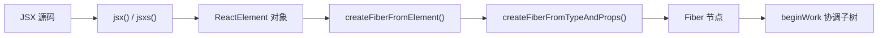

# `ReactElement`

React 的渲染起点不是 DOM，而是一个描述 UI 的普通 JavaScript 对象，也就是 `ReactElement`。它只记录“我想渲染什么”，不持有任何真实节点；真正把它变成 Fiber、再变成 DOM 的工作，由 `react-reconciler` 和 `react-dom` 完成。

React 18.3.1 默认走 `.old.js` 分叉。Element 的创建与类型转换集中在 `packages/react/src/ReactElement.js`、`packages/react/src/jsx/ReactJSXElement.js`、`packages/shared/ReactSymbols.js`、`packages/shared/ReactTypes.js`，以及 `packages/react-reconciler/src/ReactFiber.old.js`。

## 1. 为什么 Element 必须是普通对象

### 1.1 描述与执行分离

- Element 是**不可变**的：每次渲染都产生新的对象，React 不需要追踪它的内部变化。
- Fiber 是**可变的工作单元**：保存 `child`、`sibling`、`flags` 等运行时状态。
- 两者分离后，同一份 Element 可以被多次协调，也可以在不同宿主环境（DOM、Native、Canvas）中生成不同的 Fiber。
- Element 只描述“类型、key、ref、props”，不包含优先级、副作用标记、DOM 引用等调度信息。

### 1.2 Element 与 Fiber 的对比

[width(13,47,40)]

| 维度     | `ReactElement`                            | `Fiber`                                         |
| -------- | ----------------------------------------- | ----------------------------------------------- |
| 本质     | 普通对象，描述 UI                         | 链表节点，承载渲染工作                          |
| 可变性   | 不可变（开发构建会 `Object.freeze`）      | 可变，Render 阶段持续写入                       |
| 关键字段 | `type`、`key`、`ref`、`props`、`$$typeof` | `tag`、`stateNode`、`child`、`sibling`、`flags` |
| 创建时机 | JSX 执行时                                | `beginWork` 协调子节点时                        |
| 数量     | 每次渲染一批新对象                        | 通过 `alternate` 复用，数量相对稳定             |

## 2. `ReactElement` 的构造与字段

### 2.1 工厂函数

React 18 没有把 Element 定义成一个类，而是用一个内部工厂函数创建普通对象：

:::code-group

```ts [react/src/ReactElement.js]
const ReactElement = function (type, key, ref, self, source, owner, props) {
  const element = {
    // This tag allows us to uniquely identify this as a React Element
    $$typeof: REACT_ELEMENT_TYPE,

    // Built-in properties that belong on the element
    type: type,
    key: key,
    ref: ref,
    props: props,

    // Record the component responsible for creating this element.
    _owner: owner,
  }

  if (__DEV__) {
    // The validation flag is currently mutative. We put it on
    // an external backing store so that we can freeze the whole object.
    element._store = {}

    Object.defineProperty(element._store, 'validated', {
      configurable: false,
      enumerable: false,
      writable: true,
      value: false,
    })
    // self and source are DEV only properties.
    Object.defineProperty(element, '_self', {
      configurable: false,
      enumerable: false,
      writable: false,
      value: self,
    })
    Object.defineProperty(element, '_source', {
      configurable: false,
      enumerable: false,
      writable: false,
      value: source,
    })
    if (Object.freeze) {
      Object.freeze(element.props)
      Object.freeze(element)
    }
  }

  return element
}
```

```ts [shared/ReactSymbols.js]
export const REACT_ELEMENT_TYPE = Symbol.for('react.element')
export const REACT_PORTAL_TYPE = Symbol.for('react.portal')
export const REACT_FRAGMENT_TYPE = Symbol.for('react.fragment')
export const REACT_PROVIDER_TYPE = Symbol.for('react.provider')
export const REACT_CONTEXT_TYPE = Symbol.for('react.context')
export const REACT_FORWARD_REF_TYPE = Symbol.for('react.forward_ref')
export const REACT_MEMO_TYPE = Symbol.for('react.memo')
export const REACT_LAZY_TYPE = Symbol.for('react.lazy')
export const REACT_SUSPENSE_TYPE = Symbol.for('react.suspense')
export const REACT_OFFSCREEN_TYPE = Symbol.for('react.offscreen')
```

```ts [shared/ReactTypes.js]
export type ReactContext<T> = {
  $$typeof: Symbol | number,
  Consumer: ReactContext<T>,
  Provider: ReactProviderType<T>,
  _currentValue: T,
  _currentValue2: T,
  _threadCount: number,
  ...
};

export type ReactProviderType<T> = {
  $$typeof: Symbol | number,
  _context: ReactContext<T>,
  ...
};
```

:::

`ReactTypes.js` 用 Flow 类型描述了 Context、Provider、Portal 等“Element-like”对象；`ReactElement` 本身的形状则由上面的工厂函数直接写出。两者共同约束了协调器能接收的输入。

Element 的核心字段可以归纳为：

[width(16,84)]

| 字段       | 作用                                                                 |
| ---------- | -------------------------------------------------------------------- |
| `$$typeof` | 标记“这是一个 React Element”，同时承担安全校验职责                   |
| `type`     | 字符串表示原生标签，函数/类表示组件，Symbol 表示 Fragment 等内置类型 |
| `key`      | 列表 Diff 的身份标识；没有显式设置时为 `null`                        |
| `ref`      | 指向 DOM 或类组件实例的引用                                          |
| `props`    | 包含 `children` 在内的属性集合                                       |
| `_owner`   | 记录创建该元素的组件，主要用于开发期的警告与错误定位                 |

### 2.2 只在开发构建出现的字段

React 18 的开发构建会额外写入几个不可枚举字段：

- `_store`：保存 `validated` 校验位，便于在不污染枚举结果的前提下冻结整个对象。
- `_self`、`_source`：JSX 转换注入的调用位置信息，用于警告与错误堆栈。

`_owner` 在生产构建中也会写入，只是开发构建会把它和上述字段一起用于警告与错误堆栈。这些字段不影响渲染主流程，但它们解释了为什么开发构建的 Element 更重，也解释了为什么开发构建会把 `props` 和 Element 本身冻结。

## 3. `$$typeof` 的安全设计

### 3.1 为什么不能只靠 `type` 判断

假设服务端返回一段用户可控的 JSON，客户端直接把它当成元素渲染。如果没有类型标识，攻击者可以伪造：

```js
{
  type: 'div',
  props: {
    dangerouslySetInnerHTML: {__html: ''}
  }
}
```

仅凭 `type: 'div'` 无法区分“真正的 React Element”和“恰好长得很像的普通对象”。React 需要一个无法由 JSON 伪造的标记。

### 3.2 Symbol 与 `isValidElement`

React 把 `$$typeof` 设成 `Symbol.for('react.element')`。判断一个对象是不是元素时，只比较这个 Symbol：

```ts [react/src/ReactElement.js]
export function isValidElement(object) {
  return (
    typeof object === 'object' &&
    object !== null &&
    object.$$typeof === REACT_ELEMENT_TYPE
  )
}
```

这层设计的关键在于：

- `JSON.stringify` 无法序列化 Symbol，服务端返回的 JSON 里不可能出现真正的 `$$typeof`。
- 即便攻击者写字符串 `"react.element"`，它也只是字符串，不等于 `Symbol.for('react.element')`。
- 协调器在创建 Fiber 前只接受 `$$typeof` 正确的对象，伪造对象会在入口处被拒绝。

需要注意，`Symbol.for` 使用全局 Symbol 注册表。如果攻击者已经能在同一运行环境执行任意 JavaScript，这层校验并不能阻止他；它防的是“数据被当成代码”的场景，例如把不可信的 JSON 直接交给 `React.createElement` 或渲染树。

React 18 的标记是 `Symbol.for('react.element')`。React 19 改成了 `Symbol.for('react.transitional.element')`，这是与新 JSX runtime 元素格式配套的变更，不能把两个版本的值混用。

## 4. `createElement` 与自动 runtime

### 4.1 `createElement`

经典 JSX 转换会把 `<div className="box" />` 编译成 `React.createElement('div', {className: 'box'})`。React 18 的 `createElement` 负责把 `config` 拆成 `props`、`key`、`ref`：

:::code-group

```ts [react/src/ReactElement.js]
export function createElement(type, config, children) {
  let propName

  // Reserved names are extracted
  const props = {}

  let key = null
  let ref = null
  let self = null
  let source = null

  if (config != null) {
    if (hasValidRef(config)) {
      ref = config.ref

      if (__DEV__) {
        warnIfStringRefCannotBeAutoConverted(config)
      }
    }
    if (hasValidKey(config)) {
      if (__DEV__) {
        checkKeyStringCoercion(config.key)
      }
      key = '' + config.key
    }

    self = config.__self === undefined ? null : config.__self
    source = config.__source === undefined ? null : config.__source
    // Remaining properties are added to a new props object
    for (propName in config) {
      if (
        hasOwnProperty.call(config, propName) &&
        !RESERVED_PROPS.hasOwnProperty(propName)
      ) {
        props[propName] = config[propName]
      }
    }
  }

  // Children can be more than one argument, and those are transferred onto
  // the newly allocated props object.
  const childrenLength = arguments.length - 2
  if (childrenLength === 1) {
    props.children = children
  } else if (childrenLength > 1) {
    const childArray = Array(childrenLength)
    for (let i = 0; i < childrenLength; i++) {
      childArray[i] = arguments[i + 2]
    }
    props.children = childArray
  }

  // Resolve default props
  if (type && type.defaultProps) {
    const defaultProps = type.defaultProps
    for (propName in defaultProps) {
      if (props[propName] === undefined) {
        props[propName] = defaultProps[propName]
      }
    }
  }

  return ReactElement(
    type,
    key,
    ref,
    self,
    source,
    ReactCurrentOwner.current,
    props,
  )
}
```

```ts [react/src/ReactElement.js]
const RESERVED_PROPS = {
  key: true,
  ref: true,
  __self: true,
  __source: true,
}
```

:::

几个容易忽略的细节：

- `key` 会被强制转成字符串：`key = '' + config.key`。
- `ref`、`key`、`__self`、`__source` 不会进入 `props`。
- 多个子节点会被收集成数组，单个子节点则保持原值。
- `defaultProps` 只在对应 prop 为 `undefined` 时补值。

### 4.2 自动 runtime 的 `jsx` / `jsxs`

现代 JSX 转换不再生成 `React.createElement`，而是从 `react/jsx-runtime` 引入 `jsx` / `jsxs`。React 18.3.1 的入口在 `ReactJSX.js`：

```ts [react/src/jsx/ReactJSX.js]
import { REACT_FRAGMENT_TYPE } from 'shared/ReactSymbols'
import {
  jsxWithValidationStatic,
  jsxWithValidationDynamic,
  jsxWithValidation,
} from './ReactJSXElementValidator'
import { jsx as jsxProd } from './ReactJSXElement'
const jsx = __DEV__ ? jsxWithValidationDynamic : jsxProd
const jsxs = __DEV__ ? jsxWithValidationStatic : jsxProd
const jsxDEV = __DEV__ ? jsxWithValidation : undefined

export { REACT_FRAGMENT_TYPE as Fragment, jsx, jsxs, jsxDEV }
```

生产构建的 `jsx` 实现在 `ReactJSXElement.js`。它与 `createElement` 的最大区别是：`key` 作为第三个参数单独传入，不再从 `config` 里读取。

```ts [react/src/jsx/ReactJSXElement.js]
export function jsx(type, config, maybeKey) {
  let propName

  // Reserved names are extracted
  const props = {}

  let key = null
  let ref = null

  if (maybeKey !== undefined) {
    if (__DEV__) {
      checkKeyStringCoercion(maybeKey)
    }
    key = '' + maybeKey
  }

  if (hasValidKey(config)) {
    if (__DEV__) {
      checkKeyStringCoercion(config.key)
    }
    key = '' + config.key
  }

  if (hasValidRef(config)) {
    ref = config.ref
  }

  // Remaining properties are added to a new props object
  for (propName in config) {
    if (
      hasOwnProperty.call(config, propName) &&
      !RESERVED_PROPS.hasOwnProperty(propName)
    ) {
      props[propName] = config[propName]
    }
  }

  // Resolve default props
  if (type && type.defaultProps) {
    const defaultProps = type.defaultProps
    for (propName in defaultProps) {
      if (props[propName] === undefined) {
        props[propName] = defaultProps[propName]
      }
    }
  }

  return ReactElement(
    type,
    key,
    ref,
    undefined,
    undefined,
    ReactCurrentOwner.current,
    props,
  )
}
```

因此：

```jsx
function App() {
  return (
    <div className="box" id="app">
      <span>hello</span>
    </div>
  )
}
```

会被编译成近似下面的形式：

```js
import { jsx as _jsx, jsxs as _jsxs } from 'react/jsx-runtime'

function App() {
  return _jsxs('div', {
    className: 'box',
    id: 'app',
    children: _jsx('span', { children: 'hello' }),
  })
}
```

- `jsx` 用于单个子节点，`jsxs` 用于静态子节点数组。
- `<span>hello</span>` 的 `children` 是字符串，不是数组。
- `key` 会从 `props` 中抽离，作为 `jsx` 的第三个参数传入。

### 4.3 Element 只是一个对象

`_jsx('span', {children: 'hello'})` 的返回值可以近似理解为：

```js
const element = {
  $$typeof: Symbol.for('react.element'),
  type: 'span',
  key: null,
  ref: null,
  props: { children: 'hello' },
  _owner: null,
}
```

React 后续的所有工作，都是围绕这个对象展开的：先由 `createFiberFromElement` 转成 Fiber，再由 `beginWork` 协调它的 `props.children`。

## 5. `type` 如何决定 Fiber 的 `tag`

### 5.1 `shouldConstruct`：区分类组件与函数组件

React 18 没有用 `instanceof` 判断类组件，而是检查原型上的标记：

```ts [react-reconciler/src/ReactFiber.old.js]
function shouldConstruct(Component: Function) {
  const prototype = Component.prototype
  return !!(prototype && prototype.isReactComponent)
}
```

这个标记来自 `Component.prototype.isReactComponent`。`new` 出来的类组件实例会沿原型链找到它，而普通函数没有这个属性。表达式里的 `prototype &&` 还顺带处理了箭头函数没有 `prototype` 的情况。

### 5.2 `createFiberFromTypeAndProps`

Fiber 的类型分发集中在 `createFiberFromTypeAndProps`：

:::code-group

```ts [react-reconciler/src/ReactFiber.old.js]
export function createFiberFromTypeAndProps(
  type: any, // React$ElementType
  key: null | string,
  pendingProps: any,
  owner: null | Fiber,
  mode: TypeOfMode,
  lanes: Lanes,
): Fiber {
  let fiberTag = IndeterminateComponent
  // The resolved type is set if we know what the final type will be. I.e. it's not lazy.
  let resolvedType = type
  if (typeof type === 'function') {
    if (shouldConstruct(type)) {
      fiberTag = ClassComponent
    }
  } else if (typeof type === 'string') {
    fiberTag = HostComponent
  } else {
    getTag: switch (type) {
      case REACT_FRAGMENT_TYPE:
        return createFiberFromFragment(pendingProps.children, mode, lanes, key)
      case REACT_SUSPENSE_TYPE:
        return createFiberFromSuspense(pendingProps, mode, lanes, key)
      case REACT_OFFSCREEN_TYPE:
        return createFiberFromOffscreen(pendingProps, mode, lanes, key)
      default: {
        if (typeof type === 'object' && type !== null) {
          switch (type.$$typeof) {
            case REACT_PROVIDER_TYPE:
              fiberTag = ContextProvider
              break getTag
            case REACT_CONTEXT_TYPE:
              // This is a consumer
              fiberTag = ContextConsumer
              break getTag
            case REACT_FORWARD_REF_TYPE:
              fiberTag = ForwardRef
              break getTag
            case REACT_MEMO_TYPE:
              fiberTag = MemoComponent
              break getTag
            case REACT_LAZY_TYPE:
              fiberTag = LazyComponent
              resolvedType = null
              break getTag
          }
        }

        let info = ''
        if (__DEV__) {
          // ...
        }

        throw new Error(
          'Element type is invalid: expected a string (for built-in ' +
            'components) or a class/function (for composite components) ' +
            `but got: ${type == null ? type : typeof type}.${info}`,
        )
      }
    }
  }

  const fiber = createFiber(fiberTag, pendingProps, key, mode)
  fiber.elementType = type
  fiber.type = resolvedType
  fiber.lanes = lanes

  return fiber
}
```

```ts [react-reconciler/src/ReactFiber.old.js]
export function createFiberFromElement(
  element: ReactElement,
  mode: TypeOfMode,
  lanes: Lanes,
): Fiber {
  let owner = null
  if (__DEV__) {
    owner = element._owner
  }
  const type = element.type
  const key = element.key
  const pendingProps = element.props
  const fiber = createFiberFromTypeAndProps(
    type,
    key,
    pendingProps,
    owner,
    mode,
    lanes,
  )
  if (__DEV__) {
    fiber._debugSource = element._source
    fiber._debugOwner = element._owner
  }
  return fiber
}
```

:::

类型判断规则可以归纳为：

[width(45,23,32)]

| `type` 的形态                                  | Fiber `tag`              | 例子                          |
| ---------------------------------------------- | ------------------------ | ----------------------------- |
| 字符串                                         | `HostComponent`          | `'div'`、`'span'`             |
| 函数，且 `prototype.isReactComponent` 为真     | `ClassComponent`         | `class App extends Component` |
| 普通函数                                       | `IndeterminateComponent` | `function App() {}`           |
| `REACT_FRAGMENT_TYPE`                          | `Fragment`               | `<></>`、`<Fragment>`         |
| `$$typeof === REACT_PROVIDER_TYPE`             | `ContextProvider`        | `<Context.Provider>`          |
| `$$typeof === REACT_CONTEXT_TYPE`              | `ContextConsumer`        | `<Context.Consumer>`          |
| `$$typeof === REACT_FORWARD_REF_TYPE`          | `ForwardRef`             | `React.forwardRef(...)`       |
| `$$typeof === REACT_MEMO_TYPE`                 | `MemoComponent`          | `React.memo(...)`             |
| `$$typeof === REACT_LAZY_TYPE`                 | `LazyComponent`          | `React.lazy(...)`             |
| `REACT_SUSPENSE_TYPE` / `REACT_OFFSCREEN_TYPE` | `SuspenseComponent` 等   | `<Suspense>`、Offscreen       |

普通函数组件的 `tag` 不是 `FunctionComponent`，而是 `IndeterminateComponent`。首次挂载时，`beginWork` 会调用 `mountIndeterminateComponent`，执行一次组件函数，再根据返回结果把它“定型”为函数组件或类组件。这样设计是为了兼容早期不返回 JSX 的函数组件写法。

### 5.3 从 Element 到 Fiber 的完整链路



`createFiberFromElement` 不创建 DOM，只建立链表节点；真正的 DOM 创建发生在 `completeWork`，而子节点协调发生在 `beginWork`。关于 Fiber 自身的字段与双缓冲，可以继续阅读 [Fiber 节点](/frameworks/react/advanced/source-code/reconciler/fiberNode)。

## 6. Fragment、Provider 与 Consumer

### 6.1 Fragment

`<>...</>` 编译后 `type` 是 `REACT_FRAGMENT_TYPE`。它不会创建 DOM，只会在 Fiber 树中充当透明容器：

```ts [react-reconciler/src/ReactFiber.old.js]
export function createFiberFromFragment(
  elements: ReactFragment,
  mode: TypeOfMode,
  lanes: Lanes,
  key: null | string,
): Fiber {
  const fiber = createFiber(Fragment, elements, key, mode)
  fiber.lanes = lanes
  return fiber
}
```

注意 Fragment 直接复用 `pendingProps.children` 作为 `pendingProps`，因此 `beginWork` 对 `Fragment` 的处理就是取出 `props.children` 继续向下协调。

### 6.2 Provider 与 Consumer

`createContext` 返回的对象同时扮演三个角色：

:::code-group

```ts [react/src/ReactContext.js]
export function createContext<T>(defaultValue: T): ReactContext<T> {
  const context: ReactContext<T> = {
    $$typeof: REACT_CONTEXT_TYPE,
    _currentValue: defaultValue,
    _currentValue2: defaultValue,
    _threadCount: 0,
    // These are circular
    Provider: (null: any),
    Consumer: (null: any),

    // Add these to use same hidden class in VM as ServerContext
    _defaultValue: (null: any),
    _globalName: (null: any),
  };

  context.Provider = {
    $$typeof: REACT_PROVIDER_TYPE,
    _context: context,
  };

  if (__DEV__) {
    // 开发构建会创建一个带警告的 Consumer 代理对象
  } else {
    context.Consumer = context;
  }

  return context;
}
```

```ts [shared/ReactSymbols.js]
export const REACT_PROVIDER_TYPE = Symbol.for('react.provider')
export const REACT_CONTEXT_TYPE = Symbol.for('react.context')
```

:::

- `<Context.Provider value={...}>` 的 `type` 是 `context.Provider`，`createFiberFromTypeAndProps` 通过 `$$typeof` 识别为 `ContextProvider`。
- `<Context.Consumer>{value => ...}</Context.Consumer>` 的 `type` 就是 `context` 本身，因此识别为 `ContextConsumer`。
- 两者最终都指向同一个 `_currentValue`，这也是 `useContext` 能直接读取当前值的原因。Context 的依赖传播细节见 [Context 与依赖传播](/frameworks/react/advanced/source-code/context/context)。

## 7. 与简化实现的差异

这里的“简化实现”指仓库中用于教学的 mini-react / xunbei-react 版本。它们通常只保留“函数组件、类组件、原生标签、Fragment、Provider、Consumer”六种分发，并把 Element 到 Fiber 的转换压缩成一个函数。与 React 18.3.1 的主要差异如下：

[width(16,59,25)]

| 维度         | React 18.3.1                                                  | 简化实现                                          |
| ------------ | ------------------------------------------------------------- | ------------------------------------------------- |
| 元素标识     | `Symbol.for('react.element')`                                 | 可能使用 React 19 的 `react.transitional.element` |
| JSX runtime  | 自带 `react/jsx-runtime`，区分 `jsx` / `jsxs` / `jsxDEV`      | 往往直接消费官方 runtime 的产物                   |
| 类型分发     | 覆盖 `memo`、`lazy`、`forwardRef`、`Suspense`、`Offscreen` 等 | 只保留常用六种                                    |
| 函数组件 tag | 先设为 `IndeterminateComponent`，挂载时再定型                 | 可能直接写成 `FunctionComponent`                  |
| 开发期字段   | `_store`、`_self`、`_source`、`_debugSource` 等               | 通常省略                                          |
| 安全校验     | 创建与协调两处都依赖 `$$typeof`                               | 可能只做简单判断                                  |

因此，简化实现足以跑通大部分 demo，但不能直接用来解释 React 18 的完整类型分发和开发期行为。阅读源码时，应以 `.old.js` 中的官方实现为准。

## 8. 总结

- `ReactElement` 是纯数据，`$$typeof` 用 Symbol 保证它无法被 JSON 伪造。
- Element 的 `type` 决定 Fiber 的 `tag`，`key` 决定 Diff 时能否复用，`props.children` 决定下一层协调的输入。
- `createElement` 与 `jsx` / `jsxs` 只是两种创建 Element 的入口，最终都会调用同一个 `ReactElement` 工厂。
- 普通函数组件先以 `IndeterminateComponent` 进入协调流程，挂载时才被定型。
- 从 Element 到 Fiber 的入口是 `createFiberFromElement`，它不创建 DOM，只建立链表节点。

下一篇进入 Fiber 节点本身，看看 React 如何把一棵 Element 树变成可中断、可标记的工作单元。
