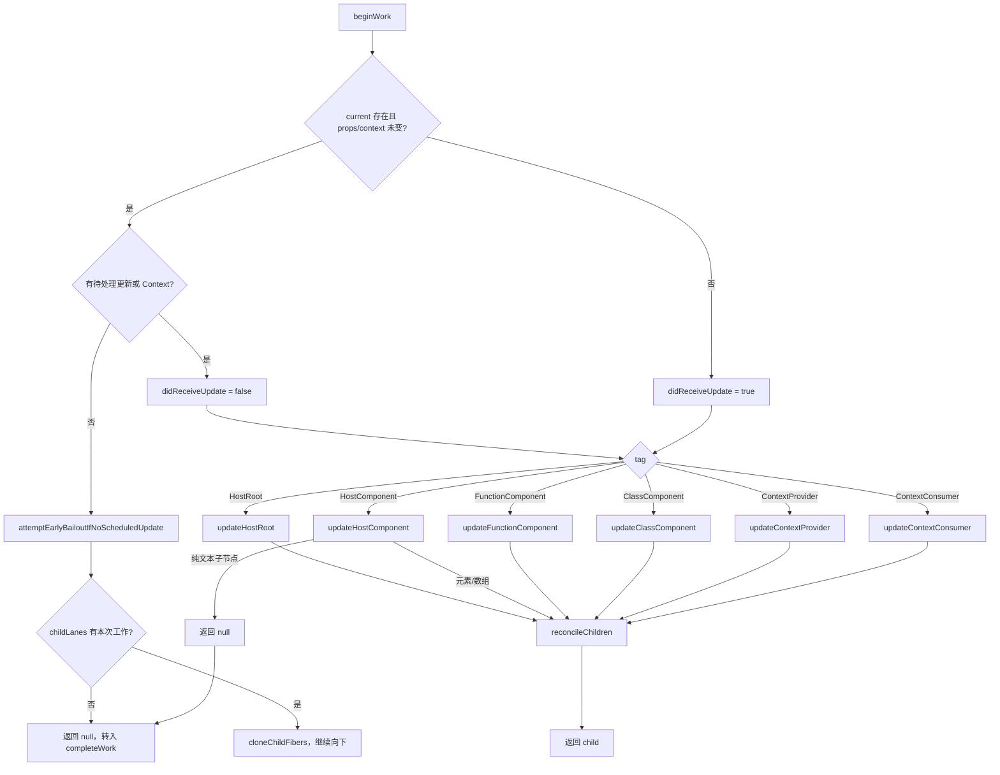

# beginWork

`beginWork` 是 React 18.3.1 Render 阶段向下遍历的核心函数。它接收当前树上的 `current`、正在构建的 `workInProgress` 和本次渲染的 `renderLanes`，根据 `workInProgress.tag` 决定如何生成下一层子 Fiber，并返回第一个子 Fiber。返回 `null` 表示当前子树没有需要继续处理的节点，工作循环随即转入 `completeWork` 回溯。

React 18.3.1 的 reconciler 同时保留 `.old.js` 与 `.new.js` 两套实现，默认启用 `.old.js` 分叉。`beginWork` 的实现位于 `packages/react-reconciler/src/ReactFiberBeginWork.old.js`，宿主环境相关函数位于 `packages/react-dom/src/client/ReactDOMHostConfig.js`。

## 1. 职责与返回值

### 1.1 三个核心动作

对每个 Fiber，`beginWork` 大致做三件事：

1. **判断是否可跳过**：比较 `current` 与 `workInProgress` 的 props，并检查是否有待处理的更新或 Context 变化；满足条件时直接 bailout，不进入组件逻辑。
2. **执行组件逻辑**：函数组件调用 `renderWithHooks`，类组件走 `constructClassInstance` / `updateClassInstance` 后调用 `instance.render()`，Provider 则把新值压入 Context 栈。
3. **协调子节点**：把组件返回的 JSX 交给 `reconcileChildren`，与旧子链表比较并生成下一层 Fiber。

`beginWork` 不创建真实 DOM，也不执行提交操作。它的产物只有两样：一棵继续向下的 WIP 子树，以及写在 Fiber 上的 `flags` / `lanes`。

### 1.2 返回值约定

[width(12,88)]

| 返回值  | 含义                                                    |
| ------- | ------------------------------------------------------- |
| `Fiber` | 第一个子节点，深度优先遍历继续向下                      |
| `null`  | 没有子节点，或子树无需处理，工作循环转入 `completeWork` |

## 2. 入口：先判断能否 bailout，再按 tag 分发

### 2.1 进入组件逻辑前的快速判断

`beginWork` 的第一段代码并不急着执行组件，而是先判断这次更新能否被跳过。

:::code-group

```ts [react-reconciler/src/ReactFiberBeginWork.old.js]
function beginWork(
  current: Fiber | null,
  workInProgress: Fiber,
  renderLanes: Lanes,
): Fiber | null {
  if (current !== null) {
    const oldProps = current.memoizedProps
    const newProps = workInProgress.pendingProps

    // 省略 __DEV__ 下对组件 type 变化的校验
    if (oldProps !== newProps || hasLegacyContextChanged()) {
      // props 或 legacy context 变了，本次必须重新执行组件。
      didReceiveUpdate = true
    } else {
      // props 没变，再看是否有待处理的更新或 Context 变化。
      const hasScheduledUpdateOrContext = checkScheduledUpdateOrContext(
        current,
        renderLanes,
      )
      if (
        !hasScheduledUpdateOrContext &&
        (workInProgress.flags & DidCapture) === NoFlags
      ) {
        didReceiveUpdate = false
        return attemptEarlyBailoutIfNoScheduledUpdate(
          current,
          workInProgress,
          renderLanes,
        )
      }
      // 省略 legacy Suspense 的 ForceUpdateForLegacySuspense 判断
      didReceiveUpdate = false
    }
  } else {
    didReceiveUpdate = false
    // 省略 hydration 场景下的 tree id 处理
  }

  // 进入 begin 阶段前清空待处理优先级。
  workInProgress.lanes = NoLanes

  switch (workInProgress.tag) {
    case IndeterminateComponent: {
      // 首次渲染，执行后才能确定是函数组件还是类组件。
      return mountIndeterminateComponent(
        current,
        workInProgress,
        workInProgress.type,
        renderLanes,
      )
    }
    case LazyComponent: {
      // 解析 lazy 组件类型后重新分派。
      const elementType = workInProgress.elementType
      return mountLazyComponent(
        current,
        workInProgress,
        elementType,
        renderLanes,
      )
    }
    case FunctionComponent: {
      // renderWithHooks 执行组件，再协调返回值。
      const Component = workInProgress.type
      const unresolvedProps = workInProgress.pendingProps
      const resolvedProps =
        workInProgress.elementType === Component
          ? unresolvedProps
          : resolveDefaultProps(Component, unresolvedProps)
      return updateFunctionComponent(
        current,
        workInProgress,
        Component,
        resolvedProps,
        renderLanes,
      )
    }
    case ClassComponent: {
      // 创建/更新实例，render() 后协调返回值。
      const Component = workInProgress.type
      const unresolvedProps = workInProgress.pendingProps
      const resolvedProps =
        workInProgress.elementType === Component
          ? unresolvedProps
          : resolveDefaultProps(Component, unresolvedProps)
      return updateClassComponent(
        current,
        workInProgress,
        Component,
        resolvedProps,
        renderLanes,
      )
    }
    case HostRoot:
      // 处理根更新队列，协调 root.render 的顶层元素。
      return updateHostRoot(current, workInProgress, renderLanes)
    case HostComponent:
      // 判断纯文本子节点优化，协调 children。
      return updateHostComponent(current, workInProgress, renderLanes)
    case HostText:
      // 没有子节点，直接返回 null。
      return updateHostText(current, workInProgress)
    case Fragment:
      // 透明容器，协调 children。
      return updateFragment(current, workInProgress, renderLanes)
    case ContextProvider:
      // 压栈新值，必要时向消费者传播 Context 变化。
      return updateContextProvider(current, workInProgress, renderLanes)
    case ContextConsumer:
      // 读取当前 Context 值，执行 render props。
      return updateContextConsumer(current, workInProgress, renderLanes)
    case MemoComponent: {
      // 比较 memo 依赖，决定是否复用子树。
      const type = workInProgress.type
      const unresolvedProps = workInProgress.pendingProps
      let resolvedProps = resolveDefaultProps(type, unresolvedProps)
      resolvedProps = resolveDefaultProps(type.type, resolvedProps)
      return updateMemoComponent(
        current,
        workInProgress,
        type,
        resolvedProps,
        renderLanes,
      )
    }
    case ForwardRef: {
      // 解析 ref 后按函数组件方式渲染。
      const type = workInProgress.type
      const unresolvedProps = workInProgress.pendingProps
      const resolvedProps =
        workInProgress.elementType === type
          ? unresolvedProps
          : resolveDefaultProps(type, unresolvedProps)
      return updateForwardRef(
        current,
        workInProgress,
        type,
        resolvedProps,
        renderLanes,
      )
    }
    case SuspenseComponent:
      // 选择 primary 子树或 fallback。
      return updateSuspenseComponent(current, workInProgress, renderLanes)
    case HostPortal:
      // 协调 Portal 子节点，容器不是父 DOM。
      return updatePortalComponent(current, workInProgress, renderLanes)
    case OffscreenComponent: {
      // 处理隐藏/离屏子树。
      return updateOffscreenComponent(current, workInProgress, renderLanes)
    }
    // 省略 SimpleMemoComponent、Mode、Profiler、SuspenseListComponent、
    // LegacyHiddenComponent、CacheComponent、TracingMarkerComponent 等分支
  }

  // 省略未知 tag 的报错
}
```

```ts [react-reconciler/src/ReactFiberLane.old.js]
// 位运算判断：按位与不为 0，说明两组 Lane 至少有一个交集。
export function includesSomeLane(a: Lanes | Lane, b: Lanes | Lane): boolean {
  return (a & b) !== NoLanes
}
```

:::

这里有几个值得注意的细节：

- `didReceiveUpdate` 是模块级变量。`beginWork` 先把“**是否需要更新**”的结论写进去，函数组件、`memo` 等分支会在后续读取它，决定是否跳过渲染。
- `checkScheduledUpdateOrContext` 先看 `current.lanes` 是否包含本次 `renderLanes`；在懒传播 Context 的实现里，它还会检查 `current.dependencies` 中是否有变化的 Context。
- `attemptEarlyBailoutIfNoScheduledUpdate` 并不是立刻返回 `null`。它仍然要完成 HostRoot、HostComponent、Provider 等节点的“**入栈**”工作，然后才调用 `bailoutOnAlreadyFinishedWork`。否则回溯阶段出栈时，Context 栈和 Host 容器栈会错位。
- `workInProgress.lanes = NoLanes` 放在 `switch` 之前，表示这次 begin 阶段会消费掉当前 Fiber 上的待处理 lane。

## 3. 根节点：`updateHostRoot`

HostRoot 没有自己的 UI，它的子节点就是 `root.render(element)` 写入更新队列的顶层元素。`updateHostRoot` 先处理更新队列，再让 `reconcileChildren` 生成子 Fiber。

:::code-group

```ts [react-reconciler/src/ReactFiberBeginWork.old.js]
function updateHostRoot(current, workInProgress, renderLanes) {
  pushHostRootContext(workInProgress)

  // 省略 invariant：HostRoot 必然已有 current
  const nextProps = workInProgress.pendingProps
  const prevState = workInProgress.memoizedState
  const prevChildren = prevState.element
  cloneUpdateQueue(current, workInProgress)
  processUpdateQueue(workInProgress, nextProps, null, renderLanes)

  const nextState: RootState = workInProgress.memoizedState
  // 省略 transition tracing 与 enableCache 下的 CacheProvider 处理

  // React DevTools 依赖这个字段名为 "element"。
  const nextChildren = nextState.element
  // 省略 hydration 分支：复用现有 DOM，并给子节点打上 Hydrating 标记
  resetHydrationState()
  if (nextChildren === prevChildren) {
    return bailoutOnAlreadyFinishedWork(current, workInProgress, renderLanes)
  }
  reconcileChildren(current, workInProgress, nextChildren, renderLanes)
  return workInProgress.child
}
```

:::

`processUpdateQueue` 会把 `updateContainer` 入队的 `element` 合并进 `workInProgress.memoizedState`，因此 `nextState.element` 就是本次要渲染的根元素。如果它与上一轮的 `prevChildren` 引用相同，说明根元素没有变化，可以直接 bailout。

hydration 是另一条分支：当 `prevState.isDehydrated` 为真时，React 不会重新创建 DOM，而是用 `mountChildFibers` 建立 Fiber 树，并把 `Placement` 替换成 `Hydrating` 标记，表示这些节点已经存在于页面中。

## 4. 宿主组件：`updateHostComponent`

### 4.1 文本子节点优化

宿主组件最常见的情况是只有一个文本子节点。React 不会为它创建 `HostText` Fiber，而是把文本留给宿主环境在 `completeWork` 中直接写入父节点的 `textContent`。

:::code-group

```ts [react-reconciler/src/ReactFiberBeginWork.old.js]
function updateHostComponent(
  current: Fiber | null,
  workInProgress: Fiber,
  renderLanes: Lanes,
) {
  pushHostContext(workInProgress)

  // 省略 hydration：current === null 时认领可复用的宿主节点
  const type = workInProgress.type
  const nextProps = workInProgress.pendingProps
  const prevProps = current !== null ? current.memoizedProps : null

  let nextChildren = nextProps.children
  const isDirectTextChild = shouldSetTextContent(type, nextProps)

  if (isDirectTextChild) {
    // 直接文本子节点不创建 HostText Fiber，交给宿主环境处理。
    nextChildren = null
  } else if (prevProps !== null && shouldSetTextContent(type, prevProps)) {
    // 从直接文本切换成普通子节点或空内容时，需要清空旧的 textContent。
    workInProgress.flags |= ContentReset
  }

  markRef(current, workInProgress)
  reconcileChildren(current, workInProgress, nextChildren, renderLanes)
  return workInProgress.child
}
```

```ts [react-dom/src/client/ReactDOMHostConfig.js]
// 纯文本子节点或 dangerouslySetInnerHTML 可以直接写 textContent/innerHTML，不必创建子 Fiber。
export function shouldSetTextContent(type: string, props: Props): boolean {
  return (
    type === 'textarea' ||
    type === 'noscript' ||
    typeof props.children === 'string' ||
    typeof props.children === 'number' ||
    (typeof props.dangerouslySetInnerHTML === 'object' &&
      props.dangerouslySetInnerHTML !== null &&
      props.dangerouslySetInnerHTML.__html != null)
  )
}
```

:::

`shouldSetTextContent` 覆盖了以下几类场景：

[width(33,67)]

| 场景                                   | 命中条件                           |
| -------------------------------------- | ---------------------------------- |
| `<div>hello</div>`                     | `children` 是字符串                |
| `<div>{1}</div>`                       | `children` 是数字                  |
| `<textarea>...</textarea>`             | 标签名是 `textarea`                |
| `<noscript>...</noscript>`             | 标签名是 `noscript`                |
| `dangerouslySetInnerHTML={{ __html }}` | `__html` 不为 `null` / `undefined` |

如果仍然为纯文本创建 `HostText` Fiber，会多一层协调和一次 `appendChild`。直接写父节点的 `textContent` 更省内存，也更少一次遍历。

### 4.2 `ContentReset` 的意义

`ContentReset` 是官方实现里很容易被忽略的一个标记。它处理的是“**上一轮是纯文本，这一轮变成了元素或空**”的情况：

```text
<div>hello</div>  →  <div><span>hello</span></div>
```

上一轮 `shouldSetTextContent` 为真，`textContent` 被写成 `hello`；这一轮 `nextChildren` 变成了 `<span>`，如果不先清空父节点，旧的文本会和新插入的 `<span>` 同时存在。`ContentReset` 会在 Commit 阶段触发 `resetTextContent`，先把父节点的内容清空。

## 5. 函数组件：`updateFunctionComponent`

函数组件没有实例，渲染结果完全来自 `renderWithHooks`。在调用它之前，React 需要准备好 Context 读取环境，并在调用之后判断这次渲染是否真的产生了更新。

:::code-group

```ts [react-reconciler/src/ReactFiberBeginWork.old.js]
function updateFunctionComponent(
  current,
  workInProgress,
  Component,
  nextProps: any,
  renderLanes,
) {
  // 省略 __DEV__ 下的 propTypes 校验

  let context
  if (!disableLegacyContext) {
    const unmaskedContext = getUnmaskedContext(workInProgress, Component, true)
    context = getMaskedContext(workInProgress, unmaskedContext)
  }

  let nextChildren
  prepareToReadContext(workInProgress, renderLanes)
  // 省略调度分析器的 markComponentRenderStarted

  // 省略 __DEV__ 下的 owner 设置、StrictMode 双调用与渲染状态标记
  nextChildren = renderWithHooks(
    current,
    workInProgress,
    Component,
    nextProps,
    context,
    renderLanes,
  )
  // 省略调度分析器的 markComponentRenderStopped

  if (current !== null && !didReceiveUpdate) {
    // 本次没有产生更新，把 Hook 队列回滚到当前树后跳过子树。
    bailoutHooks(current, workInProgress, renderLanes)
    return bailoutOnAlreadyFinishedWork(current, workInProgress, renderLanes)
  }

  // 省略 hydration 下的 tree id 处理

  // React DevTools 依赖这个标记判断组件是否执行过 render。
  workInProgress.flags |= PerformedWork
  reconcileChildren(current, workInProgress, nextChildren, renderLanes)
  return workInProgress.child
}
```

:::

这段代码里有三条关键路径：

- `prepareToReadContext` 会重置当前 Fiber 的 Context 依赖，保证本次渲染重新收集 `useContext` 的订阅。
- `renderWithHooks` 内部设置 `currentlyRenderingFiber`，把 `useState`、`useEffect` 等 Hook 挂到当前 WIP Fiber 上。
- 如果 `current !== null` 且 `didReceiveUpdate` 为假，说明这次更新没有改变组件的输入。`bailoutHooks` 会把 WIP 上的 Hook 队列回滚，然后复用 `current` 的子树。这是 `memo` 和父组件重渲染时避免子组件重复执行的重要路径。

Hook 链表和 `renderWithHooks` 的细节见 [Hooks 链表](/frameworks/react/advanced/source-code/hooks/hooksInternals)。

## 6. 类组件：`updateClassComponent`

### 6.1 实例的三种状态

类组件的 `beginWork` 需要先确定实例处于“**首次构造**”“**恢复挂载**”还是“**正常更新**”，再决定是否调用 `shouldComponentUpdate` 等生命周期。

:::code-group

```ts [react-reconciler/src/ReactFiberBeginWork.old.js]
function updateClassComponent(
  current: Fiber | null,
  workInProgress: Fiber,
  Component: any,
  nextProps: any,
  renderLanes: Lanes,
) {
  // 省略 __DEV__ 下的错误边界模拟与 propTypes 校验

  // 类组件可能是 legacy context provider，需要提前入栈。
  let hasContext
  if (isLegacyContextProvider(Component)) {
    hasContext = true
    pushLegacyContextProvider(workInProgress)
  } else {
    hasContext = false
  }
  prepareToReadContext(workInProgress, renderLanes)

  const instance = workInProgress.stateNode
  let shouldUpdate
  if (instance === null) {
    // 省略 legacy 模式下对挂起 current 的重置
    // 首次渲染：构造实例并挂载。
    constructClassInstance(workInProgress, Component, nextProps)
    mountClassInstance(workInProgress, Component, nextProps, renderLanes)
    shouldUpdate = true
  } else if (current === null) {
    // 从挂起状态恢复：实例已经存在，直接复用。
    shouldUpdate = resumeMountClassInstance(
      workInProgress,
      Component,
      nextProps,
      renderLanes,
    )
  } else {
    // 正常更新：处理 shouldComponentUpdate、getDerivedStateFromProps 等。
    shouldUpdate = updateClassInstance(
      current,
      workInProgress,
      Component,
      nextProps,
      renderLanes,
    )
  }
  const nextUnitOfWork = finishClassComponent(
    current,
    workInProgress,
    Component,
    shouldUpdate,
    hasContext,
    renderLanes,
  )
  return nextUnitOfWork
}
```

:::

三个分支分别对应：

[width(25,33,42)]

| 条件                | 调用                                            | 含义                                 |
| ------------------- | ----------------------------------------------- | ------------------------------------ |
| `instance === null` | `constructClassInstance` + `mountClassInstance` | 首次渲染，创建实例并执行挂载生命周期 |
| `current === null`  | `resumeMountClassInstance`                      | 实例已存在但当前树为空，属于恢复挂载 |
| 其他                | `updateClassInstance`                           | 正常更新，计算 `shouldUpdate`        |

### 6.2 `finishClassComponent`

`updateClassInstance` 只负责计算“**要不要更新**”。真正执行 `render()`、协调子节点、写回 `memoizedState` 的是 `finishClassComponent`。

:::code-group

```ts [react-reconciler/src/ReactFiberBeginWork.old.js]
function finishClassComponent(
  current: Fiber | null,
  workInProgress: Fiber,
  Component: any,
  shouldUpdate: boolean,
  hasContext: boolean,
  renderLanes: Lanes,
) {
  // 即使 shouldComponentUpdate 返回 false，ref 仍然需要更新。
  markRef(current, workInProgress)

  const didCaptureError = (workInProgress.flags & DidCapture) !== NoFlags

  if (!shouldUpdate && !didCaptureError) {
    // Context provider 要把“不更新”的结论同步给子节点。
    if (hasContext) {
      invalidateContextProvider(workInProgress, Component, false)
    }

    return bailoutOnAlreadyFinishedWork(current, workInProgress, renderLanes)
  }

  const instance = workInProgress.stateNode

  // 重新渲染。
  ReactCurrentOwner.current = workInProgress
  let nextChildren
  if (
    didCaptureError &&
    typeof Component.getDerivedStateFromError !== 'function'
  ) {
    // 捕获了错误但没有 getDerivedStateFromError：先卸载子树。
    nextChildren = null
    // 省略 Profiler 计时停止
  } else {
    // 省略调度分析器的埋点
    nextChildren = instance.render()
    // 省略调度分析器的埋点
  }

  // React DevTools 依赖这个标记判断组件是否执行过 render。
  workInProgress.flags |= PerformedWork
  if (current !== null && didCaptureError) {
    // 从错误中恢复时，不复用旧子节点。
    forceUnmountCurrentAndReconcile(
      current,
      workInProgress,
      nextChildren,
      renderLanes,
    )
  } else {
    reconcileChildren(current, workInProgress, nextChildren, renderLanes)
  }

  // 用刚刚渲染时读取到的实例状态更新 memoizedState。
  workInProgress.memoizedState = instance.state

  // Context 可能已经变化，重新计算 Provider 的值。
  if (hasContext) {
    invalidateContextProvider(workInProgress, Component, true)
  }

  return workInProgress.child
}
```

:::

`shouldUpdate` 为假时，`finishClassComponent` 不会调用 `instance.render()`，而是直接进入 `bailoutOnAlreadyFinishedWork`。但有两个例外：

- `didCaptureError` 为真时，即使 `shouldComponentUpdate` 返回 false，也要渲染错误边界的内容。
- 类组件本身是 legacy context provider 时，必须调用 `invalidateContextProvider`，把“**不更新**”的结论传递给下游消费者。

## 7. Context 的两个分支

### 7.1 `updateContextProvider`

Provider 是“**透明节点**”：它不产生 DOM，只在遍历子树期间临时覆盖 Context 的当前值。

:::code-group

```ts [react-reconciler/src/ReactFiberBeginWork.old.js]
function updateContextProvider(
  current: Fiber | null,
  workInProgress: Fiber,
  renderLanes: Lanes,
) {
  const providerType: ReactProviderType<any> = workInProgress.type
  const context: ReactContext<any> = providerType._context

  const newProps = workInProgress.pendingProps
  const oldProps = workInProgress.memoizedProps

  const newValue = newProps.value

  // 省略 __DEV__ 下的 value 必填与 propTypes 校验

  pushProvider(workInProgress, context, newValue)

  if (enableLazyContextPropagation) {
    // 懒传播模式下，先不扫描消费者；等某个节点 bailout 时再统一检查。
  } else {
    if (oldProps !== null) {
      const oldValue = oldProps.value
      if (is(oldValue, newValue)) {
        // 值没变，children 也没变时可以直接跳过。
        if (
          oldProps.children === newProps.children &&
          !hasLegacyContextChanged()
        ) {
          return bailoutOnAlreadyFinishedWork(
            current,
            workInProgress,
            renderLanes,
          )
        }
      } else {
        // 值变了，找到依赖该 Context 的消费者并调度更新。
        propagateContextChange(workInProgress, context, renderLanes)
      }
    }
  }

  const newChildren = newProps.children
  reconcileChildren(current, workInProgress, newChildren, renderLanes)
  return workInProgress.child
}
```

:::

几个容易混淆的点：

- `pushProvider` 必须在 `reconcileChildren` 之前调用。这样子树里的消费者读取到的就是新值。
- 判断值是否变化用的是 `Object.is` 语义的 `is(oldValue, newValue)`。`NaN` 与 `NaN` 被视为相等，`+0` 与 `-0` 被视为不同。
- 值变化时调用 `propagateContextChange(workInProgress, context, renderLanes)`，它只会给真正依赖该 Context 的消费者打上 lane，而不是重渲染整棵子树。
- 覆盖的值会在 `completeWork` 的 `popProvider` 中恢复，具体见 [completeWork](/frameworks/react/advanced/source-code/reconciler/completeWork)。

### 7.2 `updateContextConsumer`

`<Context.Consumer>{value => <div>{value}</div>}</Context.Consumer>` 的 `children` 是函数，不是元素。React 先把当前值传进去执行，得到真正的 JSX，再协调。

:::code-group

```ts [react-reconciler/src/ReactFiberBeginWork.old.js]
function updateContextConsumer(
  current: Fiber | null,
  workInProgress: Fiber,
  renderLanes: Lanes,
) {
  let context: ReactContext<any> = workInProgress.type
  // 省略 __DEV__ 下对 Context.Consumer 代理对象的兼容处理

  const newProps = workInProgress.pendingProps
  const render = newProps.children

  // 省略 __DEV__ 下“children 必须是函数”的校验

  prepareToReadContext(workInProgress, renderLanes)
  const newValue = readContext(context)
  // 省略调度分析器的 markComponentRenderStarted

  // 省略 __DEV__ 下的 owner 设置与渲染状态标记
  let newChildren = render(newValue)
  // 省略调度分析器的 markComponentRenderStopped

  // React DevTools 依赖这个标记判断组件是否执行过 render。
  workInProgress.flags |= PerformedWork
  reconcileChildren(current, workInProgress, newChildren, renderLanes)
  return workInProgress.child
}
```

:::

`readContext` 会读取 `context._currentValue`，同时把该 Context 记录到当前 Fiber 的 `dependencies` 上。这样 Provider 的值变化时，`propagateContextChange` 才能通过依赖链表找到这个 Consumer。

## 8. 子节点协调入口：`reconcileChildren`

所有“**容器型**”节点最终都会调用 `reconcileChildren`。它根据 `current` 是否为空，选择“**挂载工厂**”或“**更新工厂**”。

:::code-group

```ts [react-reconciler/src/ReactFiberBeginWork.old.js]
export function reconcileChildren(
  current: Fiber | null,
  workInProgress: Fiber,
  nextChildren: any,
  renderLanes: Lanes,
) {
  if (current === null) {
    // 首次挂载：不跟踪副作用，整棵 DOM 会在 completeWork 中一次性组装。
    workInProgress.child = mountChildFibers(
      workInProgress,
      null,
      nextChildren,
      renderLanes,
    )
  } else {
    // 更新：复用旧 Fiber，并标记 Placement / ChildDeletion。
    workInProgress.child = reconcileChildFibers(
      workInProgress,
      current.child,
      nextChildren,
      renderLanes,
    )
  }
}
```

:::

[width(15,18,33,34)]

| 场景               | 使用的工厂             | `shouldTrackSideEffects` | 结果                                  |
| ------------------ | ---------------------- | ------------------------ | ------------------------------------- |
| `current === null` | `mountChildFibers`     | `false`                  | 复用旧 Fiber 但不标记插入/删除        |
| `current !== null` | `reconcileChildFibers` | `true`                   | 精确标记 `Placement`、`ChildDeletion` |

这里的 `current === null` 表示这个 Fiber 是全新的，没有旧节点可复用。此时不标记 `Placement`，因为整棵 DOM 子树会在 `completeWork` 的 `appendAllChildren` 中从下往上组装，只需要在 Commit 阶段插入最顶层的宿主节点。

更新时则必须精确标记新增、删除和移动，具体算法见 [子节点 Diff](/frameworks/react/advanced/source-code/reconciler/childFiber)。

## 9. bailout：跳过整棵子树

`bailoutOnAlreadyFinishedWork` 是“**跳过**”逻辑的最后一站。它既要判断子树里是否还有待处理的工作，也要在需要继续时克隆子 Fiber。

:::code-group

```ts [react-reconciler/src/ReactFiberBeginWork.old.js]
function bailoutOnAlreadyFinishedWork(
  current: Fiber | null,
  workInProgress: Fiber,
  renderLanes: Lanes,
): Fiber | null {
  if (current !== null) {
    // 复用上一轮的 Context 依赖。
    workInProgress.dependencies = current.dependencies
  }

  // 省略 Profiler 计时停止

  markSkippedUpdateLanes(workInProgress.lanes)

  // 子树没有待处理的工作，可以整棵跳过。
  if (!includesSomeLane(renderLanes, workInProgress.childLanes)) {
    if (enableLazyContextPropagation && current !== null) {
      // 懒传播模式下，bailout 前还要检查子树是否有 Context 变化。
      lazilyPropagateParentContextChanges(current, workInProgress, renderLanes)
      if (!includesSomeLane(renderLanes, workInProgress.childLanes)) {
        return null
      }
    } else {
      return null
    }
  }

  // 当前 Fiber 没有工作，但子树有：克隆子 Fiber 后继续向下。
  cloneChildFibers(current, workInProgress)
  return workInProgress.child
}
```

:::

`childLanes` 是判断能否整棵跳过的关键。它在 `completeWork` 的 `bubbleProperties` 中从子节点向上冒泡，记录了整棵子树里所有待处理 lane 的并集：

- 如果 `childLanes` 与本次 `renderLanes` 没有交集，说明子树里没有本次要处理的工作，直接返回 `null`。
- 如果有交集，说明某个后代还有更新，必须克隆直接子 Fiber，让工作循环继续向下。

`cloneChildFibers` 不会重新协调子节点，它只是为 `current.child` 创建对应的 WIP 副本，保留原有的 `key`、`type`、`stateNode` 等身份信息。

## 10. 一次“**递**”的流程



## 11. 与简化实现的差异

简化实现（mini-react / xunbei-react）保留了 `beginWork` 的“**按 tag 分派 + 协调子节点**”骨架，但为了可读性裁掉了官方实现里的调度与边界处理：

- **没有 `renderLanes`**：函数签名只有 `current` 和 `workInProgress`，也不存在 `didReceiveUpdate`、`checkScheduledUpdateOrContext` 和 `attemptEarlyBailoutIfNoScheduledUpdate`。每次更新都会重新执行组件并重新协调子节点。
- **HostRoot 直接同步两棵树**：简化实现读取 `workInProgress.memoizedState.element` 后调用 `reconcileChildren`，再把 `workInProgress.child` 赋给 `current.child`，以此维持双缓冲一致；官方实现依赖 `cloneChildFibers` 和 `alternate` 指针，不会在 `updateHostRoot` 里直接改 `current.child`。
- **HostComponent 只保留文本优化**：同样实现了 `shouldSetTextContent` 的判断，但没有 `ContentReset`、hydration 和 ref 标记。
- **类组件只做“新建或复用 + render”**：没有 `shouldComponentUpdate`、`getDerivedStateFromProps`、`getSnapshotBeforeUpdate`，也没有 `resumeMountClassInstance` 分支。
- **Context 使用自己的 `pushProvide` / `popProvide`**：值变化时只刷新依赖快照，不参与 lane 调度；官方使用 `pushProvider` / `popProvider` 和 `propagateContextChange(workInProgress, context, renderLanes)`。
- **支持的 tag 更少**：没有 `LazyComponent`、`MemoComponent`、`ForwardRef`、`SuspenseComponent`、`HostPortal`、`OffscreenComponent` 等分支。
- **`reconcileChildren` 的双工厂思路一致**：挂载时关闭副作用跟踪，更新时开启，但内部 Diff 只覆盖常见的元素、文本和数组。

[width(14,33,53)]

| 关注点   | 简化实现                     | React 18.3.1                                      |
| -------- | ---------------------------- | ------------------------------------------------- |
| 入口判断 | 只检查 `current` 是否为空    | props、legacy context、lane、Context 依赖综合判断 |
| 调度单位 | 固定优先级，无 lane          | `renderLanes` + `childLanes`                      |
| HostRoot | 直接同步 `current.child`     | 更新队列 + `reconcileChildren` + bailout          |
| 函数组件 | 直接调用 render 函数         | `renderWithHooks` + `bailoutHooks`                |
| 类组件   | 构造/复用实例后直接 `render` | 完整生命周期与 `shouldComponentUpdate`            |
| Context  | `pushProvide` / `popProvide` | `pushProvider` / `popProvider` + 依赖传播         |
| 可中断性 | 无                           | 每个 Fiber 都是可中断的工作单元                   |

## 12. 总结

[width(25,61,14)]

| Fiber 类型          | `beginWork` 的核心动作                                 | 返回               |
| ------------------- | ------------------------------------------------------ | ------------------ |
| `HostRoot`          | 处理更新队列，读取 `memoizedState.element`，协调子节点 | 第一个子 Fiber     |
| `HostComponent`     | 纯文本子节点直接返回 `null`，否则协调 `children`       | 子 Fiber 或 `null` |
| `HostText`          | 没有子节点                                             | `null`             |
| `Fragment`          | 透明容器，协调 `children`                              | 子 Fiber           |
| `FunctionComponent` | `renderWithHooks` 执行函数，必要时 `bailoutHooks`      | 子 Fiber           |
| `ClassComponent`    | 构造/更新实例，`render()`，协调返回值                  | 子 Fiber           |
| `ContextProvider`   | `pushProvider` 覆盖值，值变化时传播 Context            | 子 Fiber           |
| `ContextConsumer`   | `readContext` 读取当前值，执行 render props            | 子 Fiber           |

`beginWork` 只负责“**算出下一层应该有什么**”。真正把 DOM 建出来、把属性差异算出来、把 Context 栈恢复回去，是在回溯阶段由 `completeWork` 完成的。
