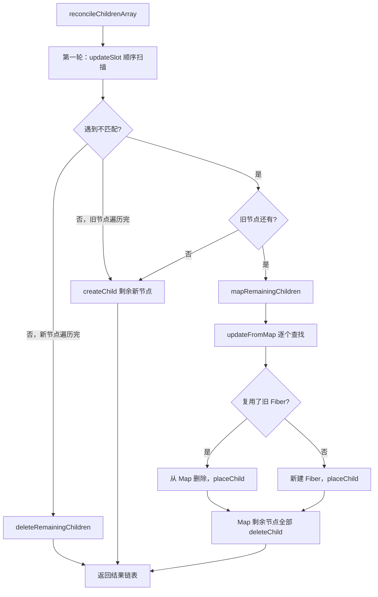

# 子节点 Diff

Render 阶段最核心的工作之一，是把新的 JSX 子节点与旧的 Fiber 子链表做比较，尽可能复用旧 Fiber，并只标记真正需要变更的部分，它和 Vue 的 `patchKeyedChildren` 解决的问题相同，但策略不同：Vue 使用双端 Diff，React 使用“**按位置顺序扫描 + key 映射兜底**”的两段式算法。React 不追求任意两棵树的最小编辑距离，而是在同层、同类型、key 稳定的前提下，用线性复杂度完成复用与标记。

## 1. 设计目标与三条前提

### 1.1 目标

- **复用**：类型和 `key` 相同的节点，复用其 `stateNode`（真实 DOM），避免删除重建。
- **最小标记**：只给新增、删除、移动的节点打上`Placement`/`ChildDeletion`，Commit阶段据此操作DOM。
- **线性复杂度**：在常见列表场景下接近 O(n)，避免 O(n²) 的两两比较。

### 1.2 三条启发式前提

React 不会做“**任意两棵树的最小编辑距离**”，而是假设：

- **同层比较**：只比较同一父节点下的子节点，不跨层级移动。
- **类型相同才复用**：`div` 不能复用成 `span`，函数组件不能复用成类组件。
- **key 标识身份**：列表项应提供稳定的 `key`，否则按位置匹配。

## 2. 挂载与更新

`ReactChildFiber`没有把挂载和更新写成两份代码，而是用`ChildReconciler(shouldTrackSideEffects)`生成两个闭包。闭包内部共享同一套协调函数，只在“**是否记录副作用**”上分叉。

:::code-group

```ts [react-reconciler/src/ReactChildFiber.old.js]
function ChildReconciler(shouldTrackSideEffects) {
  // 返回值：新子链表的第一个 Fiber；没有子节点时为 null。
  function reconcileChildFibers(
    returnFiber: Fiber,
    currentFirstChild: Fiber | null,
    newChild: any,
    lanes: Lanes,
  ): Fiber | null {
    // 协调逻辑，详见第 3 节
    // ...
  }

  return reconcileChildFibers
}

// update 与 mount 共用同一套协调逻辑，只切换是否记录副作用。
// 两者调用后都返回新子链表的第一个 Fiber，没有子节点时为 null。
export const reconcileChildFibers = ChildReconciler(true)
export const mountChildFibers = ChildReconciler(false)
```

:::

> [!TIP]
> 首次挂载不标记副作用，是因为整棵 DOM 会在 `completeWork` 中通过 `appendAllChildren` 一次性组装，最后只需要插入顶层节点。更新时 DOM 已经存在，必须精确告诉 Commit 哪些节点要新增、删除或移动。

## 3. 子节点类型派发

`reconcileChildFibers` 本身不递归。它只处理当前这一层的 `newChild`，根据类型选择单节点、数组、迭代器或 Portal 的协调函数。

:::code-group

```ts [react-reconciler/src/ReactChildFiber.old.js]
function reconcileChildFibers(
  returnFiber: Fiber,
  currentFirstChild: Fiber | null,
  newChild: any,
  lanes: Lanes,
): Fiber | null {
  // 顶层无 key 的 Fragment 当作数组处理。
  const isUnkeyedTopLevelFragment =
    typeof newChild === 'object' &&
    newChild !== null &&
    newChild.type === REACT_FRAGMENT_TYPE &&
    newChild.key === null
  if (isUnkeyedTopLevelFragment) {
    newChild = newChild.props.children
  }

  // 处理对象类型
  if (typeof newChild === 'object' && newChild !== null) {
    switch (newChild.$$typeof) {
      case REACT_ELEMENT_TYPE:
        // 单个元素：复用或新建一个 Fiber。
        return placeSingleChild(
          reconcileSingleElement(
            returnFiber,
            currentFirstChild,
            newChild,
            lanes,
          ),
        )
      case REACT_PORTAL_TYPE:
        // Portal：复用或新建 HostPortal Fiber。
        return placeSingleChild(
          reconcileSinglePortal(
            returnFiber,
            currentFirstChild,
            newChild,
            lanes,
          ),
        )
      case REACT_LAZY_TYPE:
        const payload = newChild._payload
        const init = newChild._init
        // 解析 Lazy 后重新协调。
        return reconcileChildFibers(
          returnFiber,
          currentFirstChild,
          init(payload),
          lanes,
        )
    }

    if (isArray(newChild)) {
      // 数组：进入多节点协调。
      return reconcileChildrenArray(
        returnFiber,
        currentFirstChild,
        newChild,
        lanes,
      )
    }

    if (getIteratorFn(newChild)) {
      // 可迭代对象：同样按多节点协调。
      return reconcileChildrenIterator(
        returnFiber,
        currentFirstChild,
        newChild,
        lanes,
      )
    }

    // 省略非法对象类型的报错
  }

  if (
    (typeof newChild === 'string' && newChild !== '') ||
    typeof newChild === 'number'
  ) {
    // 非空字符串或数字：协调为单个文本节点。
    return placeSingleChild(
      reconcileSingleTextNode(
        returnFiber,
        currentFirstChild,
        '' + newChild,
        lanes,
      ),
    )
  }

  // 省略 __DEV__ 下对函数类型子节点的告警。
  // 其余情况（null、boolean、undefined、空字符串）都视为空。
  return deleteRemainingChildren(returnFiber, currentFirstChild)
}
```

:::

## 4. 单节点 Diff

### 4.1 `reconcileSingleElement`

单节点协调的目标是：在旧子链表中找到 `key` 与 `elementType` 都匹配的节点，复用它的 `stateNode`；找不到就新建。

:::code-group

```ts [react-reconciler/src/ReactChildFiber.old.js]
function reconcileSingleElement(
  returnFiber: Fiber,
  currentFirstChild: Fiber | null,
  element: ReactElement,
  lanes: Lanes,
): Fiber {
  const key = element.key
  let child = currentFirstChild
  // 沿旧子链表查找 key 相同的节点。
  while (child !== null) {
    if (child.key === key) {
      const elementType = element.type
      if (elementType === REACT_FRAGMENT_TYPE) {
        if (child.tag === Fragment) {
          deleteRemainingChildren(returnFiber, child.sibling)
          const existing = useFiber(child, element.props.children)
          existing.return = returnFiber
          // 省略 __DEV__ 下的 debugSource / debugOwner
          return existing
        }
      } else {
        if (
          child.elementType === elementType ||
          // 省略 __DEV__ 下的热更新兼容性判断
          // Lazy 类型比较解析后的类型。
          (typeof elementType === 'object' &&
            elementType !== null &&
            elementType.$$typeof === REACT_LAZY_TYPE &&
            resolveLazy(elementType) === child.type)
        ) {
          deleteRemainingChildren(returnFiber, child.sibling)
          const existing = useFiber(child, element.props)
          existing.ref = coerceRef(returnFiber, child, element)
          existing.return = returnFiber
          // 省略 __DEV__ 下的 debugSource / debugOwner
          return existing
        }
      }
      // key 相同但类型不匹配：当前节点和它后面的兄弟都不可能复用。
      deleteRemainingChildren(returnFiber, child)
      break
    } else {
      // key 不同：删除当前旧节点，继续看下一个兄弟。
      deleteChild(returnFiber, child)
    }
    child = child.sibling
  }

  if (element.type === REACT_FRAGMENT_TYPE) {
    const created = createFiberFromFragment(
      element.props.children,
      returnFiber.mode,
      lanes,
      element.key,
    )
    created.return = returnFiber
    return created
  } else {
    const created = createFiberFromElement(element, returnFiber.mode, lanes)
    created.ref = coerceRef(returnFiber, currentFirstChild, element)
    created.return = returnFiber
    return created
  }
}
```

```ts [react-reconciler/src/ReactFiber.old.js]
export function createFiberFromElement(
  element: ReactElement,
  mode: TypeOfMode,
  lanes: Lanes,
): Fiber {
  // type/key/props 交给 createFiberFromTypeAndProps 决定 Fiber 的 tag。
  const fiber = createFiberFromTypeAndProps(
    element.type,
    element.key,
    element.props,
    null, // owner 只在 __DEV__ 下取 element._owner
    mode,
    lanes,
  )
  // 省略 __DEV__ 下的 debugSource / debugOwner
  return fiber
}

export function createFiberFromFragment(
  elements: ReactFragment,
  mode: TypeOfMode,
  lanes: Lanes,
  key: null | string,
): Fiber {
  // Fragment 没有对应的实例类型，直接用 createFiber 新建。
  const fiber = createFiber(Fragment, elements, key, mode)
  fiber.lanes = lanes
  return fiber
}
```

:::

单节点 Diff 的判断顺序可以概括为：

```tree
key 相同？
  ├─ 否 → 删除当前旧节点，继续看下一个兄弟
  └─ 是 → 类型相同？
          ├─ 是 → 删除其余兄弟，复用当前节点并返回
          └─ 否 → 删除当前及之后所有旧节点，创建新 Fiber
```

### 4.2 `reconcileSingleTextNode`

文本节点没有 `key`，所以协调规则更简单：如果旧链表第一个节点就是 `HostText`，复用它并删除其余兄弟；否则新建文本 Fiber，并删除所有旧节点。

:::code-group

```ts [react-reconciler/src/ReactChildFiber.old.js]
function reconcileSingleTextNode(
  returnFiber: Fiber,
  currentFirstChild: Fiber | null,
  textContent: string,
  lanes: Lanes,
): Fiber {
  if (currentFirstChild !== null && currentFirstChild.tag === HostText) {
    // 已有文本节点：复用它，删除其余兄弟。
    deleteRemainingChildren(returnFiber, currentFirstChild.sibling)
    const existing = useFiber(currentFirstChild, textContent)
    existing.return = returnFiber
    return existing
  }
  // 第一个旧节点不是文本：新建，并删除所有旧节点。
  deleteRemainingChildren(returnFiber, currentFirstChild)
  const created = createFiberFromText(textContent, returnFiber.mode, lanes)
  created.return = returnFiber
  return created
}
```

```ts [react-reconciler/src/ReactFiber.old.js]
export function createFiberFromText(
  content: string,
  mode: TypeOfMode,
  lanes: Lanes,
): Fiber {
  // 文本节点固定是 HostText，没有 type 和 key。
  const fiber = createFiber(HostText, content, null, mode)
  fiber.lanes = lanes
  return fiber
}
```

:::

### 4.3 删除标记：`deleteChild` 与 `deleteRemainingChildren`

删除不是立刻 `removeChild`，而是把待删除 Fiber 收集到父节点的 `deletions` 数组，并给父节点打上 `ChildDeletion`。真正的 DOM 删除发生在 Commit 阶段。

:::code-group

```ts [react-reconciler/src/ReactChildFiber.old.js]
function deleteChild(returnFiber: Fiber, childToDelete: Fiber): void {
  // mount 阶段不记录副作用，直接返回。
  if (!shouldTrackSideEffects) {
    return
  }
  const deletions = returnFiber.deletions
  if (deletions === null) {
    // 第一次删除：惰性创建 deletions，并给父节点打上 ChildDeletion。
    returnFiber.deletions = [childToDelete]
    returnFiber.flags |= ChildDeletion
  } else {
    deletions.push(childToDelete)
  }
}

function deleteRemainingChildren(
  returnFiber: Fiber,
  currentFirstChild: Fiber | null,
): null {
  if (!shouldTrackSideEffects) {
    return null
  }

  // 逐个标记旧兄弟，最后返回 null 供调用方直接返回。
  let childToDelete = currentFirstChild
  while (childToDelete !== null) {
    deleteChild(returnFiber, childToDelete)
    childToDelete = childToDelete.sibling
  }
  return null
}
```

:::

`deletions` 数组挂在“**父 Fiber**”上，而不是挂在被删除节点上。这样 Commit 阶段遍历到父节点时，可以一次性处理它下面所有待删除的子节点。

### 4.4 `useFiber`：复用旧 Fiber

`useFiber` 通过 `createWorkInProgress` 复用旧节点。它会把 `index` 重置为 0、`sibling` 清空，因为单节点没有兄弟。

:::code-group

```ts [react-reconciler/src/ReactChildFiber.old.js]
function useFiber(fiber: Fiber, pendingProps: mixed): Fiber {
  // 单节点场景容易忘记清理，所以在这里统一处理。
  const clone = createWorkInProgress(fiber, pendingProps)
  clone.index = 0
  clone.sibling = null
  return clone
}
```

```ts [react-reconciler/src/ReactFiber.old.js]
export function createWorkInProgress(current, pendingProps) {
  let workInProgress = current.alternate
  if (workInProgress === null) {
    // 首次为这个节点创建 WIP：新建并复制不变的实例信息
    workInProgress = createFiber(
      current.tag,
      pendingProps,
      current.key,
      current.mode,
    )
    workInProgress.elementType = current.elementType
    workInProgress.type = current.type
    workInProgress.stateNode = current.stateNode

    workInProgress.alternate = current
    current.alternate = workInProgress
  } else {
    // 复用旧 WIP：更新本次变化的字段
    workInProgress.pendingProps = pendingProps
    workInProgress.type = current.type

    workInProgress.flags = NoFlags
    workInProgress.subtreeFlags = NoFlags
    workInProgress.deletions = null
  }

  // 只保留跨 render 有效的静态标记
  workInProgress.flags = current.flags & StaticMask
  workInProgress.childLanes = current.childLanes
  workInProgress.lanes = current.lanes

  workInProgress.child = current.child
  workInProgress.memoizedProps = current.memoizedProps
  workInProgress.memoizedState = current.memoizedState
  workInProgress.updateQueue = current.updateQueue

  // dependencies 会在 Render 阶段被修改，不能与 current 共享
  const currentDependencies = current.dependencies
  workInProgress.dependencies =
    currentDependencies === null
      ? null
      : {
          lanes: currentDependencies.lanes,
          firstContext: currentDependencies.firstContext,
        }

  // 这些字段会在父节点的协调过程中被覆盖
  workInProgress.sibling = current.sibling
  workInProgress.index = current.index
  workInProgress.ref = current.ref

  return workInProgress
}

// Fiber 的构造入口：所有 createFiberFrom* 最终都落到这里。
const createFiber = function (
  tag: WorkTag,
  pendingProps: mixed,
  key: null | string,
  mode: TypeOfMode,
): Fiber {
  return new FiberNode(tag, pendingProps, key, mode)
}
```

:::

## 5. 多节点 Diff

`reconcileChildrenArray` 处理数组子节点，例如：

```tsx
// 列表项提供稳定 key，重排时才能按身份复用旧 Fiber。
<ul>
  {items.map(item => (
    <li key={item.id}>{item.name}</li>
  ))}
</ul>
```

### 5.1 算法原理

多节点 Diff 只做三件事：复用旧 Fiber、为缺失项新建 Fiber、把没被复用的旧节点收进删除列表。React 不做最小编辑距离，而是“**先按位置顺序扫描，走不动再用 key 兜底**”：

[width(23,36,41)]

| 阶段               | 匹配依据                          | 适用场景             |
| ------------------ | --------------------------------- | -------------------- |
| 位置扫描（第一轮） | 同位置且同 key                    | 前缀更新、末尾追加   |
| `Map` 兜底         | 旧节点的 key（无 key 用旧 index） | 中间插入、删除、乱序 |

带 key 的节点换了位置也能按 key 找回，没有 key 的节点只能按位置匹配。复用节点是否需要移动由 `lastPlacedIndex`（已复用节点中最大的旧 `index`）判断：旧 `index` 小于它就标记 `Placement`；它只负责标记，插入点由 Commit 阶段决定。删除同样只收进父节点的 `deletions`，mount 阶段不记录这些副作用。两段都是线性操作，整体 O(n) 时间、O(n) 空间。

[width(30,70)]

| 状态         | 处理           |
| ------------ | -------------- |
| 新节点遍历完 | 删除剩余旧节点 |
| 旧节点遍历完 | 创建剩余新节点 |
| 两边都有剩余 | `Map` 兜底     |

### 5.2 初始化与第一轮顺序扫描

第一轮只做“**同位置、同 key**”的快速匹配。循环每轮调用一次 `updateSlot`，把新节点与当前旧节点做比较；一旦返回 `null`，就立即退出，剩余节点交给后面的单边剩余或 `Map` 分支处理。这个“**快速失败**”很重要：如果列表只是末尾追加，第一轮就能走完，完全不需要创建 `Map`。

:::code-group

```ts [react-reconciler/src/ReactChildFiber.old.js]
// 初始化：结果链表的头尾、两条链表的游标，以及移动判定基准。
let resultingFirstChild: Fiber | null = null
let previousNewFiber: Fiber | null = null

let oldFiber = currentFirstChild //旧链表
let lastPlacedIndex = 0 //已复用节点中最大的旧 `index`，用于判断移动
let newIdx = 0 //新数组的游标
let nextOldFiber = null //暂存旧节点的下一个兄弟，避免匹配失败后断链

// 第一轮：按位置顺序扫描。
for (; oldFiber !== null && newIdx < newChildren.length; newIdx++) {
  if (oldFiber.index > newIdx) {
    // 旧链表出现跳跃：本槽位不参与匹配，旧节点留到 Map 阶段。
    nextOldFiber = oldFiber
    oldFiber = null
  } else {
    nextOldFiber = oldFiber.sibling
  }
  const newFiber = updateSlot(returnFiber, oldFiber, newChildren[newIdx], lanes)
  if (newFiber === null) {
    // 无法复用，退出第一轮，转入 Map 匹配。
    if (oldFiber === null) {
      oldFiber = nextOldFiber
    }
    break
  }
  if (shouldTrackSideEffects) {
    if (oldFiber && newFiber.alternate === null) {
      // 槽位匹配上了，但新建了 Fiber，旧的同位置节点需要删除。
      deleteChild(returnFiber, oldFiber)
    }
  }
  lastPlacedIndex = placeChild(newFiber, lastPlacedIndex, newIdx)
  if (previousNewFiber === null) {
    resultingFirstChild = newFiber
  } else {
    previousNewFiber.sibling = newFiber
  }
  previousNewFiber = newFiber
  oldFiber = nextOldFiber
}
```

:::

`updateSlot` 只比较 `key`，不比较 `elementType`。类型是否相同由 `updateElement` 判断。这样拆分的原因是：key 决定“**是不是同一个位置**”，类型决定“**能不能复用**”。

:::code-group

```ts [react-reconciler/src/ReactChildFiber.old.js]
function updateSlot(
  returnFiber: Fiber,
  oldFiber: Fiber | null,
  newChild: any,
  lanes: Lanes,
): Fiber | null {
  // key 匹配才继续，否则返回 null。
  const key = oldFiber !== null ? oldFiber.key : null

  if (
    (typeof newChild === 'string' && newChild !== '') ||
    typeof newChild === 'number'
  ) {
    // 文本节点没有 key。旧节点如果带 key，就不能按位置替换。
    if (key !== null) {
      return null
    }
    return updateTextNode(returnFiber, oldFiber, '' + newChild, lanes)
  }

  if (typeof newChild === 'object' && newChild !== null) {
    switch (newChild.$$typeof) {
      case REACT_ELEMENT_TYPE: {
        if (newChild.key === key) {
          return updateElement(returnFiber, oldFiber, newChild, lanes)
        } else {
          return null
        }
      }
      case REACT_PORTAL_TYPE: {
        if (newChild.key === key) {
          return updatePortal(returnFiber, oldFiber, newChild, lanes)
        } else {
          return null
        }
      }
      case REACT_LAZY_TYPE: {
        const payload = newChild._payload
        const init = newChild._init
        return updateSlot(returnFiber, oldFiber, init(payload), lanes)
      }
    }

    // 数组和迭代器没有 key，按位置匹配。
    if (isArray(newChild) || getIteratorFn(newChild)) {
      if (key !== null) {
        return null
      }
      return updateFragment(returnFiber, oldFiber, newChild, lanes, null)
    }

    // 省略非法对象类型的报错
  }

  return null
}
```

:::

`updateSlot` 的返回值有三种含义：

[width(38,62)]

| 返回值                      | 含义                               |
| --------------------------- | ---------------------------------- |
| Fiber，`alternate !== null` | 复用了旧节点                       |
| Fiber，`alternate === null` | 新建了节点，旧的同位置节点需要删除 |
| `null`                      | 无法匹配，退出第一轮               |

`placeChild` 则负责维护 `lastPlacedIndex`，判断复用节点是否需要移动：

:::code-group

```ts [react-reconciler/src/ReactChildFiber.old.js]
function placeChild(
  newFiber: Fiber,
  lastPlacedIndex: number,
  newIndex: number,
): number {
  newFiber.index = newIndex
  if (!shouldTrackSideEffects) {
    // hydration 时 useId 需要知道哪些 Fiber 属于子列表。
    newFiber.flags |= Forked
    return lastPlacedIndex
  }
  const current = newFiber.alternate
  if (current !== null) {
    const oldIndex = current.index
    if (oldIndex < lastPlacedIndex) {
      // 旧位置比上一个复用节点更靠前，说明它在新序列里被移动了。
      newFiber.flags |= Placement
      return lastPlacedIndex
    } else {
      // 相对顺序没变，可以留在原地。
      return oldIndex
    }
  } else {
    // 新节点，需要插入。
    newFiber.flags |= Placement
    return lastPlacedIndex
  }
}
```

:::

`placeChild` 的返回值就是下一轮的 `lastPlacedIndex`：命中移动时保持原值，相对顺序未变时更新为当前旧 `index`。

### 5.3 新节点遍历完：删除剩余旧节点

`newIdx === newChildren.length` 说明新列表已经全部处理完，旧链表里剩下的节点在新列表中不存在，调用 `deleteRemainingChildren(returnFiber, oldFiber)` 把它们一次性收进父节点的 `deletions`，然后返回结果链表。

:::code-group

```ts [react-reconciler/src/ReactChildFiber.old.js]
if (newIdx === newChildren.length) {
  // 新节点遍历完：删除剩余旧节点。
  deleteRemainingChildren(returnFiber, oldFiber)
  // 省略 hydration 下的 pushTreeFork
  return resultingFirstChild
}
```

:::

### 5.4 旧节点遍历完：创建剩余新节点

`oldFiber === null` 说明旧节点已经用完，后面的新节点都是新增项。循环对每个新节点调用 `createChild`，再交给 `placeChild`：新建 Fiber 的 `alternate` 为 `null`，所以 `placeChild` 会直接给它打上 `Placement`。

:::code-group

```ts [react-reconciler/src/ReactChildFiber.old.js]
if (oldFiber === null) {
  // 旧节点遍历完：剩余新节点全部创建并标记插入。
  for (; newIdx < newChildren.length; newIdx++) {
    const newFiber = createChild(returnFiber, newChildren[newIdx], lanes)
    if (newFiber === null) {
      continue
    }
    lastPlacedIndex = placeChild(newFiber, lastPlacedIndex, newIdx)
    if (previousNewFiber === null) {
      resultingFirstChild = newFiber
    } else {
      previousNewFiber.sibling = newFiber
    }
    previousNewFiber = newFiber
  }
  // 省略 hydration 下的 pushTreeFork
  return resultingFirstChild
}
```

:::

### 5.5 `Map` 兜底

当两边都还有剩余节点时，说明列表中间发生了插入、删除或乱序。React 把剩余旧节点按 key 放进 `Map`，再逐个查找。

:::code-group

```ts [react-reconciler/src/ReactChildFiber.old.js]
function mapRemainingChildren(
  returnFiber: Fiber,
  currentFirstChild: Fiber,
): Map<string | number, Fiber> {
  // 用临时 Map 按 key 快速查找，隐式 key 用 index 代替。
  const existingChildren: Map<string | number, Fiber> = new Map()

  let existingChild = currentFirstChild
  while (existingChild !== null) {
    if (existingChild.key !== null) {
      existingChildren.set(existingChild.key, existingChild)
    } else {
      existingChildren.set(existingChild.index, existingChild)
    }
    existingChild = existingChild.sibling
  }
  return existingChildren
}
```

:::

`Map` 的键规则：有 `key` 用 `key`，没有 `key` 用旧节点的 `index`。带 key 的节点在乱序中仍能按身份找回，无 key 的节点只能按位置匹配。

剩下的新节点逐个在 `Map` 中查找，复用的节点从 `Map` 里移除；循环结束后，`Map` 里剩下的就是“**新列表里不存在**”的旧节点，统一交给 `deleteChild` 标记删除：

:::code-group

```ts [react-reconciler/src/ReactChildFiber.old.js]
const existingChildren = mapRemainingChildren(returnFiber, oldFiber)

for (; newIdx < newChildren.length; newIdx++) {
  const newFiber = updateFromMap(
    existingChildren,
    returnFiber,
    newIdx,
    newChildren[newIdx],
    lanes,
  )
  if (newFiber !== null) {
    if (shouldTrackSideEffects) {
      if (newFiber.alternate !== null) {
        // 复用了旧 Fiber，从 Map 中移除，避免被当成待删除节点。
        existingChildren.delete(newFiber.key === null ? newIdx : newFiber.key)
      }
    }
    lastPlacedIndex = placeChild(newFiber, lastPlacedIndex, newIdx)
    if (previousNewFiber === null) {
      resultingFirstChild = newFiber
    } else {
      previousNewFiber.sibling = newFiber
    }
    previousNewFiber = newFiber
  }
}

if (shouldTrackSideEffects) {
  // Map 中剩下的旧节点都没有被复用，全部删除。
  existingChildren.forEach(child => deleteChild(returnFiber, child))
}

// 省略 hydration 下的 pushTreeFork
return resultingFirstChild
```

:::

### 5.6 `updateFromMap`

`updateFromMap` 在 Map 中查找新节点对应的旧 Fiber。文本节点按 `newIdx` 查找；元素优先按 `key` 查找，没有 key 时退回 `newIdx`。

:::code-group

```ts [react-reconciler/src/ReactChildFiber.old.js]
function updateFromMap(
  existingChildren: Map<string | number, Fiber>,
  returnFiber: Fiber,
  newIdx: number,
  newChild: any,
  lanes: Lanes,
): Fiber | null {
  if (
    (typeof newChild === 'string' && newChild !== '') ||
    typeof newChild === 'number'
  ) {
    // 文本没有 key，只能按位置匹配。
    const matchedFiber = existingChildren.get(newIdx) || null
    return updateTextNode(returnFiber, matchedFiber, '' + newChild, lanes)
  }

  if (typeof newChild === 'object' && newChild !== null) {
    // 元素优先按 key 查找，没有 key 时退回位置匹配。
    switch (newChild.$$typeof) {
      case REACT_ELEMENT_TYPE: {
        const matchedFiber =
          existingChildren.get(newChild.key === null ? newIdx : newChild.key) ||
          null
        return updateElement(returnFiber, matchedFiber, newChild, lanes)
      }
      case REACT_PORTAL_TYPE: {
        const matchedFiber =
          existingChildren.get(newChild.key === null ? newIdx : newChild.key) ||
          null
        return updatePortal(returnFiber, matchedFiber, newChild, lanes)
      }
      case REACT_LAZY_TYPE:
        const payload = newChild._payload
        const init = newChild._init
        return updateFromMap(
          existingChildren,
          returnFiber,
          newIdx,
          init(payload),
          lanes,
        )
    }

    // 数组和迭代器没有 key，按位置查找。
    if (isArray(newChild) || getIteratorFn(newChild)) {
      const matchedFiber = existingChildren.get(newIdx) || null
      return updateFragment(returnFiber, matchedFiber, newChild, lanes, null)
    }

    // 省略非法对象类型的报错
  }

  return null
}
```

:::

### 5.7 文本与元素的复用细节

`updateTextNode` 只复用 `HostText`；`updateElement` 只复用 `elementType` 相同的节点。两者都不检查 `key`，因为 key 的匹配已经在 `updateSlot` 或 `updateFromMap` 中完成。

:::code-group

```ts [react-reconciler/src/ReactChildFiber.old.js]
function updateTextNode(
  returnFiber: Fiber,
  current: Fiber | null,
  textContent: string,
  lanes: Lanes,
) {
  if (current === null || current.tag !== HostText) {
    // 旧节点不是文本：新建。
    const created = createFiberFromText(textContent, returnFiber.mode, lanes)
    created.return = returnFiber
    return created
  } else {
    // 旧节点是文本：复用其 stateNode。
    const existing = useFiber(current, textContent)
    existing.return = returnFiber
    return existing
  }
}

function updateElement(
  returnFiber: Fiber,
  current: Fiber | null,
  element: ReactElement,
  lanes: Lanes,
): Fiber {
  const elementType = element.type
  if (elementType === REACT_FRAGMENT_TYPE) {
    return updateFragment(
      returnFiber,
      current,
      element.props.children,
      lanes,
      element.key,
    )
  }
  if (current !== null) {
    if (
      current.elementType === elementType ||
      // 省略 __DEV__ 下的热更新兼容性判断
      (typeof elementType === 'object' &&
        elementType !== null &&
        elementType.$$typeof === REACT_LAZY_TYPE &&
        resolveLazy(elementType) === current.type)
    ) {
      // 类型相同：复用，并更新 ref。
      const existing = useFiber(current, element.props)
      existing.ref = coerceRef(returnFiber, current, element)
      existing.return = returnFiber
      // 省略 __DEV__ 下的 debugSource / debugOwner
      return existing
    }
  }
  // 类型不同或没有旧节点：新建。
  const created = createFiberFromElement(element, returnFiber.mode, lanes)
  created.ref = coerceRef(returnFiber, current, element)
  created.return = returnFiber
  return created
}
```

:::

> [!TIP] 注意
> `updateSlot` 只检查 `key`，`updateElement` 才检查 `elementType`。因此 key 相同但类型不同的节点，会走“**新建 + 删除旧节点**”的路径。这也是为什么 `key` 必须稳定且唯一：它决定身份，类型只决定复用方式。

## 6. 多节点 Diff 的流程



## 7. 总结

[width(21,47,32)]

| 阶段            | 关键函数                                 | 产物                               |
| --------------- | ---------------------------------------- | ---------------------------------- |
| 派发            | `reconcileChildFibers`                   | 按类型进入单节点、数组或迭代器协调 |
| 单节点          | `reconcileSingleElement`、`useFiber`     | 复用或新建一个 Fiber               |
| 多节点第一轮    | `updateSlot`、`placeChild`               | 顺序匹配，标记移动                 |
| 多节点单边剩余  | `deleteRemainingChildren`、`createChild` | 处理单边剩余                       |
| 多节点 Map 兜底 | `mapRemainingChildren`、`updateFromMap`  | 用 Map 处理乱序，删除未复用节点    |

React 的 Diff 不是“**找最小编辑距离**”，而是“**用 key 和位置做快速匹配，再用 Map 兜底**”，协调阶段只负责生成 Fiber 链表和标记副作用，真正的 DOM 插入、移动与删除在 Commit 阶段完成。
