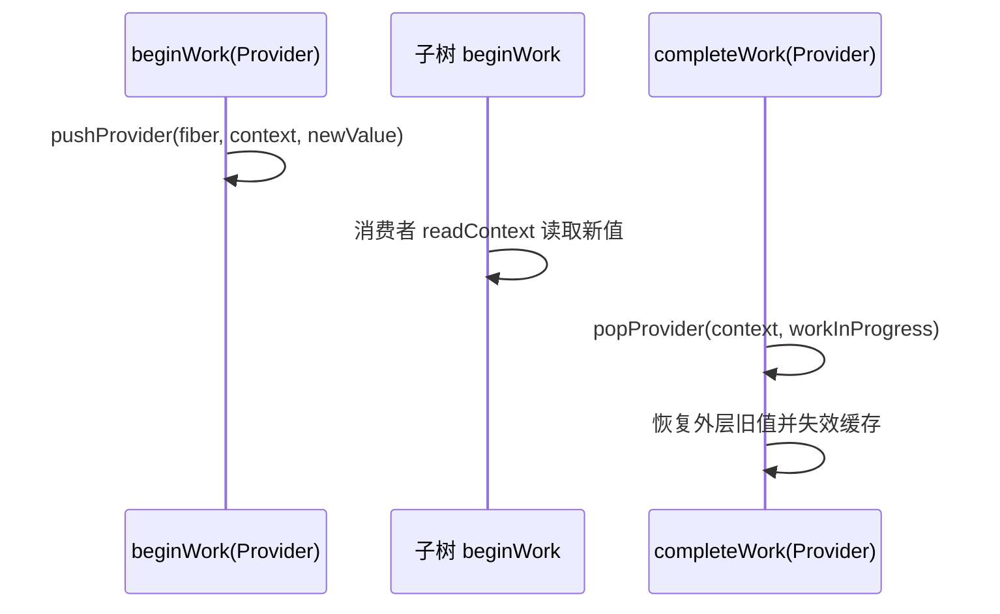
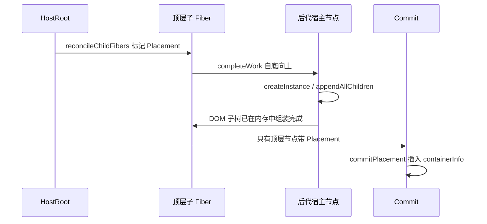
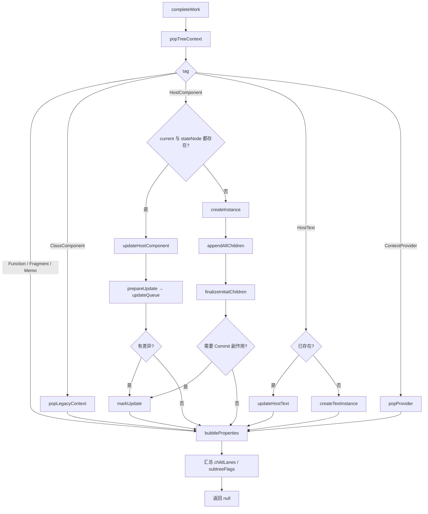

# completeWork

`beginWork` 负责“向下问”：这个节点应该有哪些子节点？`completeWork` 负责“向上答”：子节点都处理完了，当前节点该创建什么、挂载什么、恢复什么、向上冒泡什么？

在 React 18.3.1 的深度优先遍历里，`completeWork` 的执行顺序是自底向上的：先完成叶子节点，再完成父节点。真实 DOM 就是在这个阶段被创建并组装成子树的。其实现位于 `packages/react-reconciler/src/ReactFiberCompleteWork.old.js`，宿主环境相关函数位于 `packages/react-dom/src/client/ReactDOMHostConfig.js`。

## 1. 职责

`completeWork` 主要做六件事：

[width(18,82)]

| 职责           | 官方实现                                                                  |
| -------------- | ------------------------------------------------------------------------- |
| 创建宿主节点   | `HostComponent` 调用 `createInstance`，最终执行 `createElement`           |
| 初始化属性     | `finalizeInitialChildren` → `setInitialProperties`                        |
| 组装子树       | `appendAllChildren` → `appendInitialChild`                                |
| 计算更新差异   | `prepareUpdate` → `diffProperties`，结果存入 `workInProgress.updateQueue` |
| 恢复 Context   | `ContextProvider` 离开时执行 `popProvider`                                |
| 冒泡 lane/flag | `bubbleProperties` 把子树的 `childLanes` 与 `subtreeFlags` 汇总到父节点   |

它不负责把最顶层的 DOM 插入容器，那一步由 Commit 阶段的 `Placement` 处理。它也不直接修改已有 DOM 的属性，属性差异会被打包成 `updatePayload`，留给 `commitUpdate` 应用。

## 2. 入口与 tag 分发

`completeWork` 的签名比 `beginWork` 多一个 `renderLanes`。它在函数开头先执行 `popTreeContext`，然后按 tag 分派。绝大多数分支做完自己的事情后调用 `bubbleProperties` 并返回 `null`。

:::code-group

```ts [react-reconciler/src/ReactFiberCompleteWork.old.js]
function completeWork(
  current: Fiber | null,
  workInProgress: Fiber,
  renderLanes: Lanes,
): Fiber | null {
  const newProps = workInProgress.pendingProps
  popTreeContext(workInProgress)
  switch (workInProgress.tag) {
    case IndeterminateComponent:
    case LazyComponent:
    case SimpleMemoComponent:
    case FunctionComponent:
    case ForwardRef:
    case Fragment:
    case Mode:
    case Profiler:
    case ContextConsumer:
    case MemoComponent:
      bubbleProperties(workInProgress)
      return null
    case ClassComponent: {
      const Component = workInProgress.type
      if (isLegacyContextProvider(Component)) {
        popLegacyContext(workInProgress)
      }
      bubbleProperties(workInProgress)
      return null
    }
    // 省略 HostRoot、SuspenseComponent、HostPortal 等分支
    case HostComponent: {
      popHostContext(workInProgress)
      const rootContainerInstance = getRootHostContainer()
      const type = workInProgress.type
      if (current !== null && workInProgress.stateNode != null) {
        updateHostComponent(
          current,
          workInProgress,
          type,
          newProps,
          rootContainerInstance,
        )

        if (current.ref !== workInProgress.ref) {
          markRef(workInProgress)
        }
      } else {
        if (!newProps) {
          if (workInProgress.stateNode === null) {
            throw new Error(
              'We must have new props for new mounts. This error is likely ' +
                'caused by a bug in React. Please file an issue.',
            )
          }

          // 工作被中断时可能走到这里。
          bubbleProperties(workInProgress)
          return null
        }

        const currentHostContext = getHostContext()
        const wasHydrated = popHydrationState(workInProgress)
        if (wasHydrated) {
          if (
            prepareToHydrateHostInstance(
              workInProgress,
              rootContainerInstance,
              currentHostContext,
            )
          ) {
            markUpdate(workInProgress)
          }
        } else {
          const instance = createInstance(
            type,
            newProps,
            rootContainerInstance,
            currentHostContext,
            workInProgress,
          )

          appendAllChildren(instance, workInProgress, false, false)

          workInProgress.stateNode = instance

          if (
            finalizeInitialChildren(
              instance,
              type,
              newProps,
              rootContainerInstance,
              currentHostContext,
            )
          ) {
            markUpdate(workInProgress)
          }
        }

        if (workInProgress.ref !== null) {
          markRef(workInProgress)
        }
      }
      bubbleProperties(workInProgress)
      return null
    }
    case HostText: {
      const newText = newProps
      if (current && workInProgress.stateNode != null) {
        const oldText = current.memoizedProps
        updateHostText(current, workInProgress, oldText, newText)
      } else {
        if (typeof newText !== 'string') {
          if (workInProgress.stateNode === null) {
            throw new Error(
              'We must have new props for new mounts. This error is likely ' +
                'caused by a bug in React. Please file an issue.',
            )
          }
        }
        const rootContainerInstance = getRootHostContainer()
        const currentHostContext = getHostContext()
        const wasHydrated = popHydrationState(workInProgress)
        if (wasHydrated) {
          if (prepareToHydrateHostTextInstance(workInProgress)) {
            markUpdate(workInProgress)
          }
        } else {
          workInProgress.stateNode = createTextInstance(
            newText,
            rootContainerInstance,
            currentHostContext,
            workInProgress,
          )
        }
      }
      bubbleProperties(workInProgress)
      return null
    }
    // 省略 SuspenseComponent、HostPortal、SuspenseListComponent 等分支
    case ContextProvider: {
      // 离开 Provider，恢复外层 Context 值。
      const context: ReactContext<any> = workInProgress.type._context
      popProvider(context, workInProgress)
      bubbleProperties(workInProgress)
      return null
    }
    // 省略 IncompleteClassComponent、ScopeComponent、OffscreenComponent 等分支
  }

  throw new Error(
    `Unknown unit of work tag (${workInProgress.tag}). This error is likely caused by a bug in ` +
      'React. Please file an issue.',
  )
}
```

:::

`HostComponent` 的两个分支很好区分：

- `current !== null && workInProgress.stateNode != null`：这个 DOM 已经存在，进入更新分支，只计算 `updatePayload`。
- 否则：这是一个全新的 DOM，进入挂载分支，创建节点、组装子树、初始化属性。

## 3. 挂载：创建并组装 DOM

### 3.1 三个步骤

以 `<div className="box"><span>hello</span></div>` 为例：

1. `createInstance` 调用 `createElement(type, props, rootContainerInstance, parentNamespace)` 创建父 DOM，并通过 `precacheFiberNode` 建立 DOM 与 Fiber 的关联。
2. `appendAllChildren(instance, workInProgress, false, false)` 遍历子 Fiber，把 `<span>` 的 `stateNode` 挂到父 DOM。
3. `finalizeInitialChildren` 调用 `setInitialProperties` 写入 `className` 等属性，并返回一个布尔值，表示是否需要在 Commit 阶段补做挂载副作用。

`finalizeInitialChildren` 的返回值不是“有没有属性”，而是“是否需要 Commit 阶段再处理一次”。React DOM 对 `autoFocus` 和 `img` 做了特殊处理：

:::code-group

```ts [react-dom/src/client/ReactDOMHostConfig.js]
export function appendInitialChild(
  parentInstance: Instance,
  child: Instance | TextInstance,
): void {
  parentInstance.appendChild(child)
}

export function finalizeInitialChildren(
  domElement: Instance,
  type: string,
  props: Props,
  rootContainerInstance: Container,
  hostContext: HostContext,
): boolean {
  setInitialProperties(domElement, type, props, rootContainerInstance)
  switch (type) {
    case 'button':
    case 'input':
    case 'select':
    case 'textarea':
      return !!props.autoFocus
    case 'img':
      return true
    default:
      return false
  }
}
```

:::

`createInstance` 本身还负责两件与 DOM 无关的事：

- `precacheFiberNode(internalInstanceHandle, domElement)`：把 Fiber 挂到 DOM 节点的内部属性上，供事件系统和 DevTools 反查。
- `updateFiberProps(domElement, props)`：缓存当前的 props，后续事件分发需要读取最新的事件处理函数。

### 3.2 `appendAllChildren`

`appendAllChildren` 要解决一个核心问题：**子 Fiber 不一定是宿主节点**。

例如：

```text
<div>
  <App />
</div>
```

`App` 是函数组件，没有 `stateNode`；它的 DOM 在更深层的 `<span>` 上。因此不能简单遍历 `child` 就 `appendChild`，而要递归下降，直到找到 `HostComponent` 或 `HostText`。

:::code-group

```ts [react-reconciler/src/ReactFiberCompleteWork.old.js]
let appendAllChildren

if (supportsMutation) {
  appendAllChildren = function (
    parent: Instance,
    workInProgress: Fiber,
    needsVisibilityToggle: boolean,
    isHidden: boolean,
  ) {
    // 当前只有顶层 Fiber，需要递归它的子树，找到所有终端宿主节点。
    let node = workInProgress.child
    while (node !== null) {
      if (node.tag === HostComponent || node.tag === HostText) {
        appendInitialChild(parent, node.stateNode)
      } else if (node.tag === HostPortal) {
        // Portal 的子节点会插入到自己的容器，这里不向下遍历。
      } else if (node.child !== null) {
        node.child.return = node
        node = node.child
        continue
      }
      if (node === workInProgress) {
        return
      }
      while (node.sibling === null) {
        if (node.return === null || node.return === workInProgress) {
          return
        }
        node = node.return
      }
      node.sibling.return = node.return
      node = node.sibling
    }
  }
}
```

:::

这段循环等价于一次“只在宿主节点上做事的深度优先遍历”：

```text
child → 是 HostComponent / HostText？appendInitialChild
      → 否，是 HostPortal？跳过，不进入它的子树
      → 否，有 child？继续向下
      → 否，有 sibling？横向
      → 否，回父节点
```

几个边界值得注意：

- `HostPortal` 的子节点不属于当前父 DOM，所以这里遇到 Portal 就直接跳过，插入工作由 Portal 自己的提交逻辑处理。
- 循环中会顺手修复 `child.return` 和 `sibling.return`。Render 阶段可能被中断，Fiber 的 `return` 指针需要保持一致。
- `needsVisibilityToggle` 与 `isHidden` 是为 Offscreen / Suspense 的隐藏子树准备的参数，普通挂载时都传 `false`。

### 3.3 为什么不在 `beginWork` 创建 DOM

- `beginWork` 是“计算”阶段，可能因为更高优先级的更新被打断。如果在里面创建 DOM，会留下未被使用的节点。
- `completeWork` 在子树全部处理完后才执行，此时可以确定子 DOM 已经准备好。
- 把 DOM 创建推迟到“归”阶段，让 `appendAllChildren` 能一次性组装完整子树，减少页面重排。

## 4. 更新：属性 Diff 与 `updatePayload`

### 4.1 `updateHostComponent`

更新分支不直接改 DOM，而是把新旧 props 交给 `prepareUpdate`，把差异存到 `workInProgress.updateQueue`。

:::code-group

```ts [react-reconciler/src/ReactFiberCompleteWork.old.js]
updateHostComponent = function(
  current: Fiber,
  workInProgress: Fiber,
  type: Type,
  newProps: Props,
  rootContainerInstance: Container,
) {
  // 有 alternate 说明这是更新，需要安排一个 Commit 副作用。
  const oldProps = current.memoizedProps;
  if (oldProps === newProps) {
    // mutation 模式下，props 引用不变就足以 bailout：
    // 即使 children 变了，也不会碰这个节点。
    return;
  }

  const instance: Instance = workInProgress.stateNode;
  const currentHostContext = getHostContext();
  const updatePayload = prepareUpdate(
    instance,
    type,
    oldProps,
    newProps,
    rootContainerInstance,
    currentHostContext,
  );
  // 把差异挂到 updateQueue，Commit 阶段由 commitUpdate 消费。
  workInProgress.updateQueue = (updatePayload: any);
  if (updatePayload) {
    markUpdate(workInProgress);
  }
};
```

```ts [react-reconciler/src/ReactFiberCompleteWork.old.js]
function markUpdate(workInProgress: Fiber) {
  // 把 Update 标记加到 Fiber 上，Placement 会变成 PlacementAndUpdate。
  workInProgress.flags |= Update
}
```

:::

这段代码体现了 React 的一条重要原则：**Render 阶段只计算差异，不产生 DOM 副作用**。`prepareUpdate` 只是比较 props，真正的写入发生在 Commit 阶段。

### 4.2 `prepareUpdate` 与 `commitUpdate`

`prepareUpdate` 在 DOM 渲染器里最终调用 `diffProperties`。返回 `null` 表示没有差异，返回数组表示差异存在。数组的结构是 `[key1, value1, key2, value2, ...]`，具体格式由 `diffProperties` 决定。

:::code-group

```ts [react-dom/src/client/ReactDOMHostConfig.js]
export function prepareUpdate(
  domElement: Instance,
  type: string,
  oldProps: Props,
  newProps: Props,
  rootContainerInstance: Container,
  hostContext: HostContext,
): null | Array<mixed> {
  // 省略 __DEV__ 下的 DOM nesting 校验
  return diffProperties(
    domElement,
    type,
    oldProps,
    newProps,
    rootContainerInstance,
  )
}

export function commitUpdate(
  domElement: Instance,
  updatePayload: Array<mixed>,
  type: string,
  oldProps: Props,
  newProps: Props,
  internalInstanceHandle: Object,
): void {
  // 把差异应用到 DOM 节点上。
  updateProperties(domElement, updatePayload, type, oldProps, newProps)
  // 更新 props 缓存，事件系统需要读取最新的处理函数。
  updateFiberProps(domElement, newProps)
}
```

:::

`updatePayload` 的设计带来三个好处：

- Render 阶段可以被打断、丢弃、重做，而不会弄脏 DOM。
- Commit 阶段拿到的是已经算好的差异，可以批量应用。
- 差异结构可以被 DevTools、测试和性能分析工具复用。

`markUpdate` 的作用是把 `Update` 标记加到 Fiber 上。Commit 阶段遍历 `subtreeFlags` 时，看到 `Update` 才会调用 `commitUpdate`。

## 5. 文本节点

`HostText` 的处理非常直接。更新时只比较新旧文本，不同就标记 `Update`；挂载时直接创建文本节点。

:::code-group

```ts [react-reconciler/src/ReactFiberCompleteWork.old.js]
updateHostText = function (
  current: Fiber,
  workInProgress: Fiber,
  oldText: string,
  newText: string,
) {
  // 文本不同才标记更新，真正的写入在 Commit 阶段完成。
  if (oldText !== newText) {
    markUpdate(workInProgress)
  }
}
```

```ts [react-dom/src/client/ReactDOMHostConfig.js]
export function commitTextUpdate(
  textInstance: TextInstance,
  oldText: string,
  newText: string,
): void {
  textInstance.nodeValue = newText
}
```

:::

这里的 `newProps` 就是文本内容本身。`createFiberFromText` 把字符串作为 `pendingProps`，文本节点没有属性，也没有子节点，创建完就结束。

注意：纯文本子节点通常不会走到 `HostText` 分支。`beginWork` 的 `shouldSetTextContent` 会把它优化成父节点的 `textContent`，只有文本作为独立子节点（例如数组里的字符串、或 `HostText` Fiber 已经存在）时，才会进入这里的逻辑。

## 6. Context 的恢复

Provider 的 `pushProvider` 发生在 `beginWork`，`popProvider` 发生在 `completeWork`：



因为深度优先遍历保证“进入 Provider 一定先于子树、离开 Provider 一定晚于子树”，所以 Context 的覆盖天生满足后进先出，可以用一个栈管理。

`popProvider` 做的是“出栈恢复”：它从 Context 栈中弹出当前 Provider 保存的旧值，再把它写回 `context._currentValue`（非 primary renderer 写 `_currentValue2`）。这样离开 Provider 后，后续兄弟节点读到的又是外层 Provider 的值。

## 7. `bubbleProperties`：向上汇总 lane 与 flags

每个 `completeWork` 分支最后都会调用 `bubbleProperties`。它不是简单的“把子节点信息复制给父节点”，而是把整棵子树的待处理 lane 和副作用标记汇总上来。

:::code-group

```ts [react-reconciler/src/ReactFiberCompleteWork.old.js]
function bubbleProperties(completedWork: Fiber) {
  const didBailout =
    completedWork.alternate !== null &&
    completedWork.alternate.child === completedWork.child

  let newChildLanes = NoLanes
  let subtreeFlags = NoFlags

  if (!didBailout) {
    let child = completedWork.child
    while (child !== null) {
      newChildLanes = mergeLanes(
        newChildLanes,
        mergeLanes(child.lanes, child.childLanes),
      )

      subtreeFlags |= child.subtreeFlags
      subtreeFlags |= child.flags

      // 修正 return 指针，保证树结构一致。
      child.return = completedWork

      child = child.sibling
    }

    completedWork.subtreeFlags |= subtreeFlags
  } else {
    // bailout 时只向上冒泡 StaticMask 里的静态标记。
    // 省略 ProfileMode 下的耗时统计分支
  }

  completedWork.childLanes = newChildLanes

  return didBailout
}
```

:::

`bubbleProperties` 产出两个关键字段：

[width(20,80)]

| 字段           | 含义                                                           |
| -------------- | -------------------------------------------------------------- |
| `childLanes`   | 子树中所有待处理 lane 的并集，`beginWork` 用它判断能否跳过子树 |
| `subtreeFlags` | 子树中所有副作用标记的并集，Commit 阶段用它决定要遍历哪些节点  |

React 18 不再维护 `firstEffect` / `lastEffect` 的 effect list，而是让 Commit 阶段从根节点开始，沿着 `subtreeFlags` 判断哪些子树有副作用。这样可以避免在 Render 阶段维护一条额外的链表，也让中断和恢复更容易处理。

`didBailout` 为真时，当前 Fiber 的 `child` 指针与 `alternate.child` 相同，说明这次没有重新协调子节点。此时不能把子节点的普通 `flags` 冒泡上来，因为它们属于上一轮渲染，只保留 `StaticMask` 中的静态标记。

## 8. 首屏 DOM 是如何出现的

回顾 `beginWork` 的 `reconcileChildren`：首次挂载时 `current === null`，使用 `mountChildFibers`，不标记 `Placement`。那么顶层 DOM 是谁插入容器的？

答案在 HostRoot 的特殊性：

1. `updateContainer` 把 `element` 写入 HostRoot 的更新队列，并调度一次渲染。
2. HostRoot 的 `current` 不是 `null`。`updateHostRoot` 调用的 `reconcileChildren` 会走 `reconcileChildFibers` 更新分支。
3. 因此 HostRoot 的直接子节点（也就是 `root.render` 的顶层元素）会被标记 `Placement`。
4. `completeWork` 自底向上执行，所有宿主节点通过 `appendAllChildren` 在内存中组装成一棵完整的 DOM 子树。
5. Commit 阶段对顶层子节点执行 `commitPlacement`，把它插入 `containerInfo`。整棵已经组装好的 DOM 子树随之进入页面。

可以用下面的顺序概括：



其余新节点没有 `Placement`，因为它们的父 DOM 已经在 `completeWork` 中通过 `appendAllChildren` 组装好了。只需要插入顶层节点，整棵 DOM 子树就会一起进入页面。

`appendChildToContainer` 还处理了注释容器的情况：如果容器本身是注释节点，它会用 `insertBefore` 把子节点插到注释节点前面，而不是调用 `appendChild`。

## 9. 一次“归”的流程



## 10. 与简化实现的差异

简化实现（mini-react / xunbei-react）把 `completeWork` 压缩成“创建 DOM + 直接改属性 + 挂载子节点”三步，保留了自底向上的顺序，但去掉了官方实现里的差异计算与提交解耦：

- **直接在 `completeWork` 里创建 DOM**：这与官方一致，`HostComponent` 挂载时调用 `document.createElement`，`HostText` 调用 `createTextNode`。
- **直接在 `completeWork` 里读写属性**：简化版的 `finalizeInitialChildren` 会遍历新旧 props，直接给 DOM 赋值、移除旧事件、写 `textContent`。官方只在 `completeWork` 中计算 `updatePayload`，真正的 DOM 写入留给 Commit 阶段的 `commitUpdate`。
- **`appendAllChildren` 只识别 `HostComponent` 与 `HostText`**：遇到函数组件会继续向下找子节点，但没有处理 `HostPortal`、`OffscreenComponent`、Suspense fallback 等特殊子树。
- **Context 使用 `popProvide`**：函数名与官方 `popProvider` 不同，语义也更简单；官方通过 `valueCursor` 栈恢复 `_currentValue` / `_currentValue2`。
- **没有 `bubbleProperties`**：不会向上汇总 `childLanes` 与 `subtreeFlags`，因此也没有基于 lane 的跳过和 Commit 阶段的子树裁剪。
- **没有 hydration**：不会处理服务端渲染留下的 DOM，也不会使用 `Hydrating` 标记。

[width(19,32,49)]

| 关注点        | 简化实现                               | React 18.3.1                                          |
| ------------- | -------------------------------------- | ----------------------------------------------------- |
| 创建 DOM      | `completeWork` 中直接 `createElement`  | `createInstance` → `createElement`                    |
| 更新属性      | `finalizeInitialChildren` 直接读写 DOM | `prepareUpdate` 生成 `updatePayload`，Commit 应用     |
| 挂载子节点    | `appendAllChildren` 只处理 Host 节点   | 额外处理 Portal、Offscreen、Suspense                  |
| Context 恢复  | `popProvide`                           | `popProvider`，通过 `valueCursor` 栈恢复              |
| 向上汇总      | 无                                     | `bubbleProperties` 汇总 `childLanes` / `subtreeFlags` |
| Hydration     | 无                                     | `popHydrationState` + `Hydrating`                     |
| Render 副作用 | 有，直接改 DOM                         | 无，差异留给 Commit                                   |

## 11. 总结

[width(24,40,36)]

| 节点类型             | `completeWork` 的核心动作                            | 产物                                  |
| -------------------- | ---------------------------------------------------- | ------------------------------------- |
| `HostComponent`      | 挂载时创建 DOM、组装子树、初始化属性；更新时计算差异 | `stateNode` / `updateQueue`           |
| `HostText`           | 挂载时创建文本节点；更新时比较文本                   | `stateNode` / `Update`                |
| `ContextProvider`    | `popProvider` 恢复外层 Context                       | 正确的 `_currentValue`                |
| 函数 / 类 / Fragment | 无 DOM 操作，必要时执行出栈逻辑                      | `childLanes` / `subtreeFlags`         |
| 所有分支             | `bubbleProperties` 向上汇总 lane 与 flags            | 供 `beginWork` bailout 和 Commit 使用 |

`completeWork` 结束后，整棵 WIP 树已经具备完整的 DOM 子树，属性差异也已经算好并挂在 Fiber 上。下一篇进入 Commit 阶段，看这些 DOM 如何被插入、移动、删除，以及 Effect 如何被执行，详见 [Commit 阶段](/frameworks/react/advanced/source-code/commit/commitWork)。
