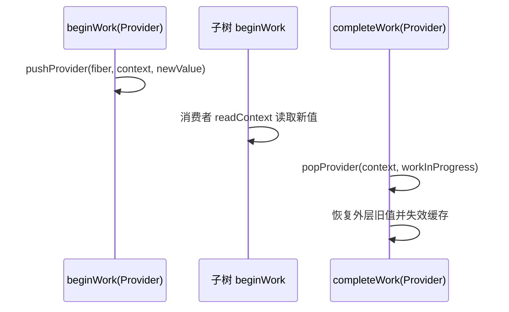
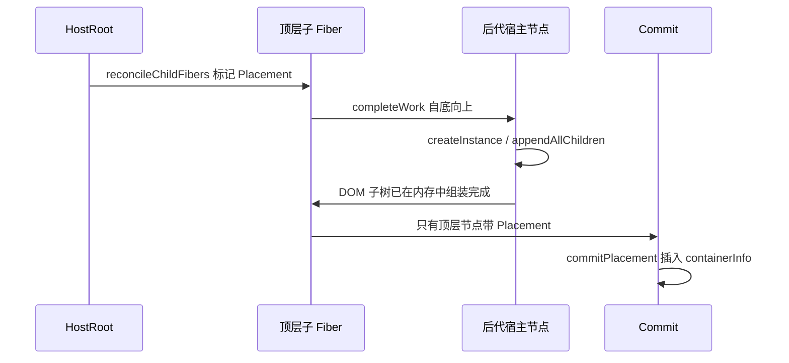
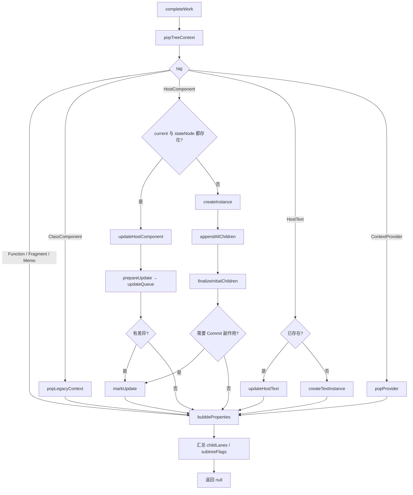

# completeWork

`beginWork` 负责“**向下问**”：这个节点应该有哪些子节点？`completeWork` 负责“**向上答**”：子节点都处理完了，当前节点该创建什么、挂载什么、恢复什么、向上冒泡什么？它是 React 18.3.1 Render 阶段回溯时的收尾函数，在 DOM 渲染器里始终返回 `null`。

## 1. 职责与返回值

### 1.1 三个核心动作

对每个 Fiber，`completeWork` 大致做三件事：

- **创建或更新宿主节点**：`HostComponent` 挂载时调用 `createInstance`，更新时调用 `updateHostComponent`；`HostText` 则调用 `createTextInstance` 或 `updateHostText`。
- **组装子树并初始化属性**：`appendAllChildren` 把后代宿主节点挂到当前 DOM 上，`finalizeInitialChildren` 负责写入初始属性。
- **恢复栈并向上汇总**：`popTreeContext` / `popHostContext` / `popProvider` 等出栈操作与 `beginWork` 的入栈一一对应，最后由 `bubbleProperties` 把子树的 `childLanes` 与 `subtreeFlags` 汇总回来。

> [!TIP]
> `completeWork` 不负责把最顶层的 DOM 插入容器，也不直接修改已有DOM的属性。前者由Commit阶段的`Placement`完成，后者被`prepareUpdate` 打包成`updatePayload`，留给`commitUpdate`应用。

### 1.2 返回值约定

[width(12,88)]

| 返回值 | 含义                                                        |
| ------ | ----------------------------------------------------------- |
| `null` | DOM 渲染器的所有分支都返回 `null`，工作循环沿 `return` 回溯 |

`beginWork` 返回的是“**下一个工作单元**”，而 `completeWork` 没有向下的工作可以交出去，工作循环会转而查看 `sibling`，没有兄弟再沿 `return` 回到父节点。函数签名虽然允许返回 `Fiber | null`，但 DOM 渲染器的每个分支都以 `return null` 收尾。

## 2. `completeWork` 入口：先出栈，再按 tag 收尾

`completeWork` 与 `beginWork` 一样按 `workInProgress.tag` 分派，但它不生成子 Fiber，只给当前节点“**收尾**”。函数第一件事是 `popTreeContext`，与 `beginWork` 进入节点时的入栈严格配对。

:::code-group

```ts [react-reconciler/src/ReactFiberCompleteWork.old.js]
function completeWork(
  current: Fiber | null,
  workInProgress: Fiber,
  renderLanes: Lanes,
): Fiber | null {
  const newProps = workInProgress.pendingProps
  // 离开当前 Fiber 的树上下文，与 beginWork 阶段的入栈配对。
  popTreeContext(workInProgress)

  switch (workInProgress.tag) {
    case IndeterminateComponent:
    case LazyComponent:
    case SimpleMemoComponent:
    case FunctionComponent:
    case ForwardRef:
    case Fragment:
    case Mode:
    case Profiler:
    case ContextConsumer:
    case MemoComponent:
      // 没有宿主节点的类型：只需把子树的 lane 与 flags 汇总上来。
      bubbleProperties(workInProgress)
      return null
    case ClassComponent: {
      const Component = workInProgress.type
      if (isLegacyContextProvider(Component)) {
        // legacy context 在这里出栈，与 beginWork 的 push 配对。
        popLegacyContext(workInProgress)
      }
      bubbleProperties(workInProgress)
      return null
    }
    // 省略 HostRoot、SuspenseComponent、HostPortal 等分支
    case HostComponent: {
      // 与 beginWork 的 pushHostContext 配对，恢复外层宿主容器。
      popHostContext(workInProgress)
      const rootContainerInstance = getRootHostContainer()
      const type = workInProgress.type
      //这个 DOM 已经存在，进入更新分支，只计算 updatePayload。
      if (current !== null && workInProgress.stateNode != null) {
        // 已有 DOM：只计算属性差异，结果写入 updateQueue。
        updateHostComponent(
          current,
          workInProgress,
          type,
          newProps,
          rootContainerInstance,
        )

        if (current.ref !== workInProgress.ref) {
          // ref 变了，Commit 阶段需要重新绑定。
          markRef(workInProgress)
        }
      } else {
        if (!newProps) {
          // 工作被中断时可能走到这里，没有 props 可以创建 DOM。
          bubbleProperties(workInProgress)
          return null
        }

        const currentHostContext = getHostContext()
        // 省略 hydration 分支：复用服务端 DOM 并标记 Update
        // 新建 DOM 节点，同时建立 DOM 与 Fiber 的关联。
        const instance = createInstance(
          type,
          newProps,
          rootContainerInstance,
          currentHostContext,
          workInProgress,
        )

        // 递归收集所有后代宿主节点，挂到刚创建的 DOM 上。
        appendAllChildren(instance, workInProgress, false, false)

        workInProgress.stateNode = instance

        if (
          finalizeInitialChildren(
            instance,
            type,
            newProps,
            rootContainerInstance,
            currentHostContext,
          )
        ) {
          // true 表示 Commit 阶段还要再处理一次（autoFocus、img）。
          markUpdate(workInProgress)
        }

        if (workInProgress.ref !== null) {
          // 首次挂载带 ref，Commit 阶段需要绑定。
          markRef(workInProgress)
        }
      }
      bubbleProperties(workInProgress)
      return null
    }
    case HostText: {
      const newText = newProps
      if (current && workInProgress.stateNode != null) {
        // 已有文本节点：只在内容变化时打 Update。
        const oldText = current.memoizedProps
        updateHostText(current, workInProgress, oldText, newText)
      } else {
        const rootContainerInstance = getRootHostContainer()
        const currentHostContext = getHostContext()
        // 省略 hydration 分支：复用服务端文本节点并标记 Update
        // 新建文本节点，pendingProps 就是文本内容本身。
        workInProgress.stateNode = createTextInstance(
          newText,
          rootContainerInstance,
          currentHostContext,
          workInProgress,
        )
      }
      bubbleProperties(workInProgress)
      return null
    }
    // 省略 SuspenseComponent、HostPortal、SuspenseListComponent 等分支
    case ContextProvider: {
      // 离开 Provider，恢复外层 Context 的值。
      const context: ReactContext<any> = workInProgress.type._context
      popProvider(context, workInProgress)
      bubbleProperties(workInProgress)
      return null
    }
    // 省略 IncompleteClassComponent、ScopeComponent、OffscreenComponent 等分支
  }

  // 省略未知 tag 的报错
}
```

:::

## 3. 挂载：创建并组装 DOM

挂载分支在 `current === null` 或 `workInProgress.stateNode` 为空时执行，依次调用三个宿主函数：`createInstance` 创建 DOM、`appendAllChildren` 组装子树、`finalizeInitialChildren` 初始化属性。

### 3.1 `createInstance`：创建宿主节点

`createInstance` 负责创建真实 DOM，并建立 DOM 与 Fiber 的关联。`createElement` 只按标签和命名空间创建元素，`precacheFiberNode` 与 `updateFiberProps` 负责后续的事件系统与 DevTools 反查。

:::code-group

```ts [react-dom/src/client/ReactDOMHostConfig.js]
export function createInstance(
  type: string,
  props: Props,
  rootContainerInstance: Container,
  hostContext: HostContext,
  internalInstanceHandle: Object,
): Instance {
  // 省略 __DEV__ 下的 DOM nesting 校验
  // HostContext 缓存了当前命名空间，SVG / MathML 子节点按它创建。
  const parentNamespace = hostContext.namespace
  // 创建真实 DOM 节点。
  const domElement: Instance = createElement(
    type,
    props,
    rootContainerInstance,
    parentNamespace,
  )
  // 把 Fiber 挂到 DOM 节点的内部属性上，供事件系统和 DevTools 反查。
  precacheFiberNode(internalInstanceHandle, domElement)
  // 缓存当前的 props，后续事件分发需要读取最新的处理函数。
  updateFiberProps(domElement, props)
  return domElement
}
```

:::

返回值被赋给 `workInProgress.stateNode`。此时 DOM 既没有父节点，也没有子节点，属性也尚未写入，后续补齐图结构与属性。

### 3.2 `appendAllChildren`：组装子树

子 Fiber 不一定是宿主节点。函数组件、Context、Fragment 等组合节点没有 `stateNode`，它们的 DOM 在更深的后代里。`appendAllChildren` 只对 `HostComponent` 和 `HostText` 执行挂载，其余节点继续向下遍历。

以 `<div><App /></div>` 为例，`<div>` 的 `stateNode` 可以直接挂到父 DOM，`App` 下的 `<span>` 则必须由 `appendAllChildren` 递归找到：

```html
<div>
  <App />
</div>
```

:::code-group

```ts [react-reconciler/src/ReactFiberCompleteWork.js]
let appendAllChildren

if (supportsMutation) {
  appendAllChildren = function (
    parent: Instance,
    workInProgress: Fiber,
    needsVisibilityToggle: boolean, //Offscreen隐藏子树参数
    isHidden: boolean, //Suspense隐藏子树参数
  ) {
    // 从当前 Fiber 的子节点开始，递归寻找所有终端宿主节点。
    let node = workInProgress.child
    while (node !== null) {
      if (node.tag === HostComponent || node.tag === HostText) {
        // 宿主节点直接挂到父 DOM 上。
        appendInitialChild(parent, node.stateNode)
      } else if (node.tag === HostPortal) {
        // Portal 的子节点会插入到自己的容器，这里不向下遍历。
      } else if (node.child !== null) {
        // 组合组件没有 DOM，继续向下找。
        node.child.return = node
        node = node.child
        continue
      }
      if (node === workInProgress) {
        return
      }
      // 无法继续向下时回溯，直到找到最近的兄弟节点。
      while (node.sibling === null) {
        if (node.return === null || node.return === workInProgress) {
          return
        }
        node = node.return
      }
      node.sibling.return = node.return
      node = node.sibling
    }
  }
}
```

```ts [react-dom/src/client/ReactDOMHostConfig.js]
export function appendInitialChild(
  parentInstance: Instance,
  child: Instance | TextInstance,
): void {
  // 子 DOM 的组装最终落到 appendChild。
  parentInstance.appendChild(child)
}
```

:::

### 3.3 `finalizeInitialChildren`：初始化属性

`finalizeInitialChildren` 调用 `setInitialProperties`写入初始属性，并返回一个布尔值。返回值表示是否需要在Commit阶段再处理一次：带`autoFocus`的表单元素和`img`返回`true`，其余标签返回 `false`。

:::code-group

```ts [react-dom/src/client/ReactDOMHostConfig.js]
export function finalizeInitialChildren(
  domElement: Instance,
  type: string,
  props: Props,
  rootContainerInstance: Container,
  hostContext: HostContext,
): boolean {
  // 设置初始属性，返回值表示是否需要 Commit 阶段再处理。
  setInitialProperties(domElement, type, props, rootContainerInstance)
  switch (type) {
    case 'button':
    case 'input':
    case 'select':
    case 'textarea':
      // 带 autoFocus 的表单元素需要在 Commit 阶段真正聚焦。
      return !!props.autoFocus
    case 'img':
      // img 固定返回 true，让 Commit 阶段再补处理。
      return true
    default:
      return false
  }
}
```

:::

返回值不是“**有没有属性**”，而是“**是否需要 Commit 阶段再处理一次**”。`completeWork` 拿到 `true` 后会调用 `markUpdate`，Commit 阶段再执行 `autoFocus` 等副作用。

### 3.4 DOM 创建推迟到 `completeWork`

- `beginWork` 是“**计算**”阶段，可能因为更高优先级的更新被打断。在里面创建 DOM 会留下未被使用的节点。
- `completeWork` 在子树全部处理完后才执行，此时可以确定子 DOM 已经准备好。
- 把 DOM 创建放在“**归**”阶段，`appendAllChildren` 能一次性组装完整子树，减少页面重排。

## 4. 更新：属性 Diff 与 `updatePayload`

### 4.1 `updateHostComponent`

更新分支不直接改 DOM，而是把新旧 props 交给 `prepareUpdate`，把差异存到 `workInProgress.updateQueue`。

:::code-group

```ts [react-reconciler/src/ReactFiberCompleteWork.old.js]
updateHostComponent = function (
  current: Fiber,
  workInProgress: Fiber,
  type: Type,
  newProps: Props,
  rootContainerInstance: Container,
) {
  // 更新分支一定存在 alternate，旧 props 从 current 上取。
  const oldProps = current.memoizedProps
  if (oldProps === newProps) {
    // mutation 模式下，props 引用不变就足以 bailout：
    // 即使 children 变了，也不会碰这个节点。
    return
  }

  const instance: Instance = workInProgress.stateNode
  const currentHostContext = getHostContext()
  // 只比较 props 并返回差异数组，不直接写 DOM。
  const updatePayload = prepareUpdate(
    instance,
    type,
    oldProps,
    newProps,
    rootContainerInstance,
    currentHostContext,
  )
  // 把差异挂到 updateQueue，Commit 阶段由 commitUpdate 消费。
  workInProgress.updateQueue = (updatePayload: any)
  if (updatePayload) {
    markUpdate(workInProgress)
  }
}

function markUpdate(workInProgress: Fiber) {
  // 把 Update 标记加到 Fiber 上，Commit 阶段才会调用 commitUpdate。
  workInProgress.flags |= Update
}
```

:::

`oldProps === newProps` 时直接返回，是因为 mutation 模式下 props 引用不变就不需要触碰这个 DOM；即使 `children` 变了，子节点也会在各自的 `completeWork` 中处理差异。

这段代码体现了 React 的一条重要原则：**Render 阶段只计算差异，不产生 DOM 副作用**。`prepareUpdate` 只是比较 props，真正的写入发生在 Commit 阶段。

### 4.2 `prepareUpdate` 与 `commitUpdate`

`prepareUpdate` 在 DOM 渲染器里最终调用 `diffProperties`。返回 `null` 表示没有差异，返回数组表示差异存在。数组的结构是 `[key1, value1, key2, value2, ...]`，具体格式由 `diffProperties` 决定。

:::code-group

```ts [react-dom/src/client/ReactDOMHostConfig.js]
export function prepareUpdate(
  domElement: Instance,
  type: string,
  oldProps: Props,
  newProps: Props,
  rootContainerInstance: Container,
  hostContext: HostContext,
): null | Array<mixed> {
  // 省略 __DEV__ 下的 DOM nesting 校验
  // 只负责算出差异，真正的写入留给 commitUpdate。
  return diffProperties(
    domElement,
    type,
    oldProps,
    newProps,
    rootContainerInstance,
  )
}

export function commitUpdate(
  domElement: Instance,
  updatePayload: Array<mixed>,
  type: string,
  oldProps: Props,
  newProps: Props,
  internalInstanceHandle: Object,
): void {
  // 把差异应用到 DOM 节点上。
  updateProperties(domElement, updatePayload, type, oldProps, newProps)
  // 更新 props 缓存，事件系统需要读取最新的处理函数。
  updateFiberProps(domElement, newProps)
}
```

:::

`updatePayload` 的设计带来三个好处：

- Render 阶段可以被打断、丢弃、重做，而不会弄脏 DOM。
- Commit 阶段拿到的是已经算好的差异，可以批量应用。
- 差异结构可以被 DevTools、测试和性能分析工具复用。

## 5. 文本节点：`updateHostText`

`HostText` 的处理非常直接。更新时只比较新旧文本，不同就标记 `Update`；挂载时直接创建文本节点。

:::code-group

```ts [react-reconciler/src/ReactFiberCompleteWork.old.js]
updateHostText = function (
  current: Fiber,
  workInProgress: Fiber,
  oldText: string,
  newText: string,
) {
  // 文本不同才标记更新，真正的写入在 Commit 阶段完成。
  if (oldText !== newText) {
    markUpdate(workInProgress)
  }
}
```

```ts [react-dom/src/client/ReactDOMHostConfig.js]
export function commitTextUpdate(
  textInstance: TextInstance,
  oldText: string,
  newText: string,
): void {
  // Commit 阶段直接改写文本节点的内容。
  textInstance.nodeValue = newText
}
```

:::

这里的 `newProps` 就是文本内容本身。`createFiberFromText` 把字符串作为 `pendingProps`，文本节点没有属性，也没有子节点，创建完就结束。

注意：纯文本子节点通常不会走到 `HostText` 分支。`beginWork` 的 `shouldSetTextContent` 会把它优化成父节点的 `textContent`，只有文本作为独立子节点（例如数组里的字符串、或 `HostText` Fiber 已经存在）时，才会进入这里的逻辑。

## 6. Context 的恢复

Provider 的 `pushProvider` 发生在 `beginWork`，`popProvider` 发生在 `completeWork`：



因为深度优先遍历保证“**进入 Provider 一定先于子树、离开 Provider 一定晚于子树**”，所以 Context 的覆盖天生满足后进先出，可以用一个栈管理。

`popProvider` 做的是“**出栈恢复**”：它从 Context 栈中弹出当前 Provider 保存的旧值，再把它写回 `context._currentValue`（非 primary renderer 写 `_currentValue2`）。这样离开 Provider 后，后续兄弟节点读到的又是外层 Provider 的值。消费者节点的 `dependencies` 不受影响，下一次 Provider 值变化时，`propagateContextChange` 仍然能顺着依赖链找到它们。

## 7. `bubbleProperties`：向上汇总 lane 与 flags

每个 `completeWork` 分支最后都会调用 `bubbleProperties`。它不是简单的“**把子节点信息复制给父节点**”，而是把整棵子树的待处理 lane 和副作用标记汇总上来。

:::code-group

```ts [react-reconciler/src/ReactFiberCompleteWork.old.js]
function bubbleProperties(completedWork: Fiber) {
  // child 指针未变，说明本轮没有重新协调子节点。
  const didBailout =
    completedWork.alternate !== null &&
    completedWork.alternate.child === completedWork.child

  let newChildLanes = NoLanes
  let subtreeFlags = NoFlags

  if (!didBailout) {
    // 汇总子树 lanes 与 flags，并顺手修正 return 指针。
    let child = completedWork.child
    while (child !== null) {
      newChildLanes = mergeLanes(
        newChildLanes,
        mergeLanes(child.lanes, child.childLanes),
      )

      // 子节点自身的 flags 和它整棵子树的 subtreeFlags 都要并上来。
      subtreeFlags |= child.subtreeFlags
      subtreeFlags |= child.flags

      // 修正 return 指针，保证树结构一致。
      child.return = completedWork

      child = child.sibling
    }

    // 子树副作用标记的并集，Commit 阶段据此决定要遍历哪些节点。
    completedWork.subtreeFlags |= subtreeFlags
  } else {
    // bailout 时不能冒泡上一轮的普通 flags，只保留静态标记。
    let child = completedWork.child
    while (child !== null) {
      newChildLanes = mergeLanes(
        newChildLanes,
        mergeLanes(child.lanes, child.childLanes),
      )

      subtreeFlags |= child.subtreeFlags & StaticMask
      subtreeFlags |= child.flags & StaticMask

      child.return = completedWork
      child = child.sibling
    }

    completedWork.subtreeFlags |= subtreeFlags
  }

  // 子树待处理 lane 的并集，beginWork 据此判断能否跳过子树。
  completedWork.childLanes = newChildLanes

  return didBailout
}
```

:::

React 18 不再维护 `firstEffect` / `lastEffect` 的 effect list，而是让 Commit 阶段从根节点开始，沿着 `subtreeFlags` 判断哪些子树有副作用。这样可以避免在 Render 阶段维护一条额外的链表，也让中断和恢复更容易处理。

`didBailout` 为真时，当前 Fiber 的 `child` 指针与 `alternate.child` 相同，说明这次没有重新协调子节点。此时不能把子节点的普通 `flags` 冒泡上来，因为它们属于上一轮渲染，只保留 `StaticMask` 中的静态标记。

## 8. 首屏 DOM 是如何出现的

回顾 `beginWork` 的 `reconcileChildren`：首次挂载时 `current === null`，使用 `mountChildFibers`，不标记 `Placement`。那么顶层 DOM 是谁插入容器的？

答案在 HostRoot 的特殊性：

1. `updateContainer` 把 `element` 写入 HostRoot 的更新队列，并调度一次渲染。
2. HostRoot 的 `current` 不是 `null`。`updateHostRoot` 调用的 `reconcileChildren` 会走 `reconcileChildFibers` 更新分支。
3. 因此 HostRoot 的直接子节点（也就是 `root.render` 的顶层元素）会被标记 `Placement`。
4. `completeWork` 自底向上执行，所有宿主节点通过 `appendAllChildren` 在内存中组装成一棵完整的 DOM 子树。
5. Commit 阶段对顶层子节点执行 `commitPlacement`，把它插入 `containerInfo`。整棵已经组装好的 DOM 子树随之进入页面。

可以用下面的顺序概括：



其余新节点没有 `Placement`，因为它们的父 DOM 已经在 `completeWork` 中通过 `appendAllChildren` 组装好了。只需要插入顶层节点，整棵 DOM 子树就会一起进入页面。

`appendChildToContainer` 还处理了注释容器的情况：如果容器本身是注释节点，它会用 `insertBefore` 把子节点插到注释节点前面，而不是调用 `appendChild`。

## 9. 完整流程图



## 10. 总结

[width(24,40,36)]

| 节点类型             | `completeWork` 的核心动作                            | 产物                                  |
| -------------------- | ---------------------------------------------------- | ------------------------------------- |
| `HostComponent`      | 挂载时创建 DOM、组装子树、初始化属性；更新时计算差异 | `stateNode` / `updateQueue`           |
| `HostText`           | 挂载时创建文本节点；更新时比较文本                   | `stateNode` / `Update`                |
| `ContextProvider`    | `popProvider` 恢复外层 Context                       | 正确的 `_currentValue`                |
| 函数 / 类 / Fragment | 无 DOM 操作，必要时执行出栈逻辑                      | `childLanes` / `subtreeFlags`         |
| 所有分支             | `bubbleProperties` 向上汇总 lane 与 flags            | 供 `beginWork` bailout 和 Commit 使用 |

`completeWork` 结束后，整棵 WIP 树已经具备完整的 DOM 子树，属性差异也已经算好并挂在 Fiber 上。下一篇进入 Commit 阶段，看这些 DOM 如何被插入、移动、删除，以及 Effect 如何被执行，详见 [Commit 阶段](/frameworks/react/advanced/source-code/commit/commitWork)。
