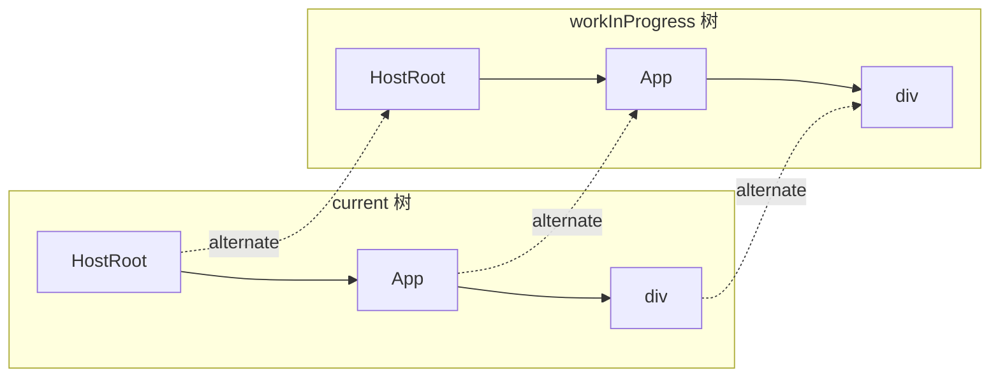

# Fiber 节点

React 18.3.1 的运行时围绕 Fiber 展开。它既是组件在内存中的表示，也是可中断的工作单元，同时还是由 `return`、`child`、`sibling` 串起来的树节点。理解 Fiber 的字段、创建方式和双缓冲，是继续阅读 `beginWork`、`completeWork`、Diff 与 Commit 的前提。

Fiber 的实现位于 `packages/react-reconciler/src/ReactFiber.old.js`、`ReactInternalTypes.js`、`ReactWorkTags.js`、`ReactFiberFlags.js` 和 `ReactFiberCompleteWork.old.js`。React 18.3.1 默认使用 `.old.js` 分叉。代码引用会省略 Flow 类型标注、`__DEV__` 与 Profiler 分支，主体与官方源码一致。

## 1. Fiber 要解决的问题

### 1.1 从递归调用栈到链表

旧版 Stack Reconciler 直接递归遍历组件树。递归一旦开始，就必须执行到底，无法在中途暂停：

- 树很深时，主线程会被长时间占用。
- 高优先级更新（输入、点击）必须排队等待。
- 无法在浏览器需要绘制时让出控制权。

Fiber 把递归调用栈“拍平”成链表：

```text
parent
  │ child
  ▼
first child ──sibling──▶ second child ──sibling──▶ third child
  │ return                    │ return                 │ return
  └──────────────▶ parent ◀───┴────────────────────────┘
```

每个节点都可以单独执行，执行完通过 `return` 回到父节点。配合全局的 `workInProgress` 指针和 `shouldYield()` 检查，React 就能在任意两个工作单元之间暂停、保存指针、稍后继续。

### 1.2 Fiber 的四个设计目标

[width(16,84)]

| 目标       | 依赖的字段/机制                                           |
| ---------- | --------------------------------------------------------- |
| 可中断     | `child` / `sibling` / `return` 链表 + 全局工作指针        |
| 优先级调度 | `lanes` / `childLanes`                                    |
| 双缓冲     | `alternate` 指针                                          |
| 错误边界   | 沿 `return` 向上回溯，配合 `Incomplete` / `ShouldCapture` |

## 2. Fiber 的运行时结构

### 2.1 构造函数 `FiberNode`

`FiberNode` 使用普通函数而不是 `class`，所有字段在构造时一次性初始化。这样每个 Fiber 都具有相同的隐藏类，避免后续动态增删属性拖慢 V8 的对象访问。

:::code-group

```ts [react-reconciler/src/ReactFiber.old.js]
function FiberNode(tag, pendingProps, key, mode) {
  // Instance
  this.tag = tag
  this.key = key
  this.elementType = null
  this.type = null
  this.stateNode = null

  // Fiber：由三个指针组成的链表树
  this.return = null
  this.child = null
  this.sibling = null
  this.index = 0

  this.ref = null

  this.pendingProps = pendingProps
  this.memoizedProps = null
  this.updateQueue = null
  this.memoizedState = null
  this.dependencies = null

  this.mode = mode

  // Effects
  this.flags = NoFlags
  this.subtreeFlags = NoFlags
  this.deletions = null

  this.lanes = NoLanes
  this.childLanes = NoLanes

  this.alternate = null

  // 省略 enableProfilerTimer 分支中的 actualDuration、treeBaseDuration 等字段
}
```

:::

### 2.2 字段说明

[width(22,78)]

| 字段                         | 含义                                                                 |
| ---------------------------- | -------------------------------------------------------------------- |
| `tag`                        | Fiber 类型，决定 `beginWork` / `completeWork` 走哪个分支             |
| `key`                        | 列表 Diff 的身份标识                                                 |
| `elementType`                | 元素原始类型，如 `'div'`、`App`、`Fragment`                          |
| `type`                       | 实际参与渲染的类型，通常与 `elementType` 相同                        |
| `stateNode`                  | 关联的宿主节点或组件实例：DOM、文本节点、类实例、`FiberRoot`         |
| `return`                     | 父 Fiber；含义是“完成工作后返回哪里”                                 |
| `child`                      | 第一个子 Fiber                                                       |
| `sibling`                    | 下一个兄弟 Fiber                                                     |
| `index`                      | 在父节点子列表中的位置，Diff 判断是否移动时使用                      |
| `ref`                        | 本次渲染要绑定的 ref                                                 |
| `pendingProps`               | 本次渲染待处理的新 props                                             |
| `memoizedProps`              | 上一次渲染完成后的 props                                             |
| `updateQueue`                | 更新队列；函数组件中存放 Effect 循环链表                             |
| `memoizedState`              | 上一次渲染后的状态；函数组件中指向第一个 Hook                        |
| `dependencies`               | Context 依赖链表                                                     |
| `mode`                       | 子树模式位，如 `ConcurrentMode`、`StrictLegacyMode`                  |
| `flags`                      | 当前 Fiber 自身的副作用位掩码                                        |
| `subtreeFlags`               | 子树副作用标记汇总，Commit 时可据此跳过无副作用子树                  |
| `deletions`                  | 本轮需要删除的子 Fiber 数组                                          |
| `nextEffect`                 | 旧 effect list 的遗留字段                                            |
| `firstEffect` / `lastEffect` | 旧 effect list 的头尾指针；18 的提交路径主要依赖 `subtreeFlags` 剪枝 |
| `lanes`                      | 当前 Fiber 上待处理的优先级                                          |
| `childLanes`                 | 子树中待处理的优先级汇总                                             |
| `alternate`                  | 另一棵 Fiber 树中的对应节点，双缓冲的关键                            |

`flags` 与 `subtreeFlags` 的分工是理解 React 18 提交优化的关键：`flags` 描述“这个节点自己要不要做什么”，`subtreeFlags` 描述“这棵子树里有没有值得提交的事情”。父节点在 `completeWork` 阶段把子节点的标记向上汇总，Commit 阶段就可以整棵跳过没有效果的子树。

### 2.3 三个链表指针

`return`、`child`、`sibling` 构成了一棵“用链表表示的树”：

- 向下：`child`
- 横向：`sibling`
- 向上：`return`

深度优先遍历的顺序可以写成：

```text
beginWork(parent)
  → beginWork(child)
    → beginWork(grandchild)
    → completeWork(grandchild)
  → completeWork(child)
→ beginWork(sibling)
  → completeWork(sibling)
→ completeWork(parent)
```

## 3. Fiber 的类型标签

`ReactWorkTags.js` 使用数字而不是字符串，方便 `switch` 做整数比较。完整标签覆盖 0 到 25，下面摘录官方常量定义。

:::code-group

```ts [react-reconciler/src/ReactWorkTags.js]
export const FunctionComponent = 0
export const ClassComponent = 1
export const IndeterminateComponent = 2 // Before we know whether it is function or class
export const HostRoot = 3 // Root of a host tree. Could be nested inside another node.
export const HostPortal = 4 // A subtree. Could be an entry point to a different renderer.
export const HostComponent = 5
export const HostText = 6
export const Fragment = 7
export const Mode = 8
export const ContextConsumer = 9
export const ContextProvider = 10
export const ForwardRef = 11
export const Profiler = 12
export const SuspenseComponent = 13
export const MemoComponent = 14
export const SimpleMemoComponent = 15
export const LazyComponent = 16
export const IncompleteClassComponent = 17
export const DehydratedFragment = 18
export const SuspenseListComponent = 19
export const ScopeComponent = 21
export const OffscreenComponent = 22
export const LegacyHiddenComponent = 23
export const CacheComponent = 24
export const TracingMarkerComponent = 25
```

:::

[width(34,8,58)]

| 常量                     | 值  | 用途                                |
| ------------------------ | --- | ----------------------------------- |
| `FunctionComponent`      | 0   | 函数组件                            |
| `ClassComponent`         | 1   | 类组件                              |
| `IndeterminateComponent` | 2   | 尚未确定是函数组件还是类组件        |
| `HostRoot`               | 3   | Fiber 树的根（`FiberRoot.current`） |
| `HostPortal`             | 4   | Portal 子树                         |
| `HostComponent`          | 5   | 原生 DOM 标签                       |
| `HostText`               | 6   | 文本节点                            |
| `Fragment`               | 7   | `<></>`                             |
| `Mode`                   | 8   | `StrictMode` 等模式节点             |
| `ContextConsumer`        | 9   | `<Context.Consumer>` / `useContext` |
| `ContextProvider`        | 10  | `<Context.Provider>`                |
| `ForwardRef`             | 11  | `forwardRef`                        |
| `Profiler`               | 12  | `<Profiler>`                        |
| `SuspenseComponent`      | 13  | `Suspense`                          |
| `MemoComponent`          | 14  | `memo`                              |
| `SimpleMemoComponent`    | 15  | 可简化的 `memo` 函数组件            |
| `LazyComponent`          | 16  | `lazy`                              |
| `OffscreenComponent`     | 22  | 离屏渲染                            |
| `CacheComponent`         | 24  | Cache 边界                          |

标签值直接参与 `switch` 分派，例如 `beginWork` 和 `completeWork` 都按 `workInProgress.tag` 进入不同分支。

## 4. 副作用标记：`flags` 与 `subtreeFlags`

`flags` 用一个整数同时保存多种操作。判断和添加都靠位运算：

```js
// 添加标记
fiber.flags |= Placement

// 判断是否存在某个标记
if (fiber.flags & Placement) {
  // 需要插入
}

// 清除标记
fiber.flags &= ~Placement
```

官方定义的关键标记如下：

:::code-group

```ts [react-reconciler/src/ReactFiberFlags.js]
export const NoFlags = /*                      */ 0b00000000000000000000000000
export const PerformedWork = /*                */ 0b00000000000000000000000001

export const Placement = /*                    */ 0b00000000000000000000000010
export const Update = /*                       */ 0b00000000000000000000000100
export const Deletion = /*                     */ 0b00000000000000000000001000
export const ChildDeletion = /*                */ 0b00000000000000000000010000
export const ContentReset = /*                 */ 0b00000000000000000000100000
export const Callback = /*                     */ 0b00000000000000000001000000
export const DidCapture = /*                   */ 0b00000000000000000010000000
export const Ref = /*                          */ 0b00000000000000001000000000
export const Snapshot = /*                     */ 0b00000000000000010000000000
export const Passive = /*                      */ 0b00000000000000100000000000
export const Hydrating = /*                    */ 0b00000000000001000000000000
export const Visibility = /*                   */ 0b00000000000010000000000000

export const Incomplete = /*                   */ 0b00000000001000000000000000
export const ShouldCapture = /*                */ 0b00000000010000000000000000
export const Forked = /*                       */ 0b00000100000000000000000000

export const RefStatic = /*                    */ 0b00001000000000000000000000
export const LayoutStatic = /*                 */ 0b00010000000000000000000000
export const PassiveStatic = /*                */ 0b00100000000000000000000000

export const MutationMask =
  Placement |
  Update |
  ChildDeletion |
  ContentReset |
  Ref |
  Hydrating |
  Visibility
export const LayoutMask = Update | Callback | Ref | Visibility
export const PassiveMask = Passive | ChildDeletion

export const StaticMask = LayoutStatic | PassiveStatic | RefStatic
```

:::

[width(21,37,42)]

| 标记            | 值                                           | 含义                                               |
| --------------- | -------------------------------------------- | -------------------------------------------------- |
| `NoFlags`       | `0b00000000000000000000000000`               | 无副作用                                           |
| `PerformedWork` | `0b00000000000000000000000001`               | DevTools 用来标记“真正执行了工作”                  |
| `Placement`     | `0b00000000000000000000000010`               | 插入或移动宿主节点                                 |
| `Update`        | `0b00000000000000000000000100`               | 更新属性、文本或执行 Layout Effect                 |
| `Deletion`      | `0b00000000000000000000001000`               | 保留的删除标记；删除子节点实际使用 `ChildDeletion` |
| `ChildDeletion` | `0b00000000000000000000010000`               | 当前节点的某个子节点需要删除                       |
| `ContentReset`  | `0b00000000000000000000100000`               | 重置文本内容                                       |
| `Ref`           | `0b00000000000000001000000000`               | 需要绑定或解绑 ref                                 |
| `Snapshot`      | `0b00000000000000010000000000`               | 需要执行 `getSnapshotBeforeUpdate`                 |
| `Passive`       | `0b00000000000000100000000000`               | 需要执行 Passive Effect（`useEffect`）             |
| `Incomplete`    | `0b00000000001000000000000000`               | 渲染未完成，需要沿 `return` 回溯                   |
| `Forked`        | `0b00000100000000000000000000`               | 节点被克隆（Suspense 等场景）                      |
| `StaticMask`    | `LayoutStatic \| PassiveStatic \| RefStatic` | 跨 render 生命周期保留的静态标记                   |

`subtreeFlags` 由 `completeWork` 阶段向上汇总。官方 `bubbleProperties` 的核心逻辑是：

:::code-group

```ts [react-reconciler/src/ReactFiberCompleteWork.old.js]
function bubbleProperties(completedWork) {
  const didBailout =
    completedWork.alternate !== null &&
    completedWork.alternate.child === completedWork.child

  let newChildLanes = NoLanes
  let subtreeFlags = NoFlags

  if (!didBailout) {
    // 省略 Profiler 计时分支
    let child = completedWork.child
    while (child !== null) {
      newChildLanes = mergeLanes(
        newChildLanes,
        mergeLanes(child.lanes, child.childLanes),
      )

      subtreeFlags |= child.subtreeFlags
      subtreeFlags |= child.flags

      child.return = completedWork
      child = child.sibling
    }

    completedWork.subtreeFlags |= subtreeFlags
  } else {
    // bailout 时只向上汇总静态标记
    let child = completedWork.child
    while (child !== null) {
      newChildLanes = mergeLanes(
        newChildLanes,
        mergeLanes(child.lanes, child.childLanes),
      )

      subtreeFlags |= child.subtreeFlags & StaticMask
      subtreeFlags |= child.flags & StaticMask

      child.return = completedWork
      child = child.sibling
    }

    completedWork.subtreeFlags |= subtreeFlags
  }

  completedWork.childLanes = newChildLanes

  return didBailout
}
```

:::

这段代码同时完成了三件事：汇总 `childLanes`、汇总 `subtreeFlags`、修正子节点的 `return` 指针。

## 5. 创建 Fiber

### 5.1 `createFiber` 与 `createFiberFromElement`

:::code-group

```ts [react-reconciler/src/ReactFiber.old.js]
const createFiber = function (tag, pendingProps, key, mode) {
  // $FlowFixMe: the shapes are exact here but Flow doesn't like constructors
  return new FiberNode(tag, pendingProps, key, mode)
}
```

```ts [react-reconciler/src/ReactFiber.old.js]
export function createFiberFromElement(element, mode, lanes) {
  let owner = null
  if (__DEV__) {
    owner = element._owner
  }
  const type = element.type
  const key = element.key
  const pendingProps = element.props
  const fiber = createFiberFromTypeAndProps(
    type,
    key,
    pendingProps,
    owner,
    mode,
    lanes,
  )
  if (__DEV__) {
    fiber._debugSource = element._source
    fiber._debugOwner = element._owner
  }
  return fiber
}
```

```ts [react-reconciler/src/ReactFiber.old.js]
export function createFiberFromText(content, mode, lanes) {
  const fiber = createFiber(HostText, content, null, mode)
  fiber.lanes = lanes
  return fiber
}
```

:::

`createFiberFromElement` 只负责取 `type`、`key`、`props`，真正的类型判断在 `createFiberFromTypeAndProps` 中完成。函数组件、类组件、`forwardRef`、`memo`、`lazy`、`Fragment` 等最终都会在这里得到对应的 `tag`，详见 [`ReactElement` 与 JSX](/frameworks/react/advanced/source-code/reactElement)。

## 6. 双缓冲：`current` 与 `workInProgress`

### 6.1 为什么需要两棵树

如果直接在页面正在使用的 Fiber 树上修改，Render 阶段一旦中断，用户就会看到“改了一半”的 UI。双缓冲把工作分成两棵树：

- `current`：当前屏幕上已经提交的树。
- `workInProgress`：内存中正在构建的新树。
- 两棵树的对应节点通过 `alternate` 互相引用。

Render 阶段只修改 `workInProgress`，Commit 完成后一次性切换 `root.current`，屏幕不会闪烁。



### 6.2 `createWorkInProgress`

React 采用“池化”策略：每个 Fiber 最多保留两个版本，旧的 `alternate` 会被下一轮更新复用，而不是每次重新分配。

:::code-group

```ts [react-reconciler/src/ReactFiber.old.js]
export function createWorkInProgress(current, pendingProps) {
  let workInProgress = current.alternate
  if (workInProgress === null) {
    // 首次为这个节点创建 WIP：新建并复制不变的实例信息
    workInProgress = createFiber(
      current.tag,
      pendingProps,
      current.key,
      current.mode,
    )
    workInProgress.elementType = current.elementType
    workInProgress.type = current.type
    workInProgress.stateNode = current.stateNode

    workInProgress.alternate = current
    current.alternate = workInProgress
  } else {
    // 复用旧 WIP：更新本次变化的字段
    workInProgress.pendingProps = pendingProps
    workInProgress.type = current.type

    workInProgress.flags = NoFlags
    workInProgress.subtreeFlags = NoFlags
    workInProgress.deletions = null
  }

  // 只保留跨 render 有效的静态标记
  workInProgress.flags = current.flags & StaticMask
  workInProgress.childLanes = current.childLanes
  workInProgress.lanes = current.lanes

  workInProgress.child = current.child
  workInProgress.memoizedProps = current.memoizedProps
  workInProgress.memoizedState = current.memoizedState
  workInProgress.updateQueue = current.updateQueue

  // dependencies 会在 Render 阶段被修改，不能与 current 共享
  const currentDependencies = current.dependencies
  workInProgress.dependencies =
    currentDependencies === null
      ? null
      : {
          lanes: currentDependencies.lanes,
          firstContext: currentDependencies.firstContext,
        }

  // 这些字段会在父节点的协调过程中被覆盖
  workInProgress.sibling = current.sibling
  workInProgress.index = current.index
  workInProgress.ref = current.ref

  return workInProgress
}
```

:::

几个容易误读的点：

- `child` 直接从 `current.child` 拷贝，表示“先沿用旧的子链表”，后续 `reconcileChildren` 会把它替换成新的子链表。
- `flags` 不是简单拷贝，而是 `current.flags & StaticMask`，只保留 `RefStatic`、`LayoutStatic`、`PassiveStatic` 这类跨 render 有效的标记。
- 复用旧 WIP 时，`subtreeFlags` 和 `deletions` 会被清零，避免上一轮的副作用污染本轮。
- `stateNode` 不重新创建，因此 DOM 节点、类实例都能在更新时复用。
- `memoizedState` 在函数组件中指向 Hook 链表，后续 `renderWithHooks` 会基于它恢复状态。
- `dependencies` 必须克隆，因为 Render 阶段会修改它；共享同一个对象会让 `current` 与 `workInProgress` 相互干扰。

### 6.3 一次提交后的指针切换

Commit 阶段完成 Mutation 之后执行：

```js
root.current = finishedWork
```

于是原来的 `workInProgress` 变成新的 `current`，原来的 `current` 则通过 `alternate` 保留下来，等待下一轮更新复用。切换必须发生在 Mutation 之后、Layout 之前：这样 `componentWillUnmount` 看到的仍是旧树，而 `componentDidMount` / `useLayoutEffect` 看到的是新树。

## 7. 总结

Fiber 的骨架可以概括为“三指针链表 + `alternate` 双缓冲 + 位掩码副作用”。官方 React 18.3.1 在此基础上补齐了 Lane 优先级、`subtreeFlags` 汇总和完整的中断恢复能力。

[width(13,25,62)]

| 关注点   | 简化实现                            | React 18.3.1                                             |
| -------- | ----------------------------------- | -------------------------------------------------------- |
| 树结构   | `child` / `sibling` / `return` 链表 | 相同                                                     |
| 双缓冲   | `alternate` 互相引用                | 相同，但复用时会重置 `subtreeFlags`、`deletions` 等字段  |
| 优先级   | 无 Lane，固定优先级                 | `lanes` / `childLanes`                                   |
| 副作用   | 只维护 `flags`                      | `flags` + `subtreeFlags`，Commit 可跳过无效果子树        |
| 可中断   | 同步循环，不支持                    | `workLoopConcurrent` + `shouldYield()` + 全局工作指针    |
| 更新起点 | 直接指向触发更新的 Fiber            | 从 HostRoot 创建新 WIP，沿 `childLanes` 决定要处理的子树 |

简化实现（mini-react / xunbei-react）为了压缩篇幅，通常只保留 `child`、`sibling`、`return`、`alternate` 和少量 `flags`，并用固定优先级与同步循环代替 Lane 和并发渲染。它能演示“Fiber 如何遍历、双缓冲如何切换”，但不能解释“渲染中断后如何恢复”。阅读官方源码时，应以 `ReactFiber.old.js` 与 `ReactFiberWorkLoop.old.js` 的实际字段和流程为准。

理解 Fiber 之后，下一步是看这棵树如何被“调度起来”：[`FiberRoot` 与应用入口](/frameworks/react/advanced/source-code/reconciler/fiberRoot) 负责持有根容器，[工作循环](/frameworks/react/advanced/source-code/reconciler/workLoop) 负责驱动 `beginWork` 与 `completeWork`。
