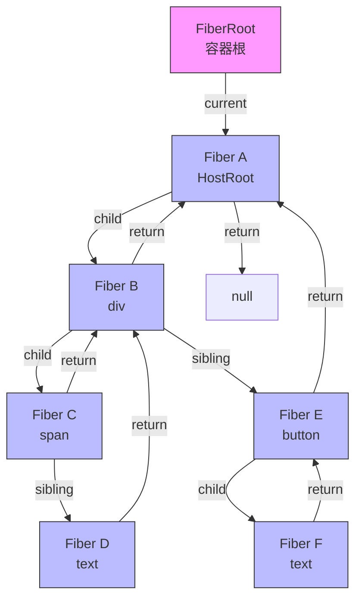
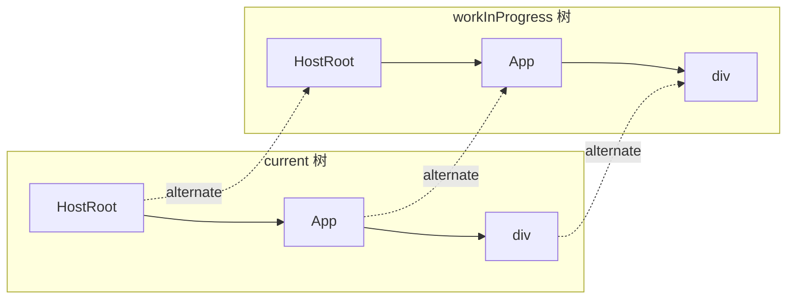

# Fiber 节点

React 18.3.1 的运行时围绕 Fiber 展开。它既是组件在内存中的表示，也是可中断的工作单元，同时还是由 `return`、`child`、`sibling` 串起来的树节点。理解 Fiber 的字段、创建方式和双缓冲，是继续阅读 `beginWork`、`completeWork`、Diff 与 Commit 的前提。

## 1. Fiber 要解决的问题

### 1.1 从递归调用栈到链表

旧版 Stack Reconciler 直接递归遍历组件树。递归一旦开始，就必须执行到底，无法在中途暂停：

- 树很深时，主线程会被长时间占用。
- 高优先级更新（输入、点击）必须排队等待。
- 无法在浏览器需要绘制时让出控制权。

Fiber 把递归调用栈“**拍平**”成链表：

```tree
parent
  │ child
  ▼
first child ──sibling──▶ second child ──sibling──▶ third child
  │ return                    │ return                 │ return
  └──────────────▶ parent ◀───┴────────────────────────┘
```

每个节点都可以单独执行，执行完通过 `return` 回到父节点。配合全局的 `workInProgress` 指针和 `shouldYield()` 检查，React 就能在任意两个工作单元之间暂停、保存指针、稍后继续。

### 1.2 Fiber 的四个设计目标

[width(16,84)]

| 目标       | 依赖的字段/机制                                           |
| ---------- | --------------------------------------------------------- |
| 可中断     | `child` / `sibling` / `return` 链表 + 全局工作指针        |
| 优先级调度 | `lanes` / `childLanes`                                    |
| 双缓冲     | `alternate` 指针                                          |
| 错误边界   | 沿 `return` 向上回溯，配合 `Incomplete` / `ShouldCapture` |

## 2. Fiber 的运行时结构

### 2.1 构造函数 `FiberNode`

`FiberNode` 使用普通函数而不是 `class`，所有字段在构造时一次性初始化。这样每个 Fiber 都具有相同的隐藏类，避免后续动态增删属性拖慢 V8 的对象访问。

:::code-group

```ts [react-reconciler/src/ReactFiber.old.js]
function FiberNode(tag, pendingProps, key, mode) {
  // 实例信息
  this.tag = tag // Fiber 类型，决定 beginWork / completeWork 走哪个分支
  this.key = key // 列表 Diff 的身份标识
  this.elementType = null // 元素原始类型，如 'div'、App、Fragment
  this.type = null // 实际参与渲染的类型，通常与 elementType 相同
  this.stateNode = null // 关联的宿主节点或组件实例（DOM、类实例、FiberRoot）

  // Fiber：由三个指针组成的链表树
  this.return = null // 父 Fiber；完成工作后返回这里
  this.child = null // 第一个子 Fiber
  this.sibling = null // 下一个兄弟 Fiber
  this.index = 0 // 在父节点子列表中的位置，Diff 判断是否移动时使用

  this.ref = null // 本次渲染要绑定的 ref

  this.pendingProps = pendingProps // 本次渲染待处理的新 props
  this.memoizedProps = null // 上一次渲染完成后的 props
  this.updateQueue = null // 更新队列；函数组件中存放 Effect 循环链表
  this.memoizedState = null // 上一次渲染后的状态；函数组件中指向第一个 Hook
  this.dependencies = null // Context 依赖链表

  this.mode = mode // 子树模式位，如 ConcurrentMode、StrictLegacyMode

  // 副作用与优先级
  this.flags = NoFlags // 当前 Fiber 自身的副作用位掩码
  this.subtreeFlags = NoFlags // 子树副作用标记汇总，供 Commit 剪枝
  this.deletions = null // 本轮需要删除的子 Fiber 数组

  this.lanes = NoLanes // 当前 Fiber 上待处理的优先级
  this.childLanes = NoLanes // 子树中待处理的优先级汇总

  this.alternate = null // 另一棵 Fiber 树中的对应节点，双缓冲的关键

  // 省略 enableProfilerTimer 下的性能字段，以及 __DEV__ 下的调试字段
}
```

:::

> [!TIP]
> `flags` 与 `subtreeFlags` 的分工是理解 React 18 提交优化的关键：`flags` 描述“**这个节点自己要不要做什么**”，`subtreeFlags` 描述“**这棵子树里有没有值得提交的事情**”。父节点在 `completeWork` 阶段把子节点的标记向上汇总，Commit 阶段就可以整棵跳过没有效果的子树。

### 2.2 三个链表指针

Fiber 放弃了传统的 `children: []` 数组，改用 **“第一个子节点 + 兄弟节点 + 父节点”三指针链表**：



## 3. Fiber 的类型标签

`ReactWorkTags.js` 使用数字而不是字符串，方便 `switch` 做整数比较。

:::code-group

```ts [react-reconciler/src/ReactWorkTags.js]
export const FunctionComponent = 0 // 函数组件
export const ClassComponent = 1 // 类组件
export const IndeterminateComponent = 2 // 尚未确定是函数组件还是类组件
export const HostRoot = 3 // 宿主树的根（FiberRoot.current），可嵌套在另一个节点内部
export const HostPortal = 4 // Portal 子树，可作为接入另一个渲染器的入口
export const HostComponent = 5 // 原生宿主组件，如 div、span
export const HostText = 6 // 文本节点
export const Fragment = 7 // Fragment，<></>
export const Mode = 8 // 子树模式节点，如 StrictMode
export const ContextConsumer = 9 // <Context.Consumer>
export const ContextProvider = 10 // <Context.Provider>
export const ForwardRef = 11 // forwardRef 包装的组件
export const Profiler = 12 // <Profiler>
export const SuspenseComponent = 13 // <Suspense>
export const MemoComponent = 14 // memo 包装的组件
export const SimpleMemoComponent = 15 // 可简化的 memo 函数组件
export const LazyComponent = 16 // lazy 包装的组件
export const IncompleteClassComponent = 17 // 首次挂载失败的类组件，不视作已完成
export const DehydratedFragment = 18 // hydration 时创建的 Suspense 占位片段
export const SuspenseListComponent = 19 // <SuspenseList>
export const ScopeComponent = 21 // React Scope 测试节点
export const OffscreenComponent = 22 // 离屏渲染的子树
export const LegacyHiddenComponent = 23 // LegacyHidden 包裹的子树
export const CacheComponent = 24 // Cache 边界
export const TracingMarkerComponent = 25 // TracingMarker，追踪一组组件的渲染
```

:::

标签值直接参与 `switch` 分派，`beginWork` 和 `completeWork` 都按 `workInProgress.tag` 进入不同分支。

## 4. 副作用标记：`flags` 与 `subtreeFlags`

`flags` 用一个整数同时保存多种操作。判断和添加都靠位运算：

```js
// 添加标记
fiber.flags |= Placement

// 判断是否存在某个标记
if (fiber.flags & Placement) {
  // 需要插入
}

// 清除标记
fiber.flags &= ~Placement
```

官方定义的关键标记如下：

:::code-group

```ts [react-reconciler/src/ReactFiberFlags.js]
// 无副作用
export const NoFlags = 0b00000000000000000000000000
// DevTools 用来标记真正执行了工作
export const PerformedWork = 0b00000000000000000000000001

// 常用副作用标记
// 插入或移动宿主节点
export const Placement = 0b00000000000000000000000010
// 更新属性、文本或执行 Layout Effect
export const Update = 0b00000000000000000000000100
// 保留的删除标记；删除子节点实际用 ChildDeletion
export const Deletion = 0b00000000000000000000001000
// 当前节点的某个子节点需要删除
export const ChildDeletion = 0b00000000000000000000010000
// 重置文本内容
export const ContentReset = 0b00000000000000000000100000
// 需要执行 setState / forceUpdate 的回调
export const Callback = 0b00000000000000000001000000
// 错误边界已经捕获错误
export const DidCapture = 0b00000000000000000010000000
// 需要绑定或解绑 ref
export const Ref = 0b00000000000000001000000000
// 需要执行 getSnapshotBeforeUpdate
export const Snapshot = 0b00000000000000010000000000
// 需要执行 Passive Effect（useEffect）
export const Passive = 0b00000000000000100000000000
// hydration 进行中，提交阶段消费后清位
export const Hydrating = 0b00000000000001000000000000
// 子树从隐藏恢复可见
export const Visibility = 0b00000000000010000000000000

// 错误捕获与 hydration 专用标记
// 渲染未完成，需要沿 return 回溯
export const Incomplete = 0b00000000001000000000000000
// 子树有错误，需要被错误边界捕获
export const ShouldCapture = 0b00000000010000000000000000
// hydration 时打的标记，供 useId 对齐两端
export const Forked = 0b00000100000000000000000000

// 跨 render 保留的静态标记
// 子树含有 ref
export const RefStatic = 0b00001000000000000000000000
// 子树含有 Layout Effect
export const LayoutStatic = 0b00010000000000000000000000
// 子树含有 Passive Effect
export const PassiveStatic = 0b00100000000000000000000000

// 提交阶段与静态标记的掩码组合
// Mutation 阶段要消费的标记
export const MutationMask =
  Placement |
  Update |
  ChildDeletion |
  ContentReset |
  Ref |
  Hydrating |
  Visibility
// Layout 阶段要消费的标记
export const LayoutMask = Update | Callback | Ref | Visibility
// Passive 阶段要消费的标记
export const PassiveMask = Passive | ChildDeletion

// clone 时保留、跨 render 有效的静态标记
export const StaticMask = LayoutStatic | PassiveStatic | RefStatic
```

:::

`subtreeFlags` 由 `completeWork` 阶段向上汇总。官方 `bubbleProperties` 的核心逻辑是：

:::code-group

```ts [react-reconciler/src/ReactFiberCompleteWork.old.js]
function bubbleProperties(completedWork) {
  // child 指针未变，说明本轮没有重新协调子节点。
  const didBailout =
    completedWork.alternate !== null &&
    completedWork.alternate.child === completedWork.child

  // 汇总 childLanes 与 subtreeFlags 的累加器。
  let newChildLanes = NoLanes
  let subtreeFlags = NoFlags

  if (!didBailout) {
    // 省略 Profiler 计时分支
    // 遍历子链表：合并每个子节点（含其孙辈汇总）的 lane。
    let child = completedWork.child
    while (child !== null) {
      newChildLanes = mergeLanes(
        newChildLanes,
        mergeLanes(child.lanes, child.childLanes),
      )

      // 子节点自身的 flags 与整棵子树的 subtreeFlags 都要并进来。
      subtreeFlags |= child.subtreeFlags
      subtreeFlags |= child.flags

      // 修正 return 指针，保证遍历与错误回溯链路完整。
      child.return = completedWork
      child = child.sibling
    }

    // 把本轮汇总结果并到当前节点，供上级继续向上冒泡。
    completedWork.subtreeFlags |= subtreeFlags
  } else {
    // bailout 时只保留静态标记：其余副作用已在上一轮提交过。
    let child = completedWork.child
    while (child !== null) {
      newChildLanes = mergeLanes(
        newChildLanes,
        mergeLanes(child.lanes, child.childLanes),
      )

      // 静态标记描述“子树里有没有 ref / Effect”，必须跨 render 保留。
      subtreeFlags |= child.subtreeFlags & StaticMask
      subtreeFlags |= child.flags & StaticMask

      child.return = completedWork
      child = child.sibling
    }

    completedWork.subtreeFlags |= subtreeFlags
  }

  // 回写 childLanes，调度阶段据此沿子树查找待处理工作。
  completedWork.childLanes = newChildLanes

  // 返回是否 bailout，调用方据此决定后续复用逻辑。
  return didBailout
}
```

:::

## 5. 创建 Fiber

:::code-group

```ts [react-reconciler/src/ReactFiber.old.js]
export function createFiberFromElement(
  element: ReactElement,
  mode: TypeOfMode,
  lanes: Lanes,
): Fiber {
  const type = element.type
  const key = element.key
  const pendingProps = element.props
  // 省略 __DEV__ 下的 owner、debugSource 采集
  // 拆出 type、key、props 后交给类型分发函数。
  const fiber = createFiberFromTypeAndProps(
    type,
    key,
    pendingProps,
    null,
    mode,
    lanes,
  )
  return fiber
}

export function createFiberFromTypeAndProps(
  type: any, // React$ElementType
  key: null | string,
  pendingProps: any,
  owner: null | Fiber,
  mode: TypeOfMode,
  lanes: Lanes,
): Fiber {
  // 默认先记为待定型组件，函数组件要等首次执行后才能确定 tag。
  let fiberTag = IndeterminateComponent
  // resolvedType 表示解析后的最终类型；lazy 在 resolve 前无法确定，会置为 null。
  let resolvedType = type
  if (typeof type === 'function') {
    // 函数类型：原型上带 isReactComponent 标记的是类组件。
    if (shouldConstruct(type)) {
      fiberTag = ClassComponent
    }
  } else if (typeof type === 'string') {
    // 字符串类型直接对应宿主组件。
    fiberTag = HostComponent
  } else {
    // 非函数、非字符串的 type 在这里按内置标记分发。
    getTag: switch (type) {
      case REACT_FRAGMENT_TYPE:
        return createFiberFromFragment(pendingProps.children, mode, lanes, key)
      case REACT_SUSPENSE_TYPE:
        return createFiberFromSuspense(pendingProps, mode, lanes, key)
      case REACT_OFFSCREEN_TYPE:
        return createFiberFromOffscreen(pendingProps, mode, lanes, key)
      default: {
        if (typeof type === 'object' && type !== null) {
          switch (type.$$typeof) {
            case REACT_PROVIDER_TYPE:
              fiberTag = ContextProvider
              break getTag
            case REACT_CONTEXT_TYPE:
              // $$typeof 为 context 自身，说明这是 Consumer。
              fiberTag = ContextConsumer
              break getTag
            case REACT_FORWARD_REF_TYPE:
              fiberTag = ForwardRef
              break getTag
            case REACT_MEMO_TYPE:
              fiberTag = MemoComponent
              break getTag
            case REACT_LAZY_TYPE:
              fiberTag = LazyComponent
              resolvedType = null
              break getTag
          }
        }
        // 省略非法元素类型的报错
      }
    }
  }

  const fiber = createFiber(fiberTag, pendingProps, key, mode)
  fiber.elementType = type
  fiber.type = resolvedType
  fiber.lanes = lanes

  return fiber
}

// Fiber 的构造入口：所有 createFiberFrom* 最终都落到这里。
const createFiber = function (
  tag: WorkTag,
  pendingProps: mixed,
  key: null | string,
  mode: TypeOfMode,
): Fiber {
  return new FiberNode(tag, pendingProps, key, mode)
}
```

:::

`createFiberFromElement` 只负责取 `type`、`key`、`props`，真正的类型判断在 `createFiberFromTypeAndProps` 中完成。函数组件、类组件、`forwardRef`、`memo`、`lazy`、`Fragment` 等最终都会在这里得到对应的 `tag`，详见 [`ReactElement` 与 JSX](/frameworks/react/advanced/source-code/reactElement)。

## 6. 双缓冲：`current` 与 `workInProgress`

### 6.1 为什么需要两棵树

如果直接在页面正在使用的 Fiber 树上修改，Render 阶段一旦中断，用户就会看到“**改了一半**”的 UI。双缓冲把工作分成两棵树：

- `current`：当前屏幕上已经提交的树。
- `workInProgress`：内存中正在构建的新树。
- 两棵树的对应节点通过 `alternate` 互相引用。

Render 阶段只修改 `workInProgress`；Mutation 之后、Layout 之前切换 `root.current`，屏幕不会闪烁。



### 6.2 `createWorkInProgress`

React 采用“**池化**”策略：每个 Fiber 最多保留两个版本，旧的 `alternate` 会被下一轮更新复用，而不是每次重新分配。

:::code-group

```ts [react-reconciler/src/ReactFiber.old.js]
export function createWorkInProgress(current, pendingProps) {
  let workInProgress = current.alternate
  if (workInProgress === null) {
    // 首次为这个节点创建 WIP：新建并复制不变的实例信息
    workInProgress = createFiber(
      current.tag,
      pendingProps,
      current.key,
      current.mode,
    )
    workInProgress.elementType = current.elementType
    workInProgress.type = current.type
    workInProgress.stateNode = current.stateNode

    workInProgress.alternate = current
    current.alternate = workInProgress
  } else {
    // 复用旧 WIP：更新本次变化的字段
    workInProgress.pendingProps = pendingProps
    workInProgress.type = current.type

    workInProgress.flags = NoFlags
    workInProgress.subtreeFlags = NoFlags
    workInProgress.deletions = null
  }

  // 只保留跨 render 有效的静态标记
  workInProgress.flags = current.flags & StaticMask
  workInProgress.childLanes = current.childLanes
  workInProgress.lanes = current.lanes

  workInProgress.child = current.child
  workInProgress.memoizedProps = current.memoizedProps
  workInProgress.memoizedState = current.memoizedState
  workInProgress.updateQueue = current.updateQueue

  // dependencies 会在 Render 阶段被修改，不能与 current 共享
  const currentDependencies = current.dependencies
  workInProgress.dependencies =
    currentDependencies === null
      ? null
      : {
          lanes: currentDependencies.lanes,
          firstContext: currentDependencies.firstContext,
        }

  // 这些字段会在父节点的协调过程中被覆盖
  workInProgress.sibling = current.sibling
  workInProgress.index = current.index
  workInProgress.ref = current.ref

  return workInProgress
}

// Fiber 的构造入口：所有 createFiberFrom* 最终都落到这里。
const createFiber = function (
  tag: WorkTag,
  pendingProps: mixed,
  key: null | string,
  mode: TypeOfMode,
): Fiber {
  return new FiberNode(tag, pendingProps, key, mode)
}
```

:::

- `child` 直接从 `current.child` 拷贝，表示“**先沿用旧的子链表**”，后续 `reconcileChildren` 会把它替换成新的子链表。
- `flags` 不是简单拷贝，而是 `current.flags & StaticMask`，只保留 `RefStatic`、`LayoutStatic`、`PassiveStatic` 这类跨 render 有效的标记。
- 复用旧 WIP 时，`subtreeFlags` 和 `deletions` 会被清零，避免上一轮的副作用污染本轮。
- `stateNode` 不重新创建，因此 DOM 节点、类实例都能在更新时复用。
- `memoizedState` 在函数组件中指向 Hook 链表，后续 `renderWithHooks` 会基于它恢复状态。
- `dependencies` 必须克隆，因为 Render 阶段会修改它；共享同一个对象会让 `current` 与 `workInProgress` 相互干扰。

### 6.3 一次提交后的指针切换

Commit 阶段完成 Mutation 之后执行：

```js
// 提交完成后切换当前树，WIP 成为新的 current。
root.current = finishedWork
```

于是原来的 `workInProgress` 变成新的 `current`，原来的 `current` 则通过 `alternate` 保留下来，等待下一轮更新复用。切换必须发生在 Mutation 之后、Layout 之前：这样 `componentWillUnmount` 看到的仍是旧树，而 `componentDidMount` / `useLayoutEffect` 看到的是新树。

## 7. 总结

[width(13,29,58)]

| 关注点     | 源码位置                                           | 实现要点                                                                                                                                                               |
| ---------- | -------------------------------------------------- | ---------------------------------------------------------------------------------------------------------------------------------------------------------------------- |
| 结构       | `ReactFiber.old.js` · `FiberNode`                  | 普通函数一次性初始化 tag、三指针、props/state、flags、lanes、alternate 等全部字段                                                                                      |
| 类型       | `ReactWorkTags.js` · `createFiberFromTypeAndProps` | 数字 tag 进入 `switch`；普通函数为 `IndeterminateComponent`，类组件由 `shouldConstruct` 判定，`Fragment` / `Suspense` / `Offscreen` 走专用工厂，最终统一 `createFiber` |
| 副作用     | `ReactFiberFlags.js` · `bubbleProperties`          | 位掩码表示插入、更新、删除、ref、Effect；回溯时汇总 `flags` / `subtreeFlags`，bailout 只保留 `StaticMask`                                                              |
| 双缓冲     | `createWorkInProgress`                             | 复用 `current.alternate`，最多两棵树；旧 WIP 清空 `flags` / `subtreeFlags` / `deletions`，再重置为 `current.flags & StaticMask`                                        |
| 提交切换   | `ReactFiberWorkLoop.old.js` · `commitRootImpl`     | Mutation 之后、Layout 之前执行 `root.current = finishedWork`                                                                                                           |
| 调度与中断 | `lanes` / `childLanes` · `workLoopConcurrent`      | Lane 记录优先级；`shouldYield()` 让出后，下一轮从模块级 `workInProgress` 续跑                                                                                          |

这些机制最终都汇入 `beginWork` / `completeWork` / `commitRootImpl` 的调用链。

理解 Fiber 之后，下一步是看这棵树如何被“**调度起来**”：[`FiberRoot` 与应用入口](/frameworks/react/advanced/source-code/reconciler/fiberRoot) 负责持有根容器，[工作循环](/frameworks/react/advanced/source-code/reconciler/workLoop) 负责驱动 `beginWork` 与 `completeWork`。
