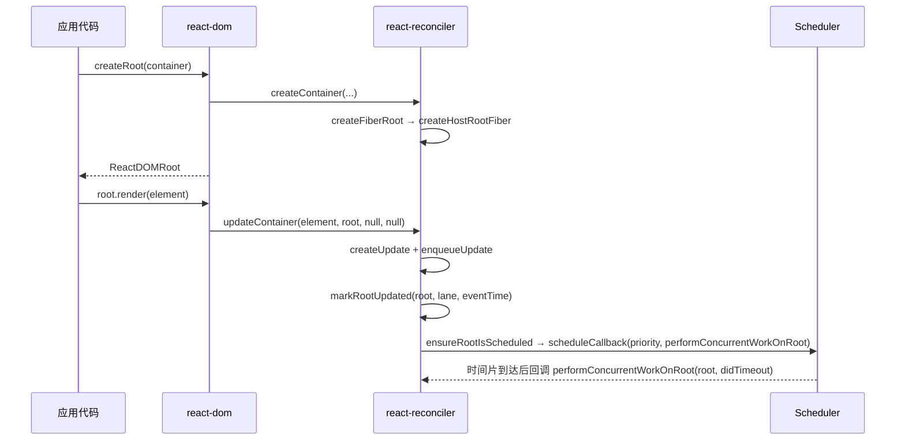

# FiberRoot

`createRoot(container)` 是 React 18.3.1 客户端应用的入口：它把 DOM 容器绑定到 `FiberRoot`，`FiberRoot.current` 指向 `HostRoot Fiber`，`render(element)` 再通过调度进入工作循环。

## 1. `FiberRoot` 的结构与两个“根”

`FiberRoot` 是应用的根管理器。它是一个普通对象，不参与 `child` / `sibling` 遍历，构造时一次性挂上容器、当前树、完成树以及调度与 Lane 状态：

```ts [react-reconciler/src/ReactFiberRoot.old.js]
function FiberRootNode(
  containerInfo,
  tag,
  hydrate,
  identifierPrefix,
  onRecoverableError,
) {
  //核心属性
  this.tag = tag // 根类型，如 ConcurrentRoot、LegacyRoot
  this.containerInfo = containerInfo // 真实 DOM 容器
  this.current = null // 当前已提交的 HostRoot Fiber
  this.finishedWork = null // Render 完成、等待 Commit 的新树

  //其他属性
  this.pendingChildren = null
  this.pingCache = null
  this.timeoutHandle = noTimeout
  this.context = null
  this.pendingContext = null
  // 根调度状态：Scheduler 回调句柄与优先级
  this.callbackNode = null // Scheduler 回调句柄
  this.callbackPriority = NoLane // 回调对应的 Lane
  this.eventTimes = createLaneMap(NoLanes) // 每条 Lane 的事件时间
  this.expirationTimes = createLaneMap(NoTimestamp) // 每条 Lane 的过期时间

  // Lane 状态：待处理、挂起、过期、本次完成等
  this.pendingLanes = NoLanes // 当前待处理的优先级集合
  this.suspendedLanes = NoLanes // 因 Suspense 挂起的优先级
  this.pingedLanes = NoLanes // 已收到 ping、可以重试的优先级
  this.expiredLanes = NoLanes // 已过期、必须同步完成的优先级
  this.mutableReadLanes = NoLanes
  this.finishedLanes = NoLanes // 本次提交对应的优先级

  this.entangledLanes = NoLanes // 相互纠缠的 Lane 集合
  this.entanglements = createLaneMap(NoLanes)

  // useId 前缀与可恢复错误回调
  this.identifierPrefix = identifierPrefix // useId 等场景使用的前缀
  this.onRecoverableError = onRecoverableError // 可恢复错误的回调

  // 省略 enableCache、hydration、Profiler、DevTools 分支
}
```

`HostRoot` 是 Fiber 树里的根节点：`tag` 固定为 `HostRoot`，没有 `key` 与 `pendingProps`，`stateNode` 指回 `FiberRoot`。创建时只需要根据根类型确定 `mode`：

```ts [react-reconciler/src/ReactFiber.old.js]
export function createHostRootFiber(
  tag,
  isStrictMode,
  concurrentUpdatesByDefaultOverride,
) {
  // ConcurrentRoot 启用并发模式，legacy 根则为 NoMode。
  let mode
  if (tag === ConcurrentRoot) {
    mode = ConcurrentMode
    // StrictMode 下追加严格模式位。
    if (isStrictMode === true) {
      mode |= StrictLegacyMode
      if (enableStrictEffects) {
        mode |= StrictEffectsMode
      }
    } else if (enableStrictEffects && createRootStrictEffectsByDefault) {
      mode |= StrictLegacyMode | StrictEffectsMode
    }
    // 省略测试用的 ConcurrentUpdatesByDefaultMode 分支
  } else {
    mode = NoMode
  }

  // 省略 DevTools 存在时的 ProfileMode

  return createFiber(HostRoot, null, null, mode)
}
```

`FiberRoot` 与 `HostRoot Fiber` 都常被叫做“**根**”，但一个是普通对象，一个是 Fiber 节点：

[width(18,18,33,31)]

| 名称        | 类型       | 位置                     | 职责                                           |
| ----------- | ---------- | ------------------------ | ---------------------------------------------- |
| `FiberRoot` | 普通对象   | `root.current.stateNode` | 持有真实容器、当前树、完成树，是应用的根管理器 |
| `RootFiber` | Fiber 节点 | `root.current`           | `tag = HostRoot` 的 Fiber，是 Fiber 树的根节点 |

```tree
FiberRoot（容器管理者）
  └── current ──▶ HostRoot Fiber（Fiber 树的根）
                    └── child ──▶ App Fiber ──▶ ...
```

`FiberRoot` 只是“**入口对象**”，真正的遍历从 `root.current` 开始。

## 2. 创建根节点

### 2.1 `createRoot`

`createRoot` 不渲染任何东西。它校验容器、整理选项、创建 `FiberRoot`，然后返回一个带 `render` 方法的 `ReactDOMRoot` 实例。

:::code-group

```ts [react-dom/src/client/ReactDOMRoot.js]
export function createRoot(container, options) {
  // 省略容器合法性校验与 __DEV__ 告警

  // 先给出默认选项，随后由 options 覆盖。
  let isStrictMode = false
  let concurrentUpdatesByDefaultOverride = false
  let identifierPrefix = ''
  let onRecoverableError = defaultOnRecoverableError
  let transitionCallbacks = null

  // 省略 options 解析：strictMode、identifierPrefix、onRecoverableError 等

  const root = createContainer(
    container,
    ConcurrentRoot,
    null,
    isStrictMode,
    concurrentUpdatesByDefaultOverride,
    identifierPrefix,
    onRecoverableError,
    transitionCallbacks,
  )
  // 把 DOM 容器与 HostRoot Fiber 关联，供事件系统与 DevTools 反查。
  markContainerAsRoot(root.current, container)

  // 在根容器上注册合成事件监听，React 18 的事件委托从 document 移到了根容器。
  const rootContainerElement =
    container.nodeType === COMMENT_NODE ? container.parentNode : container
  listenToAllSupportedEvents(rootContainerElement)

  return new ReactDOMRoot(root)
}

function ReactDOMRoot(internalRoot) {
  this._internalRoot = internalRoot
}
```

:::

### 2.2 `createContainer` 与 `createFiberRoot`

`createContainer` 是协调器对渲染器暴露的入口，它固定了 `hydrate = false` 与 `initialChildren = null`，真正的根对象由 `createFiberRoot` 创建。

:::code-group

```ts [react-reconciler/src/ReactFiberReconciler.old.js]
export function createContainer(
  containerInfo,
  tag,
  hydrationCallbacks,
  isStrictMode,
  concurrentUpdatesByDefaultOverride,
  identifierPrefix,
  onRecoverableError,
  transitionCallbacks,
) {
  // 客户端 createRoot 不走 hydration，也没有初始子节点。
  const hydrate = false
  const initialChildren = null
  return createFiberRoot(
    containerInfo,
    tag,
    hydrate,
    initialChildren,
    hydrationCallbacks,
    isStrictMode,
    concurrentUpdatesByDefaultOverride,
    identifierPrefix,
    onRecoverableError,
    transitionCallbacks,
  )
}
```

```ts [react-reconciler/src/ReactFiberRoot.old.js]
export function createFiberRoot(
  containerInfo,
  tag,
  hydrate,
  initialChildren,
  hydrationCallbacks,
  isStrictMode,
  concurrentUpdatesByDefaultOverride,
  identifierPrefix,
  onRecoverableError,
  transitionCallbacks,
) {
  const root = new FiberRootNode(
    containerInfo,
    tag,
    hydrate,
    identifierPrefix,
    onRecoverableError,
  )

  // 省略 hydration、transition tracing 与 enableCache 分支

  // 循环引用：root 与 HostRoot Fiber 互相指向。
  const uninitializedFiber = createHostRootFiber(
    tag,
    isStrictMode,
    concurrentUpdatesByDefaultOverride,
  )
  root.current = uninitializedFiber
  uninitializedFiber.stateNode = root

  // 初始化 HostRoot 的更新队列。
  initializeUpdateQueue(uninitializedFiber)

  return root
}
```

:::

`createHostRootFiber` 创建一个 `tag = HostRoot` 的 Fiber，`createFiberRoot` 随后把 `root.current` 与 `fiber.stateNode` 互指。因此首次 `render` 时，`beginWork` 拿到的 `current` 不是 `null`，走的是 `updateHostRoot` 的更新路径；顶层 DOM 如何进入容器见 [completeWork 第 8 节](/frameworks/react/advanced/source-code/reconciler/completeWork#_8-首屏-dom-是如何出现的)。

### 2.3 `initializeUpdateQueue`

HostRoot 的更新队列在 `createFiberRoot` 中初始化。`baseState` 直接引用 `fiber.memoizedState`，因此 `render` 写入的 `{ element: null, ... }` 会成为队列的初始状态。

:::code-group

```ts [react-reconciler/src/ReactFiberClassUpdateQueue.old.js]
export function initializeUpdateQueue(fiber) {
  // baseState 直接引用 Fiber 当前的 memoizedState。
  const queue = {
    baseState: fiber.memoizedState,
    firstBaseUpdate: null,
    lastBaseUpdate: null,
    shared: {
      pending: null,
      interleaved: null,
      lanes: NoLanes,
    },
    effects: null,
  }
  // 队列挂到 Fiber 上，render 产生的 Update 都入队到这里。
  fiber.updateQueue = queue
}
```

:::

## 3. `render` 如何触发更新

### 3.1 `render`

:::code-group

```javascript [react-dom/src/client/ReactDOMRoot.js]
ReactDOMRoot.prototype.render = function (children) {
  const root = this._internalRoot
  // 省略未挂载根的 invariant 与 __DEV__ 参数校验

  // 真正的渲染请求交给 updateContainer 入队并调度。
  updateContainer(children, root, null, null)
}
```

:::

### 3.2 `updateContainer`

`root.render(element)` 最终调用 `updateContainer`。官方实现不会直接改写 `memoizedState`，而是创建一个 `Update` 对象并入队，再按 Lane 调度。

:::code-group

```ts [react-reconciler/src/ReactFiberReconciler.old.js]
export function updateContainer(element, container, parentComponent, callback) {
  const current = container.current
  const eventTime = requestEventTime()
  //根据当前事件优先级选出 Lane
  const lane = requestUpdateLane(current)

  // 首次渲染记录 context，后续渲染暂存到 pendingContext。
  const context = getContextForSubtree(parentComponent)
  if (container.context === null) {
    container.context = context
  } else {
    container.pendingContext = context
  }
  //创建更新对象，payload 保存 { element }
  const update = createUpdate(eventTime, lane)
  // 注意：React DevTools 依赖 payload 中的 "element" 属性名。
  update.payload = { element }

  callback = callback === undefined ? null : callback
  if (callback !== null) {
    update.callback = callback
  }
  //把更新放入 HostRoot 的 UpdateQueue
  const root = enqueueUpdate(current, update, lane)
  if (root !== null) {
    //标记根上有待处理工作，并请求调度
    scheduleUpdateOnFiber(root, current, lane, eventTime)
    entangleTransitions(root, current, lane)
  }

  return lane
}
```

:::

### 3.3 `scheduleUpdateOnFiber`

`updateContainer` 入队后调用 `scheduleUpdateOnFiber`。它先调用 `markRootUpdated` 把 Lane 合并进 `root.pendingLanes`，再调用 `ensureRootIsScheduled` 决定是否需要注册新的 Scheduler 任务。

:::code-group

```ts [react-reconciler/src/ReactFiberWorkLoop.old.js]
export function scheduleUpdateOnFiber(root, fiber, lane, eventTime) {
  // 省略嵌套更新的 invariant 校验

  // 把本次更新的 Lane 标记到根上
  markRootUpdated(root, lane, eventTime)

  // 省略 Render 阶段更新、Profiler、Transition Tracing 等分支

  // 让根调度决定是否需要注册新的 Scheduler 任务。
  ensureRootIsScheduled(root, eventTime)
  // 省略 legacy 模式下的同步刷新
}
```

:::

## 4. 根任务如何进入 Scheduler

### 4.1 `ensureRootIsScheduled`

`ensureRootIsScheduled` 是根级调度的核心。它不只负责“**安排一个任务**”，还要处理三件事：

- 把可能被饿死的 Lane 标记为过期；
- 计算下一批要处理的 Lane；
- 如果已有同优先级的回调，就复用它，避免重复注册任务。

:::code-group

```ts [react-reconciler/src/ReactFiberWorkLoop.old.js]
function ensureRootIsScheduled(root, currentTime) {
  const existingCallbackNode = root.callbackNode

  // 检查是否有 Lane 被其他工作饿死，若有则标记为过期
  markStarvedLanesAsExpired(root, currentTime)

  // 选出下一批要处理的 Lane
  const nextLanes = getNextLanes(
    root,
    root === workInProgressRoot ? workInProgressRootRenderLanes : NoLanes,
  )

  if (nextLanes === NoLanes) {
    // 没有待处理工作：取消旧任务
    if (existingCallbackNode !== null) {
      cancelCallback(existingCallbackNode)
    }
    root.callbackNode = null
    root.callbackPriority = NoLane
    return
  }

  // 用最高优先级的 Lane 代表回调优先级
  const newCallbackPriority = getHighestPriorityLane(nextLanes)
  const existingCallbackPriority = root.callbackPriority

  // 优先级没变，复用已有任务
  if (existingCallbackPriority === newCallbackPriority) {
    return
  }

  if (existingCallbackNode != null) {
    cancelCallback(existingCallbackNode)
  }

  let newCallbackNode
  if (newCallbackPriority === SyncLane) {
    // 同步任务走 React 内部队列，并在微任务中刷新
    scheduleSyncCallback(performSyncWorkOnRoot.bind(null, root))
    if (supportsMicrotasks) {
      scheduleMicrotask(() => {
        if (
          (executionContext & (RenderContext | CommitContext)) ===
          NoContext
        ) {
          flushSyncCallbacks()
        }
      })
    } else {
      scheduleCallback(ImmediateSchedulerPriority, flushSyncCallbacks)
    }
    newCallbackNode = null
  } else {
    // 并发任务按事件优先级映射到 Scheduler 优先级
    let schedulerPriorityLevel
    switch (lanesToEventPriority(nextLanes)) {
      case DiscreteEventPriority:
        schedulerPriorityLevel = ImmediateSchedulerPriority
        break
      case ContinuousEventPriority:
        schedulerPriorityLevel = UserBlockingSchedulerPriority
        break
      case DefaultEventPriority:
        schedulerPriorityLevel = NormalSchedulerPriority
        break
      case IdleEventPriority:
        schedulerPriorityLevel = IdleSchedulerPriority
        break
      default:
        schedulerPriorityLevel = NormalSchedulerPriority
        break
    }
    newCallbackNode = scheduleCallback(
      schedulerPriorityLevel,
      performConcurrentWorkOnRoot.bind(null, root),
    )
  }

  root.callbackPriority = newCallbackPriority
  root.callbackNode = newCallbackNode
}
```

:::

### 4.2 Lane 到 Scheduler 优先级的映射

[width(32,38,30)]

| Lane 事件优先级           | Scheduler 优先级                | 典型场景                       |
| ------------------------- | ------------------------------- | ------------------------------ |
| `DiscreteEventPriority`   | `ImmediateSchedulerPriority`    | 点击、按键等离散事件           |
| `ContinuousEventPriority` | `UserBlockingSchedulerPriority` | 滚动、拖拽等连续事件           |
| `DefaultEventPriority`    | `NormalSchedulerPriority`       | `root.render`、普通 `setState` |
| `IdleEventPriority`       | `IdleSchedulerPriority`         | 空闲时才能执行的工作           |
| `SyncLane`                | 不经过 Scheduler 优先级映射     | 需要立即同步完成的工作         |

`root.callbackPriority` 保存的是 Lane，而不是 Scheduler 的优先级。这样 React 可以在每次更新时比较“**这次要处理的最高 Lane 是否和已注册任务一致**”，避免同一优先级重复注册。

### 4.3 一次根调度的时序



## 5. 总结

[width(20,80)]

| 阶段           | React 18.3.1 的实现                                                                                                        |
| -------------- | -------------------------------------------------------------------------------------------------------------------------- |
| 创建根         | `createFiberRoot` 新建 `FiberRootNode`，初始化 lanes、callbackNode、eventTimes 等，再创建 `tag = HostRoot` 的 Fiber        |
| 双向引用       | `root.current` 与 `fiber.stateNode` 互指                                                                                   |
| 写入待渲染内容 | `root.render(element)` 通过 `updateContainer` 创建 `payload = { element }` 的 `Update`，入队到 HostRoot 的 `UpdateQueue`   |
| 触发调度       | `scheduleUpdateOnFiber` 携带 lane 与 eventTime，调用 `markRootUpdated`，再由 `ensureRootIsScheduled` 选择 Scheduler 优先级 |
| 根任务注册     | 按 Lane 映射 Scheduler 优先级，同优先级任务复用已有回调                                                                    |
| 切换当前树     | Commit 阶段执行 `root.current = finishedWork`                                                                              |
