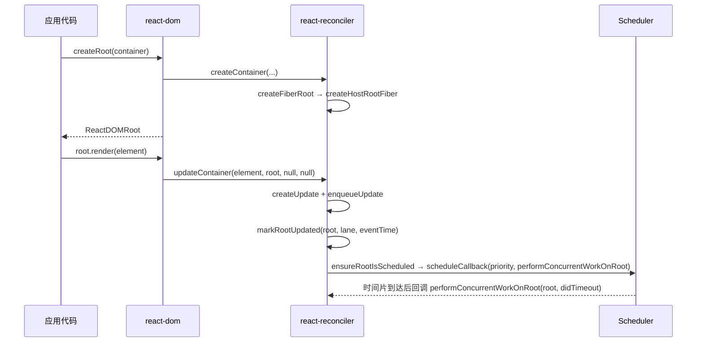

# FiberRoot

`createRoot(container)` 是 React 18.3.1 客户端应用的入口。它看起来只是一行 API，背后却建立了三组关系：

- DOM 容器与 `FiberRoot` 的绑定；
- `FiberRoot` 与 `HostRoot Fiber` 的双向引用；
- `render(element)` 与调度器之间的通道。

应用入口涉及 `react-dom/src/client/ReactDOMRoot.js`、`react-reconciler/src/ReactFiberRoot.old.js`、`ReactFiberReconciler.old.js`、`ReactFiberClassUpdateQueue.old.js` 和 `ReactFiberWorkLoop.old.js`。在 18.3.1 源码中，`ensureRootIsScheduled` 位于 `ReactFiberWorkLoop.old.js`，并不存在独立的 `ReactFiberRootScheduler.old.js`。代码引用会省略 Flow 类型标注、`__DEV__` 与 Profiler 分支，主体与官方源码一致。

## 1. 两个容易混淆的“根”

[width(18,18,33,31)]

| 名称        | 类型       | 位置                     | 职责                                           |
| ----------- | ---------- | ------------------------ | ---------------------------------------------- |
| `FiberRoot` | 普通对象   | `root.current.stateNode` | 持有真实容器、当前树、完成树，是应用的根管理器 |
| `RootFiber` | Fiber 节点 | `root.current`           | `tag = HostRoot` 的 Fiber，是 Fiber 树的根节点 |

可以这样记：

```text
FiberRoot（容器管理者）
  └── current ──▶ HostRoot Fiber（Fiber 树的根）
                    └── child ──▶ App Fiber ──▶ ...
```

`FiberRoot` 不参与 `child` / `sibling` 遍历，它只是“入口对象”。真正的遍历从 `root.current` 开始。

## 2. 创建根节点

### 2.1 `createRoot`

`createRoot` 不渲染任何东西。它校验容器、整理选项、创建 `FiberRoot`，然后返回一个带 `render` 方法的 `ReactDOMRoot` 实例。

:::code-group

```ts [react-dom/src/client/ReactDOMRoot.js]
export function createRoot(container, options) {
  if (!isValidContainer(container)) {
    throw new Error('createRoot(...): Target container is not a DOM element.')
  }

  warnIfReactDOMContainerInDEV(container)

  let isStrictMode = false
  let concurrentUpdatesByDefaultOverride = false
  let identifierPrefix = ''
  let onRecoverableError = defaultOnRecoverableError
  let transitionCallbacks = null

  // 省略 options 解析：strictMode、identifierPrefix、onRecoverableError 等

  const root = createContainer(
    container,
    ConcurrentRoot,
    null,
    isStrictMode,
    concurrentUpdatesByDefaultOverride,
    identifierPrefix,
    onRecoverableError,
    transitionCallbacks,
  )
  markContainerAsRoot(root.current, container)

  const rootContainerElement =
    container.nodeType === COMMENT_NODE ? container.parentNode : container
  listenToAllSupportedEvents(rootContainerElement)

  return new ReactDOMRoot(root)
}
```

```ts [react-dom/src/client/ReactDOMRoot.js]
function ReactDOMRoot(internalRoot) {
  this._internalRoot = internalRoot
}

ReactDOMHydrationRoot.prototype.render = ReactDOMRoot.prototype.render =
  function (children) {
    const root = this._internalRoot
    if (root === null) {
      throw new Error('Cannot update an unmounted root.')
    }

    // 省略 DEV 下的参数校验

    updateContainer(children, root, null, null)
  }
```

:::

这里有两个容易忽略的副作用：

- `markContainerAsRoot(root.current, container)` 把 DOM 容器与 HostRoot Fiber 关联起来，后续事件系统和 DevTools 可以据此找到根。
- `listenToAllSupportedEvents(rootContainerElement)` 在根容器上注册合成事件监听，React 18 的事件委托从 `document` 移到了根容器。

### 2.2 `createContainer` 与 `createFiberRoot`

`createContainer` 是协调器对渲染器暴露的入口，它固定了 `hydrate = false` 与 `initialChildren = null`，真正的根对象由 `createFiberRoot` 创建。

:::code-group

```ts [react-reconciler/src/ReactFiberReconciler.old.js]
export function createContainer(
  containerInfo,
  tag,
  hydrationCallbacks,
  isStrictMode,
  concurrentUpdatesByDefaultOverride,
  identifierPrefix,
  onRecoverableError,
  transitionCallbacks,
) {
  const hydrate = false
  const initialChildren = null
  return createFiberRoot(
    containerInfo,
    tag,
    hydrate,
    initialChildren,
    hydrationCallbacks,
    isStrictMode,
    concurrentUpdatesByDefaultOverride,
    identifierPrefix,
    onRecoverableError,
    transitionCallbacks,
  )
}
```

```ts [react-reconciler/src/ReactFiberRoot.old.js]
export function createFiberRoot(
  containerInfo,
  tag,
  hydrate,
  initialChildren,
  hydrationCallbacks,
  isStrictMode,
  concurrentUpdatesByDefaultOverride,
  identifierPrefix,
  onRecoverableError,
  transitionCallbacks,
) {
  const root = new FiberRootNode(
    containerInfo,
    tag,
    hydrate,
    identifierPrefix,
    onRecoverableError,
  )

  // 省略 hydration、transition tracing 与 enableCache 分支

  // Cyclic construction：root 与 HostRoot Fiber 互相引用
  const uninitializedFiber = createHostRootFiber(
    tag,
    isStrictMode,
    concurrentUpdatesByDefaultOverride,
  )
  root.current = uninitializedFiber
  uninitializedFiber.stateNode = root

  // 非 enableCache 构建下，HostRoot 的初始状态形状如下
  uninitializedFiber.memoizedState = {
    element: initialChildren,
    isDehydrated: hydrate,
    cache: null,
    transitions: null,
    pendingSuspenseBoundaries: null,
  }

  initializeUpdateQueue(uninitializedFiber)

  return root
}
```

:::

`createHostRootFiber` 根据 root 类型决定 `mode`，然后创建一个 `tag = HostRoot` 的 Fiber：

:::code-group

```ts [react-reconciler/src/ReactFiber.old.js]
export function createHostRootFiber(
  tag,
  isStrictMode,
  concurrentUpdatesByDefaultOverride,
) {
  let mode
  if (tag === ConcurrentRoot) {
    mode = ConcurrentMode
    if (isStrictMode === true) {
      mode |= StrictLegacyMode
      if (enableStrictEffects) {
        mode |= StrictEffectsMode
      }
    } else if (enableStrictEffects && createRootStrictEffectsByDefault) {
      mode |= StrictLegacyMode | StrictEffectsMode
    }
    // 省略测试用的 ConcurrentUpdatesByDefaultMode 分支
  } else {
    mode = NoMode
  }

  // 省略 DevTools 存在时的 ProfileMode

  return createFiber(HostRoot, null, null, mode)
}
```

:::

### 2.3 `FiberRootNode` 的字段

`FiberRootNode` 在构造时一次性建立调度、优先级和 Suspense 所需的状态：

:::code-group

```ts [react-reconciler/src/ReactFiberRoot.old.js]
function FiberRootNode(
  containerInfo,
  tag,
  hydrate,
  identifierPrefix,
  onRecoverableError,
) {
  this.tag = tag
  this.containerInfo = containerInfo
  this.pendingChildren = null
  this.current = null
  this.pingCache = null
  this.finishedWork = null
  this.timeoutHandle = noTimeout
  this.context = null
  this.pendingContext = null
  this.callbackNode = null
  this.callbackPriority = NoLane
  this.eventTimes = createLaneMap(NoLanes)
  this.expirationTimes = createLaneMap(NoTimestamp)

  this.pendingLanes = NoLanes
  this.suspendedLanes = NoLanes
  this.pingedLanes = NoLanes
  this.expiredLanes = NoLanes
  this.mutableReadLanes = NoLanes
  this.finishedLanes = NoLanes

  this.entangledLanes = NoLanes
  this.entanglements = createLaneMap(NoLanes)

  this.identifierPrefix = identifierPrefix
  this.onRecoverableError = onRecoverableError

  // 省略 enableCache、hydration、Profiler、DevTools 分支
}
```

:::

[width(41,59)]

| 字段                                | 含义                                                |
| ----------------------------------- | --------------------------------------------------- |
| `tag`                               | 根类型，如 `ConcurrentRoot`、`LegacyRoot`           |
| `containerInfo`                     | 真实 DOM 容器，如 `document.getElementById('root')` |
| `current`                           | 当前已提交的 HostRoot Fiber                         |
| `finishedWork`                      | Render 阶段完成、等待 Commit 的新树                 |
| `pendingLanes`                      | 当前待处理的优先级集合                              |
| `suspendedLanes`                    | 因 Suspense 挂起的优先级                            |
| `pingedLanes`                       | 已收到 ping、可以重试的优先级                       |
| `expiredLanes`                      | 已过期、必须同步完成的优先级                        |
| `finishedLanes`                     | 本次提交对应的优先级                                |
| `callbackNode` / `callbackPriority` | Scheduler 回调句柄与优先级                          |
| `eventTimes` / `expirationTimes`    | 每条 Lane 的事件时间与过期时间                      |
| `entangledLanes` / `entanglements`  | 相互纠缠的 Lane 集合                                |
| `identifierPrefix`                  | `useId` 等场景使用的前缀                            |
| `onRecoverableError`                | 可恢复错误的回调                                    |

## 3. `render` 如何触发更新

### 3.1 `updateContainer`

`root.render(element)` 最终调用 `updateContainer`。官方实现不会直接改写 `memoizedState`，而是创建一个 `Update` 对象并入队，再按 Lane 调度。

:::code-group

```ts [react-reconciler/src/ReactFiberReconciler.old.js]
export function updateContainer(element, container, parentComponent, callback) {
  const current = container.current
  const eventTime = requestEventTime()
  const lane = requestUpdateLane(current)

  const context = getContextForSubtree(parentComponent)
  if (container.context === null) {
    container.context = context
  } else {
    container.pendingContext = context
  }

  const update = createUpdate(eventTime, lane)
  // Caution: React DevTools currently depends on this property
  // being called "element".
  update.payload = { element }

  callback = callback === undefined ? null : callback
  if (callback !== null) {
    update.callback = callback
  }

  const root = enqueueUpdate(current, update, lane)
  if (root !== null) {
    scheduleUpdateOnFiber(root, current, lane, eventTime)
    entangleTransitions(root, current, lane)
  }

  return lane
}
```

:::

这段代码包含四个关键动作：

1. `requestUpdateLane(current)` 根据当前事件优先级选出 Lane。
2. `createUpdate(eventTime, lane)` 创建更新对象，`payload` 保存 `{ element }`。
3. `enqueueUpdate(current, update, lane)` 把更新放入 HostRoot 的 `UpdateQueue`。
4. `scheduleUpdateOnFiber(root, current, lane, eventTime)` 标记根上有待处理工作，并请求调度。

### 3.2 `initializeUpdateQueue`

HostRoot 的更新队列在 `createFiberRoot` 中初始化。`baseState` 直接引用 `fiber.memoizedState`，因此 `render` 之前写入的 `{ element: null, ... }` 会成为队列的初始状态。

:::code-group

```ts [react-reconciler/src/ReactFiberClassUpdateQueue.old.js]
export function initializeUpdateQueue(fiber) {
  const queue = {
    baseState: fiber.memoizedState,
    firstBaseUpdate: null,
    lastBaseUpdate: null,
    shared: {
      pending: null,
      interleaved: null,
      lanes: NoLanes,
    },
    effects: null,
  }
  fiber.updateQueue = queue
}
```

:::

### 3.3 `scheduleUpdateOnFiber`

`updateContainer` 入队后调用 `scheduleUpdateOnFiber`。它先调用 `markRootUpdated` 把 Lane 合并进 `root.pendingLanes`，再调用 `ensureRootIsScheduled` 决定是否需要注册新的 Scheduler 任务。

:::code-group

```ts [react-reconciler/src/ReactFiberWorkLoop.old.js]
export function scheduleUpdateOnFiber(root, fiber, lane, eventTime) {
  checkForNestedUpdates()

  // 把本次更新的 Lane 标记到根上
  markRootUpdated(root, lane, eventTime)

  // 省略 Render 阶段更新、Profiler、Transition Tracing 等分支

  ensureRootIsScheduled(root, eventTime)

  if (
    lane === SyncLane &&
    executionContext === NoContext &&
    (fiber.mode & ConcurrentMode) === NoMode &&
    // Treat `act` as if it's inside `batchedUpdates`, even in legacy mode.
    !(__DEV__ && ReactCurrentActQueue.isBatchingLegacy)
  ) {
    // 旧版 legacy 模式下的同步刷新
    resetRenderTimer()
    flushSyncCallbacksOnlyInLegacyMode()
  }
}
```

:::

## 4. 根任务如何进入 Scheduler

### 4.1 `ensureRootIsScheduled`

`ensureRootIsScheduled` 是根级调度的核心。它不只负责“安排一个任务”，还要处理三件事：

- 把可能被饿死的 Lane 标记为过期；
- 计算下一批要处理的 Lane；
- 如果已有同优先级的回调，就复用它，避免重复注册任务。

:::code-group

```ts [react-reconciler/src/ReactFiberWorkLoop.old.js]
function ensureRootIsScheduled(root, currentTime) {
  const existingCallbackNode = root.callbackNode

  // 检查是否有 Lane 被其他工作饿死，若有则标记为过期
  markStarvedLanesAsExpired(root, currentTime)

  // 选出下一批要处理的 Lane
  const nextLanes = getNextLanes(
    root,
    root === workInProgressRoot ? workInProgressRootRenderLanes : NoLanes,
  )

  if (nextLanes === NoLanes) {
    // 没有待处理工作：取消旧任务
    if (existingCallbackNode !== null) {
      cancelCallback(existingCallbackNode)
    }
    root.callbackNode = null
    root.callbackPriority = NoLane
    return
  }

  // 用最高优先级的 Lane 代表回调优先级
  const newCallbackPriority = getHighestPriorityLane(nextLanes)
  const existingCallbackPriority = root.callbackPriority

  // 优先级没变，复用已有任务
  if (existingCallbackPriority === newCallbackPriority) {
    return
  }

  if (existingCallbackNode != null) {
    cancelCallback(existingCallbackNode)
  }

  let newCallbackNode
  if (newCallbackPriority === SyncLane) {
    // 同步任务走 React 内部队列，并在微任务中刷新
    scheduleSyncCallback(performSyncWorkOnRoot.bind(null, root))
    if (supportsMicrotasks) {
      scheduleMicrotask(() => {
        if (
          (executionContext & (RenderContext | CommitContext)) ===
          NoContext
        ) {
          flushSyncCallbacks()
        }
      })
    } else {
      scheduleCallback(ImmediateSchedulerPriority, flushSyncCallbacks)
    }
    newCallbackNode = null
  } else {
    // 并发任务按事件优先级映射到 Scheduler 优先级
    let schedulerPriorityLevel
    switch (lanesToEventPriority(nextLanes)) {
      case DiscreteEventPriority:
        schedulerPriorityLevel = ImmediateSchedulerPriority
        break
      case ContinuousEventPriority:
        schedulerPriorityLevel = UserBlockingSchedulerPriority
        break
      case DefaultEventPriority:
        schedulerPriorityLevel = NormalSchedulerPriority
        break
      case IdleEventPriority:
        schedulerPriorityLevel = IdleSchedulerPriority
        break
      default:
        schedulerPriorityLevel = NormalSchedulerPriority
        break
    }
    newCallbackNode = scheduleCallback(
      schedulerPriorityLevel,
      performConcurrentWorkOnRoot.bind(null, root),
    )
  }

  root.callbackPriority = newCallbackPriority
  root.callbackNode = newCallbackNode
}
```

:::

### 4.2 Lane 到 Scheduler 优先级的映射

[width(32,38,30)]

| Lane 事件优先级           | Scheduler 优先级                | 典型场景                       |
| ------------------------- | ------------------------------- | ------------------------------ |
| `DiscreteEventPriority`   | `ImmediateSchedulerPriority`    | 点击、按键等离散事件           |
| `ContinuousEventPriority` | `UserBlockingSchedulerPriority` | 滚动、拖拽等连续事件           |
| `DefaultEventPriority`    | `NormalSchedulerPriority`       | `root.render`、普通 `setState` |
| `IdleEventPriority`       | `IdleSchedulerPriority`         | 空闲时才能执行的工作           |
| `SyncLane`                | 不经过 Scheduler 优先级映射     | 需要立即同步完成的工作         |

`root.callbackPriority` 保存的是 Lane，而不是 Scheduler 的优先级。这样 React 可以在每次更新时比较“这次要处理的最高 Lane 是否和已注册任务一致”，避免同一优先级重复注册。

### 4.3 一次根调度的时序



## 5. 首次挂载时发生了什么

首次渲染时，`beginWork` 收到的 `current` 并不是 `null`：

1. `createFiberRoot` 已经建立 `root.current` 与 `uninitializedFiber.stateNode` 的双向引用。
2. `root.render(element)` 通过 `updateContainer` 创建一个 `payload = { element }` 的 `Update`，并入队到 HostRoot。
3. `ensureRootIsScheduled` 选出 Lane，把 `performConcurrentWorkOnRoot` 交给 Scheduler。
4. `renderRootSync` 或 `renderRootConcurrent` 调用 `prepareFreshStack`，执行 `createWorkInProgress(root.current, null)`，为 HostRoot 创建 `alternate`。
5. `performUnitOfWork` 从 HostRoot 的 WIP 开始，`beginWork` 进入 `updateHostRoot`。因为 `current !== null`，它走的是更新路径：先 `processUpdateQueue` 处理刚才入队的 `Update`，再用 `nextState.element` 协调子节点。

```mermaid
flowchart LR
    A[root.render element] --> B[updateContainer]
    B --> C[createUpdate payload element]
    C --> D[enqueueUpdate HostRoot]
    D --> E[ensureRootIsScheduled]
    E --> F[performConcurrentWorkOnRoot]
    F --> G[prepareFreshStack]
    G --> H[createWorkInProgress root.current]
    H --> I[beginWork HostRoot]
    I --> J[processUpdateQueue]
    J --> K[reconcileChildren]
```



这解释了“首次挂载没有显式插入容器的代码，DOM 却能出现在页面上”：顶层子节点在协调时被标记 `Placement`，Commit 的 Mutation 阶段据此把它插入容器；更深层的新节点由 `completeWork` 在离线 DOM 树上创建并 `appendChild`，不需要逐个标记插入。

## 6. 总结

`FiberRoot` 是“根管理器”，`HostRoot Fiber` 是“Fiber 树的根节点”。官方 React 18.3.1 通过 `UpdateQueue` + Lane + Scheduler 把 `render` 接入调度，而不是直接改写状态或固定优先级。

[width(20,46,34)]

| 步骤           | 简化实现                                | React 18.3.1                                        |
| -------------- | --------------------------------------- | --------------------------------------------------- |
| 创建根         | `createFiberRoot(container)`            | 相同，额外初始化 lanes、callbackNode、eventTimes 等 |
| 建立双向引用   | `root.current` ↔ `HostRoot.stateNode`   | 相同                                                |
| 写入待渲染内容 | `current.memoizedState = { element }`   | 创建 `Update` 并入队 `UpdateQueue`                  |
| 触发调度       | `scheduleUpdateOnFiber(root, current)`  | 携带 lane 与 eventTime，并调用 `markRootUpdated`    |
| 根任务注册     | 固定 `NormalPriority`                   | 按 Lane 映射 Scheduler 优先级，并复用同优先级任务   |
| 切换当前树     | Commit 中 `root.current = finishedWork` | 相同                                                |

简化实现（mini-react / xunbei-react）通常把 `render` 的内容直接写进 HostRoot 的 `memoizedState`，并用固定的 `NormalPriority` 注册任务；它没有 Lane、`UpdateQueue`、`hydrateRoot` 和 `flushSync`，因此无法表达“高优先级打断低优先级”和 Suspense 重试。理解官方实现时，应以 `ReactFiberRoot.old.js`、`ReactFiberReconciler.old.js` 与 `ReactFiberWorkLoop.old.js` 为准。

Portal 与 Provider 让“根”不再只有一个，但无论多少根，最终都要回到 `FiberRoot` 与 `HostRoot Fiber` 这对关系上。下一篇进入 [工作循环](/frameworks/react/advanced/source-code/reconciler/workLoop)，看 Render 与 Commit 如何被一步步驱动。
