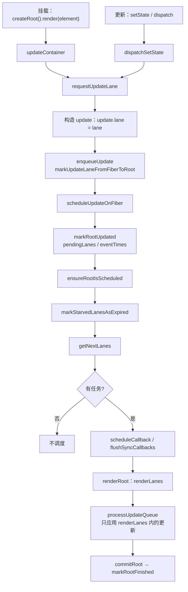

# Lane 模型

React 18 用 31 位二进制整数表示更新优先级，每一位叫一条 Lane。位号越小优先级越高；多条更新就是多个位的组合，因此可以用与、或、非、子集判断来筛选和合并任务，而不必逐个比较时间戳。下面按一次挂载、一次更新的执行顺序，把 Lane 从分配到清理的源码串起来。

## 1. 为什么用位掩码

- 一条更新占一个二进制位，多条更新天然组成集合，`|` 合并、`&` 求交、`~` 去掉已完成的位。
- 取最高优先级只需要 `lanes & -lanes`，不用遍历队列。
- 不同来源（事件、Transition、Suspense 重试、水合）各占一段位区间，互不冲突。
- 集合可以整体挂在 `fiber.lanes`、`fiber.childLanes`、`root.pendingLanes` 上，判断“**子树有没有本次要处理的更新**”只用一次位运算。

React 使用 bit 0 到 bit 30，共 31 条 Lane。JavaScript 位运算是 32 位有符号整数，最高位被符号占用，因此 `TotalLanes = 31`。

## 2. Lane 常量

:::code-group

```ts [react-reconciler/src/ReactFiberLane.old.js]
export const TotalLanes = 31

export const NoLanes: Lanes = 0b0000000000000000000000000000000
export const NoLane: Lane = 0b0000000000000000000000000000000

// 同步更新：离散事件、flushSync、legacy root。
export const SyncLane: Lane = 0b0000000000000000000000000000001

// 连续事件与水合各有一条独立车道。
export const InputContinuousHydrationLane: Lane = 0b0000000000000000000000000000010
export const InputContinuousLane: Lanes = 0b0000000000000000000000000000100

export const DefaultHydrationLane: Lane = 0b0000000000000000000000000001000
export const DefaultLane: Lanes = 0b0000000000000000000000000010000

// Transition 使用 16 条车道的池，可轮流分配。
export const TransitionHydrationLane: Lane = 0b0000000000000000000000000100000
export const TransitionLanes: Lanes = 0b0000000001111111111111111000000
export const TransitionLane1: Lane = 0b0000000000000000000000001000000
export const TransitionLane2: Lane = 0b0000000000000000000000010000000
export const TransitionLane3: Lane = 0b0000000000000000000000100000000
export const TransitionLane4: Lane = 0b0000000000000000000001000000000
export const TransitionLane5: Lane = 0b0000000000000000000010000000000
export const TransitionLane6: Lane = 0b0000000000000000000100000000000
export const TransitionLane7: Lane = 0b0000000000000000001000000000000
export const TransitionLane8: Lane = 0b0000000000000000010000000000000
export const TransitionLane9: Lane = 0b0000000000000000100000000000000
export const TransitionLane10: Lane = 0b0000000000000001000000000000000
export const TransitionLane11: Lane = 0b0000000000000010000000000000000
export const TransitionLane12: Lane = 0b0000000000000100000000000000000
export const TransitionLane13: Lane = 0b0000000000001000000000000000000
export const TransitionLane14: Lane = 0b0000000000010000000000000000000
export const TransitionLane15: Lane = 0b0000000000100000000000000000000
export const TransitionLane16: Lane = 0b0000000001000000000000000000000

// Suspense 重试使用 5 条车道。
export const RetryLanes: Lanes = 0b0000111110000000000000000000000
export const RetryLane1: Lane = 0b0000000010000000000000000000000
export const RetryLane2: Lane = 0b0000000100000000000000000000000
export const RetryLane3: Lane = 0b0000001000000000000000000000000
export const RetryLane4: Lane = 0b0000010000000000000000000000000
export const RetryLane5: Lane = 0b0000100000000000000000000000000

export const SelectiveHydrationLane: Lane = 0b0001000000000000000000000000000

// bit 0 ~ bit 27：所有非 idle 工作。
export const NonIdleLanes: Lanes = 0b0001111111111111111111111111111

export const IdleHydrationLane: Lane = 0b0010000000000000000000000000000
export const IdleLane: Lane = 0b0100000000000000000000000000000
export const OffscreenLane: Lane = 0b1000000000000000000000000000000
```

:::

## 3. 基础位运算

:::code-group

```ts [react-reconciler/src/ReactFiberLane.old.js]
// 合并两个 lane 集合。
export function mergeLanes(a: Lanes | Lane, b: Lanes | Lane): Lanes {
  return a | b
}

// 从集合中移除一段位。
export function removeLanes(set: Lanes, subset: Lanes | Lane): Lanes {
  return set & ~subset
}

// 求交集。
export function intersectLanes(a: Lanes | Lane, b: Lanes): Lanes {
  return a & b
}

// 判断两个集合是否有交集。
export function includesSomeLane(a: Lanes | Lane, b: Lanes | Lane) {
  return (a & b) !== NoLanes
}

// 判断 subset 是否被 set 完整包含。
export function isSubsetOfLanes(set: Lanes, subset: Lanes | Lane) {
  return (set & subset) === subset
}

// 只保留最低位：位号越小优先级越高。
export function getHighestPriorityLane(lanes: Lanes): Lane {
  return lanes & -lanes
}
```

:::

`lanes & -lanes` 依赖补码：对正整数取负等价于“**按位取反再加一**”，只有最低位的 `1` 会被保留。例如 `0b1100 & -0b1100 = 0b0100`。

## 4. 挂载：初始渲染怎么拿到 Lane

React 18 把挂载也建模成一次更新：`createRoot(container).render(element)` 最终调用 `updateContainer`，给 HostRoot 排一个带 lane 的 update。挂载阶段没有 `setState`，lane 完全由运行模式与当前上下文决定。

### 4.1 `updateContainer`

`updateContainer` 是挂载（以及后续 `root.render`）的入口：先分配 Lane 并创建 update，再入队、标记根、进入调度：

:::code-group

```ts [react-reconciler/src/ReactFiberReconciler.old.js]
export function updateContainer(element, container, parentComponent, callback) {
  const current = container.current
  const eventTime = requestEventTime()
  // 挂载也被建模成一次更新，所以第一步同样是分配 Lane。
  const lane = requestUpdateLane(current)

  // 省略 context 计算与 __DEV__ 下的嵌套更新告警。

  const update = createUpdate(eventTime, lane)
  // render 传入的元素放进 payload，后面由更新队列消费。
  update.payload = { element }
  // 省略 callback 校验。

  // 入队并沿父路径记录 lane，返回需要调度的根。
  const root = enqueueUpdate(current, update, lane)
  if (root !== null) {
    // 标记根上有待处理 lane，并安排渲染任务。
    scheduleUpdateOnFiber(root, current, lane, eventTime)
    // 省略 Transition lane 的纠缠处理。
  }

  return lane
}
```

:::

挂载时 `current` 是 HostRoot 的 Fiber，`enqueueUpdate` 把 update 挂到它的更新队列上。

### 4.2 `requestUpdateLane`

无论挂载时的 `updateContainer`，还是更新时的 `dispatchSetState`，第一步都是 `requestUpdateLane` 决定这次更新属于哪条 Lane：

:::code-group

```ts [ReactFiberWorkLoop.old.js]
function requestUpdateLane(fiber) {
  const mode = fiber.mode

  // 非并发模式（legacy root）一律同步。
  if ((mode & ConcurrentMode) === NoMode) {
    return SyncLane
  }

  // 渲染阶段更新：沿用当前正在渲染的 lanes。
  if (
    (executionContext & RenderContext) !== NoContext &&
    workInProgressRootRenderLanes !== NoLanes
  ) {
    return pickArbitraryLane(workInProgressRootRenderLanes)
  }

  // Transition：同一事件内的多条 transition 共用一条 Lane。
  if (requestCurrentTransition() !== NoTransition) {
    if (currentEventTransitionLane === NoLane) {
      currentEventTransitionLane = claimNextTransitionLane()
    }
    return currentEventTransitionLane
  }

  // 事件包装器、flushSync 等设置过的更新优先级优先。
  const updateLane = getCurrentUpdatePriority()
  if (updateLane !== NoLane) {
    return updateLane
  }

  // 最后才根据 window.event 的类型推断。
  return getCurrentEventPriority()
}
```

```ts [ReactEventPriorities.old.js]
// 当前更新优先级：默认 NoLane，表示没有事件正在派发。
let currentUpdatePriority: EventPriority = NoLane

// 事件包装器 / flushSync 通过 setCurrentUpdatePriority 写入这里。
export function getCurrentUpdatePriority(): EventPriority {
  return currentUpdatePriority
}
```

```ts [ReactDOMHostConfig.js]
export function getCurrentEventPriority() {
  const currentEvent = window.event
  // 不在任何原生事件里：按默认优先级处理。
  if (currentEvent === undefined) {
    return DefaultEventPriority
  }
  // 正在派发原生事件：按事件类型映射到事件优先级。
  return getEventPriority(currentEvent.type)
}
```

:::

挂载时既没有 Transition，也没有事件包装器设置的优先级，所以 `updateContainer` 通常走到最后一行 `getCurrentEventPriority()`：并发模式下拿到 `DefaultLane`，legacy root 则在函数开头直接返回 `SyncLane`。

### 4.3 事件优先级到 Lane

事件优先级定义成 Lane 常量，因此事件包装器设置的 `DiscreteEventPriority` 就是 `SyncLane`：

:::code-group

```ts [react-reconciler/src/ReactEventPriorities.old.js]
// 离散事件（click、input、keydown）：同步优先级。
export const DiscreteEventPriority: EventPriority = SyncLane
// 连续事件（scroll、mousemove、wheel）：连续优先级。
export const ContinuousEventPriority: EventPriority = InputContinuousLane
// 普通事件与 root 上未指定优先级的工作。
export const DefaultEventPriority: EventPriority = DefaultLane
// 空闲时段才能处理的工作。
export const IdleEventPriority: EventPriority = IdleLane
```

:::

> [!TIP]
> 点击事件 → `SyncLane`，滚动事件 → `InputContinuousLane`，定时器或 Promise 回调 → `DefaultLane`。映射的入口与完整事件类型表见 [事件处理](/frameworks/react/advanced/source-code/events/eventSystem)。

### 4.4 Transition 与 Retry 的循环分配

Transition 与 Retry 都使用固定长度的 Lane 池。分配游标每次左移一位，越过池尾后回到第一条：

:::code-group

```ts [react-reconciler/src/ReactFiberLane.old.js]
let nextTransitionLane: Lane = TransitionLane1
let nextRetryLane: Lane = RetryLane1

function claimNextTransitionLane(): Lane {
  const lane = nextTransitionLane
  nextTransitionLane <<= 1

  // 16 条用完，回到第一条复用。
  if ((nextTransitionLane & TransitionLanes) === NoLanes) {
    nextTransitionLane = TransitionLane1
  }

  return lane
}

function claimNextRetryLane(): Lane {
  const lane = nextRetryLane
  nextRetryLane <<= 1

  if ((nextRetryLane & RetryLanes) === NoLanes) {
    nextRetryLane = RetryLane1
  }

  return lane
}
```

:::

## 5. 更新：setState 复用同一条链路

更新走的是同一套流程。以 `useState` 返回的 dispatch 为例，差别只在更新挂在 Hook 的循环队列上，而不是 HostRoot 的更新队列。

### 5.1 `dispatchSetState`

`dispatchSetState` 先分配 Lane、构造 update，再入队并交给 `scheduleUpdateOnFiber`：

:::code-group

```ts [react-reconciler/src/ReactFiberHooks.old.js]
function dispatchSetState(fiber, queue, action) {
  // 和挂载一样，先决定这次更新属于哪条 Lane。
  const lane = requestUpdateLane(fiber)

  const update = {
    lane,
    action,
    hasEagerState: false,
    eagerState: null,
    next: null,
  }

  // 省略渲染阶段更新与 eager state 的提前 bailout。

  // 入队（内部会调用 markUpdateLaneFromFiberToRoot），返回需要调度的根。
  const root = enqueueConcurrentHookUpdate(fiber, queue, update, lane)
  if (root !== null) {
    const eventTime = requestEventTime()
    scheduleUpdateOnFiber(root, fiber, lane, eventTime)
    // 省略 Transition 更新的纠缠。
  }
}
```

```ts [react-reconciler/src/ReactFiberWorkLoop.old.js]
function requestUpdateLane(fiber) {
  const mode = fiber.mode

  // 非并发模式（legacy root）一律同步。
  if ((mode & ConcurrentMode) === NoMode) {
    return SyncLane
  }

  // 渲染阶段更新：沿用当前正在渲染的 lanes。
  if (
    (executionContext & RenderContext) !== NoContext &&
    workInProgressRootRenderLanes !== NoLanes
  ) {
    return pickArbitraryLane(workInProgressRootRenderLanes)
  }

  // Transition：同一事件内的多条 transition 共用一条 Lane。
  if (requestCurrentTransition() !== NoTransition) {
    if (currentEventTransitionLane === NoLane) {
      currentEventTransitionLane = claimNextTransitionLane()
    }
    return currentEventTransitionLane
  }

  // 事件包装器、flushSync 等设置过的更新优先级优先。
  const updateLane = getCurrentUpdatePriority()
  if (updateLane !== NoLane) {
    return updateLane
  }

  // 最后才根据 window.event 的类型推断。
  return getCurrentEventPriority()
}

export function requestEventTime() {
  // 渲染 / 提交阶段：直接读取当前时间。
  if ((executionContext & (RenderContext | CommitContext)) !== NoContext) {
    return now()
  }
  // 浏览器事件内：同一批更新共用事件开始时间。
  if (currentEventTime !== NoTimestamp) {
    return currentEventTime
  }
  // 本轮第一个更新：记下新的开始时间。
  currentEventTime = now()
  return currentEventTime
}
```

:::

`requestEventTime` 让同一个浏览器事件内产生的多条更新共享同一个 `eventTime`，后面的过期时间计算因此不会因为处理耗时而出现偏差。

### 5.2 Lane 存在哪里

挂载和更新产生的 lane 最终都落在这些字段上：

[width(29,14,57)]

| 字段                   | 所在位置  | 含义                                 |
| ---------------------- | --------- | ------------------------------------ |
| `update.lane`          | Update    | 单条更新所属的 Lane                  |
| `fiber.lanes`          | Fiber     | 这个 Fiber 自己排队的更新            |
| `fiber.childLanes`     | Fiber     | 子树中待处理 Lane 的并集，向上冒泡   |
| `root.pendingLanes`    | FiberRoot | 根上所有待处理 Lane                  |
| `root.suspendedLanes`  | FiberRoot | 因 Suspense 挂起的 Lane              |
| `root.pingedLanes`     | FiberRoot | 已恢复、允许重试的 Lane              |
| `root.expiredLanes`    | FiberRoot | 超过过期时间、必须强制完成的 Lane    |
| `root.entangledLanes`  | FiberRoot | 与其他 Lane 纠缠、必须同批渲染的集合 |
| `root.eventTimes`      | FiberRoot | 每条 Lane 最近一次事件时间           |
| `root.expirationTimes` | FiberRoot | 每条 Lane 的过期时间                 |
| `renderLanes`          | 工作循环  | 本次 Render 实际处理的 Lane 子集     |

更新入队后，Lane 会沿 `return` 指针写到每个祖先的 `childLanes` 上：

:::code-group

```ts [react-reconciler/src/ReactFiberConcurrentUpdates.js]
function markUpdateLaneFromFiberToRoot(sourceFiber, lane) {
  // 更新来源节点自己记一份。
  sourceFiber.lanes = mergeLanes(sourceFiber.lanes, lane)
  const alternate = sourceFiber.alternate
  if (alternate !== null) {
    alternate.lanes = mergeLanes(alternate.lanes, lane)
  }

  // 沿父路径向上，把 lane 合并进每一层的 childLanes。
  let node = sourceFiber
  let parent = sourceFiber.return

  while (parent !== null) {
    parent.childLanes = mergeLanes(parent.childLanes, lane)
    const alternateParent = parent.alternate
    if (alternateParent !== null) {
      alternateParent.childLanes = mergeLanes(alternateParent.childLanes, lane)
    }

    node = parent
    parent = parent.return
  }

  // 走到 HostRoot 就返回对应的 FiberRoot。
  return node.tag === HostRoot ? node.stateNode : null
}
```

```ts [react-reconciler/src/ReactFiberLane.js]
// 合并两个 lane 集合：按位或。
export function mergeLanes(a: Lanes | Lane, b: Lanes | Lane): Lanes {
  return a | b
}
```

:::

`childLanes` 让 `beginWork` 可以用一次位运算判断整棵子树是否需要继续处理；没有本次 `renderLanes` 的子树直接 bailout。

## 6. 调度：从根到 Scheduler

挂载和更新最后都会调用 `scheduleUpdateOnFiber`，把 Lane 从 Fiber 送到根和 Scheduler。

### 6.1 `scheduleUpdateOnFiber`

`scheduleUpdateOnFiber` 是挂载与更新共同汇入的调度入口：先把 lane 汇总到根上，再选批并安排任务；渲染过程中又收到更新时，也在这一层记录交错 lane：

:::code-group

```ts [react-reconciler/src/ReactFiberWorkLoop.old.js]
export function scheduleUpdateOnFiber(root, fiber, lane, eventTime) {
  // 更新一般不能从渲染 / 提交阶段发起（局部 Hook 更新除外）。
  checkForNestedUpdates()

  // 第一步：把 lane 汇总到根上。
  markRootUpdated(root, lane, eventTime)

  if (
    (executionContext & RenderContext) !== NoLanes &&
    root === workInProgressRoot
  ) {
    // 渲染阶段产生的更新：记到本轮，稍后一起处理。
    workInProgressRootRenderPhaseUpdatedLanes = mergeLanes(
      workInProgressRootRenderPhaseUpdatedLanes,
      lane,
    )
  } else {
    // 省略 DevTools、Transition tracing 等旁路。

    if (root === workInProgressRoot) {
      // 渲染中又来了更新：记录交错 lane。
      workInProgressRootInterleavedUpdatedLanes = mergeLanes(
        workInProgressRootInterleavedUpdatedLanes,
        lane,
      )
      // 原本准备挂起等待的根，改用新更新立即重试。
      if (workInProgressRootExitStatus === RootSuspendedWithDelay) {
        markRootSuspended(root, workInProgressRootRenderLanes)
      }
    }

    // 第二步：选批并安排任务。
    ensureRootIsScheduled(root, eventTime)
  }
}
```

:::

### 6.2 `markRootUpdated`

新更新进入根时，`markRootUpdated` 把它并入 `pendingLanes`，同时记录事件时间：

:::code-group

```ts [react-reconciler/src/ReactFiberLane.old.js]
export function markRootUpdated(root, updateLane, eventTime) {
  root.pendingLanes |= updateLane

  // 非 idle 更新可能解除 Suspense 的挂起状态。
  if (updateLane !== IdleLane) {
    root.suspendedLanes = NoLanes
    root.pingedLanes = NoLanes
  }

  // 同一条 lane 只保留最近一次事件时间。
  const eventTimes = root.eventTimes
  const index = laneToIndex(updateLane)
  eventTimes[index] = eventTime
}

// 把单条 lane 转成它在 eventTimes / expirationTimes 数组里的下标。
function laneToIndex(lane: Lane) {
  return pickArbitraryLaneIndex(lane)
}

// 31 - 前导零个数：得到最高位（也就是这条 lane）的位号。
function pickArbitraryLaneIndex(lanes: Lanes) {
  return 31 - clz32(lanes)
}
```

:::

`eventTimes` 与 `expirationTimes` 都是按位号索引的 31 项数组；`laneToIndex` 用 `31 - clz32(lane)` 把单条 lane 换算成下标，所以同一条 lane 的事件时间、过期时间永远落在同一个槽位。

### 6.3 `ensureRootIsScheduled`

每次根上有新工作，`ensureRootIsScheduled` 都要把 `pendingLanes` 变成一次具体任务：先检查饿死，再选批，最后按优先级复用或新建任务。

:::code-group

```ts [react-reconciler/src/ReactFiberWorkLoop.old.js]
function ensureRootIsScheduled(root, currentTime) {
  const existingCallbackNode = root.callbackNode

  // 先检查有没有被高优先级工作饿死的 lane，到期的升级为必须完成。
  markStarvedLanesAsExpired(root, currentTime)

  // 从 pendingLanes 里选出这一轮要处理的 lane 集合。
  const nextLanes = getNextLanes(
    root,
    root === workInProgressRoot ? workInProgressRootRenderLanes : NoLanes,
  )

  if (nextLanes === NoLanes) {
    // 没有工作：取消已有任务，清掉回调信息。
    if (existingCallbackNode !== null) cancelCallback(existingCallbackNode)
    root.callbackNode = null
    root.callbackPriority = NoLane
    return
  }

  // 用最高优先级 lane 代表本次任务的优先级。
  const newCallbackPriority = getHighestPriorityLane(nextLanes)
  if (root.callbackPriority === newCallbackPriority) {
    // 优先级没变，复用已经安排好的任务。
    return
  }
  if (existingCallbackNode != null) cancelCallback(existingCallbackNode)

  if (newCallbackPriority === SyncLane) {
    // SyncLane 走内部同步队列，在微任务里 flush。
    scheduleSyncCallback(performSyncWorkOnRoot.bind(null, root))
    // 省略 microtask / Immediate 的 flush 与 legacy root 分叉。
  } else {
    // 省略：映射到 Scheduler 优先级后调用 scheduleCallback。
  }

  root.callbackPriority = newCallbackPriority
}
```

```ts [react-reconciler/src/ReactFiberLane.old.js]
export function getHighestPriorityLanes(lanes: Lanes | Lane): Lanes {
  switch (getHighestPriorityLane(lanes)) {
    case SyncLane:
      return SyncLane
    case InputContinuousLane:
      return InputContinuousLane
    case DefaultLane:
      return DefaultLane
    case TransitionLane1:
    case TransitionLane2:
    // ... TransitionLane3 ~ TransitionLane15
    case TransitionLane16:
      // 同一批 transition 必须一起渲染。
      return lanes & TransitionLanes
    case RetryLane1:
    case RetryLane2:
    case RetryLane3:
    case RetryLane4:
    case RetryLane5:
      return lanes & RetryLanes
    // 省略水合、SelectiveHydration、Idle、Offscreen 分支。
    default:
      return lanes
  }
}
```

:::

### 6.4 过期与防饿死

低优先级工作可能被连续的高优先级更新挤占。React 给每条 Lane 记录过期时间，到达时间后强制升级：

:::code-group

```ts [react-reconciler/src/ReactFiberLane.old.js]
function markStarvedLanesAsExpired(root, currentTime) {
  const pendingLanes = root.pendingLanes
  const suspendedLanes = root.suspendedLanes
  const pingedLanes = root.pingedLanes
  const expirationTimes = root.expirationTimes

  let lanes = pendingLanes
  while (lanes > 0) {
    const index = pickArbitraryLaneIndex(lanes)
    const lane = 1 << index
    const expirationTime = expirationTimes[index]

    if (expirationTime === NoTimestamp) {
      // 首次遇到这条 lane：非挂起或已 ping 时计算过期时间。
      if (
        (lane & suspendedLanes) === NoLanes ||
        (lane & pingedLanes) !== NoLanes
      ) {
        expirationTimes[index] = computeExpirationTime(lane, currentTime)
      }
    } else if (expirationTime <= currentTime) {
      // 已过期，写入 expiredLanes，后续会被强制同步完成。
      root.expiredLanes |= lane
    }

    lanes &= ~lane
  }
}

function computeExpirationTime(lane, currentTime) {
  switch (lane) {
    case SyncLane:
    case InputContinuousHydrationLane:
    case InputContinuousLane:
      // 用户交互类更新过期更快。
      return currentTime + 250

    case DefaultHydrationLane:
    case DefaultLane:
    case TransitionHydrationLane:
    case TransitionLane1:
    // ... TransitionLane2 ~ TransitionLane15
    case TransitionLane16:
      return currentTime + 5000

    case RetryLane1:
    // ... RetryLane2 ~ RetryLane4
    case RetryLane5:
      // Retry 不设置过期时间。
      return NoTimestamp

    default:
      // Idle、Offscreen 等不设置过期时间。
      return NoTimestamp
  }
}
```

:::

> [!TIP]
> `markStarvedLanesAsExpired` 在 `ensureRootIsScheduled` 里、以及并发渲染每次让出主线程时都会调用。过期不是新优先级，而是“**不能再等**”的标记：`renderRootConcurrent` 一旦发现 `includesExpiredLane`，就会立即完成当前工作，不再让出。

### 6.5 选批：`getNextLanes`

`ensureRootIsScheduled` 在创建 Scheduler 任务前会调用 `getNextLanes`，从 `root.pendingLanes` 里选出这一次要渲染的 Lane 集合：

:::code-group

```ts [react-reconciler/src/ReactFiberLane.old.js]
export function getNextLanes(root: FiberRoot, wipLanes: Lanes): Lanes {
  const pendingLanes = root.pendingLanes
  // 没有待处理工作。
  if (pendingLanes === NoLanes) {
    return NoLanes
  }

  let nextLanes = NoLanes
  const suspendedLanes = root.suspendedLanes
  const pingedLanes = root.pingedLanes

  // 只要还有非 idle 工作，就不处理 idle 与 offscreen。
  const nonIdlePendingLanes = pendingLanes & NonIdleLanes

  if (nonIdlePendingLanes !== NoLanes) {
    const nonIdleUnblockedLanes = nonIdlePendingLanes & ~suspendedLanes

    if (nonIdleUnblockedLanes !== NoLanes) {
      // 排除挂起后取最高优先级组。
      nextLanes = getHighestPriorityLanes(nonIdleUnblockedLanes)
    } else {
      // 全部挂起时，只处理已经 ping 恢复的 lane。
      const nonIdlePingedLanes = nonIdlePendingLanes & pingedLanes
      if (nonIdlePingedLanes !== NoLanes) {
        nextLanes = getHighestPriorityLanes(nonIdlePingedLanes)
      }
    }
  } else {
    // 只剩 idle 工作。
    const unblockedLanes = pendingLanes & ~suspendedLanes
    if (unblockedLanes !== NoLanes) {
      nextLanes = getHighestPriorityLanes(unblockedLanes)
    } else if (pingedLanes !== NoLanes) {
      nextLanes = getHighestPriorityLanes(pingedLanes)
    }
  }

  if (nextLanes === NoLanes) {
    return NoLanes
  }

  // 已有进行中的渲染时，只有更高优先级才值得打断。
  if (
    wipLanes !== NoLanes &&
    wipLanes !== nextLanes &&
    (wipLanes & suspendedLanes) === NoLanes
  ) {
    const nextLane = getHighestPriorityLane(nextLanes)
    const wipLane = getHighestPriorityLane(wipLanes)

    if (
      nextLane >= wipLane ||
      // Default 不打断 Transition。
      (nextLane === DefaultLane && (wipLane & TransitionLanes) !== NoLanes)
    ) {
      return wipLanes
    }
  }

  // 连续事件与 Default 放入同一批，避免拆成多次渲染。
  if ((nextLanes & InputContinuousLane) !== NoLanes) {
    nextLanes |= pendingLanes & DefaultLane
  }

  // 展开纠缠关系：与选中 lane 纠缠的 lane 必须一起渲染。
  const entangledLanes = root.entangledLanes
  if (entangledLanes !== NoLanes) {
    const entanglements = root.entanglements
    let lanes = nextLanes & entangledLanes

    while (lanes > 0) {
      const index = pickArbitraryLaneIndex(lanes)
      const lane = 1 << index
      nextLanes |= entanglements[index]
      lanes &= ~lane
    }
  }

  return nextLanes
}
```

```ts [react-reconciler/src/ReactFiberLane.old.js]
export function getHighestPriorityLanes(lanes: Lanes | Lane): Lanes {
  switch (getHighestPriorityLane(lanes)) {
    case SyncLane:
      return SyncLane
    case InputContinuousLane:
      return InputContinuousLane
    case DefaultLane:
      return DefaultLane
    case TransitionLane1:
    case TransitionLane2:
    // ... TransitionLane3 ~ TransitionLane15
    case TransitionLane16:
      // 同一批 transition 必须一起渲染。
      return lanes & TransitionLanes
    case RetryLane1:
    case RetryLane2:
    case RetryLane3:
    case RetryLane4:
    case RetryLane5:
      return lanes & RetryLanes
    // 省略水合、SelectiveHydration、Idle、Offscreen 分支。
    default:
      return lanes
  }
}
```

:::

选批规则可以概括为：**排除挂起 → 取最高优先级组 → 避免无谓打断 → 合并连续事件与 Default → 展开纠缠**。`wipLanes` 是当前进行中的渲染批次，返回值如果仍是它，说明继续原有工作，不重新开始。

## 7. 渲染：从挂载到更新看 `processUpdateQueue`

调度阶段选出的 `renderLanes` 会沿 `beginWork` 进入每个组件；无论挂载还是更新，更新队列最后都由 `processUpdateQueue` 消费，它用同一个 `renderLanes` 判断哪些更新现在生效。

### 7.1 挂载阶段：`updateHostRoot`

应用启动时，`createRoot().render(element)` 由`updateContainer` 排进 HostRoot 的更新队列。首次进入 HostRoot 时，`beginWork` 调用 `updateHostRoot`：先 `cloneUpdateQueue`，再用 `processUpdateQueue` 消费这条元素更新。类组件挂载则由 `mountClassInstance` 在 `componentWillMount` 之后做同样的调用：

:::code-group

```ts [react-reconciler/src/ReactFiberBeginWork.old.js]
function updateHostRoot(current, workInProgress, renderLanes) {
  pushHostRootContext(workInProgress)

  const nextProps = workInProgress.pendingProps
  // 把 pending 队列接到 base 队列，准备消费。
  cloneUpdateQueue(current, workInProgress)

  // 挂载时消费的就是 updateContainer 排进来的 { element } 更新。
  processUpdateQueue(workInProgress, nextProps, null, renderLanes)

  const nextState = workInProgress.memoizedState
  // 省略根据 nextState.element 协调 children 的逻辑。
}
```

:::

### 7.2 更新阶段：`updateClassInstance`

更新阶段以类组件为例：`updateClassInstance` 先 clone 队列，再调用 `processUpdateQueue` 应用属于 `renderLanes` 的更新，随后拿新的 `memoizedState` 与旧 state 比较，决定是否继续渲染：

:::code-group

```ts [react-reconciler/src/ReactFiberClassComponent.old.js]
function updateClassInstance(
  current,
  workInProgress,
  ctor,
  newProps,
  renderLanes,
) {
  const instance = workInProgress.stateNode

  // 把 pending 队列接到 base 队列，准备消费。
  cloneUpdateQueue(current, workInProgress)

  // 省略 props / context 比较与 componentWillReceiveProps 调用。

  resetHasForceUpdateBeforeProcessing()

  const oldState = workInProgress.memoizedState
  let newState = (instance.state = oldState)
  // 只应用 lane 属于本轮 renderLanes 的更新。
  processUpdateQueue(workInProgress, newProps, instance, renderLanes)
  newState = workInProgress.memoizedState

  // 省略 shouldComponentUpdate、生命周期与 bailout 判断。
}
```

:::

### 7.3 `processUpdateQueue`：过滤规则

`processUpdateQueue` 从 base 队列逐条读取 update，用 `isSubsetOfLanes(renderLanes, updateLane)` 判断这条更新是否属于本轮：属于就应用并推进 `baseState`；不属于就跳过，把 lane 合并进 `newLanes`，最后写回 `fiber.lanes` 等待下一轮：

:::code-group

```ts [react-reconciler/src/ReactFiberClassUpdateQueue.old.js]
export function processUpdateQueue(
  workInProgress,
  props,
  instance,
  renderLanes,
) {
  const queue = workInProgress.updateQueue
  let firstBaseUpdate = queue.firstBaseUpdate
  // 省略把 pending 队列接到 base 队列、并同步到 current 队列的逻辑。

  if (firstBaseUpdate !== null) {
    let newState = queue.baseState
    let newLanes = NoLanes

    let update = firstBaseUpdate
    do {
      const updateLane = update.lane
      if (!isSubsetOfLanes(renderLanes, updateLane)) {
        // 优先级不够：跳过这条更新，把它的 lane 累积到 newLanes。
        newLanes = mergeLanes(newLanes, updateLane)
        // 省略：把跳过的更新克隆到新的 baseQueue。
      } else {
        // 属于本轮 renderLanes：应用更新，推进 baseState。
        // 省略 hasEagerState 快路径与 getStateFromUpdate 的细节。
      }
      update = update.next
    } while (update !== null && update !== firstBaseUpdate)

    // 跳过的 lane 重新挂回 fiber.lanes，等待下一轮。
    workInProgress.lanes = newLanes
    // 省略 baseState / baseQueue / memoizedState 的回写。
  }
}
```

```ts [react-reconciler/src/ReactFiberLane.js]
// 合并两个 lane 集合：按位或。
export function mergeLanes(a: Lanes | Lane, b: Lanes | Lane): Lanes {
  return a | b
}
```

:::

## 8. 挂起、恢复与完成

渲染过程中如果 Suspense 边界没有就绪，这些 lane 会从 pending 转入 suspended；恢复后转为 pinged；提交结束时再统一清理。

:::code-group

```ts [react-reconciler/src/ReactFiberLane.old.js]
export function markRootSuspended(root, suspendedLanes) {
  root.suspendedLanes |= suspendedLanes
  root.pingedLanes &= ~suspendedLanes

  // 挂起期间不再计算过期时间。
  const expirationTimes = root.expirationTimes
  let lanes = suspendedLanes
  while (lanes > 0) {
    const index = pickArbitraryLaneIndex(lanes)
    const lane = 1 << index
    expirationTimes[index] = NoTimestamp
    lanes &= ~lane
  }
}

export function markRootPinged(root, pingedLanes) {
  // 只有仍然挂起的 lane 才能被标记为可重试。
  root.pingedLanes |= root.suspendedLanes & pingedLanes
}

export function markRootFinished(root, remainingLanes) {
  const noLongerPendingLanes = root.pendingLanes & ~remainingLanes

  // 本次处理完的 lane 从 pending 中移除，剩余的留给下一轮。
  root.pendingLanes = remainingLanes
  root.suspendedLanes = NoLanes
  root.pingedLanes = NoLanes
  root.expiredLanes &= remainingLanes
  root.entangledLanes &= remainingLanes
}
```

:::

## 9. 完整流程图



一次挂载或更新的 Lane 生命周期可以写成：

```tree
入口：挂载走 updateContainer，更新走 dispatchSetState
  → 分配：requestUpdateLane 选出单条 lane
  → 入队：update.lane = lane
          markUpdateLaneFromFiberToRoot 合并 fiber.lanes / 祖先 childLanes
  → 根标记：markRootUpdated → pendingLanes / eventTimes
  → 调度：ensureRootIsScheduled → markStarvedLanesAsExpired → getNextLanes
  → 渲染：renderLanes 过滤更新，processUpdateQueue 只应用属于 renderLanes 的更新
  → 完成：markRootFinished 移除已完成的 lane
```

## 10. 总结

[width(15,44,41)]

| 概念       | 关键 API                               | 作用                                  |
| ---------- | -------------------------------------- | ------------------------------------- |
| 入口       | `updateContainer` / `dispatchSetState` | 挂载与更新分别创建带 lane 的 update   |
| 单条 Lane  | `1 << n`                               | 表示一种优先级，位号越小越紧急        |
| 集合操作   | `mergeLanes` / `removeLanes`           | 合并、移除待处理优先级                |
| 最高优先级 | `getHighestPriorityLane`               | `lanes & -lanes`，O(1)                |
| 同组返回   | `getHighestPriorityLanes`              | Transition / Retry 整组一起渲染       |
| 分配       | `requestUpdateLane`                    | 按模式、Transition、事件优先级取 Lane |
| 选批       | `getNextLanes`                         | 处理挂起、打断与纠缠                  |
| 防饿死     | `markStarvedLanesAsExpired`            | 到期后升级为强制完成                  |
| 根状态     | `markRootUpdated` / `markRootFinished` | 维护 pending / suspended / expired    |

Lane 模型把“**优先级**”从单一数字变成可组合的位集合：入队时合并、调度时选批、渲染时用 `renderLanes` 过滤，完成后再从根上移除。配合 [Scheduler](/frameworks/react/advanced/source-code/scheduler) 的时间切片，React 才能在保证高优先级响应的同时，把低优先级工作推迟到空闲时间。
