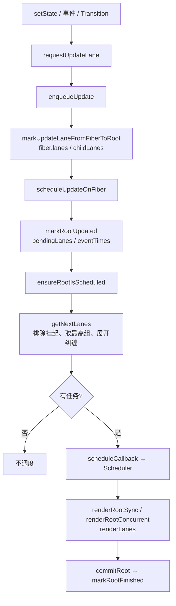

# Lane 模型

React 18 用 31 位二进制整数表示更新优先级，每一位叫一条 Lane。位号越小优先级越高；多条更新就是多个位的组合，因此可以用与、或、非、子集判断来筛选和合并任务，而不必逐个比较时间戳。本文按 `ReactFiberLane.old.js` 的源码，拆解 Lane 的编码、分配、选批、过期与清理。

实现位于 `react-reconciler/src/ReactFiberLane.old.js`，配合 `ReactFiberWorkLoop.old.js`、`ReactFiberConcurrentUpdates.old.js` 与 `ReactEventPriorities.old.js`。为什么放弃 `ExpirationTime` 的概念说明见 [调度与优先级](/frameworks/react/advanced/core-design/schedulingAndLanes)；事件如何产生优先级见 [事件处理](/frameworks/react/advanced/source-code/events/eventSystem)。

## 1. 为什么用位掩码

- 一条更新占一个二进制位，多条更新天然组成集合，`|` 合并、`&` 求交、`~` 去掉已完成的位。
- 取最高优先级只需要 `lanes & -lanes`，不用遍历队列。
- 不同来源（事件、Transition、Suspense 重试、水合）各占一段位区间，互不冲突。
- 集合可以整体挂在 `fiber.lanes`、`fiber.childLanes`、`root.pendingLanes` 上，判断“子树有没有本次要处理的更新”只用一次位运算。

React 使用 bit 0 到 bit 30，共 31 条 Lane。JavaScript 位运算是 32 位有符号整数，最高位被符号占用，因此 `TotalLanes = 31`。

## 2. Lane 常量

:::code-group

```ts [react-reconciler/src/ReactFiberLane.old.js]
export const TotalLanes = 31

export const NoLanes: Lanes = /*                        */ 0b0000000000000000000000000000000
export const NoLane: Lane = /*                          */ 0b0000000000000000000000000000000

// 同步更新：离散事件、flushSync、legacy root。
export const SyncLane: Lane = /*                        */ 0b0000000000000000000000000000001

// 连续事件与水合各有一条独立车道。
export const InputContinuousHydrationLane: Lane = /*     */ 0b0000000000000000000000000000010
export const InputContinuousLane: Lanes = /*            */ 0b0000000000000000000000000000100

export const DefaultHydrationLane: Lane = /*             */ 0b0000000000000000000000000001000
export const DefaultLane: Lanes = /*                     */ 0b0000000000000000000000000010000

// Transition 使用 16 条车道的池，可轮流分配。
export const TransitionHydrationLane: Lane = /*          */ 0b0000000000000000000000000100000
export const TransitionLanes: Lanes = /*                 */ 0b0000000001111111111111111000000
export const TransitionLane1: Lane = /*                  */ 0b0000000000000000000000001000000
export const TransitionLane2: Lane = /*                  */ 0b0000000000000000000000010000000
export const TransitionLane3: Lane = /*                  */ 0b0000000000000000000000100000000
export const TransitionLane4: Lane = /*                  */ 0b0000000000000000000001000000000
export const TransitionLane5: Lane = /*                  */ 0b0000000000000000000010000000000
export const TransitionLane6: Lane = /*                  */ 0b0000000000000000000100000000000
export const TransitionLane7: Lane = /*                  */ 0b0000000000000000001000000000000
export const TransitionLane8: Lane = /*                  */ 0b0000000000000000010000000000000
export const TransitionLane9: Lane = /*                  */ 0b0000000000000000100000000000000
export const TransitionLane10: Lane = /*                 */ 0b0000000000000001000000000000000
export const TransitionLane11: Lane = /*                 */ 0b0000000000000010000000000000000
export const TransitionLane12: Lane = /*                 */ 0b0000000000000100000000000000000
export const TransitionLane13: Lane = /*                 */ 0b0000000000001000000000000000000
export const TransitionLane14: Lane = /*                 */ 0b0000000000010000000000000000000
export const TransitionLane15: Lane = /*                 */ 0b0000000000100000000000000000000
export const TransitionLane16: Lane = /*                 */ 0b0000000001000000000000000000000

// Suspense 重试使用 5 条车道。
export const RetryLanes: Lanes = /*                      */ 0b0000111110000000000000000000000
export const RetryLane1: Lane = /*                       */ 0b0000000010000000000000000000000
export const RetryLane2: Lane = /*                       */ 0b0000000100000000000000000000000
export const RetryLane3: Lane = /*                       */ 0b0000001000000000000000000000000
export const RetryLane4: Lane = /*                       */ 0b0000010000000000000000000000000
export const RetryLane5: Lane = /*                       */ 0b0000100000000000000000000000000

export const SelectiveHydrationLane: Lane = /*           */ 0b0001000000000000000000000000000

// bit 0 ~ bit 27：所有非 idle 工作。
export const NonIdleLanes: Lanes = /*                    */ 0b0001111111111111111111111111111

export const IdleHydrationLane: Lane = /*                */ 0b0010000000000000000000000000000
export const IdleLane: Lane = /*                         */ 0b0100000000000000000000000000000
export const OffscreenLane: Lane = /*                    */ 0b1000000000000000000000000000000
```

:::

[width(33,18,13,36)]

| 车道组                       | 位范围      | 数量 | 用途                         |
| ---------------------------- | ----------- | ---- | ---------------------------- |
| `SyncLane`                   | bit 0       | 1    | 离散事件、`flushSync`        |
| `InputContinuous*Lane`       | bit 1 ~ 2   | 2    | 连续事件与水合               |
| `Default*Lane`               | bit 3 ~ 4   | 2    | 普通 `setState`、默认优先级  |
| `Transition*Lane`            | bit 5 ~ 21  | 17   | Transition 池（16 条）与水合 |
| `RetryLane1..5`              | bit 22 ~ 26 | 5    | Suspense 重试                |
| `SelectiveHydrationLane`     | bit 27      | 1    | 选择性水合                   |
| `IdleHydrationLane`          | bit 28      | 1    | 空闲水合                     |
| `IdleLane` / `OffscreenLane` | bit 29 ~ 30 | 2    | 空闲工作、Offscreen 预渲染   |

`TransitionLanes`、`RetryLanes`、`NonIdleLanes` 是掩码而不是单条 Lane，用来整组判断或选批。`NonIdleLanes` 覆盖 bit 0 ~ bit 27，只要它非零，`IdleLane` 与 `OffscreenLane` 就不会被选中。

## 3. 基础位运算

:::code-group

```ts [react-reconciler/src/ReactFiberLane.old.js]
// 合并两个 lane 集合。
export function mergeLanes(a: Lanes | Lane, b: Lanes | Lane): Lanes {
  return a | b
}

// 从集合中移除一段位。
export function removeLanes(set: Lanes, subset: Lanes | Lane): Lanes {
  return set & ~subset
}

// 求交集。
export function intersectLanes(a: Lanes | Lane, b: Lanes): Lanes {
  return a & b
}

// 判断两个集合是否有交集。
export function includesSomeLane(a: Lanes | Lane, b: Lanes | Lane) {
  return (a & b) !== NoLanes
}

// 判断 subset 是否被 set 完整包含。
export function isSubsetOfLanes(set: Lanes, subset: Lanes | Lane) {
  return (set & subset) === subset
}

// 只保留最低位：位号越小优先级越高。
export function getHighestPriorityLane(lanes: Lanes): Lane {
  return lanes & -lanes
}
```

:::

`lanes & -lanes` 依赖补码：对正整数取负等价于“按位取反再加一”，只有最低位的 `1` 会被保留。例如 `0b1100 & -0b1100 = 0b0100`。这个写法不需要循环，是整个 Lane 模型最高频的操作。

`getHighestPriorityLanes` 在此基础上处理“整组返回”：如果最高位落在 Transition 或 Retry 区间，就把同一组的全部位一起返回，让它们在同一个批次里渲染：

:::code-group

```ts [react-reconciler/src/ReactFiberLane.old.js]
export function getHighestPriorityLanes(lanes: Lanes | Lane): Lanes {
  switch (getHighestPriorityLane(lanes)) {
    case SyncLane:
      return SyncLane
    case InputContinuousLane:
      return InputContinuousLane
    case DefaultLane:
      return DefaultLane
    case TransitionLane1:
    case TransitionLane2:
    // ... TransitionLane3 ~ TransitionLane15
    case TransitionLane16:
      // 同一批 transition 必须一起渲染。
      return lanes & TransitionLanes
    case RetryLane1:
    case RetryLane2:
    case RetryLane3:
    case RetryLane4:
    case RetryLane5:
      return lanes & RetryLanes
    // 省略水合、SelectiveHydration、Idle、Offscreen 分支。
    default:
      return lanes
  }
}
```

:::

## 4. Lane 存在哪里

[width(29,14,57)]

| 字段                   | 所在位置  | 含义                                 |
| ---------------------- | --------- | ------------------------------------ |
| `update.lane`          | Update    | 单条更新所属的 Lane                  |
| `fiber.lanes`          | Fiber     | 这个 Fiber 自己排队的更新            |
| `fiber.childLanes`     | Fiber     | 子树中待处理 Lane 的并集，向上冒泡   |
| `root.pendingLanes`    | FiberRoot | 根上所有待处理 Lane                  |
| `root.suspendedLanes`  | FiberRoot | 因 Suspense 挂起的 Lane              |
| `root.pingedLanes`     | FiberRoot | 已恢复、允许重试的 Lane              |
| `root.expiredLanes`    | FiberRoot | 超过过期时间、必须强制完成的 Lane    |
| `root.entangledLanes`  | FiberRoot | 与其他 Lane 纠缠、必须同批渲染的集合 |
| `root.eventTimes`      | FiberRoot | 每条 Lane 最近一次事件时间           |
| `root.expirationTimes` | FiberRoot | 每条 Lane 的过期时间                 |
| `renderLanes`          | 工作循环  | 本次 Render 实际处理的 Lane 子集     |

更新入队后，Lane 会沿 `return` 指针写到每个祖先的 `childLanes` 上：

:::code-group

```ts [react-reconciler/src/ReactFiberConcurrentUpdates.old.js]
function markUpdateLaneFromFiberToRoot(sourceFiber, lane) {
  // 更新来源节点自己记一份。
  sourceFiber.lanes = mergeLanes(sourceFiber.lanes, lane)
  const alternate = sourceFiber.alternate
  if (alternate !== null) {
    alternate.lanes = mergeLanes(alternate.lanes, lane)
  }

  // 沿父路径向上，把 lane 合并进每一层的 childLanes。
  let node = sourceFiber
  let parent = sourceFiber.return

  while (parent !== null) {
    parent.childLanes = mergeLanes(parent.childLanes, lane)
    const alternateParent = parent.alternate
    if (alternateParent !== null) {
      alternateParent.childLanes = mergeLanes(alternateParent.childLanes, lane)
    }

    node = parent
    parent = parent.return
  }

  // 走到 HostRoot 就返回对应的 FiberRoot。
  return node.tag === HostRoot ? node.stateNode : null
}
```

:::

`childLanes` 让 `beginWork` 可以用一次位运算判断整棵子树是否需要继续处理；没有本次 `renderLanes` 的子树直接 bailout。

## 5. Lane 的分配

### 5.1 `requestUpdateLane`

每次 `setState`、`dispatch` 都会调用 `requestUpdateLane` 决定这次更新属于哪条 Lane：

:::code-group

```ts [react-reconciler/src/ReactFiberWorkLoop.old.js]
function requestUpdateLane(fiber) {
  const mode = fiber.mode

  // 非并发模式（legacy root）一律同步。
  if ((mode & ConcurrentMode) === NoMode) {
    return SyncLane
  }

  // 渲染阶段更新：沿用当前正在渲染的 lanes。
  if (
    (executionContext & RenderContext) !== NoContext &&
    workInProgressRootRenderLanes !== NoLanes
  ) {
    return pickArbitraryLane(workInProgressRootRenderLanes)
  }

  // Transition：同一事件内的多条 transition 共用一条 Lane。
  if (requestCurrentTransition() !== NoTransition) {
    if (currentEventTransitionLane === NoLane) {
      currentEventTransitionLane = claimNextTransitionLane()
    }
    return currentEventTransitionLane
  }

  // 事件包装器、flushSync 等设置过的更新优先级优先。
  const updateLane = getCurrentUpdatePriority()
  if (updateLane !== NoLane) {
    return updateLane
  }

  // 最后才根据 window.event 的类型推断。
  return getCurrentEventPriority()
}
```

:::

### 5.2 Transition 与 Retry 的循环分配

Transition 与 Retry 都使用固定长度的 Lane 池。分配游标每次左移一位，越过池尾后回到第一条：

:::code-group

```ts [react-reconciler/src/ReactFiberLane.old.js]
let nextTransitionLane: Lane = TransitionLane1
let nextRetryLane: Lane = RetryLane1

function claimNextTransitionLane(): Lane {
  const lane = nextTransitionLane
  nextTransitionLane <<= 1

  // 16 条用完，回到第一条复用。
  if ((nextTransitionLane & TransitionLanes) === NoLanes) {
    nextTransitionLane = TransitionLane1
  }

  return lane
}

function claimNextRetryLane(): Lane {
  const lane = nextRetryLane
  nextRetryLane <<= 1

  if ((nextRetryLane & RetryLanes) === NoLanes) {
    nextRetryLane = RetryLane1
  }

  return lane
}
```

:::

### 5.3 事件优先级到 Lane

`ReactEventPriorities.old.js` 直接把事件优先级定义成 Lane 常量，因此事件包装器设置的 `DiscreteEventPriority` 就是 `SyncLane`：

:::code-group

```ts [react-reconciler/src/ReactEventPriorities.old.js]
export const DiscreteEventPriority: EventPriority = SyncLane
export const ContinuousEventPriority: EventPriority = InputContinuousLane
export const DefaultEventPriority: EventPriority = DefaultLane
export const IdleEventPriority: EventPriority = IdleLane
```

:::

点击事件 → `SyncLane`，滚动事件 → `InputContinuousLane`，定时器或 Promise 回调 → `DefaultLane`。映射的入口与完整事件类型表见 [事件处理](/frameworks/react/advanced/source-code/events/eventSystem)。

## 6. 选批：`getNextLanes`

`ensureRootIsScheduled` 在创建 Scheduler 任务前会调用 `getNextLanes`，从 `root.pendingLanes` 里选出这一次要渲染的 Lane 集合：

:::code-group

```ts [react-reconciler/src/ReactFiberLane.old.js]
export function getNextLanes(root: FiberRoot, wipLanes: Lanes): Lanes {
  const pendingLanes = root.pendingLanes
  // 没有待处理工作。
  if (pendingLanes === NoLanes) {
    return NoLanes
  }

  let nextLanes = NoLanes
  const suspendedLanes = root.suspendedLanes
  const pingedLanes = root.pingedLanes

  // 只要还有非 idle 工作，就不处理 idle 与 offscreen。
  const nonIdlePendingLanes = pendingLanes & NonIdleLanes

  if (nonIdlePendingLanes !== NoLanes) {
    const nonIdleUnblockedLanes = nonIdlePendingLanes & ~suspendedLanes

    if (nonIdleUnblockedLanes !== NoLanes) {
      // 排除挂起后取最高优先级组。
      nextLanes = getHighestPriorityLanes(nonIdleUnblockedLanes)
    } else {
      // 全部挂起时，只处理已经 ping 恢复的 lane。
      const nonIdlePingedLanes = nonIdlePendingLanes & pingedLanes
      if (nonIdlePingedLanes !== NoLanes) {
        nextLanes = getHighestPriorityLanes(nonIdlePingedLanes)
      }
    }
  } else {
    // 只剩 idle 工作。
    const unblockedLanes = pendingLanes & ~suspendedLanes
    if (unblockedLanes !== NoLanes) {
      nextLanes = getHighestPriorityLanes(unblockedLanes)
    } else if (pingedLanes !== NoLanes) {
      nextLanes = getHighestPriorityLanes(pingedLanes)
    }
  }

  if (nextLanes === NoLanes) {
    return NoLanes
  }

  // 已有进行中的渲染时，只有更高优先级才值得打断。
  if (
    wipLanes !== NoLanes &&
    wipLanes !== nextLanes &&
    (wipLanes & suspendedLanes) === NoLanes
  ) {
    const nextLane = getHighestPriorityLane(nextLanes)
    const wipLane = getHighestPriorityLane(wipLanes)

    if (
      nextLane >= wipLane ||
      // Default 不打断 Transition。
      (nextLane === DefaultLane && (wipLane & TransitionLanes) !== NoLanes)
    ) {
      return wipLanes
    }
  }

  // 连续事件与 Default 放入同一批，避免拆成多次渲染。
  if ((nextLanes & InputContinuousLane) !== NoLanes) {
    nextLanes |= pendingLanes & DefaultLane
  }

  // 展开纠缠关系：与选中 lane 纠缠的 lane 必须一起渲染。
  const entangledLanes = root.entangledLanes
  if (entangledLanes !== NoLanes) {
    const entanglements = root.entanglements
    let lanes = nextLanes & entangledLanes

    while (lanes > 0) {
      const index = pickArbitraryLaneIndex(lanes)
      const lane = 1 << index
      nextLanes |= entanglements[index]
      lanes &= ~lane
    }
  }

  return nextLanes
}
```

:::

选批规则可以概括为：**排除挂起 → 取最高优先级组 → 避免无谓打断 → 合并连续事件与 Default → 展开纠缠**。`wipLanes` 是当前进行中的渲染批次，返回值如果仍是它，说明继续原有工作，不重新开始。

## 7. 过期与防饿死

低优先级工作可能被连续的高优先级更新挤占。React 给每条 Lane 记录过期时间，到达时间后强制升级：

:::code-group

```ts [react-reconciler/src/ReactFiberLane.old.js]
function computeExpirationTime(lane, currentTime) {
  switch (lane) {
    case SyncLane:
    case InputContinuousHydrationLane:
    case InputContinuousLane:
      // 用户交互类更新过期更快。
      return currentTime + 250

    case DefaultHydrationLane:
    case DefaultLane:
    case TransitionHydrationLane:
    case TransitionLane1:
    // ... TransitionLane2 ~ TransitionLane15
    case TransitionLane16:
      return currentTime + 5000

    case RetryLane1:
    // ... RetryLane2 ~ RetryLane4
    case RetryLane5:
      // Retry 不设置过期时间。
      return NoTimestamp

    default:
      // Idle、Offscreen 等不设置过期时间。
      return NoTimestamp
  }
}

function markStarvedLanesAsExpired(root, currentTime) {
  const pendingLanes = root.pendingLanes
  const suspendedLanes = root.suspendedLanes
  const pingedLanes = root.pingedLanes
  const expirationTimes = root.expirationTimes

  let lanes = pendingLanes
  while (lanes > 0) {
    const index = pickArbitraryLaneIndex(lanes)
    const lane = 1 << index
    const expirationTime = expirationTimes[index]

    if (expirationTime === NoTimestamp) {
      // 首次遇到这条 lane：非挂起或已 ping 时计算过期时间。
      if (
        (lane & suspendedLanes) === NoLanes ||
        (lane & pingedLanes) !== NoLanes
      ) {
        expirationTimes[index] = computeExpirationTime(lane, currentTime)
      }
    } else if (expirationTime <= currentTime) {
      // 已过期，写入 expiredLanes，后续会被强制同步完成。
      root.expiredLanes |= lane
    }

    lanes &= ~lane
  }
}
```

:::

`markStarvedLanesAsExpired` 在每次让出主线程时调用。过期不是新优先级，而是“**不能再等**”的标记：`renderRootConcurrent` 一旦发现 `includesExpiredLane`，就会立即完成当前工作，不再让出。

## 8. 标记与清理

### 8.1 `markRootUpdated`

新更新进入根时，`markRootUpdated` 把它并入 `pendingLanes`，同时记录事件时间：

:::code-group

```ts [react-reconciler/src/ReactFiberLane.old.js]
export function markRootUpdated(root, updateLane, eventTime) {
  root.pendingLanes |= updateLane

  // 非 idle 更新可能解除 Suspense 的挂起状态。
  if (updateLane !== IdleLane) {
    root.suspendedLanes = NoLanes
    root.pingedLanes = NoLanes
  }

  // 同一条 lane 只保留最近一次事件时间。
  const eventTimes = root.eventTimes
  const index = laneToIndex(updateLane)
  eventTimes[index] = eventTime
}
```

:::

### 8.2 挂起、恢复与完成

:::code-group

```ts [react-reconciler/src/ReactFiberLane.old.js]
export function markRootSuspended(root, suspendedLanes) {
  root.suspendedLanes |= suspendedLanes
  root.pingedLanes &= ~suspendedLanes

  // 挂起期间不再计算过期时间。
  const expirationTimes = root.expirationTimes
  let lanes = suspendedLanes
  while (lanes > 0) {
    const index = pickArbitraryLaneIndex(lanes)
    const lane = 1 << index
    expirationTimes[index] = NoTimestamp
    lanes &= ~lane
  }
}

export function markRootPinged(root, pingedLanes) {
  // 只有仍然挂起的 lane 才能被标记为可重试。
  root.pingedLanes |= root.suspendedLanes & pingedLanes
}

export function markRootFinished(root, remainingLanes) {
  const noLongerPendingLanes = root.pendingLanes & ~remainingLanes

  // 本次处理完的 lane 从 pending 中移除，剩余的留给下一轮。
  root.pendingLanes = remainingLanes
  root.suspendedLanes = NoLanes
  root.pingedLanes = NoLanes
  root.expiredLanes &= remainingLanes
  root.entangledLanes &= remainingLanes
}
```

:::

## 9. 完整流程



一次更新的 Lane 生命周期可以写成：

```text
分配：requestUpdateLane 选出单条 lane
  → 入队：update.lane = lane
  → 冒泡：fiber.lanes、祖先 childLanes 合并 lane
  → 根标记：root.pendingLanes |= lane，记录 eventTime
  → 选批：getNextLanes 得到 renderLanes
  → 渲染：processUpdateQueue 只处理属于 renderLanes 的更新
  → 完成：markRootFinished 移除已完成的 lane
```

## 10. 总结

[width(15,44,41)]

| 概念       | 关键 API                               | 作用                                  |
| ---------- | -------------------------------------- | ------------------------------------- |
| 单条 Lane  | `1 << n`                               | 表示一种优先级，位号越小越紧急        |
| 集合操作   | `mergeLanes` / `removeLanes`           | 合并、移除待处理优先级                |
| 最高优先级 | `getHighestPriorityLane`               | `lanes & -lanes`，O(1)                |
| 同组返回   | `getHighestPriorityLanes`              | Transition / Retry 整组一起渲染       |
| 分配       | `requestUpdateLane`                    | 按模式、Transition、事件优先级取 Lane |
| 选批       | `getNextLanes`                         | 处理挂起、打断与纠缠                  |
| 防饿死     | `markStarvedLanesAsExpired`            | 到期后升级为强制完成                  |
| 根状态     | `markRootUpdated` / `markRootFinished` | 维护 pending / suspended / expired    |

Lane 模型把“**优先级**”从单一数字变成可组合的位集合：入队时合并、调度时选批、渲染时用 `renderLanes` 过滤，完成后再从根上移除。配合 [Scheduler](/frameworks/react/advanced/source-code/scheduler) 的时间切片，React 才能在保证高优先级响应的同时，把低优先级工作推迟到空闲时间。
