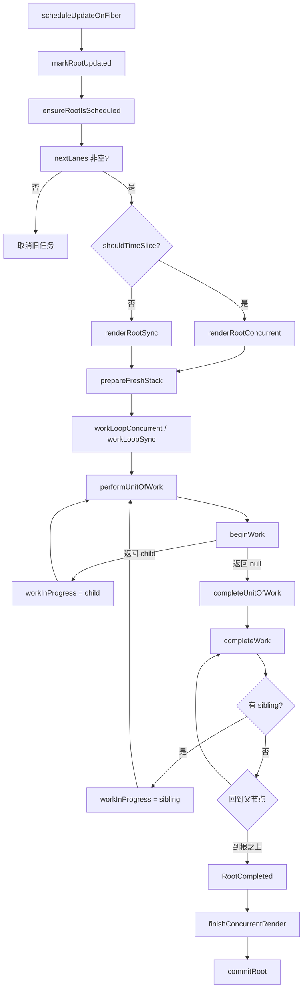

# 工作循环

`ReactFiberWorkLoop.old.js` 是 React 18.3.1 运行时的“**心跳**”。它把一次更新拆成两个阶段：

- **Render 阶段**：可计算、可中断，负责构建 `workInProgress` 树。
- **Commit 阶段**：不可中断、同步执行，负责把变更写入真实 DOM 并执行布局副作用。

工作循环的核心实现位于 `react-reconciler/src/ReactFiberWorkLoop.old.js`，并串联 `ReactFiberRoot.old.js`、`ReactFiberBeginWork.old.js`、`ReactFiberCompleteWork.old.js`、`ReactFiberCommitWork.old.js` 与 `scheduler`。代码引用会省略 Flow 类型标注、`__DEV__` 与 Profiler 分支，主体与官方源码一致。

## 1. 模块职责

[width(36,64)]

| 函数                            | 职责                                                          |
| ------------------------------- | ------------------------------------------------------------- |
| `scheduleUpdateOnFiber`         | 更新入口：标记根上的 Lane，请求根调度                         |
| `ensureRootIsScheduled`         | 选出下一批 Lane，把根任务注册到 Scheduler                     |
| `performConcurrentWorkOnRoot`   | Scheduler 回调：决定时间切片还是同步渲染，完成后进入 Commit   |
| `renderRootSync`                | 同步 Render 主入口：准备 WIP 树，启动同步工作循环             |
| `renderRootConcurrent`          | 并发 Render 主入口：启动可让出的工作循环                      |
| `prepareFreshStack`             | 清理上一轮状态，从 HostRoot 创建新的 WIP                      |
| `workLoopSync`                  | 同步循环：一直执行到 `workInProgress === null`                |
| `workLoopConcurrent`            | 并发循环：每个工作单元后检查 `shouldYield()`                  |
| `performUnitOfWork`             | 单个工作单元：调用 `beginWork`，决定“**向下**”还是“**向上**”  |
| `completeUnitOfWork`            | 回溯逻辑：`completeWork` 后找兄弟，找不到就回父节点           |
| `commitRoot` / `commitRootImpl` | Commit 主入口：BeforeMutation、Mutation、切换 current、Layout |

## 2. 执行上下文

React 用位掩码记录“**当前正在做什么**”，避免在 Render 或 Commit 中错误地触发新的调度：

:::code-group

```ts [react-reconciler/src/ReactFiberWorkLoop.old.js]
export const NoContext = /*             */ 0b000
const BatchedContext = /*               */ 0b001
const RenderContext = /*                */ 0b010
const CommitContext = /*                */ 0b100

// 描述当前处于 React 执行栈的哪一层。
let executionContext = NoContext
```

:::

进入某个阶段时用位或添加标记，退出时恢复旧值：

```js
// 进入 Render 阶段前保存旧上下文。
const prevExecutionContext = executionContext
executionContext |= RenderContext

// ... 执行 Render

// 退出时恢复，避免影响外层调用。
executionContext = prevExecutionContext
```

这样可以嵌套判断，例如：

```js
if ((executionContext & RenderContext) !== NoContext) {
  // 当前处于 Render 阶段
}
```

`BatchedContext` 用于事件批处理，`RenderContext` 与 `CommitContext` 则保护两个不可重入的阶段。`renderRootSync`、`renderRootConcurrent` 和 `commitRootImpl` 都遵循“**保存旧值 → 设置标记 → 执行 → 恢复旧值**”的模式。

## 3. 更新入口与根调度

### 3.1 `scheduleUpdateOnFiber`

`scheduleUpdateOnFiber` 不再直接持有“**下一个工作单元**”，它只负责两件事：把更新标记到根上，然后请求根调度。

:::code-group

```ts [react-reconciler/src/ReactFiberWorkLoop.old.js]
export function scheduleUpdateOnFiber(root, fiber, lane, eventTime) {
  // 省略嵌套更新的 invariant 校验

  // 标记根上有待处理更新。
  markRootUpdated(root, lane, eventTime)

  // 省略 Render 阶段更新、Profiler、Transition Tracing 等分支

  ensureRootIsScheduled(root, eventTime)
  // 省略 legacy 模式下的同步刷新
}
```

:::

两个参数值得注意：

- `lane`：本次更新的优先级；`markRootUpdated` 会把它合并进 `root.pendingLanes`。
- `eventTime`：用于计算 Lane 的过期时间，避免低优先级任务被无限推迟。

### 3.2 `ensureRootIsScheduled`

`ensureRootIsScheduled` 负责把“**根上有哪些 Lane 待处理**”翻译成“**Scheduler 里要不要有一个任务**”。如果已有同优先级的回调，它会直接复用，而不是重复注册。

:::code-group

```ts [react-reconciler/src/ReactFiberWorkLoop.old.js]
function ensureRootIsScheduled(root, currentTime) {
  const existingCallbackNode = root.callbackNode

  // 长时间得不到执行的 Lane 标记为过期，避免饿死。
  markStarvedLanesAsExpired(root, currentTime)

  // 选出本轮要处理的 Lane。
  const nextLanes = getNextLanes(
    root,
    root === workInProgressRoot ? workInProgressRootRenderLanes : NoLanes,
  )

  if (nextLanes === NoLanes) {
    // 没有待处理工作：取消已有回调并复位状态。
    if (existingCallbackNode !== null) {
      cancelCallback(existingCallbackNode)
    }
    root.callbackNode = null
    root.callbackPriority = NoLane
    return
  }

  // 用最高优先级的 Lane 代表本次回调的优先级。
  const newCallbackPriority = getHighestPriorityLane(nextLanes)

  // 省略 act 队列的特判；优先级相同则复用已有任务
  if (root.callbackPriority === newCallbackPriority) {
    return
  }

  if (existingCallbackNode != null) {
    cancelCallback(existingCallbackNode)
  }

  let newCallbackNode
  if (newCallbackPriority === SyncLane) {
    // 同步任务不经过 Scheduler，改为在微任务中刷新。
    scheduleSyncCallback(performSyncWorkOnRoot.bind(null, root))
    if (supportsMicrotasks) {
      scheduleMicrotask(() => {
        if (
          (executionContext & (RenderContext | CommitContext)) ===
          NoContext
        ) {
          flushSyncCallbacks()
        }
      })
    } else {
      scheduleCallback(ImmediateSchedulerPriority, flushSyncCallbacks)
    }
    newCallbackNode = null
  } else {
    let schedulerPriorityLevel
    switch (lanesToEventPriority(nextLanes)) {
      case DiscreteEventPriority:
        schedulerPriorityLevel = ImmediateSchedulerPriority
        break
      case ContinuousEventPriority:
        schedulerPriorityLevel = UserBlockingSchedulerPriority
        break
      case DefaultEventPriority:
        schedulerPriorityLevel = NormalSchedulerPriority
        break
      case IdleEventPriority:
        schedulerPriorityLevel = IdleSchedulerPriority
        break
      default:
        schedulerPriorityLevel = NormalSchedulerPriority
        break
    }
    newCallbackNode = scheduleCallback(
      schedulerPriorityLevel,
      performConcurrentWorkOnRoot.bind(null, root),
    )
  }

  root.callbackPriority = newCallbackPriority
  root.callbackNode = newCallbackNode
}
```

:::

### 3.3 两条渲染路径

[width(13,43,44)]

| 维度     | 同步路径                               | 并发路径                                |
| -------- | -------------------------------------- | --------------------------------------- |
| 入口     | `renderRootSync(root, lanes)`          | `renderRootConcurrent(root, lanes)`     |
| 工作循环 | `workLoopSync`                         | `workLoopConcurrent`                    |
| 是否让出 | 否，一直执行到整棵树完成               | 每个工作单元后检查 `shouldYield()`      |
| 触发条件 | 阻塞 Lane、已过期 Lane、Scheduler 超时 | 普通并发更新                            |
| 返回值   | `RootCompleted` 或错误状态             | `RootInProgress` 表示还需要下一轮时间片 |
| 中断恢复 | 不适用                                 | 保留 `workInProgress`，下次从断点继续   |

`performConcurrentWorkOnRoot` 会根据 `includesBlockingLane`、`includesExpiredLane` 和 `didTimeout` 决定走哪条路径：

:::code-group

```ts [react-reconciler/src/ReactFiberWorkLoop.old.js]
// 只有非阻塞、未过期且未超时，才走可中断的并发渲染。
const shouldTimeSlice =
  !includesBlockingLane(root, lanes) &&
  !includesExpiredLane(root, lanes) &&
  (disableSchedulerTimeoutInWorkLoop || !didTimeout)

let exitStatus = shouldTimeSlice
  ? renderRootConcurrent(root, lanes)
  : renderRootSync(root, lanes)
```

:::

## 4. Render 阶段

### 4.1 入口：`performConcurrentWorkOnRoot`

这个函数是 Scheduler 回调的实际入口。它先冲刷 Passive Effect，再选出本轮 Lane，执行 Render，最后把完成树交给 Commit。

:::code-group

```ts [react-reconciler/src/ReactFiberWorkLoop.old.js]
function performConcurrentWorkOnRoot(root, didTimeout) {
  currentEventTime = NoTimestamp
  currentEventTransitionLane = NoLanes

  const originalCallbackNode = root.callbackNode

  // Passive Effect 可能产生新的工作，先冲刷
  const didFlushPassiveEffects = flushPassiveEffects()
  if (didFlushPassiveEffects) {
    if (root.callbackNode !== originalCallbackNode) {
      return null
    }
  }

  // 选出本轮要处理的 Lane。
  let lanes = getNextLanes(
    root,
    root === workInProgressRoot ? workInProgressRootRenderLanes : NoLanes,
  )
  if (lanes === NoLanes) {
    return null
  }

  // 阻塞 Lane、过期 Lane 或 Scheduler 超时都必须同步渲染。
  const shouldTimeSlice =
    !includesBlockingLane(root, lanes) &&
    !includesExpiredLane(root, lanes) &&
    (disableSchedulerTimeoutInWorkLoop || !didTimeout)

  let exitStatus = shouldTimeSlice
    ? renderRootConcurrent(root, lanes)
    : renderRootSync(root, lanes)

  if (exitStatus !== RootInProgress) {
    if (exitStatus === RootErrored) {
      // 出错后先尝试同步重试一次。
      const errorRetryLanes = getLanesToRetrySynchronouslyOnError(root)
      if (errorRetryLanes !== NoLanes) {
        lanes = errorRetryLanes
        exitStatus = recoverFromConcurrentError(root, errorRetryLanes)
      }
    }
    if (exitStatus === RootFatalErrored) {
      const fatalError = workInProgressRootFatalError
      prepareFreshStack(root, NoLanes)
      markRootSuspended(root, lanes)
      ensureRootIsScheduled(root, now())
      throw fatalError
    }
    if (exitStatus === RootDidNotComplete) {
      // 未完成整棵树：先挂起根，等待下一轮继续。
      markRootSuspended(root, lanes)
    } else {
      // 省略与外部 store 的一致性检查
      const finishedWork = root.current.alternate
      root.finishedWork = finishedWork
      root.finishedLanes = lanes
      finishConcurrentRender(root, exitStatus, lanes)
    }
  }

  ensureRootIsScheduled(root, now())
  if (root.callbackNode === originalCallbackNode) {
    // 当前任务仍是同一个，返回续体让 Scheduler 继续调用
    return performConcurrentWorkOnRoot.bind(null, root)
  }
  return null
}
```

:::

`finishConcurrentRender` 根据 `RootExitStatus` 决定提交、挂起还是延迟提交。正常完成时，它调用 `commitRoot`。

### 4.2 `renderRootSync`

同步 Render 会用 `try/catch` 包住工作循环，捕获到的异常交给 `handleError` 沿 `return` 回溯到最近的错误边界。

:::code-group

```ts [react-reconciler/src/ReactFiberWorkLoop.old.js]
function renderRootSync(root, lanes) {
  const prevExecutionContext = executionContext
  executionContext |= RenderContext
  // 保存并切换 Hooks dispatcher。
  const prevDispatcher = pushDispatcher()

  // 根或 Lane 变化时，丢弃旧栈并准备新的 WIP
  if (workInProgressRoot !== root || workInProgressRootRenderLanes !== lanes) {
    workInProgressTransitions = getTransitionsForLanes(root, lanes)
    prepareFreshStack(root, lanes)
  }

  // 异常交给 handleError 处理后重试，直到工作循环正常结束。
  do {
    try {
      workLoopSync()
      break
    } catch (thrownValue) {
      handleError(root, thrownValue)
    }
  } while (true)

  resetContextDependencies()
  executionContext = prevExecutionContext
  popDispatcher(prevDispatcher)

  // 省略“同步渲染必须完成整棵树”的 invariant

  workInProgressRoot = null
  workInProgressRootRenderLanes = NoLanes

  return workInProgressRootExitStatus
}
```

:::

### 4.3 `prepareFreshStack`

`prepareFreshStack` 负责清理上一轮渲染的残留状态。它不会无条件覆盖 `workInProgress`，而是先对中断的节点执行 `unwindInterruptedWork`，再从 HostRoot 创建新的 WIP。

:::code-group

```ts [react-reconciler/src/ReactFiberWorkLoop.old.js]
function prepareFreshStack(root, lanes) {
  root.finishedWork = null
  root.finishedLanes = NoLanes

  const timeoutHandle = root.timeoutHandle
  if (timeoutHandle !== noTimeout) {
    // 上一轮 Suspense 安排的超时提交不再需要
    root.timeoutHandle = noTimeout
    cancelTimeout(timeoutHandle)
  }

  if (workInProgress !== null) {
    // 中断恢复：沿 return 逐个回溯，弹出未完成节点的上下文
    let interruptedWork = workInProgress.return
    while (interruptedWork !== null) {
      const current = interruptedWork.alternate
      unwindInterruptedWork(
        current,
        interruptedWork,
        workInProgressRootRenderLanes,
      )
      interruptedWork = interruptedWork.return
    }
  }

  workInProgressRoot = root
  // 从 HostRoot 重新创建 WIP 根节点。
  const rootWorkInProgress = createWorkInProgress(root.current, null)
  workInProgress = rootWorkInProgress
  workInProgressRootRenderLanes =
    subtreeRenderLanes =
    workInProgressRootIncludedLanes =
      lanes
  workInProgressRootExitStatus = RootInProgress

  // 省略错误、ping、跳过 Lane 等状态重置

  finishQueueingConcurrentUpdates()

  return rootWorkInProgress
}
```

:::

注意这里是 `workInProgress = rootWorkInProgress`，而不是“**有旧指针就保留**”。真正需要续跑时，`workInProgressRoot` 和 `workInProgressRootRenderLanes` 没有变化，`renderRootConcurrent` 会跳过 `prepareFreshStack`，直接从上次保存的 `workInProgress` 继续。

### 4.4 工作循环

同步循环和并发循环只差一个 `shouldYield()` 条件：

:::code-group

```ts [react-reconciler/src/ReactFiberWorkLoop.old.js]
/** @noinline */
function workLoopSync() {
  // 已超时，持续执行到整棵树完成，不再检查是否让出。
  while (workInProgress !== null) {
    performUnitOfWork(workInProgress)
  }
}

/** @noinline */
function workLoopConcurrent() {
  // 每个工作单元后检查是否该让出，直到 Scheduler 要求暂停。
  while (workInProgress !== null && !shouldYield()) {
    performUnitOfWork(workInProgress)
  }
}
```

:::

`shouldYield()` 来自 Scheduler。它让 React 在时间片用尽后主动让出主线程，浏览器就有机会处理输入、布局和绘制。由于 `workInProgress` 是模块级变量，让出后下一次回调可以直接从断点继续。

### 4.5 `performUnitOfWork`：向下“**递**”

:::code-group

```ts [react-reconciler/src/ReactFiberWorkLoop.old.js]
function performUnitOfWork(unitOfWork) {
  // current 是已经提交的版本，也是 diff 的基准
  const current = unitOfWork.alternate

  let next = beginWork(current, unitOfWork, subtreeRenderLanes)

  // 本次 pendingProps 已经应用，同步为 memoizedProps
  unitOfWork.memoizedProps = unitOfWork.pendingProps

  if (next === null) {
    // 没有子节点 → 转入“归”
    completeUnitOfWork(unitOfWork)
  } else {
    // 有子节点 → 继续向下
    workInProgress = next
  }
}
```

:::

`beginWork` 返回第一个子 Fiber，或者返回 `null` 表示当前节点没有需要继续处理的子节点。它不负责创建 DOM，只负责“**算出下一层应该有什么**”，详见 [beginWork](/frameworks/react/advanced/source-code/reconciler/beginWork)。

### 4.6 `completeUnitOfWork`：向上“**归**”

:::code-group

```ts [react-reconciler/src/ReactFiberWorkLoop.old.js]
function completeUnitOfWork(unitOfWork) {
  // 先完成当前工作单元，再转去下一个兄弟；没有兄弟时回到父节点。
  let completedWork = unitOfWork
  do {
    const current = completedWork.alternate
    const returnFiber = completedWork.return

    // 省略 flags & Incomplete 的错误回溯分支
    const next = completeWork(current, completedWork, subtreeRenderLanes)

    if (next !== null) {
      // 完成当前节点时产生了新的工作，优先处理它
      workInProgress = next
      return
    }

    const siblingFiber = completedWork.sibling
    if (siblingFiber !== null) {
      // 有兄弟节点 → 兄弟成为下一个工作单元
      workInProgress = siblingFiber
      return
    }

    // 没有兄弟节点 → 回到父节点继续 complete
    completedWork = returnFiber
    workInProgress = completedWork
  } while (completedWork !== null)

  // 已经回溯到根之上，整棵树完成
  if (workInProgressRootExitStatus === RootInProgress) {
    workInProgressRootExitStatus = RootCompleted
  }
}
```

:::

回溯顺序可以概括为：

```text
completeWork(叶子)
  → 有 sibling：处理 sibling
  → 无 sibling：completeWork(父)
    → 父有 sibling：处理父的 sibling
    → 父无 sibling：继续向上
```

当 `completedWork` 变成 `null` 时，说明已经回溯到 HostRoot 之上，整棵树处理完毕。`completeWork` 负责创建 DOM、初始化属性、挂载子节点并汇总 `subtreeFlags`，详见 [completeWork](/frameworks/react/advanced/source-code/reconciler/completeWork)。

### 4.7 一次 Render 的完整路径



## 5. Commit 阶段

### 5.1 `commitRoot`

`commitRoot` 只是对 `commitRootImpl` 的薄包装，用来临时切换到 `DiscreteEventPriority`，并保存/恢复 Transition 配置。

:::code-group

```ts [react-reconciler/src/ReactFiberWorkLoop.old.js]
function commitRoot(root, recoverableErrors, transitions) {
  const previousUpdateLanePriority = getCurrentUpdatePriority()
  const prevTransition = ReactCurrentBatchConfig.transition

  try {
    // Commit 期间使用离散事件优先级，并暂时清空 Transition 配置。
    ReactCurrentBatchConfig.transition = null
    setCurrentUpdatePriority(DiscreteEventPriority)
    commitRootImpl(
      root,
      recoverableErrors,
      transitions,
      previousUpdateLanePriority,
    )
  } finally {
    // 结束后恢复进入前的优先级与 Transition 配置。
    ReactCurrentBatchConfig.transition = prevTransition
    setCurrentUpdatePriority(previousUpdateLanePriority)
  }

  return null
}
```

:::

### 5.2 `commitRootImpl`：四个关键动作

:::code-group

```ts [react-reconciler/src/ReactFiberWorkLoop.old.js]
function commitRootImpl(
  root,
  recoverableErrors,
  transitions,
  renderPriorityLevel,
) {
  do {
    // Passive Effect 可能会产生新的 Passive Effect，循环冲刷干净
    flushPassiveEffects()
  } while (rootWithPendingPassiveEffects !== null)

  const finishedWork = root.finishedWork
  const lanes = root.finishedLanes

  if (finishedWork === null) {
    return null
  }

  root.finishedWork = null
  root.finishedLanes = NoLanes

  // 清空本轮回调，允许 Commit 期间注册新的任务
  root.callbackNode = null
  root.callbackPriority = NoLane

  let remainingLanes = mergeLanes(finishedWork.lanes, finishedWork.childLanes)
  markRootFinished(root, remainingLanes)

  if (root === workInProgressRoot) {
    workInProgressRoot = null
    workInProgress = null
    workInProgressRootRenderLanes = NoLanes
  }

  // 如果整棵树存在 Passive Effect，先注册异步回调
  if (
    (finishedWork.subtreeFlags & PassiveMask) !== NoFlags ||
    (finishedWork.flags & PassiveMask) !== NoFlags
  ) {
    if (!rootDoesHavePassiveEffects) {
      rootDoesHavePassiveEffects = true
      pendingPassiveEffectsRemainingLanes = remainingLanes
      pendingPassiveTransitions = transitions
      scheduleCallback(NormalSchedulerPriority, () => {
        flushPassiveEffects()
        return null
      })
    }
  }

  const subtreeHasEffects =
    (finishedWork.subtreeFlags &
      (BeforeMutationMask | MutationMask | LayoutMask | PassiveMask)) !==
    NoFlags
  const rootHasEffect =
    (finishedWork.flags &
      (BeforeMutationMask | MutationMask | LayoutMask | PassiveMask)) !==
    NoFlags

  if (subtreeHasEffects || rootHasEffect) {
    const prevExecutionContext = executionContext
    const prevTransition = ReactCurrentBatchConfig.transition
    const previousPriority = getCurrentUpdatePriority()
    executionContext |= CommitContext

    ReactCurrentBatchConfig.transition = null
    setCurrentUpdatePriority(DiscreteEventPriority)

    // 1. BeforeMutation：读取 DOM 变更前的快照
    commitBeforeMutationEffects(root, finishedWork)

    // 2. Mutation：插入、删除、更新 DOM
    commitMutationEffects(root, finishedWork, lanes)
    resetAfterCommit(root.containerInfo)

    // 3. 切换 current：WIP 树正式成为当前树
    root.current = finishedWork

    // 4. Layout：同步执行 useLayoutEffect / componentDidMount
    commitLayoutEffects(finishedWork, root, lanes)
    requestPaint()

    executionContext = prevExecutionContext
    setCurrentUpdatePriority(previousPriority)
    ReactCurrentBatchConfig.transition = prevTransition
  } else {
    // 没有副作用，只需要切换 current
    root.current = finishedWork
  }

  // 省略 root.pendingLanes 剩余工作检查与 Passive Effect 收尾
}
```

:::

Commit 阶段有几条严格的顺序约束：

1. **BeforeMutation 必须最先**：`getSnapshotBeforeUpdate` 需要读取 DOM 变更前的状态。
2. **Mutation 之后才能切换 `current`**：卸载生命周期仍应看到旧树。
3. **Layout 必须在切换之后**：`componentDidMount` / `useLayoutEffect` 应看到新 DOM。
4. **Passive Effect 不能阻塞绘制**：`useEffect` 通过 `scheduleCallback` 推迟到浏览器绘制之后。

### 5.3 三个 Commit 子阶段

[width(13,30,57)]

| 子阶段         | 入口函数                      | 典型工作                                                                               |
| -------------- | ----------------------------- | -------------------------------------------------------------------------------------- |
| BeforeMutation | `commitBeforeMutationEffects` | `getSnapshotBeforeUpdate`、读取 DOM 变更前的快照                                       |
| Mutation       | `commitMutationEffects`       | 插入/删除/更新 DOM、解绑 ref、执行 `useLayoutEffect` 的清理函数                        |
| Layout         | `commitLayoutEffects`         | 执行 `useLayoutEffect` 的 create、`componentDidMount` / `componentDidUpdate`、绑定 ref |

### 5.4 Passive Effect 为什么异步

- `useLayoutEffect` 的语义是“**DOM 已变、浏览器未绘制**”，必须同步执行。
- `useEffect` 的语义是“**浏览器已绘制**”，如果同步执行会阻塞首屏。
- 因此 `commitRootImpl` 只注册 `scheduleCallback(NormalSchedulerPriority, flushPassiveEffects)`，真正的执行发生在当前帧的绘制之后。

`flushPassiveEffects` 会检查 `rootWithPendingPassiveEffects`，避免同一个根上的 Passive Effect 被重复执行；如果在执行过程中又产生了新的 Passive Effect，`commitRootImpl` 开头的 `do...while` 会继续冲刷，直到队列为空。

## 6. 错误处理与退出状态

### 6.1 `handleError`

`renderRootSync` 和 `renderRootConcurrent` 都用 `try/catch` 包住工作循环。异常不会直接冒泡给调用方，而是交给 `handleError`：

1. 从当前 `workInProgress` 沿 `return` 向上查找最近的有错误处理能力的 Fiber。
2. 找到错误边界后，给它打上 `ShouldCapture` / `DidCapture`，并安排一次重新渲染。
3. 找不到边界时，把根标记为 `RootFatalErrored`，整棵树渲染失败。
4. 中途失败的节点会带上 `Incomplete`，`completeUnitOfWork` 通过 `unwindWork` 弹出上下文而不是执行正常的完成逻辑。

### 6.2 `RootExitStatus`

[width(31,8,61)]

| 常量                     | 值  | 含义                            |
| ------------------------ | --- | ------------------------------- |
| `RootInProgress`         | 0   | 尚未完成，需要继续工作          |
| `RootFatalErrored`       | 1   | 致命错误，没有错误边界可以捕获  |
| `RootErrored`            | 2   | 渲染出错，已尝试同步重试        |
| `RootSuspended`          | 3   | 挂起，但有可接受的 loading 状态 |
| `RootSuspendedWithDelay` | 4   | 挂起，并延迟提交 fallback       |
| `RootCompleted`          | 5   | 完成，可以提交                  |
| `RootDidNotComplete`     | 6   | 未完成整棵树，不能提交          |

### 6.3 可中断性的三个支点

[width(31,69)]

| 机制                      | 作用                                                         |
| ------------------------- | ------------------------------------------------------------ |
| `workInProgress` 全局指针 | 指向下一个待处理的工作单元，让出后可以从断点恢复             |
| `shouldYield()`           | 每个工作单元后检查时间片是否用尽                             |
| `lanes` / `childLanes`    | 记录每个节点和子树上的待处理优先级，恢复时知道该处理哪些子树 |

这三者缺一不可：没有全局指针就无法恢复，没有 `shouldYield()` 就不会让出，没有 Lane 就无法判断恢复后哪些工作仍然有效。

## 7. 总结

`ReactFiberWorkLoop.old.js` 的主线可以概括为：

- `scheduleUpdateOnFiber` 标记根上的 Lane，`ensureRootIsScheduled` 把根任务交给 Scheduler。
- Render 阶段由 `beginWork` “**递**”、`completeWork` “**归**”，`performUnitOfWork` 决定下一步走向。
- 并发渲染通过 `workLoopConcurrent` + `shouldYield()` 中断，靠全局 `workInProgress` 恢复。
- Commit 阶段严格按 BeforeMutation → Mutation → 切换 `current` → Layout 的顺序执行，Passive Effect 异步调度。

[width(15,26,59)]

| 维度           | 简化实现                                 | React 18.3.1                                             |
| -------------- | ---------------------------------------- | -------------------------------------------------------- |
| 工作循环       | 只有同步循环，一直执行到整棵树完成       | `workLoopSync` + `workLoopConcurrent`                    |
| 让出主线程     | 不支持                                   | 每个工作单元后检查 `shouldYield()`                       |
| 恢复渲染       | 不支持                                   | 保存 `workInProgress`，下次从断点继续                    |
| 更新入口       | 用 `isSync` 布尔值区分微任务与 Scheduler | 用 `lane` + `eventTime` 进入统一的 Lane 调度             |
| 渲染起点       | 直接指向触发更新的 Fiber                 | 从 HostRoot 创建 WIP，结合 `childLanes` 决定处理哪些子树 |
| Commit         | 只实现 Mutation，Layout Effect 同步执行  | BeforeMutation / Mutation / Layout 三个子阶段            |
| Passive Effect | 直接同步调用或简单异步                   | `scheduleCallback` + `flushPassiveEffects` + 绘制后执行  |
| 错误处理       | 异常直接冒泡                             | `handleError` + 错误边界 + `Incomplete` 回溯 + 同步重试  |

简化实现（mini-react / xunbei-react）保留了“`beginWork` 向下、`completeWork` 向上、`commitRoot` 收尾”的调用形状，但把 Lane、并发循环、effect list 和错误边界都裁掉了。因此它可以用来理解函数调用顺序，却不能用来解释 React 为什么能中断渲染、为什么高优先级更新可以打断低优先级更新。阅读官方实现时，应以 `ReactFiberWorkLoop.old.js` 的实际分支与状态机为准。

下一篇进入 [beginWork](/frameworks/react/advanced/source-code/reconciler/beginWork)，看不同类型的 Fiber 如何产生下一层子节点。
