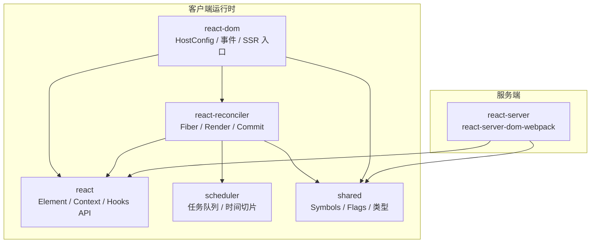
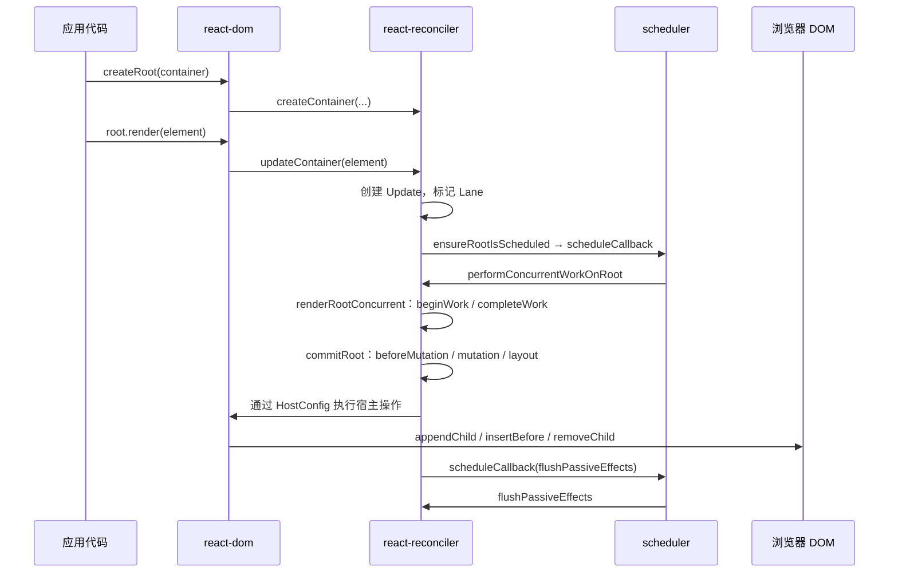
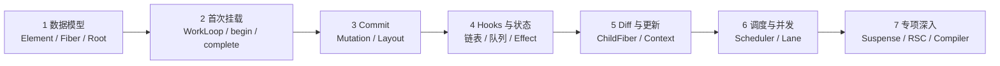

# 源码目录结构

React 官方源码仓库 [`facebook/react`](https://github.com/facebook/react) 用 monorepo 管理核心运行时、不同宿主环境的渲染器、调度器、服务端组件、开发者工具和测试设施。本页不追求覆盖每个文件，而是依次给出四张地图：整体架构、根目录结构、核心源码板块和源码阅读路线。

> [!IMPORTANT]
> 版本基准：本目录的源码剖析文章统一以 `v18.3.1` tag 为准。该版本的 `enableNewReconciler` 默认为 `false`，构建时由 `scripts/rollup/forks.js` 把 reconciler 的无后缀导入重写到 `.old.js`。

## 1. 整体架构

### 1.1 三种表示

React 的渲染过程，本质上是在三种表示之间来回转换：

[width(18,24,58)]

| 表示         | 产生位置           | 关键特征                                               |
| ------------ | ------------------ | ------------------------------------------------------ |
| ReactElement | `react` 包         | 不可变纯对象，只描述“**要渲染什么**”                   |
| Fiber        | `react-reconciler` | 可变工作单元，记录“**已经渲染成什么、接下来要改什么**” |
| 宿主节点     | `react-dom` 等     | 真实 DOM、Native View 或测试节点，是最终落到屏幕的结果 |

```tree
JSX
 └─编译→ ReactElement      不可变描述：type / props / key / ref
          └─协调→ Fiber     可变工作副本：current ↔ workInProgress
                   └─提交→ 宿主节点   真实 DOM / Native View / 测试节点
```

Element 是某一刻 UI 的“**快照**”，一旦创建就不再修改；Fiber 是 React 为了可中断渲染而维护的“**工作副本**”，每轮 Render 都可能在它上面反复计算；宿主节点才是用户真正看到的结果。React 不直接操作 DOM，它只是把新旧 Element 树比较成一组宿主操作，再交给渲染器执行。理解了这条主线，也就理解了 React 为什么要把代码拆成“**描述、协调、宿主**”三层。

### 1.2 分层与依赖



箭头表示“**依赖于**”。从架构职责看，客户端运行时可以分成五层：

- **`react`（描述层）**：定义组件、Element、Context、Hooks 等面向开发者的 API。它不知道 Fiber 长什么样，更不知道 DOM 怎么操作。
- **`react-reconciler`（协调层）**：实现 Fiber、更新队列、优先级、Render 阶段与 Commit 阶段，是 React 运行时的核心。它负责把新旧两棵 Element 树比较成一组宿主操作。
- **`react-dom` 等（宿主层）**：把协调器计算出的变更落实到 DOM 或其他宿主环境，同时提供 HostConfig、合成事件与服务端入口。
- **`scheduler`（调度层）**：根据优先级安排任务，在占用主线程过久时让出控制权。它不依赖 React，甚至可以单独使用，它不导入 React，只管理回调、优先级和时间片，属于完全独立的状态。
- **`react-server`、`react-server-dom-*`（服务端层）**：承载流式 SSR、Server Components 和 Flight 协议相关实现。

### 1.3 更新时序

以 `createRoot` 创建的并发根、一次默认优先级的 `render` 为例：



这条链路可以概括为四步：**创建根 → 入队更新 → Render 计算 → Commit 落地**。`root.render` 并不直接改 DOM，它只创建一个 Update 并标记 Lane，然后请求 Scheduler 在合适的时机回调。真正的工作发生在 `performConcurrentWorkOnRoot` 里：先由 Render 阶段算出 `workInProgress` 树，再由 Commit 阶段把变更刷到宿主。Render 可以被更高优先级的更新打断并重做，Commit 一旦开始就不可中断。

### 1.4 产品线与工具链

- **客户端运行时**：`react` + `react-reconciler` + `react-dom` + `scheduler`，是源码阅读的主线。
- **服务端渲染 (SSR)**：`react-dom/server` 中的 Fizz 把 React 树流式输出为 HTML；客户端用 `hydrateRoot` 复用这份 HTML。
- **React Server Components (RSC)**：`react-server` 与 `react-server-dom-webpack` 通过 Flight 协议传输可被客户端继续组合、恢复引用的组件数据流。它传的不是 HTML，和传统 SSR 是两套机制。
- **工具链**：`scripts/rollup` 负责打包；`compiler/` 在 main 分支承载 React Compiler（React Forget），它是一个独立的编译期优化器，通过自动记忆化减少手写 `useMemo` / `useCallback`；DevTools 与测试设施位于 `packages/` 的周边包。它们不参与运行时主干，但决定了 npm 产物长什么样。

## 2. 根结构

### 2.1 根目录

v18.3.1 的仓库根目录很精简，真正需要长期停留的只有 `packages/`：

```tree
react/
├── .github/          # CI、Issue/PR 模板、发布流程
├── fixtures/         # 最小复现、调试沙箱、性能样例
├── packages/         # 所有可发布包与内部核心模块
├── scripts/          # 构建、测试、错误码、发布脚本
├── babel.config.js   # Flow / JSX 编译配置
├── ReactVersions.js  # 版本号与发布通道定义
├── package.json      # workspace 脚本与依赖
└── yarn.lock         # 依赖锁文件
```

[width(21,39,40)]

| 目录/文件          | 核心职责                                                                                         | 阅读定位                                   |
| ------------------ | ------------------------------------------------------------------------------------------------ | ------------------------------------------ |
| `packages/`        | React 的心脏，所有可发布包与内部核心模块都在这里                                                 | 主线，绝大部分阅读时间应花在这里           |
| `scripts/rollup/`  | React 并非原样发布源码，而是通过这里的脚本抹平错误码、按环境打包，并按发布通道裁剪 feature flags | 探究 npm 产物为何与源码长得不一样时必看    |
| `scripts/jest/`    | Jest 配置、transform 与测试环境搭建                                                              | 跑测试、定位同名 `__tests__` 时使用        |
| `fixtures/`        | 官方提供的最小复现 Demo、性能场景和测试沙箱                                                      | 调试源码时，直接在 fixtures 中打断点最稳定 |
| `.github/`         | GitHub Actions、Issue 与 PR 模板                                                                 | 了解发布通道与贡献流程时查阅               |
| `babel.config.js`  | 把 Flow、JSX 和内部模块别名转换为可执行代码                                                      | 疑惑源码为何能直接运行时查阅               |
| `ReactVersions.js` | 维护 stable、experimental 等发布通道与版本映射                                                   | 判断某个 API 在哪个通道可用时查阅          |

### 2.2 `packages/` 组织

`packages/` 是 React 的心脏。不要被几十个文件夹吓到，主线只有几个核心包。先以一个包为例，看入口、实现、测试与发布信息如何摆放：

```tree
packages/react-dom/
├── client.js           # 子路径入口：react-dom/client
├── index.js            # 默认入口：react-dom
├── server.node.js      # 条件入口：Node.js 流式 SSR
├── src/                # 真正的实现
│   ├── __tests__/      # 与实现同目录的测试
│   ├── client/         # createRoot、DOM 操作与 HostConfig
│   ├── events/         # 合成事件系统
│   ├── server/         # Fizz 服务端渲染
│   └── shared/         # 客户端与服务端共享的工具
├── npm/                # 发布时使用的 package.json 模板
└── package.json        # exports、files 等发布元信息
```

- **入口文件通常只做转发**。`client.js`、`index.js`、`server.node.js` 只有几行 re-export，真正的逻辑在 `src/`。阅读前先看 `package.json` 的 `exports`，确认某个导入最终落到哪个文件。
- **`src/` 按领域分目录**。`client`、`events`、`server`、`shared` 分别对应客户端渲染、合成事件、服务端渲染与共享工具；换到 `react-reconciler`，同样的位置则平铺着 Fiber、Render、Commit、Hooks、Lane 等模块。
- **测试与实现同目录**。`src/__tests__/` 中的测试紧挨着被测代码，通常比注释更准确地描述并发更新、Effect 顺序、水合恢复等边缘行为。
- **发布信息与实现分离**。`npm/` 存放发布时替换的 `package.json` 模板，包根目录的 `package.json` 则声明 `exports`、`files` 等入口元信息。

## 3. 核心源码板块

按职责划分，主线只有六个板块：

[width(13,33,33,21)]

| 板块   | 包                                         | 一句话职责                                      | 深读入口                                                                           |
| ------ | ------------------------------------------ | ----------------------------------------------- | ---------------------------------------------------------------------------------- |
| 描述层 | `react`                                    | 定义 Element、Context、Hooks 等面向开发者的 API | [ReactElement](/frameworks/react/advanced/source-code/reactElement)                |
| 共享层 | `shared`                                   | 提供 Symbol、feature flags、Flow 类型与工具函数 | [shared 共享层](#_3-2-shared-共享层)                                               |
| 协调层 | `react-reconciler`                         | 实现 Fiber、Render 与 Commit，是运行时核心      | [Fiber 节点](/frameworks/react/advanced/source-code/reconciler/fiberNode)          |
| 宿主层 | `react-dom`                                | 实现 DOM HostConfig、合成事件与服务端渲染入口   | [Commit 阶段](/frameworks/react/advanced/source-code/commit/commitWork)            |
| 调度层 | `scheduler`                                | 按优先级调度任务并在适当时机让出主线程          | [调度器](/frameworks/react/advanced/source-code/scheduler)                         |
| 服务端 | `react-server`、`react-server-dom-webpack` | 承载 Fizz SSR 与 Flight / RSC 协议              | [React Server Components](/frameworks/react/advanced/core-design/serverComponents) |

### 3.1 `react`：描述层

```text
packages/react/
├── index.js                  # 稳定入口
├── jsx-runtime.js            # 自动 JSX runtime 入口
├── jsx-dev-runtime.js        # 开发环境 JSX runtime 入口
├── src/
│   ├── React.js              # 客户端公开 API 汇总
│   ├── ReactElement.js       # createElement、cloneElement、isValidElement
│   ├── jsx/ReactJSXElement.js # 自动 runtime 的 jsx / jsxs 实现
│   ├── ReactHooks.js         # Hooks API 到 Dispatcher 的转发层
│   ├── ReactContext.js       # Context 对象创建
│   ├── ReactCurrentDispatcher.js
│   ├── ReactChildren.js      # Children 工具方法
│   ├── ReactMemo.js          # memo 元素类型
│   ├── ReactLazy.js          # lazy 状态与加载逻辑
│   └── ReactForwardRef.js    # forwardRef 元素类型
└── package.json
```

这个包只负责**定义 UI 和数据模型**，不包含任何真实的渲染逻辑：

- **`src/jsx/`（JSX 运行时）**：JSX 被编译后的执行入口。React 17 引入的自动 runtime 把 `<div />` 变成 `jsx()` / `jsxs()` 调用，并提前分离 `key` 与静态子节点，减少运行时的对象规范化开销。
- **`ReactElement.js`（元素工厂）**：`React.createElement` 的底层实现，产出纯 JavaScript 对象。核心字段是 `type`、`props`、`key`、`ref` 和 `$$typeof`。`$$typeof` 使用 `Symbol.for('react.element')`，利用 JSON 无法序列化 Symbol 的特性阻断服务端注入伪造元素。React 19 改用了新的 Symbol，不能把两个版本的值混用。
- **`ReactHooks.js`（Hooks 空壳）**：每个 Hook 都只是从 `ReactCurrentDispatcher` 取出实现再调用。调用 `useState` 实际上是在调用 Dispatcher，具体实现由 `react-reconciler` 按挂载/更新阶段动态注入。
- **`ReactContext.js`、`ReactMemo.js`、`ReactLazy.js`、`ReactForwardRef.js`**：只创建 Context 对象或带特殊 `$$typeof` / `type` 的元素类型，具体行为由协调器解释。

更完整的字段、`createElement` 与自动 runtime 的差异，见 [ReactElement](/frameworks/react/advanced/source-code/reactElement)。

### 3.2 `shared`：共享层

`shared` 通常包含 React Symbols、特性开关、环境检测、浅比较、组件名解析、错误处理以及内部类型。它是最先可以放心阅读的包，因为这里只有常量、类型和纯工具函数，没有组件运行时状态：

- `ReactSymbols.js`：Element、Fragment、Context、Memo、Lazy 等内部类型标识。`REACT_ELEMENT_TYPE` 同时也是 Element 的安全标记。
- `ReactFeatureFlags.js` 与 `forks/`：按构建目标选择 feature flags，决定同一份源码编出哪些行为。
- `ReactTypes.js`：跨包复用的 Flow 类型，是理解 Fiber 字段类型的入口。
- `ExecutionEnvironment.js`：判断当前是浏览器、Node 还是其他宿主。
- `objectIs.js`、`shallowEqual.js`：相等性判断工具，Hooks 依赖比较与 `memo` 浅比较都会用到。
- `getComponentNameFromType.js`：从组件类型推导调试名称。
- `formatProdErrorMessage.js`：把生产环境错误码还原为带文档链接的信息。

### 3.3 `react-reconciler`：协调层

这是整个 React 最复杂、最核心的目录，负责 **Fiber 架构、Diff 算法与生命周期**。v18.3.1 中大多数模块同时存在 `.old.js` 与 `.new.js`，默认走 `.old.js`：

```text
packages/react-reconciler/src/
├── ReactFiber.old.js                  # Fiber 创建与双缓冲
├── ReactFiberRoot.old.js              # FiberRoot / HostRootFiber
├── ReactFiberWorkLoop.old.js          # 更新入口与 Render/Commit 主循环
├── ReactFiberBeginWork.old.js         # “递”：按 tag 生成子 Fiber
├── ReactChildFiber.old.js             # 子节点协调与 key diff
├── ReactFiberCompleteWork.old.js      # “归”：创建宿主节点、汇总 flags
├── ReactFiberCommitWork.old.js        # Commit 三阶段
├── ReactFiberHooks.old.js             # Hooks 链表与更新队列
├── ReactFiberClassUpdateQueue.old.js  # Class 组件更新队列
├── ReactFiberClassComponent.old.js    # Class 组件生命周期
├── ReactFiberNewContext.old.js        # Context 值栈、依赖收集与传播
├── ReactFiberLane.old.js              # Lane 位运算与优先级模型
├── ReactFiberConcurrentUpdates.old.js # 并发更新入队
├── ReactFiberSuspenseComponent.old.js # Suspense 相关逻辑
├── ReactFiberHydrationContext.old.js  # 水合状态管理
├── ReactFiberFlags.js                 # 副作用位掩码
├── ReactWorkTags.js                   # Fiber 类型标记
├── ReactFiberHostConfig.js            # 宿主接口占位（构建时替换）
└── ReactFiberReconciler.js            # createContainer / updateContainer 等对外接口
```

阅读时可以按主题分成七组：

- **基石数据**：`ReactFiber.old.js` 创建 Fiber，维护 `return` / `child` / `sibling` 三根指针与 `alternate` 双缓冲；`ReactFiberRoot.old.js` 创建 `FiberRootNode` 与 `HostRootFiber`；`ReactWorkTags.js`、`ReactFiberFlags.js` 提供类型标记与副作用位掩码。见 [Fiber 节点](/frameworks/react/advanced/source-code/reconciler/fiberNode)、[FiberRoot](/frameworks/react/advanced/source-code/reconciler/fiberRoot)。
- **工作循环 (WorkLoop)**：`ReactFiberWorkLoop.old.js` 是引擎的心跳，控制 Render 阶段（可中断）与 Commit 阶段（不可中断），同时负责更新入口、根调度、异常处理与退出状态。见 [工作循环](/frameworks/react/advanced/source-code/reconciler/workLoop)。
- **Render 阶段 (找不同)**：`ReactFiberBeginWork.old.js` 是“**递**”阶段，按 `WorkTag` 比对状态、生成下级 Fiber；`ReactChildFiber.old.js` 是核心 Diff，单节点先比 `key` 再比 `type`，多节点用两轮遍历处理移动；`ReactFiberCompleteWork.old.js` 是“**归**”阶段，创建宿主节点并把 `flags` 向上汇总成 `subtreeFlags`。见 [beginWork](/frameworks/react/advanced/source-code/reconciler/beginWork)、[子节点 Diff](/frameworks/react/advanced/source-code/reconciler/childFiber)、[completeWork](/frameworks/react/advanced/source-code/reconciler/completeWork)。
- **Commit 阶段 (操刀修改)**：`ReactFiberCommitWork.old.js` 按 BeforeMutation / Mutation / Layout 三幕执行，真正修改 DOM、触发生命周期与 Effect。见 [Commit 阶段](/frameworks/react/advanced/source-code/commit/commitWork)。
- **Hooks 与状态**：`ReactFiberHooks.old.js` 构建 Hook 单向链表与 `UpdateQueue`；`ReactFiberClassUpdateQueue.old.js` 处理 Class 组件的环状更新队列。见 [Hooks 链表](/frameworks/react/advanced/source-code/hooks/hooksInternals)、[useState](/frameworks/react/advanced/source-code/hooks/useState)、[useReducer](/frameworks/react/advanced/source-code/hooks/useReducer)。
- **优先级与并发**：`ReactFiberLane.old.js` 用 31 位二进制表示优先级；`ReactFiberConcurrentUpdates.old.js` 负责并发更新入队。见 [调度与优先级](/frameworks/react/advanced/core-design/schedulingAndLanes)。
- **Context、Suspense 与水合**：`ReactFiberNewContext.old.js` 维护 Context 值栈、依赖收集与传播；`ReactFiberSuspenseComponent.old.js`、`ReactFiberHydrationContext.old.js` 处理挂起、重试与水合。见 [Context](/frameworks/react/advanced/source-code/context/context)、[并发特性](/frameworks/react/advanced/core-design/suspenseOffscreenHydration)。

把七组串起来的是三个机制：双缓冲让 Render 可以随时丢弃重来；`beginWork` 的“**递**”与 `completeWork` 的“**归**”构成深度优先遍历；`flags` 与 `subtreeFlags` 的位掩码让 Commit 能整棵跳过没有效果的子树。

### 3.4 `react-dom`：宿主层

`react-dom` 为协调器提供操作浏览器 DOM 的“**武器库**”（Host Config），同时承载事件系统和 SSR 入口：

```text
packages/react-dom/
├── client.js                  # react-dom/client 入口
├── index.js                   # react-dom 默认入口
├── server.js                  # 通用服务端入口
├── server.browser.js          # 浏览器流式 SSR 入口
├── server.node.js             # Node.js 流式 SSR 入口
├── src/
│   ├── client/
│   │   ├── ReactDOMRoot.js          # createRoot / hydrateRoot
│   │   ├── ReactDOMComponent.js     # DOM 属性创建与更新
│   │   ├── ReactDOMComponentTree.js # DOM 节点与 Fiber 的关联
│   │   └── ReactDOMHostConfig.js    # HostConfig 的 DOM 实现
│   ├── events/                      # 合成事件与事件委托
│   ├── server/                      # Fizz 服务端渲染
│   └── shared/                      # 客户端与服务端共享工具
└── package.json                     # exports 子路径映射
```

- **`ReactDOMRoot.js`（应用入口）**：`createRoot` 在底层创建 `FiberRootNode` 与 `HostRootFiber`，并在根容器上调用 `listenToAllSupportedEvents` 注册事件监听。
- **`ReactDOMHostConfig.js`（桥接文件）**：向协调器暴露 `createInstance`、`appendChild`、`insertBefore`、`commitUpdate`、`removeChild` 等纯净接口。协调器本身不出现任何 DOM API，所有宿主细节都被这层挡住。
- **`src/events/`（合成事件系统）**：独立于浏览器的 SyntheticEvent 实现。从 React 17 起，事件委托挂在根容器而不是 `document` 上；事件优先级会映射成 Lane，再参与调度。
- **`src/server/`（服务端适配）**：Fizz 的 DOM 适配层，提供 `renderToString`、`renderToPipeableStream`、`renderToReadableStream` 等入口。

> [!NOTE]
> React 19 后 `ReactDOMHostConfig.js` 等文件被拆分、改名，出现了 `ReactFiberConfigDOM.js` 这类新名称。18.3.1 中并不存在这些文件，不要拿 main 的文件名来对照。

### 3.5 `scheduler`：调度层

`scheduler` 是一个独立于 React 的任务调度库，甚至可以脱离 React 使用。它负责按优先级执行回调，并在占用主线程过久时让出控制权：

```text
packages/scheduler/src/
├── forks/
│   ├── Scheduler.js         # 宿主调度实现，DOM 版使用 MessageChannel
│   ├── SchedulerMock.js     # 测试替身
│   └── SchedulerPostTask.js # 基于 scheduler.postTask 的实验实现
├── SchedulerMinHeap.js      # 小顶堆
├── SchedulerPriorities.js   # 优先级常量
├── SchedulerFeatureFlags.js
└── SchedulerProfiling.js
```

- **`forks/Scheduler.js`（宏任务时间切片）**：通过 `MessageChannel` 产生宏任务，在 `workLoop` 中每个任务执行完后检查是否超过 5ms 的 `frameInterval`，超时就调用 `shouldYieldToHost` 让出主线程。
- **`SchedulerMinHeap.js`（任务队列）**：`timerQueue` 存放尚未到期的延时任务，`taskQueue` 存放可以立即执行的任务，两者都按 `expirationTime` 维护为小顶堆，保证 `O(log n)` 取出最早到期的任务。
- **`SchedulerPriorities.js`（优先级常量）**：提供 Immediate、UserBlocking、Normal、Low、Idle 五档优先级，React 会把 Lane 映射到这几档上。
- **与 React 的边界**：Scheduler 只知道回调与优先级，不知道 Fiber、Lane 或组件。React 负责把 Lane 映射成 Scheduler 优先级，再在回调里执行 `performConcurrentWorkOnRoot`。

完整的队列结构、`scheduleCallback` 流程与 React 集成方式，见 [调度器](/frameworks/react/advanced/source-code/scheduler)。

### 3.6 服务端与 RSC

v18.3.1 的服务端相关包分为三层：

[width(20,36,44)]

| 包                          | 主要职责                                                   | 关键文件                                                    |
| --------------------------- | ---------------------------------------------------------- | ----------------------------------------------------------- |
| `react-dom` 的 `src/server` | DOM 侧的 Fizz 渲染器与旧版 `renderToString` 实现           | `ReactDOMFizzServerBrowser.js`、`ReactDOMFizzServerNode.js` |
| `react-server`              | 服务端共享核心：Fizz 渲染流程、Flight 服务端、Hooks 与配置 | `ReactFizzServer.js`、`ReactFlightServer.js`                |
| `react-server-dom-webpack`  | 面向 webpack 的 Flight 客户端与服务端适配、bundler 配置    | `ReactFlightDOMClient.js`、`ReactFlightDOMServerNode.js`    |

> [!NOTE]
> Server Components 不是“**组件在服务器生成 HTML**”这么简单。传统 SSR 主要传输 HTML，客户端负责水合；RSC 传输的是可被客户端继续组合、恢复引用的组件数据流，两者可以协同工作。RSC 在 18.3.1 中仍属实验特性，main 分支还新增了 Parcel、Turbopack 适配和 `react-markup` 等包。

### 3.7 周边包

`packages/` 里还有一批不参与客户端主线的包，它们恰好能证明“**协调器与宿主解耦**”不是口号：

[width(43,24,33)]

| 包                                                     | 作用                                                  | 阅读价值                         |
| ------------------------------------------------------ | ----------------------------------------------------- | -------------------------------- |
| `react-test-renderer`、`react-noop-renderer`           | 测试用渲染器，把 Fiber 树映射为可断言的 JSON 或空操作 | 看清 HostConfig 的最小接口       |
| `react-art`、`react-native-renderer`                   | Canvas/SVG 与 Native 渲染器                           | 验证同一协调器可以服务不同宿主   |
| `react-devtools-*`                                     | DevTools 扩展、内联面板与共享逻辑                     | 调试 Fiber 树、Profiler 与组件栈 |
| `react-is`、`use-sync-external-store`、`react-refresh` | 类型判断、外部状态订阅、热更新                        | 按需查阅，不影响主线理解         |
| `eslint-plugin-react-hooks`                            | Hooks 调用规则检查                                    | 从工具侧理解 Hooks 顺序约束      |

## 4. 源码阅读路线

源码不是按目录顺序读的。推荐从数据结构开始，沿着一次挂载、一次更新走通，再进入调度与专项模块。

### 4.1 阅读原则

1. **先数据后流程**。先弄清 Element、Fiber、FiberRoot 的字段，再读 `workLoop`，否则会在大量状态字段中失去方向。
2. **先挂载后更新**。Mount 路径没有 bailout、Lane 复用和 Diff 分支，是最干净的入口；Update 路径是在它之上叠加优化。
3. **沿一条调用链读**。用一个最小示例（一个函数组件、一个 `useState`）打断点，只跟一条路径，不要同时追所有分支。
4. **官方源码与简化实现对照**。本目录每篇文章末尾都有简化实现对照小节，先看缩小版建立骨架，再回到官方源码补细节。

### 4.2 路线总览



[width(9,31,38,22)]

| 阶段 | 要回答的问题                                    | 主读文件                                                                                                      | 配套文章                                                                                                                                                                                                                         |
| ---- | ----------------------------------------------- | ------------------------------------------------------------------------------------------------------------- | -------------------------------------------------------------------------------------------------------------------------------------------------------------------------------------------------------------------------------- |
| 1    | 一段 UI 在内存里如何表示？                      | `ReactElement.js`、`ReactFiber.old.js`、`ReactFiberRoot.old.js`                                               | [ReactElement](/frameworks/react/advanced/source-code/reactElement)、[Fiber 节点](/frameworks/react/advanced/source-code/reconciler/fiberNode)、[FiberRoot](/frameworks/react/advanced/source-code/reconciler/fiberRoot)         |
| 2    | `createRoot().render()` 如何变成一棵 Fiber 树？ | `ReactDOMRoot.js`、`ReactFiberWorkLoop.old.js`、`ReactFiberBeginWork.old.js`、`ReactFiberCompleteWork.old.js` | [工作循环](/frameworks/react/advanced/source-code/reconciler/workLoop)、[beginWork](/frameworks/react/advanced/source-code/reconciler/beginWork)、[completeWork](/frameworks/react/advanced/source-code/reconciler/completeWork) |
| 3    | 内存中的变更如何落到 DOM？Effect 何时执行？     | `ReactFiberCommitWork.old.js`                                                                                 | [Commit 阶段](/frameworks/react/advanced/source-code/commit/commitWork)                                                                                                                                                          |
| 4    | 函数组件的状态如何跨渲染存活？                  | `ReactFiberHooks.old.js`、`ReactFiberClassUpdateQueue.old.js`                                                 | [Hooks 链表](/frameworks/react/advanced/source-code/hooks/hooksInternals)、[useState](/frameworks/react/advanced/source-code/hooks/useState)、[useReducer](/frameworks/react/advanced/source-code/hooks/useReducer)              |
| 5    | 更新时如何复用旧 Fiber？Context 如何传播？      | `ReactFiberBeginWork.old.js`、`ReactChildFiber.old.js`、`ReactFiberNewContext.old.js`                         | [子节点 Diff](/frameworks/react/advanced/source-code/reconciler/childFiber)、[Context](/frameworks/react/advanced/source-code/context/context)                                                                                   |
| 6    | 为什么 Render 可中断、Commit 不可中断？         | `forks/Scheduler.js`、`ReactFiberLane.old.js`、`ReactFiberWorkLoop.old.js`                                    | [调度器](/frameworks/react/advanced/source-code/scheduler)、[调度与优先级](/frameworks/react/advanced/core-design/schedulingAndLanes)                                                                                            |
| 7    | 挂起、水合、RSC 与编译期优化如何实现？          | `ReactFiberSuspenseComponent`、`ReactFiberHydrationContext`、`react-server/*`                                 | [并发特性](/frameworks/react/advanced/core-design/suspenseOffscreenHydration)、[RSC](/frameworks/react/advanced/core-design/serverComponents)、[React 编译器](/frameworks/react/advanced/core-design/compiler)                   |

### 4.3 数据模型

**核心目标：** 摒弃“**DOM 节点**”的心智，理解 React 如何在内存中描述一段 UI，以及安全机制的底层实现。

- **`react/src/jsx/ReactJSXElement.js`（JSX 运行时）**：探究 React 17 引入的 Automatic Runtime。观察编译器如何把 `<div />` 转换为 `jsx()` 或 `jsxs()` 函数调用，以及它如何提前分离 `key` 和静态子节点，减少运行时的对象规范化开销。
- **`react/src/ReactElement.js`（元素工厂）**：理解 `ReactElement` 只是一个极轻量级的普通 JavaScript 对象。剖析它的 `type`（元素类型）、`props`（属性）、`key`、`ref` 以及最核心的 `$$typeof`。
- **`shared/ReactSymbols.js`（安全与类型标识）**：精读 `REACT_ELEMENT_TYPE` 的定义。理解 React 为什么强制要求 `$$typeof: Symbol.for('react.element')`：JSON 无法序列化 Symbol，这一设计从根本上杜绝了服务端注入未经转义的 JSON 字符串所导致的 XSS 攻击。
- **`ReactFiber.old.js` 与 `ReactFiberRoot.old.js`（工作树）**：弄清 `return`、`child`、`sibling` 三根指针如何组成树，`alternate` 如何指向另一棵缓冲区，`memoizedState`、`updateQueue`、`lanes`、`flags` 各自存什么，以及 `FiberRootNode` 与 `HostRootFiber` 分别负责什么。
- **完成标志**：能画出“**一个 `<App />` 从 Element 到 Fiber 的字段映射**”，并解释 `current` 与 `workInProgress` 的关系。

### 4.4 首次挂载

**核心目标：** 追踪 `createRoot` 的完整生命周期，理解双缓存机制的建立，以及 Fiber 树的“**递**”与“**归**”。

```text
createRoot(container)
  └─ createContainer → FiberRootNode + HostRootFiber
root.render(element)
  └─ updateContainer → createUpdate → enqueueUpdate
       └─ scheduleUpdateOnFiber → ensureRootIsScheduled
            └─ performConcurrentWorkOnRoot → renderRootConcurrent
                 ├─ beginWork   “递”：按 tag 分发，生成子 Fiber
                 └─ completeWork “归”：createInstance / appendAllChildren
```

- **`react-dom/src/client/ReactDOMRoot.js`（应用入口）**：观察 `createRoot` 如何在底层创建双重数据结构：`FiberRootNode`（全局根管理器，维护调度优先级与时间信息）与 `HostRootFiber`（当前渲染树的根节点），并在根容器上注册事件监听。
- **`ReactFiberWorkLoop.old.js`（更新入口）**：看 `root.render` 如何创建 Update、标记 Lane，再通过 `ensureRootIsScheduled` 请求 Scheduler 在合适时机回调。
- **`ReactFiberBeginWork.old.js`（自顶向下的“递”）**：探究组件的挂载过程。观察 React 如何根据不同的 `WorkTag`（如 `FunctionComponent`、`HostComponent`）进入不同的处理分支，调用组件函数计算新的 React Element，并生成对应的下级 Fiber 节点。返回 `null` 表示当前子树处理完毕，工作循环随即转入回溯。
- **`ReactFiberCompleteWork.old.js`（自底向上的“归”）**：这是连接纯逻辑与宿主环境的关键。首次挂载时，React 会调用 `createInstance` 在内存中悄无声息地创建真实 DOM 节点，并通过 `appendAllChildren` 把子 DOM 节点组装成一棵离线 DOM 树，同时收集所有需要突变的副作用标记。
- **完成标志**：能解释“**DOM 为什么在 `completeWork` 才创建**”“**真正插入页面发生在什么时候**”。

### 4.5 Commit

**核心目标：** 理解内存中的计算结果如何最终体现在用户屏幕上，以及生命周期钩子的执行时机。

- **`ReactFiberCommitWork.old.js`（DOM 操刀者）**：理解 Commit 阶段的不可中断性。观察三幕剧的执行：
  - **BeforeMutation**：调用 `getSnapshotBeforeUpdate`，获取 DOM 变更前的快照。
  - **Mutation**：执行真实的宿主突变（如 `appendChild`、`insertBefore`、`textContent` 赋值），以及组件卸载的清理工作，同时运行 `useInsertionEffect` 的销毁与创建。
  - **Layout**：同步执行 `useLayoutEffect`、ref 挂载与 `componentDidMount`。此时 DOM 已更新，但浏览器尚未绘制，这是读取布局信息并进行同步修正的最后时机。
- **Passive Effect（异步副作用）**：`useEffect` 不在这三幕里同步执行，而是通过 Scheduler 以普通优先级调度，在浏览器绘制（Paint）完成之后 flush，防止复杂的副作用逻辑阻塞视觉呈现。
- **剪枝**：Commit 从根开始，沿 `subtreeFlags` 判断整棵子树是否有效果，没有就跳过。这是 React 18 去掉 effect list 后仍能避免全树扫描的关键。
- **完成标志**：能排出一次更新中 `getSnapshotBeforeUpdate`、DOM 变更、`useLayoutEffect`、`useEffect` 的先后顺序。

### 4.6 Hooks 与状态

**核心目标：** 揭开 Hooks 的魔法面纱，理解函数组件的状态是如何跨越渲染周期持久化存活的。

1. **Hooks 链表（`ReactFiberHooks.old.js`）**：精读 `memoizedState` 属性。理解为什么 Hooks 绝对不能写在条件分支里：每一个 Hook 调用（`useState`、`useEffect`）在首次挂载时都会被构建成一个单向链表，后续渲染严重依赖这个链表的绝对顺序来读取状态。见 [Hooks 链表](/frameworks/react/advanced/source-code/hooks/hooksInternals)。
2. **动态分发**：观察全局 `ReactCurrentDispatcher` 的切换机制，理解为什么 Mount 阶段调用的是 `mountState`，而 Update 阶段会自动切换为 `updateState`。
3. **状态更新**：看 `dispatch` 如何把每次更新包装成 `Update`，放进 `UpdateQueue` 的**环状单向链表**（通过 `tail.next = head` 实现 `O(1)` 的队尾插入），以及 `baseState` 与 `pendingState` 分离如何保证低优先级任务被高优先级打断后，状态依然能正确计算。见 [useState](/frameworks/react/advanced/source-code/hooks/useState)、[useReducer](/frameworks/react/advanced/source-code/hooks/useReducer)。
4. **Effect 三件套**：[useEffect](/frameworks/react/advanced/source-code/hooks/useEffect)、[useLayoutEffect](/frameworks/react/advanced/source-code/hooks/useLayoutEffect)、[useInsertionEffect](/frameworks/react/advanced/source-code/hooks/useInsertionEffect)，重点是执行时机、清理顺序与 Effect 循环链表。
5. **缓存与引用**：[useMemo](/frameworks/react/advanced/source-code/hooks/useMemo)、[useCallback](/frameworks/react/advanced/source-code/hooks/useCallback)、[useRef](/frameworks/react/advanced/source-code/hooks/useRef)，理解依赖比较规则、闭包陷阱与“**引用稳定**”的边界。

**完成标志**：能解释“**为什么 Hooks 不能写在条件分支里**”，以及一次 `setState` 从 `dispatch` 到重新渲染的完整路径。

### 4.7 Diff 与更新

**核心目标：** 理解更新路径如何复用旧 Fiber，只标记真正变化的部分。

- **`ReactFiberBeginWork.old.js`（bailout）**：先看 `oldProps === newProps`、无待处理 lane、无 Context 变化等条件如何让整棵子树直接跳过。
- **`ReactChildFiber.old.js`（核心 Diff）**：单节点先比 `key` 再比 `type`；多节点先做一次遍历处理常见移动，再用 `lastPlacedIndex` 处理复杂移动。理解为什么 `key` 能决定节点是复用、移动还是销毁。
- **`ReactFiberNewContext.old.js`（Context 传播）**：Provider 在 `beginWork` 压栈、在 `completeWork` 出栈；消费者通过依赖集合在值变化时被标记，更新时沿依赖关系向上传播。
- **`ReactFiberLane.old.js`（优先级过滤）**：更新带 lane，`childLanes` 把子树的优先级向上汇总；没有待处理更新的子树可以在 Render 阶段直接 bailout。
- **完成标志**：能说清 `key` 的作用、多节点 Diff 的两轮遍历，以及一次 Context 更新的传播路径。

### 4.8 调度与并发

**核心目标：** 跨越前端常规视界，理解 React 如何模拟操作系统级别的任务调度与中断恢复。

- **`scheduler/src/forks/Scheduler.js`（宏任务时间切片）**：理解 React 为什么放弃 `setTimeout` 和 `requestAnimationFrame`，转而使用 `MessageChannel` 来生成 5ms 的时间切片。剖析内部的小顶堆算法，观察调度器如何高效地管理 `timerQueue`（延时任务）和 `taskQueue`（就绪任务）。
- **`ReactFiberLane.old.js`（车道优先级模型）**：解析 React 18+ 的核心调度数学模型。理解为什么弃用 `ExpirationTime`，转而使用 31 位的二进制位运算来表示优先级（Lanes）。掌握 `按位或 (|)` 合并任务、`按位与 (&)` 判断交集、`补码 (& -lane)` 提取最高优先级的极速算法原理。
- **`ReactFiberWorkLoop.old.js`（并发引擎心跳）**：对比 `workLoopSync` 与 `workLoopConcurrent`。精读并发循环中的 `shouldYieldToHost()` 函数，观察引擎如何在每个 Fiber 工作单元执行完毕后，检查是否超过了 5ms 阈值，并在超时后主动让出（Yield）主线程控制权给浏览器以保障页面流畅。
- **完成标志**：能解释 Lane 与 Scheduler 优先级的映射关系，以及 `startTransition` 为什么能产生可中断的低优先级更新。

### 4.9 专项

主线走通后，可以按兴趣选择专项：

- **Context**：[Context](/frameworks/react/advanced/source-code/context/context)，重点看值栈、依赖收集与 `enableLazyContextPropagation` 两条传播路径。
- **Suspense / Offscreen / 水合**：[并发特性](/frameworks/react/advanced/core-design/suspenseOffscreenHydration)，理解挂起、重试、隐藏树与 SSR 恢复。
- **RSC 与 Flight**：[React Server Components](/frameworks/react/advanced/core-design/serverComponents)，对照 `react-server` 与 `react-server-dom-webpack`。
- **React Compiler**：[React 编译器](/frameworks/react/advanced/core-design/compiler)，注意它位于 main 分支的 `compiler/`，与 18.3.1 的运行时主线相互独立。
- **渲染器架构**：[渲染器架构](/frameworks/react/advanced/core-design/rendererArchitecture)，从 HostConfig 的接口反推协调器与宿主的边界。

### 4.10 阅读陷阱

- **`.old.js`、`.new.js` 和 forks**：某些版本或历史 tag 会同时保留新旧实现，或通过 `forks/` 为不同构建目标选择文件。不要只凭文件名推断最终产物，应结合构建脚本、特性开关与目标发布通道确认实际加载的实现。
- **Flow 类型**：React 核心源码长期使用 Flow，而不是 TypeScript。源码里的 `import type`、精确对象类型和类型转换语法可能无法直接交给普通 Babel/TypeScript 项目执行。读逻辑时可以先跳过类型标注。
- **Feature Flags 与发布通道**：稳定版、实验版、不同渲染器可能使用不同特性开关。同一段代码在源码中存在，不代表它会进入稳定构建，更不代表已成为公共 API。判断功能状态时需要同时检查 `ReactFeatureFlags`、Rollup 入口、发布通道和官方文档。
- **`__DEV__` 分支**：开发构建包含大量校验、警告和调试字段，生产构建会裁掉。不要把开发期行为当成运行时语义。
- **`__tests__` 与内联测试**：React 大量测试与源码同目录放置。测试通常比注释更准确地描述并发更新、Effect 顺序、水合恢复和错误边界等边缘行为。阅读一个模块时，建议同步检索同名测试。
- **简化实现不是官方源码**：本目录的 mini-react / xunbei-react 对照用于建立骨架，字段名、调度细节和边界处理都与官方实现有差异，最终以 `v18.3.1` 源码为准。

读完这张地图，再回到 [ReactElement](/frameworks/react/advanced/source-code/reactElement) 开始第一站即可。遇到读不懂的流程，优先回到 Fiber 的字段和双缓冲模型，大多数分支都能在这里找到解释。
