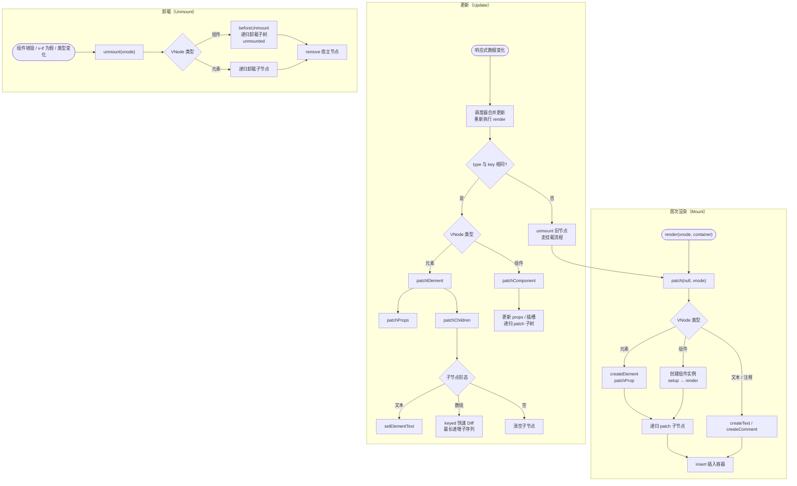

# 渲染器 (Renderer)

## 1. 什么是渲染器？

渲染器是 Vue 3 运行时核心的组成部分，负责将**虚拟 DOM (VNode)** 转换为**平台真实 DOM**（或目标平台的 UI 元素），并处理后续的更新与销毁。渲染器的设计使得 Vue 能够跨平台运行：Web、Native (如 NativeScript)、Canvas、小程序等。

Vue 3 的渲染器采用**可配置**的设计，核心渲染逻辑与平台无关，具体的节点操作（创建、插入、删除、属性设置等）通过**节点操作接口 (NodeOps)** 注入，从而适配不同平台。

## 2. 渲染器的核心职责

[width(20,80)]

| 职责               | 描述                                                            |
| ------------------ | --------------------------------------------------------------- |
| **挂载 (mount)**   | 将 VNode 树转换为真实 DOM 并插入到容器中。                      |
| **更新 (patch)**   | 比较新旧 VNode 树，计算最小化变更，并应用到真实 DOM。           |
| **卸载 (unmount)** | 从 DOM 中移除 VNode 对应的真实节点，并触发相关的生命周期钩子。  |
| **组件处理**       | 识别组件 VNode，实例化组件、渲染组件内容、处理组件更新。        |
| **指令处理**       | 解析和应用自定义指令的生命周期（`beforeMount`、`mounted` 等）。 |
| **事件处理**       | 绑定、更新和销毁 DOM 事件监听器。                               |

## 3. 渲染器的架构设计

### 3.1 平台无关核心 (`@vue/runtime-core`)

- 定义了 VNode 的类型、形状和创建函数 (`h`)。
- 实现了 `render`、`patch`、`mount`、`unmount` 等核心算法。
- 定义了组件系统、插槽、生命周期、指令等抽象概念。
- **不包含任何特定平台的 DOM 操作代码**。

### 3.2 平台特定适配器 (`@vue/runtime-dom` for Web)

- 实现了 `NodeOps` 接口：`createElement`、`setElementText`、`insert`、`remove`、`setAttribute`、`addEventListener` 等。
- 处理 Web 平台的特定行为：`innerHTML`、`class`/`style` 的特殊处理、`svg` 命名空间等。
- 导出 `createApp` 方法，内部使用 Web 平台适配器创建渲染器。

### 3.3 自定义渲染器 (`createRenderer` API)

Vue 3 暴露了 `createRenderer` 函数，允许开发者构建面向任意平台的渲染器：

```typescript
import { createRenderer } from '@vue/runtime-core'

const { render, createApp } = createRenderer<Node, Element>({
  // 节点操作接口实现
  createElement(type) {
    /* ... */
  },
  insert(child, parent, anchor) {
    /* ... */
  },
  remove(child) {
    /* ... */
  },
  setElementText(node, text) {
    /* ... */
  },
  patchProp(el, key, prevValue, nextValue) {
    /* ... */
  },
  // ... 其他方法
})
```

## 4. 渲染器的核心工作流程

渲染器对外只暴露一个入口`render(vnode, container)`,内部的挂载、更新、卸载最终都汇聚到两个核心函数:

- **`patch`**：同时负责挂载与更新。旧 VNode 为空时走挂载分支，否则走对比分支。
- **`unmount`**：负责递归拆除节点，并在过程中触发对应的生命周期钩子。

### 4.1 首次渲染 (Mount)

应用启动时，`createApp(App).mount('#app')` 最终会调用渲染器的 `render(vnode, container)`：

此时容器中没有旧 VNode，`patch` 走挂载分支：

1. **创建根 VNode**：`createApp(App)` 以根组件为 `type` 创建 VNode，`mount` 再调用渲染器的 `render(vnode, container)`。
2. **`patch(null, vnode, container)`**：容器中没有旧 VNode，跳过新旧对比，直接按 VNode 类型分发。
3. **按类型挂载**：
   - **元素 VNode**：`createElement` 创建宿主元素，`patchProp` 设置属性与事件，再递归 `patch` 子节点。
   - **组件 VNode**：创建组件实例并执行 `setup`，再执行 `render` 得到子树 VNode，递归 `patch`。
   - **文本 / 注释 VNode**：`createText` / `createComment` 创建宿主节点。
4. **插入容器**：子树在内存中构建完成后，调用 `insert` 把根宿主节点一次性插入容器，减少页面重排。

### 4.2 更新流程 (Update)

响应式数据变化后，依赖它的渲染 effect 会被调度器放入微任务队列；同一轮事件循环内的多次修改会按组件去重，只触发一次重新渲染：

1. **重新执行 `render`**：得到新的 VNode 树。
2. **`patch(oldVNode, newVNode)`**：先比较 `type` 与 `key`。
   - **相同**：复用宿主节点，元素进入 `patchElement`，组件进入 `patchComponent`。
   - **不同**：调用 `unmount` 拆除旧节点，再走挂载流程创建新节点。
3. **`patchElement`**：
   - `patchProps`：对比新旧 props，只更新发生变化的属性、事件和 `class` / `style`。
   - `patchChildren`：根据子节点形态（文本、数组、空）选择策略；数组子树使用带 `key` 的快速 Diff，并借助最长递增子序列减少节点移动。
4. **最小化 DOM 操作**：Diff 的目标是复用节点、只改动必要部分。真正的批处理发生在调度阶段，而不是把 DOM 操作攒到最后统一提交。

### 4.3 卸载流程 (Unmount)

组件销毁、`v-if` 变为假，或更新时 `type` / `key` 不同，都会触发 `unmount(vnode)`：

- **组件 VNode**：先调用 `beforeUnmount`，递归卸载组件子树，再在更新队列冲刷后调用 `unmounted`；同时停止组件的渲染 effect 与作用域。
- **元素 VNode**：递归卸载全部子节点，再调用 `remove` 把宿主节点从父节点上摘除。
- **指令钩子**：卸载过程中依次触发指令的 `beforeUnmount` / `unmounted`，确保事件监听、定时器等副作用被清理。

### 4.4 完整流程图



## 5. 虚拟 DOM 与 Diff 算法

渲染器使用虚拟 DOM 来高效更新真实 UI。Vue 3 的 diff 算法基于以下优化：

- **同层比较**：不跨层级比较，假设层级移动很少。
- **Key 的使用**：在 `v-for` 中提供唯一的 `key` 可以极大地提高列表重排序的性能。
- **最长递增子序列**：在移动节点时，通过计算最长递增子序列来最小化移动次数。
- **静态标记 (PatchFlags)**：编译时标记动态节点类型，更新时跳过静态子树的比较。
- **Block 树**：将动态节点收集到数组，更新时直接遍历数组进行靶向更新。

## 6. 渲染器与编译器的协作

Vue 3 采用**编译时 + 运行时**混合策略。编译器在编译模板时生成带有优化提示的渲染函数，渲染器利用这些提示跳过不必要的工作。

示例模板：

```vue
<template>
  <div class="static">Hello</div>
  <div>{{ dynamic }}</div>
</template>
```

编译后的渲染函数（简化）：

```javascript
import { createVNode, openBlock, createBlock } from 'vue'

const _hoisted_1 = createVNode('div', { class: 'static' }, 'Hello', -1) // 静态提升

export function render(_ctx) {
  return (
    openBlock(),
    createBlock('div', null, [
      _hoisted_1,
      createVNode('div', null, _ctx.dynamic, 1 /* TEXT */), // 标记为动态文本
    ])
  )
}
```

- `_hoisted_1` 被提升到函数外，多次渲染复用同一 VNode。
- 动态节点标记了 `PatchFlags.TEXT`，渲染器更新时只需要检查文本内容。

## 7. 自定义渲染器示例

:::code-group

```js[main.js]
import * as PIXI from 'pixi.js';
import { App } from "./App.js";
import { createRenderer } from '@vue/runtime-core'

const app = new PIXI.Application();

// 异步初始化
await app.init({
    width: 800,
    height: 600,
});

// 添加到页面
document.body.appendChild(app.canvas);

const renderer = createRenderer({
  createElement(type) {
    if (type === "rect") {
      const rect = new PIXI.Graphics();
      rect.fill(0xff0000);
      rect.rect(0, 0, 100, 100);
      rect.fill();

      return rect;
    }
  },
  patchProp(el, key, val) {
    el[key] = val;
  },
  insert(el, parent) {
    parent.addChild(el);
  },
});


renderer.createApp(App).mount(app.stage);
```

```js[App.js]
import { h } from 'vue'
export const App = {
  setup() {
    return {
      x: 100,
      y: 100,
    };
  },
  render() {
    return h("rect", { x: this.x, y: this.y });
  },
};
```

:::

## 8. 渲染器的性能特性

- **异步更新队列**：渲染器将多次数据变更触发的更新任务放入微任务队列，去重后批量执行，避免重复渲染。
- **组件级更新**：只有状态变化的组件及其子组件会重新渲染，兄弟组件不受影响。
- **静态树提升**：完全静态的子树被提升到渲染函数外，永远不会参与更新。
- **缓存事件处理函数**：内联事件处理函数被缓存，避免子组件 props 变化导致的不必要更新。

## 9. 总结

[width(13,87)]

| 方面         | 说明                                                      |
| ------------ | --------------------------------------------------------- |
| **核心作用** | 将 VNode 转换为平台真实 UI，并高效更新。                  |
| **设计特点** | 平台无关核心 + 节点操作接口，支持跨平台。                 |
| **主要流程** | 挂载、更新（patch）、卸载。                               |
| **性能优化** | 虚拟 DOM diff、静态提升、PatchFlags、Block 树、异步队列。 |
| **扩展性**   | 提供 `createRenderer` API，可构建任意目标平台的渲染器。   |
